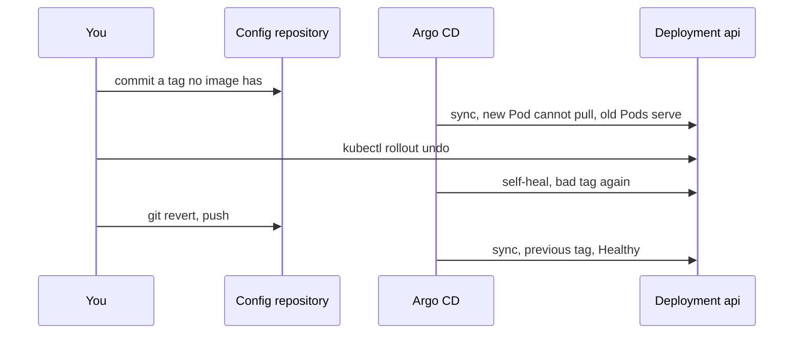

## Before you start

- [[devops.l3.self-heal]] — you know that with self-heal on, Argo CD undoes a change made by hand to the objects from `envs/staging`, so only a commit changes them for good.
- [[k8s.l1.rollbacks]] — you know `kubectl rollout undo` makes a Deployment's previous revision current again, and that a missing tag leaves the new Pod unable to pull its image.
- [[foundation.l2.git-history-and-recovery]] — you know `git revert` adds a commit that reverses another, while `git reset` moves a branch name.

## The situation

You deploy a new api build to staging with a commit to `envs/staging`, but the tag you paste is one CI never pushed. Argo CD syncs it like any other commit. One new api Pod cannot pull its image, and the two old Pods keep serving. From the Kubernetes lessons you know the fix: `kubectl rollout undo deployment/api -n donhang`. It works for a moment, but then the Deployment names the missing tag again, and nobody has committed anything. How do you take staging back to the previous version when Argo CD keeps applying the bad one?

## Core concepts

- A bad deploy commit (not a new term) — a commit that sets the api's image tag in `envs/staging/api.yaml` to one no image in the registry, `ghcr.io`, has; Argo CD syncs it like any other, because it compares manifests with live objects, not with the registry.
- A rollback in the cluster (not a new term) — `kubectl rollout undo`, which makes the Deployment's previous revision current again by changing the live object only, not the manifest in Git.
- A revert commit (not a new term) — the new commit `git revert` makes, whose change is the reverse of an earlier commit's, so the files go back while both commits stay in the history.
- Argo CD's rollback (not a new term) — Argo CD's own way back to a revision it synced earlier; it refuses to run while the Application has automated sync on.

## How it works



Argo CD syncs your commit, the first arrow: the live Deployment now names the missing tag, so it matches Git and the Application is `Synced`. The rolling update creates one new Pod, which fails with `ErrImagePull`, the same failed pull the Kubernetes lessons showed as `ImagePullBackOff`. With two replicas it removes no old Pod until a new one is ready, so both old Pods keep serving and the Application shows `Progressing`, not `Healthy`.

The third arrow is the rollback from the Kubernetes lessons. `kubectl rollout undo` brings the previous tag back into the live Deployment, but Git still names the bad one. To Argo CD that is drift. With self-heal on, it syncs again, and the bad tag is back shortly after. Without self-heal, the next sync of any commit would bring it back.

Argo CD's own rollback can apply a revision it synced earlier, but while automated sync is on, Argo CD refuses it. So the way back goes through the repository.

`git revert` adds a commit whose change is the reverse of the bad one: the `image:` line names the previous tag again. Once it is pushed, Argo CD syncs it like any deploy, the rollout completes and the Application becomes `Healthy`. The history keeps both the mistake and its fix.

A revert restores manifests, not data. If a deploy commit brought a newer migration and the hook applied it, the database keeps that migration after the revert. Going back past a schema change therefore works only when the older api works with the newer schema. When it does not, the way forward is a new deploy commit naming an image that does.

## In the Đơn Hàng system

The first part of the script, the bad commit:

```bash file=scripts/devops/gitops-revert.sh tag=stage-3 lines=21-31
# lesson: devops.l3.rollback-by-revert
# A commit naming a tag no image has: synced like any other. The new Pod
# cannot pull its image; the two old Pods keep serving.
echo "== a commit that sets the api's tag to $bad"
perl -pi -e "s/donhang-api:\Q$good\E\$/donhang-api:$bad/" "$config_repo/envs/staging/api.yaml"
config_commit gitops-revert.sh "Deploy api $bad to staging"
app_refresh
app_wait_sync "$(config_head --verify)" >/dev/null
app_wait Synced Progressing "$(config_head --verify)"
for _ in $(seq 120); do api_images | grep -q -e ErrImagePull -e ImagePullBackOff && break; sleep 1; done
api_images
```

Line 25 replaces the tag in the `image:` line of `envs/staging/api.yaml` in the working clone with `$bad`, a `sha-` tag of zeros that no image has. `$good` and `$bad` are set at lines 9–10, outside the excerpt; `$good` is read from the same file, so it is the tag staging runs when you start. Line 26 commits and pushes the change, and line 27 asks Argo CD to compare now. Lines 28–29 wait for the sync of that commit and print `staging: Synced, Progressing`. Line 30 waits until a Pod reports `ErrImagePull` or `ImagePullBackOff`, and line 31 counts the api Pods by tag, readiness and waiting reason, with `api_images` defined at lines 11–15.

The rest of the script, the undo that does not last and the revert:

```bash file=scripts/devops/gitops-revert.sh tag=stage-3 lines=34-57
# lesson: devops.l3.rollback-by-revert
# Rolling back in the cluster does not last: the live Deployment no longer
# matches Git, and self-heal applies the bad tag again.
echo "== kubectl rollout undo"
kubectl rollout undo deployment/api -n donhang
echo "right after: the Deployment names $(deployed_tag)"
for _ in $(seq 120); do [ "$(deployed_tag)" = "$bad" ] && break; sleep 1; done
echo "shortly after: the Deployment names $(deployed_tag)"
echo

# lesson: devops.l3.rollback-by-revert
# The way back goes through the repository: a new commit that undoes the bad
# one. The history keeps both.
echo "== git revert"
git -C "$config_repo" -c user.name=gitops-revert.sh -c user.email=lab@donhang.example revert --no-edit HEAD >/dev/null
config_commit_pushed=$(config_head --verify)
git_server_open
git_auth -C "$config_repo" push -q "$git_server/$repo_path" main
app_refresh
app_wait_sync "$config_commit_pushed" >/dev/null
app_wait Synced Healthy "$config_commit_pushed"
kubectl rollout status deployment/api -n donhang --timeout=300s >/dev/null
api_images
git -C "$config_repo" log --format='%h %an: %s' -n 3
```

```text output=true
== a commit that sets the api's tag to sha-0000000000000000000000000000000000000000
staging: Synced, Progressing
      2 1.0.0 true
      1 sha-0000000000000000000000000000000000000000 false ErrImagePull

== kubectl rollout undo
...
deployment.apps/api rolled back
right after: the Deployment names 1.0.0
shortly after: the Deployment names sha-0000000000000000000000000000000000000000

== git revert
staging: Synced, Healthy
      2 1.0.0 true
... gitops-revert.sh: Revert "Deploy api sha-0000000000000000000000000000000000000000 to staging"
... gitops-revert.sh: Deploy api sha-0000000000000000000000000000000000000000 to staging
... gitops-self-heal.sh: Remove the ConfigMap prune-demo
```

Line 38 is the undo, and line 39 prints `1.0.0`, the tag staging ran when the output was captured. Line 40 waits up to 120 seconds for the Deployment to name `$bad` again. Nothing in the script changes it back, so the change comes from Argo CD. The `...` after `== kubectl rollout undo` stands for a warning kubectl printed about the Pod's security settings, which this lesson does not cover.

Line 48 reverts `HEAD`, the bad commit, without opening an editor, and lines 50–51 push it. Lines 52–54 wait for its sync and print `staging: Synced, Healthy`; line 55 waits for the rollout, and line 56 shows two ready Pods on `1.0.0`. Line 57 prints the last three commits; the capture hides their ids as `...`. The revert sits on top of the bad commit, and neither is gone.

## Seniors often assume…

- **"`kubectl rollout undo` is still the quickest safe fix when Argo CD manages the Deployment."** → Actually it lasts only until Argo CD next syncs the Application, because Git still names the bad tag. With self-heal on that is shortly after; without it, the next sync of any commit. You notice this when the `ErrImagePull` Pod is back shortly after and nobody has committed anything.
- **"The cleanest rollback is resetting the branch to the last good commit and force-pushing."** → Actually Argo CD would sync the reset `main` too, but force-pushing makes the server's branch match yours even if that drops commits, so the record of what staging ran is gone. A revert reaches the same manifests with a new commit. A teammate's clone still holds the bad commit under their new one, and Git accepts their ordinary push, because the server's branch holds nothing theirs lacks. You notice this when a teammate who pulled before the reset pushes their next commit, and the bad tag is back in staging.
- **"Reverting the deploy commit also rolls the database back."** → Actually a revert changes files in the config repository; migrations the hook already applied stay in the database. The older api then runs against the newer schema, which works only if it was written to. You notice this when the database still records the newer migration after the revert.

## Try it (3 minutes)

If you have not run `scripts/devops/gitops-self-heal.sh` from [[devops.l3.self-heal]], run it first. Then, in the `don-hang` repository folder:

1. Run `scripts/devops/gitops-revert.sh`. It waits for two syncs, so it can take a few minutes beyond the 3 in the heading. If it stops and prints a command to run first, run that command and try again.
2. Compare the tag after `right after:` with the one after `shortly after:`, then read the last three lines.

Expected result: `right after:` names the tag staging ran before, `shortly after:` names the `sha-` tag of zeros, and after `== git revert` the output shows `staging: Synced, Healthy` with two ready Pods on the earlier tag. The last lines list the `Revert "Deploy api …"` commit above the bad deploy commit.

## Connections

- [[devops.l3.self-heal]] — prerequisite: self-heal is the reason `kubectl rollout undo` no longer lasts.
- [[k8s.l1.rollbacks]] — the same rollback one layer down, where nothing watches Git and kubectl is the way back.
- [[foundation.l2.git-history-and-recovery]] — `git revert` and `git reset` from there, now deciding what runs in a cluster.
- [[devops.l3.ordering-a-sync]] — the hook that applies migrations on every sync, which a revert does not undo.
- [[devops.l3.promoting-between-environments]] — next: the same commit-based flow carries a tag from staging to production.

## Five-line summary

1. With GitOps, the way back from a bad deploy is a commit: `git revert` the deploy commit and let Argo CD sync the previous tag.
2. A tag missing from the registry syncs like any other: `Synced`, `Progressing`, one Pod in `ErrImagePull`, both old Pods still serving.
3. Under self-heal, `kubectl rollout undo` lasts only until Argo CD notices the drift and applies the bad tag again.
4. Argo CD refuses its own rollback while automated sync is on; the history keeps both the mistake and the revert.
5. A revert restores manifests, not data: applied migrations stay, so the older api must work with the newer schema.
