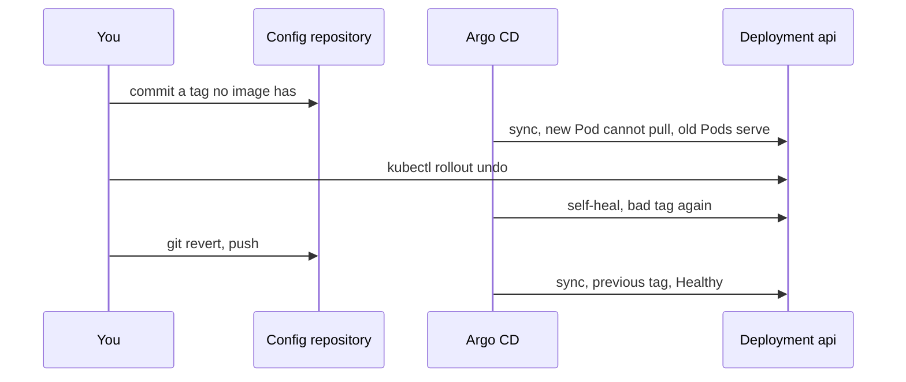

## Bạn cần biết trước

- [[devops.l3.self-heal]] — bạn biết khi bật self-heal, Argo CD hoàn tác thay đổi làm tay trên các object đến từ `envs/staging`, nên chỉ một commit mới đổi được chúng lâu dài.
- [[k8s.l1.rollbacks]] — bạn biết `kubectl rollout undo` đưa revision trước của Deployment trở lại làm revision hiện hành, và một tag không tồn tại khiến Pod mới không kéo được image.
- [[foundation.l2.git-history-and-recovery]] — bạn biết `git revert` thêm một commit đảo ngược commit khác, còn `git reset` dời tên nhánh đi chỗ khác.

## Tình huống

Bạn deploy một bản build api mới lên staging bằng một commit vào `envs/staging`, nhưng tag bạn dán vào là tag CI chưa từng push. Argo CD sync nó như mọi commit khác. Một Pod api mới không kéo được image, còn hai Pod cũ vẫn phục vụ. Từ các bài Kubernetes, bạn biết cách sửa: `kubectl rollout undo deployment/api -n donhang`. Nó có tác dụng trong chốc lát, rồi Deployment lại ghi tag không tồn tại kia, dù không ai commit gì. Vậy làm sao đưa staging về phiên bản trước khi Argo CD cứ apply lại bản lỗi?

## Khái niệm cốt lõi

- Commit deploy lỗi (không phải term mới) — commit đặt tag image của api trong `envs/staging/api.yaml` thành một tag mà registry `ghcr.io` không có image nào. Argo CD sync nó như mọi commit khác, vì Argo CD so manifest với object đang chạy, không so với registry.
- Rollback trong cluster (không phải term mới) — `kubectl rollout undo`, đưa revision trước của Deployment trở lại làm revision hiện hành bằng cách chỉ sửa object đang chạy, không sửa manifest trong Git.
- Commit revert (không phải term mới) — commit mới mà `git revert` tạo ra, có thay đổi ngược với một commit trước đó. Các file trở về như cũ, còn cả hai commit vẫn nằm trong lịch sử.
- Rollback của Argo CD (không phải term mới) — cách riêng của Argo CD để quay về một revision nó từng sync. Argo CD từ chối chạy nó khi Application đang bật sync tự động.

## Cơ chế hoạt động



Mũi tên đầu tiên là lúc Argo CD sync commit của bạn. Deployment đang chạy giờ ghi tag không tồn tại, nên nó khớp với Git và Application là `Synced`. Rolling update tạo một Pod mới, Pod này lỗi `ErrImagePull`, cũng là lần kéo image thất bại mà các bài Kubernetes hiển thị dưới dạng `ImagePullBackOff`. Với hai replica, rolling update không gỡ Pod cũ nào cho tới khi có một Pod mới sẵn sàng. Vì thế cả hai Pod cũ vẫn phục vụ, và Application hiện `Progressing` chứ không phải `Healthy`.

Mũi tên thứ ba là thao tác rollback từ các bài Kubernetes. `kubectl rollout undo` đưa tag trước trở lại Deployment đang chạy, nhưng Git vẫn ghi tag lỗi. Với Argo CD, đó là drift. Khi bật self-heal, Argo CD sync lại, và tag lỗi quay về ngay sau đó. Nếu không có self-heal, lần sync kế tiếp của bất kỳ commit nào cũng sẽ đưa nó về.

Rollback của chính Argo CD có thể apply một revision nó từng sync, nhưng khi sync tự động đang bật, Argo CD từ chối. Nên đường quay lui phải đi qua repository.

`git revert` thêm một commit có thay đổi ngược với commit lỗi: dòng `image:` lại ghi tag trước. Khi commit này được push, Argo CD sync nó như mọi lần deploy, rollout hoàn tất và Application thành `Healthy`. Lịch sử giữ cả lỗi lẫn bản sửa.

Revert khôi phục manifest, không khôi phục dữ liệu. Nếu một commit deploy mang theo migration mới hơn và hook đã apply nó, database vẫn giữ migration đó sau khi revert. Vì vậy, quay về qua một lần đổi schema chỉ được khi api cũ chạy được với schema mới. Nếu không, hướng đi là một commit deploy mới, ghi một image chạy được với schema đó.

## Trong hệ thống Đơn Hàng

Phần đầu của script, commit lỗi:

```bash file=scripts/devops/gitops-revert.sh tag=stage-3 lines=21-31
# lesson: devops.l3.rollback-by-revert
# A commit naming a tag no image has: synced like any other. The new Pod
# cannot pull its image; the two old Pods keep serving.
echo "== a commit that sets the api's tag to $bad"
perl -pi -e "s/donhang-api:\Q$good\E\$/donhang-api:$bad/" "$config_repo/envs/staging/api.yaml"
config_commit gitops-revert.sh "Deploy api $bad to staging"
app_refresh
app_wait_sync "$(config_head --verify)" >/dev/null
app_wait Synced Progressing "$(config_head --verify)"
for _ in $(seq 120); do api_images | grep -q -e ErrImagePull -e ImagePullBackOff && break; sleep 1; done
api_images
```

Dòng 25 thay tag trong dòng `image:` của `envs/staging/api.yaml` ở bản clone làm việc bằng `$bad`, một tag `sha-` toàn số 0 mà không image nào có. `$good` và `$bad` được đặt ở dòng 9–10, ngoài đoạn trích. `$good` đọc từ chính file đó, nên đó là tag staging đang chạy lúc bạn bắt đầu. Dòng 26 commit và push thay đổi, dòng 27 yêu cầu Argo CD so sánh ngay. Dòng 28–29 chờ lần sync của commit đó và in `staging: Synced, Progressing`. Dòng 30 chờ tới khi một Pod báo `ErrImagePull` hoặc `ImagePullBackOff`, và dòng 31 đếm các Pod api theo tag, trạng thái sẵn sàng và lý do đang chờ, với `api_images` định nghĩa ở dòng 11–15.

Phần còn lại của script, lệnh undo không giữ được và lệnh revert:

```bash file=scripts/devops/gitops-revert.sh tag=stage-3 lines=34-57
# lesson: devops.l3.rollback-by-revert
# Rolling back in the cluster does not last: the live Deployment no longer
# matches Git, and self-heal applies the bad tag again.
echo "== kubectl rollout undo"
kubectl rollout undo deployment/api -n donhang
echo "right after: the Deployment names $(deployed_tag)"
for _ in $(seq 120); do [ "$(deployed_tag)" = "$bad" ] && break; sleep 1; done
echo "shortly after: the Deployment names $(deployed_tag)"
echo

# lesson: devops.l3.rollback-by-revert
# The way back goes through the repository: a new commit that undoes the bad
# one. The history keeps both.
echo "== git revert"
git -C "$config_repo" -c user.name=gitops-revert.sh -c user.email=lab@donhang.example revert --no-edit HEAD >/dev/null
config_commit_pushed=$(config_head --verify)
git_server_open
git_auth -C "$config_repo" push -q "$git_server/$repo_path" main
app_refresh
app_wait_sync "$config_commit_pushed" >/dev/null
app_wait Synced Healthy "$config_commit_pushed"
kubectl rollout status deployment/api -n donhang --timeout=300s >/dev/null
api_images
git -C "$config_repo" log --format='%h %an: %s' -n 3
```

```text output=true
== a commit that sets the api's tag to sha-0000000000000000000000000000000000000000
staging: Synced, Progressing
      2 1.0.0 true
      1 sha-0000000000000000000000000000000000000000 false ErrImagePull

== kubectl rollout undo
...
deployment.apps/api rolled back
right after: the Deployment names 1.0.0
shortly after: the Deployment names sha-0000000000000000000000000000000000000000

== git revert
staging: Synced, Healthy
      2 1.0.0 true
... gitops-revert.sh: Revert "Deploy api sha-0000000000000000000000000000000000000000 to staging"
... gitops-revert.sh: Deploy api sha-0000000000000000000000000000000000000000 to staging
... gitops-self-heal.sh: Remove the ConfigMap prune-demo
```

Dòng 38 là lệnh undo, và dòng 39 in `1.0.0`, tag staging chạy lúc output được ghi lại. Dòng 40 chờ tối đa 120 giây cho tới khi Deployment ghi lại `$bad`. Không chỗ nào trong script đổi nó về, nên thay đổi đó đến từ Argo CD. Dấu `...` sau `== kubectl rollout undo` thay cho một cảnh báo kubectl in ra về thiết lập bảo mật của Pod, bài này không đề cập.

Dòng 48 revert `HEAD`, tức commit lỗi, mà không mở trình soạn thảo, và dòng 50–51 push nó. Dòng 52–54 chờ lần sync của nó và in `staging: Synced, Healthy`. Dòng 55 chờ rollout, và dòng 56 cho thấy hai Pod sẵn sàng chạy `1.0.0`. Dòng 57 in ba commit gần nhất, bản ghi lại giấu id của chúng thành `...`. Commit revert nằm trên commit lỗi, và không commit nào mất đi.

## Senior hay nhầm rằng…

- **"`kubectl rollout undo` vẫn là cách sửa an toàn nhanh nhất khi Argo CD quản lý Deployment."** → Thực ra nó chỉ giữ được tới lần kế tiếp Argo CD sync Application, vì Git vẫn ghi tag lỗi. Khi bật self-heal, đó là ngay sau đó. Không có self-heal, đó là lần sync kế tiếp của bất kỳ commit nào. Bạn sẽ nhận ra khi Pod `ErrImagePull` quay lại ngay sau đó mà không ai commit gì.
- **"Cách rollback gọn nhất là reset nhánh về commit tốt cuối cùng rồi force-push."** → Thực ra Argo CD cũng sẽ sync `main` đã reset, nhưng force-push khiến nhánh trên server khớp với nhánh của bạn kể cả khi phải bỏ commit, nên dấu vết staging đã chạy gì không còn. Một commit revert đạt tới cùng manifest đó bằng một commit mới. Bản clone của một đồng nghiệp vẫn giữ commit lỗi dưới commit mới của họ, và Git chấp nhận lần push thông thường của họ, vì nhánh trên server không có gì mà nhánh của họ thiếu. Bạn sẽ nhận ra khi một đồng nghiệp đã pull trước lúc reset push commit tiếp theo, và tag lỗi quay lại staging.
- **"Revert commit deploy thì database cũng được quay lui theo."** → Thực ra revert chỉ đổi file trong repo cấu hình, các migration hook đã apply vẫn nằm trong database. Khi đó api cũ chạy trên schema mới hơn, và chỉ chạy được nếu nó được viết để làm vậy. Bạn sẽ nhận ra khi database vẫn ghi nhận migration mới hơn sau khi revert.

## Thử ngay (3 phút)

Nếu bạn chưa chạy `scripts/devops/gitops-self-heal.sh` ở [[devops.l3.self-heal]], hãy chạy nó trước. Sau đó, trong thư mục repository `don-hang`:

1. Chạy `scripts/devops/gitops-revert.sh`. Script chờ hai lần sync, nên có thể mất thêm vài phút ngoài 3 phút ở tiêu đề. Nếu nó dừng và in ra một lệnh cần chạy trước, hãy chạy lệnh đó rồi thử lại.
2. So tag sau `right after:` với tag sau `shortly after:`, rồi đọc ba dòng cuối.

Kết quả mong đợi: `right after:` ghi tag staging chạy trước đó, `shortly after:` ghi tag `sha-` toàn số 0, và sau `== git revert` output hiện `staging: Synced, Healthy` với hai Pod sẵn sàng chạy tag cũ. Mấy dòng cuối liệt kê commit `Revert "Deploy api …"` nằm trên commit deploy lỗi.

## Liên hệ

- [[devops.l3.self-heal]] — điều kiện tiên quyết: self-heal là lý do `kubectl rollout undo` không còn giữ được.
- [[k8s.l1.rollbacks]] — cùng thao tác rollback ở tầng bên dưới, nơi không gì theo dõi Git và kubectl là đường quay lui.
- [[foundation.l2.git-history-and-recovery]] — `git revert` và `git reset` từ bài đó, giờ quyết định thứ gì chạy trong cluster.
- [[devops.l3.ordering-a-sync]] — hook apply migration ở mỗi lần sync, thứ mà revert không hoàn tác được.
- [[devops.l3.promoting-between-environments]] — bài kế: cùng luồng dựa trên commit đó đưa một tag từ staging lên production.

## Tóm tắt 5 dòng

1. Với GitOps, đường quay lui sau một lần deploy lỗi là một commit: `git revert` commit deploy và để Argo CD sync tag trước.
2. Một tag không có trong registry vẫn sync như mọi tag khác: `Synced`, `Progressing`, một Pod `ErrImagePull`, cả hai Pod cũ vẫn phục vụ.
3. Dưới self-heal, `kubectl rollout undo` chỉ giữ được tới khi Argo CD nhận ra drift và apply lại tag lỗi.
4. Argo CD từ chối rollback của chính nó khi sync tự động đang bật, còn lịch sử giữ cả lỗi lẫn commit revert.
5. Revert khôi phục manifest, không khôi phục dữ liệu: migration đã apply vẫn còn, nên api cũ phải chạy được với schema mới hơn.
