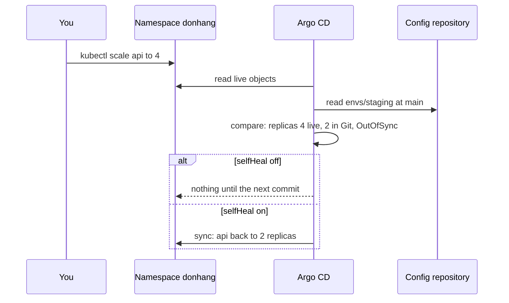

## Bạn cần biết trước

- [[devops.l3.deploying-by-commit]] — bạn biết sync tự động khiến Argo CD tự bắt đầu sync khi một commit mới làm Application `OutOfSync`.
- [[devops.l3.configuration-drift]] — bạn biết drift là thay đổi làm bên ngoài công cụ sở hữu cấu hình, và OpenTofu chỉ phát hiện nó khi chạy plan.
- [[devops.l3.tofu-state]] — bạn biết OpenTofu so các file của nó với những gì nó đã ghi lại và đọc được, và không làm gì giữa các lệnh.
- [[k8s.l1.deployments]] — bạn biết `replicas` trong một Deployment quyết định có bao nhiêu Pod chạy.

## Tình huống

Staging chạy api từ `envs/staging`, được deploy bằng một commit, và đã bật sync tự động. Trong lúc team bắn lượng traffic test lớn vào staging, một đồng nghiệp chạy `kubectl scale deployment api -n donhang --replicas=4`, vì hai Pod không đủ. Ba mươi giây sau vẫn là 4 replica, và Application hiện `OutOfSync`.

Không ai commit gì. Cuối ngày hôm đó, một commit không liên quan tới staging, và api quay về 2 replica ngay giữa buổi test. Vậy ai quyết định staging chạy bao nhiêu Pod api: repo cấu hình, hay người chạy kubectl gần nhất? Và làm sao để câu trả lời lần nào cũng như nhau?

## Khái niệm cốt lõi

- **self-heal (Argo CD)** (tùy chọn của sync tự động: Argo CD sync lại cả khi object trên cluster bị sửa lệch khỏi Git) — tùy chọn này viết là `selfHeal: true` dưới `syncPolicy.automated`. Khi bật nó, Argo CD cũng bắt đầu sync khi các object đang chạy bị sửa lệch khỏi Git. Không có nó, một thay đổi làm trong cluster khiến Application `OutOfSync` nhưng không khởi động sync nào, dù cụm "cứ `OutOfSync` là sync" nghe như ngược lại.
- Prune (một tùy chọn, không phải term mới) — tùy chọn `prune: true` nằm cạnh nó. Khi bật, một lần sync sẽ xóa object của Application có manifest đã rời khỏi thư mục trong Git.
- Requires pruning (một dấu đánh, không phải term mới) — dấu Argo CD gắn lên object của Application có manifest đã rời khỏi Git. Chừng nào prune còn tắt, object đó vẫn chạy và Application `OutOfSync` vì nó.

## Cơ chế hoạt động



Trong tình huống trên, mũi tên đầu tiên là lệnh của người đồng nghiệp. Lệnh đó đổi Deployment đang chạy, còn `envs/staging` vẫn ghi `replicas: 2`.

Argo CD liên tục so các object đang chạy của Application với manifest trong Git. Nó không chờ lệnh như OpenTofu chờ một plan. Tự nó đọc lại Git sau mỗi vài phút và theo dõi các object đang chạy mỗi khi chúng thay đổi. Vì thế nó thấy khác biệt và đánh dấu Application `OutOfSync`.

Chuyện xảy ra tiếp theo tùy vào policy. Sync tự động đơn thuần chỉ phản ứng với thay đổi trong Git, nên Argo CD để yên 4 replica đang chạy. Một lần sync apply mọi object của Application, không chỉ các file commit đã đổi, mà api đã scale thì khác với Git. Vì vậy commit không liên quan kia đưa api về đúng 2 replica mà Git khai báo.

Khi bật self-heal, khác biệt đến từ cluster cũng khởi động sync, và api trở về 2 replica ngay sau đó, không cần commit nào. Muốn giữ 4 replica thì ghi 4 vào Git. Có team để self-heal tắt để thay đổi làm tay vẫn hiện rõ là `OutOfSync`. Cái giá là trong một khoảng thời gian, cluster chạy thứ không ai commit.

Câu hỏi tương tự xuất hiện khi một manifest rời khỏi thư mục. Không có `prune: true`, object vẫn chạy và bị đánh dấu là cần prune: chừng nào `prune` còn tắt, không lần sync tự động nào xóa nó. Khi bật prune, lần sync tự động của commit đó sẽ xóa object.

## Trong hệ thống Đơn Hàng

Application mà Đơn Hàng dùng cho staging:

```yaml file=deploy/gitops/config-repo/apps/staging.yaml tag=stage-3 lines=1-25
# The Application Đơn Hàng keeps for staging: staging-auto.yaml with
# self-heal and prune turned on. scripts/devops/gitops-self-heal.sh applies
# it; scripts/devops/dr-drill.sh applies it to a rebuilt cluster.
apiVersion: argoproj.io/v1alpha1
kind: Application
metadata:
  name: staging
  namespace: argocd
spec:
  project: default
  source:
    repoURL: http://gitea.git.svc:3000/donhang/donhang-config.git
    targetRevision: main
    path: envs/staging
  destination:
    server: https://kubernetes.default.svc
    namespace: donhang
  # lesson: devops.l3.self-heal
  # selfHeal: also sync when the live objects drift from Git, such as after
  # kubectl scale. prune: delete an object whose manifest left the folder.
  # The objects in donhang that came from envs/staging follow Git both ways.
  syncPolicy:
    automated:
      selfHeal: true
      prune: true
```

Dòng 4–17 là cùng Application với `staging-auto.yaml` ở [[devops.l3.deploying-by-commit]] (ở đó `selfHeal` và `prune` đặt là `false`): thư mục `envs/staging` ở `main` của repo cấu hình (chính là `repoURL`, được phục vụ bên trong cluster), apply vào namespace `donhang`. Ngoài phần comment, chỉ dòng 24–25 là khác. Hai dòng này cùng nhau khiến các object từ `envs/staging` bám theo Git theo cả hai chiều: thay đổi làm trong cluster bị hoàn tác, và object có manifest đã rời khỏi Git bị xóa. Những object trong `donhang` chưa từng đến từ thư mục đó không thuộc Application, và hai tùy chọn này để yên chúng.

Phần cuối của script cho thấy cả hai điều. Đoạn trích bắt đầu từ dòng 40:

```bash file=scripts/devops/gitops-self-heal.sh tag=stage-3 lines=40-57
app_wait OutOfSync Healthy "$(config_head --verify)" >/dev/null
kubectl get configmap prune-demo -n donhang -o name
kubectl get application staging -n argocd \
  -o jsonpath='{range .status.resources[?(@.name=="prune-demo")]}{.kind}/{.name}: requiresPruning={.requiresPruning}{"\n"}{end}'
echo

# lesson: devops.l3.self-heal
# apps/staging.yaml turns on selfHeal and prune: the ConfigMap no longer in
# Git is deleted, and a hand-made scale lasts only until Argo CD notices it.
echo "== self-heal and prune, from config-repo/apps/staging.yaml"
kubectl apply -f "$config_repo/apps/staging.yaml" -o name
app_wait Synced Healthy
kubectl get configmap prune-demo -n donhang -o name 2>&1 || true
kubectl scale deployment api -n donhang --replicas=4
for _ in $(seq 120); do [ "$(replicas)" = 2 ] && break; sleep 1; done
app_wait Synced Healthy >/dev/null
kubectl rollout status deployment/api -n donhang --timeout=300s >/dev/null
echo "shortly after: $(replicas) replicas, $(sync_status)"
```

```text output=true
== kubectl scale api to 4, with automated sync but no self-heal
deployment.apps/api scaled
30 s later: 4 replicas, OutOfSync

== a ConfigMap added in Git, then removed from Git, without prune
after the sync of that commit: 2 replicas
configmap/prune-demo
ConfigMap/prune-demo: requiresPruning=true

== self-heal and prune, from config-repo/apps/staging.yaml
application.argoproj.io/staging
staging: Synced, Healthy
Error from server (NotFound): configmaps "prune-demo" not found
deployment.apps/api scaled
shortly after: 2 replicas, Synced
```

Trước đoạn trích, script tự apply `staging-auto.yaml`, nên lần chạy nào cũng bắt đầu từ sync tự động đơn thuần. Nó scale api lên 4, yêu cầu Argo CD so sánh ngay, rồi chờ 30 giây. Sau đó nó commit một ConfigMap tên `prune-demo` vào `envs/staging`, và lần sync của commit đó đưa api về 2. Commit thứ hai gỡ manifest ấy đi. Phần output tới dòng `after the sync of that commit: 2 replicas` là từ những dòng đó.

Dòng 40 chờ tới khi Argo CD báo `OutOfSync` ở commit gỡ manifest. `app_wait` và `config_head` lấy từ `scripts/lib/gitops.sh`, còn `replicas` và `sync_status` là hai hàm nhỏ định nghĩa ở dòng 9–10 của chính script này. Dòng 41 in `configmap/prune-demo`: ConfigMap vẫn còn. Dòng 42–43 in mục của nó, `requiresPruning=true`.

Dòng 50 thay policy bằng `apps/staging.yaml`, và không có commit nào được push. Sync tự động đơn thuần chỉ thử sync một lần cho mỗi commit. `selfHeal` bỏ giới hạn đó, nên một lần sync có thể bắt đầu ở commit gỡ manifest, dù commit này đã được sync trước đó hay chưa. Vì giờ `prune` đã bật, lần sync đó xóa ConfigMap. Dòng 51 chờ nó xong và in `staging: Synced, Healthy`, còn dòng 52 thấy ConfigMap đã mất. Dòng 53 lại scale api lên 4, và dòng 54 chờ tối đa 120 giây cho tới khi về 2, không có commit nào, cũng không có yêu cầu so sánh nào. Dòng 56 chỉ chờ tới khi các Pod của api sẵn sàng.

## Senior hay nhầm rằng…

- **"Sync tự động vốn đã đảo lại mọi thay đổi làm bằng kubectl."** → Thực ra sync tự động đơn thuần chỉ phản ứng với thay đổi trong Git: một thay đổi làm trong cluster chỉ khiến Application `OutOfSync`, còn cluster tiếp tục chạy như đã bị đổi. Bạn sẽ nhận ra khi `kubectl get deployment api -n donhang` cho thấy 4 replica trong lúc Argo CD hiện `OutOfSync` mà không làm gì.
- **"Xóa một file khỏi repo cấu hình thì object của nó trong cluster luôn bị xóa theo."** → Thực ra không có `prune: true`, object vẫn chạy và chỉ bị đánh dấu là cần prune, vì xóa là một lựa chọn riêng của policy. Bạn sẽ nhận ra khi một ConfigMap đã bị gỡ manifest vẫn trả lời `kubectl get`, và Application cứ ở `OutOfSync`.
- **"Self-heal giúp sửa khẩn cấp bằng kubectl an toàn, vì Git có thể cập nhật theo sau."** → Thực ra khi bật self-heal, bản sửa bị hoàn tác ngay sau khi Argo CD nhận ra, thường là trước khi ai kịp ghi nó vào Git. Ngay cả khi tắt self-heal, lần sync kế tiếp, vốn apply mọi object của Application, cũng gỡ nó đi. Bạn sẽ nhận ra khi api tụt về 2 replica trong lúc lượng traffic test cần tới 4 vẫn còn đó. Bản sửa nào cần tồn tại lâu dài thì phải là một commit.

## Thử ngay (3 phút)

Nếu bạn chưa chạy `scripts/devops/gitops-deploy.sh` ở [[devops.l3.deploying-by-commit]], hãy chạy nó trước. Sau đó, trong thư mục repository `don-hang`:

1. Chạy `scripts/devops/gitops-self-heal.sh`. Script chờ các lần sync và chờ api ổn định, nên có thể mất thêm vài phút ngoài 3 phút ở tiêu đề. Nó tự đặt policy ban đầu, nên bạn chạy lại được.
2. So số replica sau `30 s later:` với số sau `shortly after:`.

Kết quả mong đợi: `30 s later: 4 replicas, OutOfSync` khi chỉ có sync tự động, rồi `ConfigMap/prune-demo: requiresPruning=true`. Sau khi `apps/staging.yaml` được apply, ConfigMap là `NotFound` và dòng cuối là `shortly after: 2 replicas, Synced`.

## Liên hệ

- [[devops.l3.deploying-by-commit]] — điều kiện tiên quyết: sync tự động cho thay đổi trong Git, còn self-heal mở rộng nó sang thay đổi trong cluster.
- [[devops.l3.configuration-drift]] — cùng drift đó nhưng nhìn từ OpenTofu, vốn chỉ phát hiện nó khi chạy plan. Argo CD thì so sánh liên tục và, khi có self-heal, hoàn tác nó.
- [[k8s.l1.manifests-and-kubectl-apply]] — cách làm ngược lại: ở đó kubectl từ máy bạn thay đổi cluster, còn ở đây thay đổi kiểu đó không còn tồn tại lâu.
- [[devops.l3.rollback-by-revert]] — bài kế: vì sao `kubectl rollout undo` không giữ được dưới self-heal, và nên làm gì thay thế.

## Tóm tắt 5 dòng

1. Khi bật self-heal, Argo CD hoàn tác thay đổi làm tay trên các object đến từ `envs/staging`, nên chỉ một commit mới đổi được chúng lâu dài.
2. Sync tự động đơn thuần phản ứng với Git, còn `kubectl scale` để Application `OutOfSync` và api chạy như đã bị đổi.
3. Lần sync kế tiếp, vốn apply mọi object của Application, đưa api về 2 replica kể cả khi không có self-heal.
4. Manifest bị gỡ khỏi Git chỉ làm object của nó bị xóa khi có `prune: true`, không có nó thì object bị đánh dấu là cần prune.
5. `apps/staging.yaml` bật self-heal và prune, nên các object từ `envs/staging` bám theo Git theo cả hai chiều.
