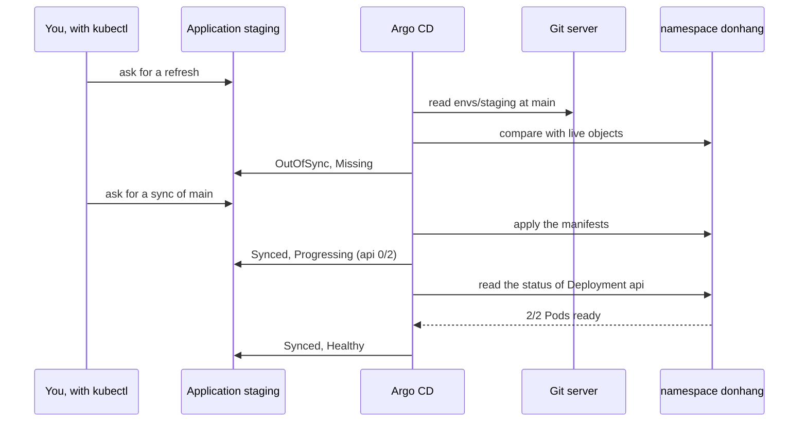

## Bạn cần biết trước

- [[devops.l3.argo-cd-applications]] — bạn biết Application `staging` nối `envs/staging` của repo cấu hình, branch `main`, với namespace `donhang`, và bạn đã apply nó bằng kubectl.
- [[k8s.l1.readiness-probes]] — bạn biết một Pod chỉ được tính là sẵn sàng khi readiness probe của nó đạt, và probe của api gọi `/health/ready`.
- [[k8s.l1.rolling-updates]] — bạn biết rollout của một Deployment chỉ xong khi các Pod mới của nó đã available, và `kubectl rollout status` chờ đúng điều đó.

## Tình huống

Ở bài trước, bạn đã apply Application `staging`, và giờ Argo CD đọc được `envs/staging` từ repo cấu hình. Bạn chờ api, database và các service khác khởi động trong namespace `donhang`. Không có gì khởi động cả. `kubectl get applications -n argocd` cho thấy `staging` với hai cột: một cột ghi `OutOfSync`, cột kia ghi `Missing`.

Một đồng nghiệp chạy sync, và khi xong thì cột đầu chuyển thành `Synced`. Họ báo cả nhóm là staging đã lên. Thế nhưng `kubectl get deployment api -n donhang` lại cho thấy `0/2` sẵn sàng: chưa Pod api nào nhận được request. Mỗi cột nói lên điều gì, và cột nào mới cho biết staging thật sự chạy được?

## Khái niệm cốt lõi

- **sync status (Argo CD)** (Synced khi object đang chạy khớp manifest trong Git, OutOfSync khi có object khác hoặc thiếu) — kết luận của Argo CD sau khi so các manifest ở revision của Application (với `staging` là branch `main`) với các object đang chạy: `Synced` khi mọi object đều khớp, `OutOfSync` khi có object nào khác đi hoặc còn thiếu. Argo CD so lại theo một chu kỳ, còn refresh yêu cầu nó so ngay lúc đó.
- **sync (Argo CD)** (một lần Argo CD áp manifest ở revision trong Git vào cluster để object đang chạy khớp với chúng) — một lần chạy trong đó Argo CD apply các manifest ở revision ấy vào cluster để các object đang chạy khớp với chúng. Argo CD chỉ tự bắt đầu sync khi Application có sync policy, tức một thiết lập trong Application bảo Argo CD tự sync khi thấy khác biệt. `staging-manual.yaml` không có thiết lập này, nên sync chỉ chạy khi có người yêu cầu.
- **health status (Argo CD)** (đánh giá của Argo CD object có đang chạy được không, như Healthy, Progressing, Degraded…, tách khỏi sync status) — đánh giá riêng của Argo CD xem các object có thật sự chạy được không, ví dụ `Missing` khi một object chưa tồn tại trong cluster, `Progressing` khi các Pod của một Deployment chưa sẵn sàng, và `Healthy` khi chúng đã sẵn sàng.

## Cơ chế hoạt động



Script của bài này, `gitops-first-sync.sh` (chính là "You" trong sơ đồ), yêu cầu refresh bằng cách ghi yêu cầu đó vào Application. Argo CD đọc `envs/staging` ở `main` và so từng manifest với object đang chạy cùng loại, cùng tên trong `donhang`. Chưa object nào tồn tại, nên sync status là `OutOfSync` và health status là `Missing`.

`staging-manual.yaml` không có sync policy, nên Argo CD báo ra chỗ khác biệt rồi chờ. Sau đó script yêu cầu sync theo cùng cách. Argo CD apply các manifest của thư mục, gần giống `kubectl apply`, và khi các object đang chạy đã khớp Git thì sync status chuyển thành `Synced`.

Khớp Git không nói gì về chuyện api có chạy hay không. Deployment `api` giờ đã tồn tại, nhưng các Pod của nó chưa đạt readiness probe, nên Argo CD báo nó là `Progressing`, kéo theo cả Application. Argo CD biết khi nào các Pod sẵn sàng bằng cách đọc status của Deployment, như mấy mũi tên cuối trong sơ đồ, rồi mới báo `Healthy`.

Health của Application là health tệ nhất trong số các object nó quản lý: chỉ cần một object báo health tệ hơn `Healthy`, chẳng hạn `Progressing`, thì Application cũng báo như vậy. Một Pod api không bao giờ đạt readiness probe sẽ giữ Application ở ngoài `Healthy`, trong khi sync status vẫn là `Synced`.

Vì sao Argo CD để yên namespace `donhang`? Nó xét hai tập object: các manifest trong thư mục của nó, và các object đang chạy có mang dấu của nó. Argo CD ghi dấu này lên từng object khi một lần sync apply object đó, nên nó vẫn liệt kê được một object dù manifest đã bị xóa khỏi thư mục. Namespace không thuộc tập nào, vì OpenTofu đã tạo nó trước khi có gì được deploy. Argo CD không báo nó thiếu, cũng không thay đổi nó.

## Trong hệ thống Đơn Hàng

Phần giữa của script chạy lần sync đầu tiên:

```bash file=scripts/devops/gitops-first-sync.sh tag=stage-3 lines=18-42
# lesson: devops.l3.synced-versus-healthy
# Argo CD rereads the repository on an interval; a refresh asks it to
# compare now. With no sync policy it only reports what differs.
app_refresh
app_wait OutOfSync Missing "" 120
echo
resources
echo

# lesson: devops.l3.synced-versus-healthy
# A sync applies the folder's manifests. Without the argocd CLI, kubectl asks
# for one by writing an operation into the Application.
echo "== sync"
kubectl patch application staging -n argocd --type merge \
  -p '{"operation":{"initiatedBy":{"username":"gitops-first-sync.sh"},"sync":{"revision":"main"}}}' -o name
for _ in $(seq 900); do
  phase=$(kubectl get application staging -n argocd -o jsonpath='{.status.operationState.phase}')
  [ "$phase" = Succeeded ] || [ "$phase" = Failed ] || [ "$phase" = Error ] && break
  sleep 1
done
echo "sync: $phase"
# Right after the sync: every object matches Git, the api's new Pods are
# not ready yet.
kubectl get application staging -n argocd
kubectl get deployment api -n donhang
```

```text output=true
== the Application, from deploy/gitops/lessons/staging-manual.yaml
application.argoproj.io/staging
staging: OutOfSync, Missing

ConfigMap/api               OutOfSync  
...
Service/redis               OutOfSync  

== sync
application.argoproj.io/staging
sync: Succeeded
NAME      SYNC STATUS   HEALTH STATUS
staging   Synced        Progressing
NAME   READY   UP-TO-DATE   AVAILABLE   AGE
api    0/2     2            0           ...

staging: Synced, Healthy
NAME      SYNC STATUS   HEALTH STATUS
staging   Synced        Healthy
NAME   READY   UP-TO-DATE   AVAILABLE   AGE
api    2/2     2            2           ...
...
== is the namespace donhang among the Application's objects?
no
```

Hai dòng output đầu tiên đến từ dòng 15–16, nằm trước đoạn trích, là chỗ apply `staging-manual.yaml`. Dòng 21 là refresh: `app_refresh`, một hàm tiện ích trong `scripts/lib/gitops.sh`, ghi vào Application yêu cầu so sánh ngay. Dòng 22 chờ tối đa 120 giây tới khi Application hiện `OutOfSync` và `Missing`. Tham số thứ ba để trống nghĩa là Argo CD so ở commit nào cũng được. Dòng 24 in từng object mà Argo CD quản lý kèm sync status của nó, và mọi dòng đều là `OutOfSync`.

Dòng 31–32 yêu cầu sync mà không cần công cụ dòng lệnh riêng của Argo CD: `kubectl patch` ghi một yêu cầu sync cho `main` vào Application, và Argo CD thực hiện nó. `initiatedBy` chỉ ghi lại ai yêu cầu, ở đây là tên script. Dòng 33–37 chờ tới khi Application ghi nhận lần sync này đã kết thúc, và dòng 38 in `sync: Succeeded`. Thế nhưng dòng 41–42 lại cho thấy `Synced` đi cùng `Progressing`, còn api ở `0/2`: sync đã apply xong, nhưng các Pod vẫn đang khởi động.

Ngoài đoạn trích, dòng 44 chờ `Synced` và `Healthy`, lúc đó api hiện `2/2`. Dòng 53–55 kiểm tra xem có `Namespace` nào nằm trong các object của Application không, và câu trả lời là `no`.

Thứ quyết định `Healthy` cho api:

```yaml file=deploy/gitops/config-repo/envs/staging/api.yaml tag=stage-3 lines=54-64
          # lesson: devops.l3.synced-versus-healthy
          # Argo CD reports the Deployment Healthy only once its Pods pass this
          # probe; until then the Application is Synced but Progressing.
          livenessProbe:
            httpGet:
              path: /health/live
              port: 8080
          readinessProbe:
            httpGet:
              path: /health/ready
              port: 8080
```

Dòng 61–64, chứ không phải liveness probe phía trên, là readiness probe bạn đã gặp ở track k8s: một Pod chỉ được tính là sẵn sàng khi `/health/ready` trả lời. Bản thân Argo CD không gọi `/health/ready`. Nó đọc status của Deployment, nơi đếm số Pod sẵn sàng, và báo `Healthy` khi rollout đã xong. Vì vậy, một api không kết nối được tới PostgreSQL sẽ để Application ở `Synced` nhưng không bao giờ `Healthy`.

## Senior hay nhầm rằng…

- **"`Synced` nghĩa là phiên bản mới đã lên và đang phục vụ request."** → Thực ra `Synced` chỉ nói các object đang chạy khớp Git, còn Pod của api đã sẵn sàng hay chưa là chuyện của health status. Bạn sẽ nhận ra khi `gitops-first-sync.sh` in `Synced` và `Progressing` trong lúc Deployment `api` mới có `0/2` sẵn sàng.
- **"Argo CD deploy mọi thứ nó tìm thấy trong repository ngay khi được cài."** → Thực ra nó chỉ so những thư mục mà một Application chỉ định, và một Application không có sync policy chỉ báo ra chỗ khác biệt. Bạn sẽ nhận ra khi, sau khi apply `staging-manual.yaml`, Application hiện `OutOfSync` và `Missing`, và không có gì trong `donhang` khởi động cho tới khi script yêu cầu sync.
- **"Argo CD sẽ xóa namespace `donhang` vì nó không có trong Git."** → Thực ra Argo CD chỉ quản lý những object có manifest trong thư mục của nó hoặc mang dấu của nó. OpenTofu tạo namespace này, nên nó không bị báo thiếu, cũng không bị thay đổi. Bạn sẽ nhận ra khi Application là `Synced` dù `envs/staging` không chứa namespace nào, và lần kiểm tra cuối của script in `no`.

## Thử ngay (3 phút)

Nếu chưa làm phần Thử ngay của bài trước, hãy làm nó trước để Application `staging` tồn tại. Sau đó, trong thư mục repository `don-hang`:

1. Chạy `kubectl --context kind-donhang-staging get application staging -n argocd`.
2. Chạy `scripts/devops/gitops-first-sync.sh`. Lần sync đầu có thể mất vài phút, lâu hơn con số 3 ở tiêu đề, trong lúc tải image. Script in một dòng trạng thái mỗi khi tới một điểm nó phải chờ, và im lặng ở giữa các điểm đó.
3. Chạy lại lệnh ở bước 1.

Kết quả mong đợi: bước 1 hiện `OutOfSync` dưới `SYNC STATUS` và `Missing` dưới `HEALTH STATUS`. Bước 2 in `sync: Succeeded`, rồi `Synced` với `Progressing` và api ở `0/2`, rồi `Synced` với `Healthy` và `2/2`, cuối cùng là `no`. Bước 3 hiện `Synced` và `Healthy`. Nếu ngay bước 1 đã hiện `Synced` và `Healthy`, tức là bạn đã chạy script trước đó: bước 2 sẽ dừng sau khoảng 120 giây với `staging is still Synced, Healthy after 120 s`, vì không còn gì thiếu nữa. Khi đó, chuyển sang bước 3.

## Liên hệ

- [[devops.l3.argo-cd-applications]] — bài cần học trước: Application mà bài này đọc hai trạng thái của nó.
- [[k8s.l1.readiness-probes]] — phép kiểm tra đứng sau `Healthy`: health của api mà Argo CD báo đi theo readiness probe của nó.
- [[k8s.l1.deploying-don-hang]] — cùng backend đó được apply bằng tay với `deploy.sh`, còn ở đây Argo CD apply và báo xem nó có khớp và có chạy được không.
- [[devops.l3.ordering-a-sync]] — bài kế: một lần sync apply database, migration và api theo thứ tự nào.
- [[devops.l3.deploying-by-commit]] — nơi sync tự bắt đầu sau một commit, thay vì chờ có người yêu cầu.

## Tóm tắt 5 dòng

1. `Synced` nghĩa là các object đang chạy khớp Git, `Healthy` nghĩa là chúng thật sự chạy được, và Argo CD báo hai điều này riêng rẽ.
2. Argo CD so các manifest ở revision của Application với các object đang chạy, chỉ cần một chỗ khác hoặc một object thiếu là thành `OutOfSync`.
3. Sync apply các manifest của thư mục. Không có sync policy thì Argo CD chỉ báo `OutOfSync` và chờ có người bắt đầu sync.
4. Ngay sau sync, api là `Synced` nhưng `Progressing` cho tới khi các Pod đạt readiness probe, và một object chưa sẵn sàng là đủ giữ Application ở ngoài `Healthy`.
5. Argo CD đọc lại Git theo chu kỳ hoặc khi refresh, và để yên những object không nằm trong thư mục cũng không mang dấu của nó, như namespace `donhang`.
