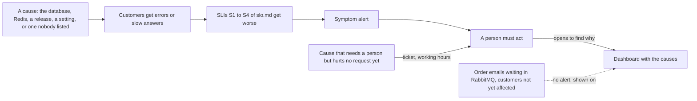

## Before you start

- [[backend.l4.error-budget]] — you know the error budget is the share of requests an SLO lets fail, and that a release which causes failures spends it like any outage.
- [[backend.l4.service-level-indicators]] — you know an SLI is the share of good requests out of all valid ones, and that `slo.md` defines S1–S4 for Đơn Hàng.
- [[devops.l2.grafana-dashboards]] — you know each panel of `donhang-api.json` is one PromQL query that Grafana draws, and that someone has to open it to see it.
- [[devops.l4.canary-release]] — you know `api-canary` can receive a small share of requests while `api` keeps the rest.

## The situation

Staging now has Prometheus, and your lead asks you to decide what should call a person. A colleague proposes three conditions: CPU of an `api` Pod above 80%, any Pod restart, and Redis answering slowly. Suppose a canary of the next version answers a tenth of product reads with `503`. Its CPU is normal, no Pod restarts, Redis is fast. Customers get errors, and none of the three conditions is met. Suppose also that a load test pushes CPU high while every read is answered in time: the first condition is met, and nobody is hurt.

What should call a person so that it does so whenever customers are hurt, and only then?

## Core concepts

- **alert** — a condition checked automatically that tells a person something needs attention, such as the colleague's "CPU above 80%".
- **incident** — an unplanned loss or degradation of the service customers receive, such as the product reads the canary answered with `503`.
- **alert fatigue** — what follows when many alerts need no action: people learn to ignore alerts, until the alert that matters is ignored too.
- Cause and symptom (plain words, used in this sense here) — a cause is something inside the system that can go wrong, such as CPU, a restarted Pod or a slow Redis; a symptom is what customers feel, measured by the SLIs of `slo.md`.

## How it works



In the situation above, each of the colleague's conditions is an alert on a cause. It fails in two directions. It fires when customers notice nothing, as with CPU during the load test. And it stays silent when a cause nobody listed breaks the service, as with the canary's `503`, because nobody can list every way a system can break.

Read the diagram from the left. Whatever the cause, if customers get errors or slow answers, the SLIs get worse. S1 counts failed `POST /api/v1/orders`, S2 slow ones, S3 failed product reads, and S4 slow refund requests. S3 counts every `5xx` of `GET /api/v1/products` and `GET /api/v1/products/{id:int}` as bad, including `503`. An alert on the SLI therefore catches the canary's fault without anyone having named it, and an incident is noticed by the team rather than reported by a shop. A cause that hurts nobody, the dotted arrow, does not reach the SLIs, so the symptom alert stays quiet.

Quiet matters as much as loud. Each alert that fires with nothing to do teaches the person who gets it that alerts can wait. That is alert fatigue, and it ends with the one alert that matters being read late or not at all.

Causes do not disappear. They move to the dashboard, which a person opens after a symptom alert to find out why it fired. A few causes need a person even before any request fails, such as a message nobody can process. Those become a ticket, a task handled in working hours, not a call now.

## In the Đơn Hàng system

`docs/design/alerts.md` opens with the rule the diagram draws:

```markdown file=docs/design/alerts.md tag=stage-4 lines=8-13
### Alert theo triệu chứng

Alert gọi người theo thứ khách cảm thấy: các SLI S1–S4 trong `slo.md`. Nguyên
nhân nào làm khách gặp lỗi hay chậm (database, Redis, một bản phát hành, một
cấu hình sai) cũng làm SLI xấu đi, nên alert theo SLI bắt được cả những nguyên
nhân không ai liệt kê trước. Nguyên nhân không chạm tới khách thì alert im.
```

Lines 10–13 say that alerts call a person on what customers feel, the SLIs S1–S4. Any cause that gives customers errors or slow answers makes an SLI worse, so these alerts also catch causes nobody listed in advance. The next paragraph of the document sets no alert on CPU, memory or Pod restarts: those numbers move while customers see nothing, and alerts on them teach the person on duty to ignore alerts. The person who receives a symptom alert opens the dashboard to find out why.

Further down, the document's table gives each SLI two alerts. One has the level `page`, meant to call the person on duty at once; the other has the level `ticket`, a task for working hours. (At this tag nothing yet sends the call, see below.) `ProductReadsFastBurn`, for example, watches S3, the SLI the canary in the situation would make worse. Each fires only when the share of bad requests is high enough for long enough; how those thresholds come from how fast the error budget is spent, the "burn" in the name, is the subject of the next lessons.

The share adds up every api Pod Prometheus scrapes: `api`, `api-canary`, and `api-green`, the green Deployment of the blue-green deployment. So the requests a canary answers count like the others.

The document also lists the causes that need a person:

```markdown file=docs/design/alerts.md tag=stage-4 lines=67-79
### Alert theo nguyên nhân

Một số nguyên nhân không làm SLI xấu ngay nhưng cần người xem. Chúng chỉ ở mức
`ticket`, và hiện chưa chạy:

| Alert dự kiến | Điều kiện | Mức | Vì sao chưa chạy |
|---|---|---|---|
| Dead-letter queue có message | `rabbitmq_detailed_queue_messages_ready{queue=~".*[.]dead"} > 0` trong 10 phút | ticket | Chỉ Prometheus của Compose scrape RabbitMQ; Prometheus của staging chỉ scrape các Pod api |
| Restore test thất bại | Lần chạy gần nhất của `scripts/devops/restore-test.sh` thất bại | ticket | Restore test chưa chạy theo lịch, chỉ chạy tay |
| Job migration hay backup lỗi | Job `db-backup` hay hook migration kết thúc lỗi | ticket | Staging chưa thu thập trạng thái object của cluster (cần một công cụ thu thập mới) |

Bật các alert này cần staging scrape RabbitMQ, hoặc thêm công cụ thu thập
trạng thái object của cluster; đội không làm ở V1.
```

Lines 69–70 say some causes do not make an SLI worse at once but need someone to look, so they are only `ticket`, and none runs yet. The table names three: a message waiting in a dead-letter queue for 10 minutes (the condition counts ready messages in every queue whose name ends in `.dead`), a failed restore test, and a migration or backup Job that ended in an error. Each row says why it is not running: staging's Prometheus scrapes only the api Pods, the restore test is run by hand, and staging does not collect the state of cluster objects. A dead-lettered order message is the clearest case: the order was placed and the customer got a success answer, yet the email will never be sent unless a person acts.

The dashboard `donhang-api.json`, which Grafana loads in the Compose profile `monitoring`, keeps the causes visible: next to requests by status code, `5xx` per second, p95 and orders placed, it has order emails waiting in RabbitMQ and dead-lettered order messages.

Two gaps remain at this tag. Staging runs no Grafana, so this dashboard exists only in Compose. And Prometheus keeps an alert's state but sends no notification itself, and staging runs no component that does, as the document's last section records. In practice, the alerts are defined and their state is visible in Prometheus, but nobody is called until such a component is added.

## Trade-offs

What calls a person:

| | Alerts on causes | Alerts on symptoms only | Symptoms now, a few causes as tickets | Dashboards only |
|---|---|---|---|---|
| Fires when customers are hurt by an unlisted cause | No | Yes | Yes | Only if someone is looking |
| Fires when nobody is hurt | Often | Rarely | Rarely, and only as a ticket | Never |
| Catches a problem before any request fails | Some, if listed | No | The listed ones, in working hours | Only if someone is looking |
| Tells you why | Yes, the cause is the alert | No, the dashboard does | The dashboard does | Yes, if read |
| Fits when | Rarely: when they fire with nothing to do, they lead to alert fatigue | Every cause that matters reaches an SLI | Some failures, like lost emails, hurt customers later than any SLI shows | Nobody needs to act outside working hours |

Đơn Hàng takes the third column on staging.

## What would you choose if…

- …a new service starts serving shops before `slo.md` names an SLI for it: write its SLI first, because without it there is no symptom to alert on. Alerting on its CPU in the meantime would fire when nobody is hurt, and teach the team to ignore alerts.
- …the database disk is filling and will be full in a few days, while every SLI is fine today: a cause alert at the `ticket` level, like the rows of `alerts.md`, gives a person working hours to act before customers are hurt.
- …someone asks for an alert on every single `5xx`: point them to the SLI alert that already counts every `5xx` as bad, and fires when the share is high enough to matter, not on one request.

## Seniors often assume…

- **"The more alerts we have, the safer the system is."** → Actually each alert that fires with nothing to do teaches people to ignore alerts, so a large set of alerts makes the important one easier to miss. You notice this when alerts are acknowledged within seconds without anyone opening the dashboard.
- **"High CPU on a server is a good reason to wake someone up at night."** → Actually CPU can be high while every request is answered in time, as under a load test, and normal while customers get errors, as with the canary's `503`; `alerts.md` sets no alert on it. You notice this when a night call ends with the SLIs fine and nothing to do.
- **"If the dashboard shows everything, we do not need alerts."** → Actually a dashboard shows a problem only to someone who is looking, while an alert is checked automatically all the time. You notice this when a shop reports failed orders that a panel had shown for an hour.

## Try it (3 minutes)

1. In `examples/don-hang` at `stage-4`, open `docs/design/alerts.md` and find its two tables: the alerts for S1–S4 and the planned alerts on causes.
2. For each proposal below, decide: a `page`, a `ticket`, or no alert.
   - (a) the share of `POST /api/v1/orders` answered with `5xx` is high over the last hour;
   - (b) memory of the `db` container is above 90%;
   - (c) a message has waited in `notifications.order-events.dead` for 10 minutes;
   - (d) an `api` Pod restarted twice in an hour.

Expected result: one proposal is a `page`, one a `ticket`, two get no alert, and each answer matches a sentence or a row of `alerts.md`.

<details><summary>Suggested answer</summary>

(a) is a `page`: it is a symptom, the bad share S1 counts, and its fast alert has the level `page`. (b) gets no alert: memory is a cause, and the document sets no alert on it; if it ever makes requests fail, S1 or S3 gets worse and that alert fires. (c) is a `ticket`: it is the first row of the cause table (planned, not running at this tag), because a lost email hurts a customer without any request failing. (d) gets no alert, for the same reason as (b).

</details>

## Connections

- [[backend.l4.service-level-indicators]] — the SLIs S1–S4 that every symptom alert here watches.
- [[backend.l4.error-budget]] — what the alerts protect; the next lessons turn the budget into their thresholds.
- [[devops.l2.grafana-dashboards]] — where the causes stay, read after a symptom alert fires.
- [[devops.l4.canary-release]] — why a canary's failed requests count in the same SLI as the others.
- [[devops.l2.why-monitoring]] — the same idea one step further: monitoring makes problems visible, alerts make noticing them not depend on someone looking.
- [[backend.l3.queue-backlog-metrics]] — a cause no SLI sees, shown on the dashboard.
- [[backend.l3.dead-letter-queue]] — the queue behind the first planned cause alert.
- [[devops.l3.restore-testing]] — the test whose failure is the second planned cause alert.
- [[devops.l4.recording-rules]] — the next step: how staging's Prometheus computes the bad shares these alerts read.

## Five-line summary

1. Alert on symptoms, what customers feel as the SLIs measure it, so any cause that hurts them trips an alert and harmless causes stay quiet.
2. An alert is an automatic check that tells a person to act; an incident is an unplanned loss or degradation of customers' service.
3. Alerts on causes like CPU fire when nobody is hurt and miss causes nobody listed; alerts needing no action cause alert fatigue.
4. `alerts.md` gives each SLI a `page` and a `ticket` alert, and plans cause alerts, like dead-lettered messages, only as tickets.
5. Causes stay on the dashboard, where the person who receives a symptom alert looks for why it fired.
