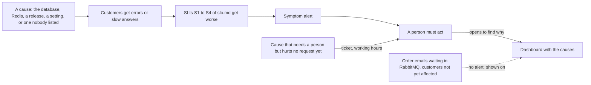

## Bạn cần biết trước

- [[backend.l4.error-budget]] — bạn biết error budget là phần request mà SLO cho phép lỗi, và một bản phát hành gây lỗi cũng tiêu nó như mọi lần sập dịch vụ.
- [[backend.l4.service-level-indicators]] — bạn biết SLI là tỉ lệ request tốt trên mọi request hợp lệ, và `slo.md` định nghĩa S1–S4 cho Đơn Hàng.
- [[devops.l2.grafana-dashboards]] — bạn biết mỗi panel của `donhang-api.json` là một truy vấn PromQL mà Grafana vẽ ra, và phải có người mở nó thì mới thấy.
- [[devops.l4.canary-release]] — bạn biết `api-canary` có thể nhận một phần nhỏ request trong khi `api` giữ phần còn lại.

## Tình huống

Staging giờ đã có Prometheus, và lead nhờ bạn quyết định điều gì sẽ gọi người. Một đồng nghiệp đề xuất ba điều kiện: CPU của một Pod `api` trên 80%, bất kỳ Pod nào khởi động lại, và Redis trả lời chậm. Giả sử canary của phiên bản kế tiếp trả `503` cho một phần mười lượt đọc sản phẩm. CPU của nó bình thường, không Pod nào khởi động lại, Redis vẫn nhanh. Khách gặp lỗi, mà không điều kiện nào trong ba điều kiện đó đúng. Giả sử thêm một đợt kiểm thử tải đẩy CPU lên cao trong khi mọi lượt đọc vẫn được trả lời kịp: điều kiện đầu tiên đúng, mà không ai bị ảnh hưởng.

Điều gì nên gọi người, sao cho nó gọi mỗi khi khách bị ảnh hưởng, và chỉ khi đó?

## Khái niệm cốt lõi

- **cảnh báo** (alert) — một điều kiện được kiểm tự động, báo cho người rằng có việc cần chú ý, như "CPU trên 80%" của đồng nghiệp.
- **sự cố** (incident) — một lần dịch vụ mà khách nhận được bị mất hoặc giảm chất lượng ngoài kế hoạch, như các lượt đọc sản phẩm mà canary trả `503`.
- **nhờn cảnh báo** (alert fatigue) — điều xảy ra khi có nhiều cảnh báo không cần làm gì: người nhận quen bỏ qua cảnh báo, cho tới khi cảnh báo quan trọng cũng bị bỏ qua.
- Nguyên nhân và triệu chứng (từ thông thường, ở đây dùng theo nghĩa này) — nguyên nhân là thứ bên trong hệ thống có thể hỏng, như CPU, một Pod khởi động lại hay Redis chậm. Triệu chứng là thứ khách cảm thấy, đo bằng các SLI của `slo.md`.

## Cơ chế hoạt động



Trong tình huống trên, mỗi điều kiện của đồng nghiệp là một cảnh báo theo nguyên nhân. Cách này hỏng theo hai hướng. Nó kêu khi khách không thấy gì, như CPU trong đợt kiểm thử tải. Và nó im khi một nguyên nhân không ai liệt kê làm hỏng dịch vụ, như `503` của canary, vì không ai liệt kê hết được mọi cách một hệ thống có thể hỏng.

Đọc sơ đồ từ trái sang. Dù nguyên nhân là gì, hễ khách gặp lỗi hay nhận câu trả lời chậm thì các SLI xấu đi. S1 đếm các lượt `POST /api/v1/orders` lỗi, S2 đếm các lượt chậm, S3 đếm các lượt đọc sản phẩm lỗi, còn S4 đếm các yêu cầu hoàn tiền chậm. S3 tính mọi `5xx` của `GET /api/v1/products` và `GET /api/v1/products/{id:int}` là xấu, kể cả `503`. Vì vậy cảnh báo theo SLI bắt được lỗi của canary mà không cần ai gọi tên nó trước, và sự cố do đội tự phát hiện chứ không phải do một cửa hàng báo. Nguyên nhân không làm ai bị ảnh hưởng, mũi tên nét chấm, không chạm tới SLI, nên cảnh báo theo triệu chứng vẫn im.

Im lặng quan trọng không kém lúc kêu. Mỗi cảnh báo kêu mà không có gì để làm lại dạy người nhận rằng cảnh báo có thể chờ. Đó là nhờn cảnh báo, và kết cục là cảnh báo quan trọng duy nhất bị đọc muộn, hoặc không ai đọc.

Nguyên nhân không biến mất. Chúng chuyển sang dashboard, nơi một người mở ra sau khi có cảnh báo theo triệu chứng để tìm vì sao nó kêu. Vài nguyên nhân cần người ngay cả trước khi có request nào lỗi, như một message không ai xử lý được. Những nguyên nhân đó thành một ticket, tức một việc làm trong giờ hành chính, chứ không phải một cuộc gọi ngay lúc đó.

## Trong hệ thống Đơn Hàng

`docs/design/alerts.md` mở đầu bằng đúng quy tắc mà sơ đồ vẽ:

```markdown file=docs/design/alerts.md tag=stage-4 lines=8-13
### Alert theo triệu chứng

Alert gọi người theo thứ khách cảm thấy: các SLI S1–S4 trong `slo.md`. Nguyên
nhân nào làm khách gặp lỗi hay chậm (database, Redis, một bản phát hành, một
cấu hình sai) cũng làm SLI xấu đi, nên alert theo SLI bắt được cả những nguyên
nhân không ai liệt kê trước. Nguyên nhân không chạm tới khách thì alert im.
```

Dòng 10–13 nói cảnh báo gọi người theo thứ khách cảm thấy, tức các SLI S1–S4. Nguyên nhân nào làm khách gặp lỗi hay chậm cũng làm một SLI xấu đi, nên các cảnh báo này bắt được cả những nguyên nhân không ai liệt kê trước. Đoạn kế tiếp của tài liệu không đặt cảnh báo nào trên CPU, bộ nhớ hay số lần Pod khởi động lại: các con số đó dao động trong khi khách không thấy gì, và cảnh báo theo chúng dạy người trực bỏ qua cảnh báo. Người nhận cảnh báo theo triệu chứng mở dashboard để tìm vì sao.

Xuống dưới, bảng của tài liệu cho mỗi SLI hai cảnh báo. Một cảnh báo có mức `page`, dùng để gọi người trực ngay, cảnh báo kia có mức `ticket`, một việc cho giờ hành chính. (Ở tag này chưa có gì thực sự gửi cuộc gọi, xem bên dưới.) Ví dụ, `ProductReadsFastBurn` theo dõi S3, chính SLI mà canary trong tình huống sẽ làm xấu đi. Mỗi cảnh báo chỉ kêu khi phần request xấu đủ cao trong đủ lâu. Các ngưỡng đó đến từ tốc độ tiêu error budget ra sao, tức chữ "burn" trong tên, là chủ đề của các bài kế tiếp.

Tỉ lệ đó cộng dồn trên mọi Pod api mà Prometheus scrape: `api`, `api-canary`, và `api-green`, Deployment green của blue-green deployment. Vì vậy các request mà canary trả lời cũng được tính như mọi request khác.

Tài liệu cũng liệt kê các nguyên nhân cần người:

```markdown file=docs/design/alerts.md tag=stage-4 lines=67-79
### Alert theo nguyên nhân

Một số nguyên nhân không làm SLI xấu ngay nhưng cần người xem. Chúng chỉ ở mức
`ticket`, và hiện chưa chạy:

| Alert dự kiến | Điều kiện | Mức | Vì sao chưa chạy |
|---|---|---|---|
| Dead-letter queue có message | `rabbitmq_detailed_queue_messages_ready{queue=~".*[.]dead"} > 0` trong 10 phút | ticket | Chỉ Prometheus của Compose scrape RabbitMQ; Prometheus của staging chỉ scrape các Pod api |
| Restore test thất bại | Lần chạy gần nhất của `scripts/devops/restore-test.sh` thất bại | ticket | Restore test chưa chạy theo lịch, chỉ chạy tay |
| Job migration hay backup lỗi | Job `db-backup` hay hook migration kết thúc lỗi | ticket | Staging chưa thu thập trạng thái object của cluster (cần một công cụ thu thập mới) |

Bật các alert này cần staging scrape RabbitMQ, hoặc thêm công cụ thu thập
trạng thái object của cluster; đội không làm ở V1.
```

Dòng 69–70 nói một số nguyên nhân không làm SLI xấu ngay nhưng cần người xem, nên chúng chỉ ở mức `ticket`, và hiện chưa cái nào chạy. Bảng nêu ba nguyên nhân: một message chờ trong dead-letter queue suốt 10 phút (điều kiện đếm các message sẵn sàng trong mọi queue có tên kết thúc bằng `.dead`), một lần kiểm thử khôi phục thất bại, và một Job migration hay backup kết thúc lỗi. Mỗi dòng ghi vì sao nó chưa chạy: Prometheus của staging chỉ scrape các Pod api, kiểm thử khôi phục chỉ chạy tay, và staging không thu thập trạng thái các object của cluster. Một message đơn hàng rơi vào dead-letter queue là trường hợp rõ nhất: đơn đã đặt xong, khách đã nhận câu trả lời thành công, vậy mà email sẽ không bao giờ được gửi nếu không có người can thiệp.

Dashboard `donhang-api.json`, mà Grafana nạp trong Compose profile `monitoring`, giữ cho các nguyên nhân luôn nhìn thấy được: bên cạnh số request theo status code, số `5xx` mỗi giây, p95 và số đơn đã đặt, nó có số email đơn hàng đang chờ trong RabbitMQ và số message đơn hàng đã vào dead-letter queue.

Ở tag này còn hai khoảng trống. Staging không chạy Grafana, nên dashboard này chỉ có trong Compose. Và Prometheus giữ trạng thái của cảnh báo nhưng tự nó không gửi thông báo, staging cũng không chạy thành phần nào làm điều đó, như mục cuối của tài liệu ghi lại. Trên thực tế, các cảnh báo đã được định nghĩa và trạng thái của chúng xem được trong Prometheus, nhưng không ai bị gọi cho tới khi có thêm một thành phần như vậy.

## Đánh đổi

Điều gì gọi người:

| | Cảnh báo theo nguyên nhân | Chỉ cảnh báo theo triệu chứng | Triệu chứng gọi ngay, vài nguyên nhân thành ticket | Chỉ dashboard |
|---|---|---|---|---|
| Kêu khi khách bị ảnh hưởng bởi một nguyên nhân không ai liệt kê | Không | Có | Có | Chỉ khi có người đang nhìn |
| Kêu khi không ai bị ảnh hưởng | Thường xuyên | Hiếm | Hiếm, và chỉ dưới dạng ticket | Không bao giờ |
| Bắt được vấn đề trước khi có request nào lỗi | Một số, nếu đã liệt kê | Không | Những nguyên nhân đã liệt kê, trong giờ hành chính | Chỉ khi có người đang nhìn |
| Cho biết vì sao | Có, nguyên nhân chính là cảnh báo | Không, dashboard cho biết | Dashboard cho biết | Có, nếu có người đọc |
| Hợp khi | Hiếm khi: khi chúng kêu mà không có gì để làm, chúng dẫn tới nhờn cảnh báo | Mọi nguyên nhân đáng kể đều chạm tới một SLI | Có những hỏng hóc, như email bị mất, làm khách bị ảnh hưởng muộn hơn mọi điều SLI cho thấy | Không ai cần hành động ngoài giờ hành chính |

Đơn Hàng chọn cột thứ ba trên staging.

## Bạn sẽ chọn gì nếu…

- …một service mới bắt đầu phục vụ các cửa hàng trước khi `slo.md` đặt SLI cho nó: viết SLI của nó trước, vì không có SLI thì không có triệu chứng nào để cảnh báo. Trong lúc chờ mà cảnh báo theo CPU của nó thì cảnh báo sẽ kêu khi không ai bị ảnh hưởng, và dạy cả đội bỏ qua cảnh báo.
- …ổ đĩa của database đang đầy dần và sẽ đầy hẳn trong vài ngày, trong khi hôm nay mọi SLI đều ổn: một cảnh báo theo nguyên nhân ở mức `ticket`, như các dòng của `alerts.md`, cho một người thời gian trong giờ hành chính để xử lý trước khi khách bị ảnh hưởng.
- …có người muốn cảnh báo cho từng `5xx` một: chỉ cho họ cảnh báo theo SLI, vốn đã tính mọi `5xx` là xấu, và kêu khi tỉ lệ đủ cao để đáng kể, chứ không phải vì một request.

## Senior hay nhầm rằng…

- **"Càng nhiều cảnh báo, hệ thống càng an toàn."** → Thực ra mỗi cảnh báo kêu mà không có gì để làm lại dạy người ta bỏ qua cảnh báo, nên một bộ cảnh báo lớn khiến cảnh báo quan trọng dễ bị bỏ sót hơn. Bạn sẽ nhận ra khi cảnh báo được xác nhận chỉ sau vài giây mà không ai mở dashboard.
- **"CPU của server cao là lý do chính đáng để đánh thức người lúc nửa đêm."** → Thực ra CPU có thể cao trong khi mọi request vẫn được trả lời kịp, như khi kiểm thử tải, và bình thường trong khi khách gặp lỗi, như với `503` của canary. `alerts.md` không đặt cảnh báo nào trên CPU. Bạn sẽ nhận ra khi một cuộc gọi đêm kết thúc với các SLI vẫn ổn và không có gì để làm.
- **"Nếu dashboard đã hiện mọi thứ thì không cần cảnh báo."** → Thực ra dashboard chỉ cho thấy vấn đề với người đang nhìn, còn cảnh báo được kiểm tự động suốt thời gian. Bạn sẽ nhận ra khi một cửa hàng báo các đơn đặt thất bại mà một panel đã hiện suốt một tiếng.

## Thử ngay (3 phút)

1. Trong `examples/don-hang` ở `stage-4`, mở `docs/design/alerts.md` và tìm hai bảng của nó: các cảnh báo cho S1–S4 và các cảnh báo theo nguyên nhân dự kiến.
2. Với mỗi đề xuất dưới đây, quyết định: `page`, `ticket`, hay không cảnh báo.
   - (a) tỉ lệ `POST /api/v1/orders` trả `5xx` cao trong một giờ vừa qua
   - (b) bộ nhớ của container `db` trên 90%
   - (c) một message đã chờ trong `notifications.order-events.dead` suốt 10 phút
   - (d) một Pod `api` khởi động lại hai lần trong một giờ.

Kết quả mong đợi: một đề xuất là `page`, một là `ticket`, hai không có cảnh báo, và mỗi đáp án khớp với một câu hoặc một dòng của `alerts.md`.

<details><summary>Gợi ý đáp án</summary>

(a) là `page`: đó là triệu chứng, chính phần request xấu mà S1 đếm, và cảnh báo nhanh của nó có mức `page`. (b) không có cảnh báo: bộ nhớ là nguyên nhân, và tài liệu không đặt cảnh báo nào trên nó. Nếu có lúc nó làm request lỗi, S1 hay S3 sẽ xấu đi và cảnh báo đó kêu. (c) là `ticket`: đó là dòng đầu của bảng nguyên nhân (dự kiến, chưa chạy ở tag này), vì một email bị mất làm khách bị ảnh hưởng mà không request nào lỗi. (d) không có cảnh báo, cùng lý do với (b).

</details>

## Liên hệ

- [[backend.l4.service-level-indicators]] — các SLI S1–S4 mà mọi cảnh báo theo triệu chứng ở đây theo dõi.
- [[backend.l4.error-budget]] — thứ mà các cảnh báo bảo vệ. Các bài kế tiếp biến budget đó thành ngưỡng của chúng.
- [[devops.l2.grafana-dashboards]] — nơi các nguyên nhân ở lại, để đọc sau khi một cảnh báo theo triệu chứng kêu.
- [[devops.l4.canary-release]] — vì sao các request lỗi của canary được tính trong cùng SLI với các request khác.
- [[devops.l2.why-monitoring]] — cùng ý đó, tiến thêm một bước: monitoring làm vấn đề hiện ra, cảnh báo khiến vấn đề được phát hiện mà không cần ai đang nhìn.
- [[backend.l3.queue-backlog-metrics]] — một nguyên nhân mà không SLI nào thấy, hiện trên dashboard.
- [[backend.l3.dead-letter-queue]] — queue đứng sau cảnh báo theo nguyên nhân dự kiến đầu tiên.
- [[devops.l3.restore-testing]] — kiểm thử mà khi thất bại là cảnh báo theo nguyên nhân dự kiến thứ hai.
- [[devops.l4.recording-rules]] — bước kế tiếp: cách Prometheus của staging tính các phần request xấu mà các cảnh báo này đọc.

## Tóm tắt 5 dòng

1. Cảnh báo theo triệu chứng, tức thứ khách cảm thấy mà các SLI đo, để nguyên nhân nào làm khách bị ảnh hưởng cũng kích hoạt cảnh báo, còn nguyên nhân vô hại thì im.
2. Cảnh báo là một phép kiểm tự động báo cho người rằng cần hành động. Sự cố là một lần dịch vụ khách nhận được bị mất hoặc giảm chất lượng ngoài kế hoạch.
3. Cảnh báo theo nguyên nhân như CPU kêu khi không ai bị ảnh hưởng và bỏ sót nguyên nhân không ai liệt kê. Cảnh báo không cần hành động gây ra nhờn cảnh báo.
4. `alerts.md` cho mỗi SLI một cảnh báo `page` và một cảnh báo `ticket`, và chỉ dự kiến cảnh báo theo nguyên nhân, như message trong dead-letter queue, ở mức ticket.
5. Nguyên nhân ở lại trên dashboard, nơi người nhận cảnh báo theo triệu chứng tìm vì sao nó kêu.
