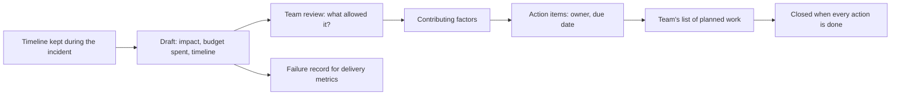

## Before you start

- [[devops.l4.incident-command]] — you know the incident ends when the SLI stays good with the mitigation in place, and that the timeline kept during it is what the written review starts from.
- [[devops.l4.delivery-metrics]] — you know change failure rate and time to restore need the team's written failure records for failures that Git history does not see.
- [[management.l3.technical-debt-register]] — you know a list of known problems, each with someone who watches it, keeps them from being forgotten between sprints.
- [[backend.l4.error-budget]] — you know the error budget is the share of requests an SLO lets fail, and that `slo.md`'s policy acts on how much of it an incident spends.

## The situation

Two working days after the practice incident the team staged on `envs/staging` in the incident-command lesson, the team meets to write it up, as if real shops had been affected. Product reads returned `503` for several minutes, and the timeline shows a config commit at T+0 that set the `catalog-reads` limit to one read at a time.

The first question in the room is "who pushed that?" The teammate who made the commit says little. Nobody hears that they believed a config-only change needed no canary, a belief nothing written contradicts. The meeting ends with "be more careful", and nothing else changes.

What should the written review after an incident ask, so the team learns what let the failure happen?

## Core concepts

- **postmortem** — the written review after an incident: its impact including the error budget spent, the timeline, contributing factors, what helped, and action items each with an owner and a due date.
- **blameless postmortem** — a postmortem that describes what the system and the process allowed, such as a setting no check stops, instead of who made the change.
- Contributing factor (plain words) — one condition that let the incident happen or made it bigger; an incident usually has several.
- Action item (plain words) — a piece of work the postmortem asks for, marked as preventing, detecting or mitigating, with an owner by role, a due date and a status.
- Root cause (plain words) — the single condition a review names as the reason for an incident, as if fixing it alone would stop a repeat.

## How it works



It starts from the timeline the incident commander, or whoever they assigned, kept during the incident, because memory afterwards is incomplete and out of order. The draft adds the impact: what customers saw, for how long, and how much of each SLI's error budget the incident spent. That share also decides whether the postmortem is required at all.

The team then reviews the draft together and asks what the system and the process allowed. "Who pushed that?" becomes "what let a limit of one reach the api without any check stopping it?" The second question has answers a team can change: a step to add, a check to write, a rule to put on paper. The first has one answer, a name, and the conditions that let it through stay in place, so the next person in the same position can make the same change.

The answers are contributing factors, usually several. Each turns into an action item that prevents the failure, detects it sooner or limits it. Action items join the team's list of planned work like any other work. The postmortem closes only when every action item is done; until then, the conditions that allowed the incident are still in place.

A postmortem has a second use. It is the team's record that a change failed and when service came back, which the delivery metrics read alongside Git history.

## In the Đơn Hàng system

```markdown file=docs/postmortems/template.md tag=stage-4 lines=1-23
# Postmortem NNNN: [tên ngắn của sự cố, theo điều khách gặp]

Trạng thái: nháp | đã xem lại | đóng (mọi action item xong)
Mức: SEV1 | SEV2 | SEV3
Người viết: [vai trò, không tên người]
Ngày xem lại cùng đội: [ngày]

Postmortem mô tả điều hệ thống và quy trình đã cho phép xảy ra, không mô tả ai
làm sai. Người sợ bị đổ lỗi sẽ giấu điều họ biết, và lần sau đội học được ít
hơn. Viết "commit đổi cấu hình đi thẳng vào Deployment", không viết "X đã đổi
cấu hình".

### Tóm tắt

Hai hay ba câu: khách gặp gì, bao lâu, đội giảm thiểu bằng cách nào.

### Ảnh hưởng

- Khách và cửa hàng gặp gì, bao nhiêu request hay đơn bị ảnh hưởng.
- Thời gian: từ lúc khách bắt đầu gặp lỗi tới lúc giảm thiểu xong.
- Error budget đã tiêu: số request xấu, và phần trăm budget 28 ngày của mỗi SLI
  bị chạm (`docs/design/slo.md`). Hơn một phần tư budget của một SLI là lý do
  postmortem này bắt buộc.
```

`template.md` is the shape every postmortem in `docs/postmortems/` follows. Lines 3–6 are the header: a status that moves from draft to reviewed to closed once every action item is done, the severity, and an author named by role, never by name. Lines 8–11 state the blameless rule and its reason: people who fear blame hide what they know, and the team learns less next time. Lines 10–11 show the technique in one pair: write "a config commit went straight into the Deployment", not "X changed the config".

Lines 17–23 ask for the impact, including the bad requests and the share of each touched SLI's 28-day budget. More than a quarter of one SLI's budget makes the postmortem required, matching the policy in `slo.md` (not shown). Nothing in the template stops a team writing one for a smaller incident.

The template's later sections (not shown) ask for contributing factors, usually several rather than one root cause, each with why it made sense to the person at the time. They give every action item a kind (prevent, detect, mitigate), an owner by role, a due date and a status, tracked like other planned work.

```markdown file=docs/postmortems/0001-doc-san-pham-tra-503.md tag=stage-4 lines=47-58
### Yếu tố góp phần

- Thay đổi cấu hình đi thẳng vào Deployment `api` của `envs/staging`, không qua
  bước canary mà ADR 0019 yêu cầu cho api. Canary ở bước 10% đã dừng thay đổi
  này với chỉ một phần mười request bị ảnh hưởng, như `canary-steps.sh --bad`
  cho thấy. Quy trình hiện coi "chỉ đổi cấu hình" là không cần canary; quy tắc
  đó chưa được viết ra ở đâu, nên người làm có lý do hợp lý để nghĩ vậy.
- Không phép kiểm nào chặn một giá trị giới hạn bất thường. `PermitLimit=1` là
  giá trị hợp lệ về kiểu, kubeconform và admission policy đều nhận, và review
  pull request không có danh sách giá trị cần xem kỹ.
- Giới hạn `catalog-reads` đọc từ cấu hình mà không có giá trị tối thiểu, nên
  một số nhỏ tới mức làm hỏng dịch vụ vẫn được nhận khi khởi động.
```

`0001-doc-san-pham-tra-503.md` is the postmortem for the incident `incident-drill.sh` reproduces on staging. Its minutes and budget figures are assumptions, as its lines 8–10 (not shown) say. Its impact section estimates the incident spent more than a quarter of S3's budget (S3 is the product-reads SLI in `slo.md`), so the postmortem is required.

The excerpt lists three contributing factors. First, the change went straight into the `api` Deployment, skipping the canary step ADR 0019 requires for the api; the canary's 10% step would have stopped it with a tenth of requests affected, and lines 52–53 say why skipping it was reasonable: no written rule said a config change needs one. Second, no check stops an unusual limit: `PermitLimit=1` (the setting that holds the `catalog-reads` limit) is a valid value to every automated check, `kubeconform` among them, and pull request review has no list of values to look at closely. Third, the api accepts the limit from config with no minimum. No line names who made the commit, and none of the three is "the" cause on its own.

Lines 76–83 (not shown) list four action items, three from the factors and one from what slowed the response, each with a kind, an owner by role, a due date and the status open. Line 3 says the postmortem has been reviewed but still has open action items, so it is not closed.

`docs/team/delivery-metrics.md` names these records. Lines 29–31 (not shown) take failures not fixed by a revert, such as a setting changed on the cluster, from `docs/postmortems/`, because `git log` cannot see them. Lines 36–38 say each postmortem's timeline holds the time of the deploy that caused the incident and the time service came back. Lines 42–43 add that without these records the change failure rate reads lower than it really is.

## Trade-offs

What the review looks for:

| | Blameless postmortem | Postmortem that names who | No written review |
|---|---|---|---|
| What people say in the review | What they knew and why it made sense | As little as they can | Nothing is asked |
| What changes afterwards | Steps, checks and written rules | One person is told to be careful | Nothing, until the next incident |
| Records for delivery metrics | Timeline with deploy and restore times | Timeline, but factors are missing | Failures not fixed by a revert are lost |
| Fits when | Every incident over the budget threshold, and smaller ones worth learning from | Never as a team practice | An incident spends little budget and teaches nothing new |

How many causes the review accepts:

| | Several contributing factors | One root cause |
|---|---|---|
| Action items | One or more per factor: process, check, code | Usually one |
| A repeat of the incident | Has to get past several fixes | Returns if the one fix is bypassed |
| Effort | More action items to track | Fewer |

## What would you choose if…

- …an incident spent a tenth of the budget of S1, the orders-placed SLI, but it was the same kind of config mistake as `0001`: `slo.md` does not require a postmortem. Write a short one if you want to learn why `0001`'s action items did not stop it; a repeat can mean an action item is still open or did not cover this case.
- …an incident ended when someone changed a setting by hand on the cluster, with no revert: write the postmortem, at least its timeline, because `git log` never sees this failure and the delivery metrics count it only through the record.
- …the sprint ends with two of `0001`'s action items still open and feature work waiting: keep them open and plan them against the features in the next sprint.
## Seniors often assume…

- **"A postmortem's goal is to find who made the mistake so it does not happen again."** → Actually the next person in the same position can make the same change, because the missing check, the missing minimum and the unwritten rule are still there. Naming someone also teaches everyone to say less in the next review. You notice this when reviews get shorter and quieter while the same kind of incident comes back.
- **"Every incident has exactly one root cause."** → Actually `0001` needed several conditions at once: a skipped canary, no check on the value, no minimum when the api starts. Picking one leaves the others in place. You notice this when a postmortem has a single action item and the "fixed" incident returns by another path.
- **"Once the postmortem is written, the incident work is finished."** → Actually the work is in the action items, and they compete with features in every sprint. A postmortem with open actions leaves the same incident free to happen again. You notice this when a new incident's contributing factors match an open action item from an old postmortem.

## Try it (3 minutes)

1. Open `docs/postmortems/0001-doc-san-pham-tra-503.md` at `stage-4` and read lines 47–58 and 78–83.
2. Rewrite this sentence blamelessly: "A developer skipped the canary for a config change."
3. Pick the action item in lines 80–83 that addresses the situation in your sentence.

Expected result: a sentence that names what the process allowed and why it seemed reasonable, with no person in it, and one action item from lines 80–83.

<details><summary>Suggested answer</summary>

"A config change went straight into the `api` Deployment without the canary ADR 0019 requires; no written rule said a config change needs one." The action item on line 80 writes into `canary-checks.md` that config changes to the api also go through the canary. Line 81 addresses a different factor, the missing minimum.

</details>

## Connections

- [[devops.l4.incident-command]] — prerequisite: its timeline and its end of the incident are where a postmortem starts.
- [[devops.l4.delivery-metrics]] — the consumer: postmortems are the failure records those metrics need beyond Git history.
- [[management.l3.technical-debt-register]] — the same discipline of a reviewed list with owners, applied to action items.
- [[backend.l4.error-budget]] — the share of it an incident spends decides whether a postmortem is required.
- [[devops.l4.runbooks]] — `0001` lists the drilled runbook among what helped.
- [[devops.l4.release-strategy-per-component]] — ADR 0019, whose canary step the incident in `0001` skipped.
- [[management.l3.architecture-decision-record]] — the other written record in the repository: an ADR explains a decision, a postmortem explains a failure.
- [[management.l4.blameless-culture]] — the same idea one level up, for the whole team rather than one review.

## Five-line summary

1. A blameless postmortem asks what the system and the process allowed, not who made the change, so people share what they know.
2. It records impact and error budget spent, the timeline, contributing factors, what helped, and action items with owners and due dates.
3. `slo.md` requires one when an incident spends over a quarter of an SLI's budget; `template.md` gives its sections.
4. `0001` finds several contributing factors, such as a change that skipped ADR 0019's canary, rather than one root cause.
5. Action items are tracked until done, and postmortems are the incident records the delivery metrics read for failures Git cannot see.
