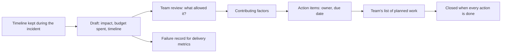

## Bạn cần biết trước

- [[devops.l4.incident-command]] — bạn biết sự cố kết thúc khi SLI vẫn tốt với biện pháp giảm thiểu giữ nguyên, và dòng thời gian ghi trong lúc xử lý là điểm xuất phát của bản xem lại viết sau đó.
- [[devops.l4.delivery-metrics]] — bạn biết tỉ lệ thay đổi gây lỗi và thời gian khôi phục cần bản ghi lỗi do đội tự viết, cho những lỗi mà lịch sử Git không thấy.
- [[management.l3.technical-debt-register]] — bạn biết một danh sách các vấn đề đã biết, mỗi vấn đề có người theo dõi, giữ cho chúng không bị quên giữa các sprint.
- [[backend.l4.error-budget]] — bạn biết error budget là phần request mà SLO cho phép lỗi, và chính sách trong `slo.md` hành động theo lượng budget một sự cố tiêu mất.

## Tình huống

Hai ngày làm việc sau buổi diễn tập sự cố mà đội dựng trên `envs/staging` ở bài về người chỉ huy sự cố, cả đội ngồi lại để viết về nó, coi như các cửa hàng thật đã bị ảnh hưởng. Lượt đọc sản phẩm trả `503` trong vài phút, và dòng thời gian cho thấy một commit cấu hình lúc T+0 đặt giới hạn `catalog-reads` thành mỗi lần chỉ một lượt đọc.

Câu hỏi đầu tiên trong phòng là "ai đã push cái đó?". Người đồng đội làm commit gần như không nói gì. Không ai nghe được rằng họ tin một thay đổi chỉ đụng cấu hình thì không cần canary, và không có văn bản nào nói ngược lại niềm tin đó. Buổi họp kết thúc bằng câu "lần sau cẩn thận hơn", và không có gì khác thay đổi.

Bản xem lại viết sau sự cố nên hỏi gì, để đội học được điều gì đã để lỗi xảy ra?

## Khái niệm cốt lõi

- **postmortem** (bản xem lại viết sau sự cố: ảnh hưởng, dòng thời gian, yếu tố góp phần, action item có người phụ trách) — bản xem lại viết sau một sự cố: ảnh hưởng, gồm cả error budget đã tiêu, dòng thời gian, các yếu tố góp phần, điều gì đã giúp, và các action item, mỗi cái có người phụ trách và hạn chót.
- **postmortem không đổ lỗi** (blameless postmortem) — postmortem mô tả điều hệ thống và quy trình đã cho phép, chẳng hạn một giá trị cấu hình không phép kiểm nào chặn, thay vì mô tả ai đã làm thay đổi.
- Yếu tố góp phần (từ thông thường) — một điều kiện đã để sự cố xảy ra hoặc làm nó lớn hơn. Một sự cố thường có vài yếu tố như vậy.
- Action item (từ thông thường) — một phần việc postmortem yêu cầu, được đánh dấu là ngăn chặn, phát hiện hay giảm thiểu, có người phụ trách theo vai trò, hạn chót và trạng thái.
- Nguyên nhân gốc (từ thông thường) — điều kiện duy nhất mà một bản xem lại gọi tên là lý do của sự cố, như thể chỉ cần sửa nó là sự cố không lặp lại.

## Cơ chế hoạt động



Mọi thứ bắt đầu từ dòng thời gian mà người chỉ huy sự cố, hoặc người họ giao, đã ghi trong lúc xử lý, vì trí nhớ sau sự cố thì thiếu và lộn thứ tự. Bản nháp thêm phần ảnh hưởng: khách đã thấy gì, trong bao lâu, và sự cố tiêu bao nhiêu error budget của mỗi SLI. Phần đã tiêu đó cũng quyết định có bắt buộc viết postmortem hay không.

Sau đó cả đội cùng xem bản nháp và hỏi hệ thống và quy trình đã cho phép điều gì. "Ai đã push cái đó?" trở thành "điều gì để một giới hạn bằng 1 đi tới api mà không phép kiểm nào chặn lại?". Câu hỏi thứ hai có những câu trả lời đội thay đổi được: một bước cần thêm, một phép kiểm cần viết, một quy tắc cần ghi ra giấy. Câu hỏi thứ nhất chỉ có một câu trả lời, là một cái tên, còn các điều kiện đã để lỗi lọt qua vẫn nằm nguyên đó. Người tiếp theo ở cùng vị trí có thể làm đúng thay đổi ấy.

Các câu trả lời là những yếu tố góp phần, thường có vài cái. Mỗi yếu tố trở thành một action item để ngăn lỗi, phát hiện nó sớm hơn, hoặc thu hẹp nó. Action item vào danh sách việc đã lên kế hoạch của đội như mọi việc khác. Postmortem chỉ đóng khi mọi action item đã xong. Trước lúc đó, các điều kiện đã cho phép sự cố vẫn còn.

Postmortem còn một công dụng thứ hai. Nó là bản ghi của đội rằng một thay đổi đã gây lỗi và dịch vụ trở lại lúc nào, thứ mà các số đo giao phần mềm đọc cùng với lịch sử Git.

## Trong hệ thống Đơn Hàng

```markdown file=docs/postmortems/template.md tag=stage-4 lines=1-23
# Postmortem NNNN: [tên ngắn của sự cố, theo điều khách gặp]

Trạng thái: nháp | đã xem lại | đóng (mọi action item xong)
Mức: SEV1 | SEV2 | SEV3
Người viết: [vai trò, không tên người]
Ngày xem lại cùng đội: [ngày]

Postmortem mô tả điều hệ thống và quy trình đã cho phép xảy ra, không mô tả ai
làm sai. Người sợ bị đổ lỗi sẽ giấu điều họ biết, và lần sau đội học được ít
hơn. Viết "commit đổi cấu hình đi thẳng vào Deployment", không viết "X đã đổi
cấu hình".

### Tóm tắt

Hai hay ba câu: khách gặp gì, bao lâu, đội giảm thiểu bằng cách nào.

### Ảnh hưởng

- Khách và cửa hàng gặp gì, bao nhiêu request hay đơn bị ảnh hưởng.
- Thời gian: từ lúc khách bắt đầu gặp lỗi tới lúc giảm thiểu xong.
- Error budget đã tiêu: số request xấu, và phần trăm budget 28 ngày của mỗi SLI
  bị chạm (`docs/design/slo.md`). Hơn một phần tư budget của một SLI là lý do
  postmortem này bắt buộc.
```

`template.md` là khuôn mà mọi postmortem trong `docs/postmortems/` đi theo. Dòng 3–6 là phần đầu: trạng thái đi từ nháp sang đã xem lại rồi sang đóng khi mọi action item xong, mức nghiêm trọng, và người viết ghi theo vai trò, không bao giờ ghi tên. Dòng 8–11 nêu quy tắc không đổ lỗi và lý do của nó: người sợ bị đổ lỗi sẽ giấu điều họ biết, và lần sau đội học được ít hơn. Dòng 10–11 cho thấy kỹ thuật này qua một cặp câu: viết "commit đổi cấu hình đi thẳng vào Deployment", không viết "X đã đổi cấu hình".

Dòng 17–23 yêu cầu phần ảnh hưởng, gồm số request xấu và phần trăm budget 28 ngày của mỗi SLI bị chạm. Hơn một phần tư budget của một SLI thì postmortem là bắt buộc, khớp với chính sách trong `slo.md` (không trích). Khuôn này không cấm đội viết postmortem cho một sự cố nhỏ hơn.

Các phần sau của khuôn (không trích) yêu cầu các yếu tố góp phần, thường là vài yếu tố chứ không phải một nguyên nhân gốc, mỗi yếu tố kèm lý do vì sao điều đó hợp lý với người làm lúc ấy. Chúng cũng gán cho mỗi action item một loại (ngăn chặn, phát hiện, giảm thiểu), một người phụ trách theo vai trò, hạn chót và trạng thái, được theo dõi như mọi việc đã lên kế hoạch khác.

```markdown file=docs/postmortems/0001-doc-san-pham-tra-503.md tag=stage-4 lines=47-58
### Yếu tố góp phần

- Thay đổi cấu hình đi thẳng vào Deployment `api` của `envs/staging`, không qua
  bước canary mà ADR 0019 yêu cầu cho api. Canary ở bước 10% đã dừng thay đổi
  này với chỉ một phần mười request bị ảnh hưởng, như `canary-steps.sh --bad`
  cho thấy. Quy trình hiện coi "chỉ đổi cấu hình" là không cần canary; quy tắc
  đó chưa được viết ra ở đâu, nên người làm có lý do hợp lý để nghĩ vậy.
- Không phép kiểm nào chặn một giá trị giới hạn bất thường. `PermitLimit=1` là
  giá trị hợp lệ về kiểu, kubeconform và admission policy đều nhận, và review
  pull request không có danh sách giá trị cần xem kỹ.
- Giới hạn `catalog-reads` đọc từ cấu hình mà không có giá trị tối thiểu, nên
  một số nhỏ tới mức làm hỏng dịch vụ vẫn được nhận khi khởi động.
```

`0001-doc-san-pham-tra-503.md` là postmortem cho sự cố mà `incident-drill.sh` tái hiện trên staging. Số phút và số budget trong đó là giả định, như dòng 8–10 (không trích) của nó ghi rõ. Phần ảnh hưởng ước tính sự cố đã tiêu hơn một phần tư budget của S3 (S3 là SLI đọc sản phẩm trong `slo.md`), nên postmortem này bắt buộc.

Đoạn trích liệt kê ba yếu tố góp phần. Thứ nhất, thay đổi đi thẳng vào Deployment `api`, bỏ qua bước canary mà ADR 0019 yêu cầu cho api. Bước 10% của canary lẽ ra đã dừng nó khi mới một phần mười request bị ảnh hưởng, và dòng 52–53 giải thích vì sao bỏ qua là hợp lý: không có quy tắc nào viết ra rằng thay đổi cấu hình cũng cần canary. Thứ hai, không có phép kiểm nào chặn một giới hạn bất thường. `PermitLimit=1` (giá trị cấu hình chứa giới hạn `catalog-reads`) là hợp lệ với mọi phép kiểm tự động, trong đó có `kubeconform`, và review pull request không có danh sách giá trị cần xem kỹ. Thứ ba, api nhận giới hạn từ cấu hình mà không có giá trị tối thiểu. Không dòng nào ghi tên người làm commit, và không yếu tố nào trong ba tự nó là "nguyên nhân".

Dòng 76–83 (không trích) liệt kê bốn action item, ba cái từ các yếu tố góp phần và một cái từ điều đã làm chậm việc xử lý. Mỗi cái có loại, người phụ trách theo vai trò, hạn chót và trạng thái mở. Dòng 3 ghi postmortem đã được xem lại nhưng vẫn còn action item mở, nên chưa đóng.

`docs/team/delivery-metrics.md` gọi tên các bản ghi này. Dòng 29–31 (không trích) lấy từ `docs/postmortems/` những lỗi không được sửa bằng revert, chẳng hạn một giá trị bị đổi ngay trên cluster, vì `git log` không thấy chúng. Dòng 36–38 nói dòng thời gian của mỗi postmortem chứa giờ của lần deploy gây ra sự cố và giờ dịch vụ trở lại. Dòng 42–43 thêm rằng thiếu các bản ghi này thì tỉ lệ thay đổi gây lỗi hiện ra thấp hơn thực tế.

## Đánh đổi

Bản xem lại tìm kiếm điều gì:

| | Postmortem không đổ lỗi | Postmortem gọi tên người | Không có bản xem lại |
|---|---|---|---|
| Mọi người nói gì trong buổi xem lại | Điều họ biết và vì sao lúc đó nó hợp lý | Càng ít càng tốt | Không ai hỏi gì |
| Điều gì thay đổi sau đó | Các bước, phép kiểm và quy tắc viết ra | Một người được dặn phải cẩn thận | Không gì cả, tới sự cố tiếp theo |
| Bản ghi cho số đo giao phần mềm | Dòng thời gian có giờ deploy và giờ khôi phục | Có dòng thời gian, nhưng thiếu yếu tố góp phần | Mất những lỗi không được sửa bằng revert |
| Hợp khi | Mọi sự cố vượt ngưỡng budget, và những sự cố nhỏ hơn đáng học | Không bao giờ, nếu là cách làm của cả đội | Sự cố tiêu ít budget và không dạy thêm điều gì mới |

Bản xem lại chấp nhận bao nhiêu nguyên nhân:

| | Vài yếu tố góp phần | Một nguyên nhân gốc |
|---|---|---|
| Action item | Một hay nhiều cho mỗi yếu tố: quy trình, phép kiểm, code | Thường chỉ một |
| Khi sự cố lặp lại | Phải vượt qua nhiều lớp sửa | Quay lại nếu bản sửa duy nhất bị đi vòng |
| Công sức | Nhiều action item hơn để theo dõi | Ít hơn |

## Bạn sẽ chọn gì nếu…

- …một sự cố tiêu một phần mười budget của S1, SLI đặt đơn, nhưng vẫn là kiểu lỗi cấu hình như `0001`: `slo.md` không bắt buộc postmortem. Hãy viết một bản ngắn nếu bạn muốn hiểu vì sao các action item của `0001` không chặn được nó. Lặp lại có thể nghĩa là một action item vẫn còn mở, hoặc không bao được trường hợp này.
- …một sự cố kết thúc khi có người sửa tay một giá trị trên cluster, không có revert nào: hãy viết postmortem, ít nhất là dòng thời gian, vì `git log` không bao giờ thấy lỗi này và các số đo giao phần mềm chỉ đếm được nó qua bản ghi.
- …sprint kết thúc mà hai action item của `0001` vẫn mở, còn việc làm tính năng đang chờ: giữ chúng mở và lên kế hoạch cho chúng cạnh các tính năng trong sprint sau.

## Senior hay nhầm rằng…

- **"Mục tiêu của postmortem là tìm ra ai đã làm sai để chuyện đó không lặp lại."** → Thực ra người tiếp theo ở cùng vị trí vẫn có thể làm đúng thay đổi ấy, vì phép kiểm còn thiếu, giá trị tối thiểu còn thiếu và quy tắc chưa viết ra vẫn còn đó. Gọi tên một người còn dạy mọi người nói ít đi trong buổi xem lại sau. Bạn sẽ nhận ra khi các buổi xem lại ngắn dần và im lặng dần, trong khi cùng một kiểu sự cố cứ quay lại.
- **"Sự cố nào cũng có đúng một nguyên nhân gốc."** → Thực ra `0001` cần nhiều điều kiện cùng lúc: canary bị bỏ qua, không phép kiểm nào xét giá trị, không có giá trị tối thiểu khi api khởi động. Chọn một cái thì những cái còn lại vẫn nằm đó. Bạn sẽ nhận ra khi một postmortem chỉ có một action item và sự cố "đã sửa" quay lại theo một đường khác.
- **"Viết xong postmortem là xong việc với sự cố."** → Thực ra việc nằm ở các action item, và chúng phải tranh chỗ với tính năng trong mọi sprint. Một postmortem còn action item mở thì cùng sự cố đó vẫn có thể xảy ra lần nữa. Bạn sẽ nhận ra khi các yếu tố góp phần của một sự cố mới trùng với một action item còn mở của một postmortem cũ.

## Thử ngay (3 phút)

1. Mở `docs/postmortems/0001-doc-san-pham-tra-503.md` ở `stage-4` và đọc dòng 47–58 và 78–83.
2. Viết lại câu sau theo cách không đổ lỗi: "Một lập trình viên đã bỏ qua canary cho một thay đổi cấu hình."
3. Chọn action item trong dòng 80–83 xử lý đúng tình huống trong câu bạn viết.

Kết quả mong đợi: một câu nêu điều quy trình đã cho phép và vì sao lúc đó nó có vẻ hợp lý, không có người nào trong câu, cùng một action item từ dòng 80–83.

<details><summary>Gợi ý đáp án</summary>

"Một thay đổi cấu hình đi thẳng vào Deployment `api` mà không qua canary như ADR 0019 yêu cầu, và không có quy tắc nào viết ra rằng thay đổi cấu hình cũng cần canary." Action item ở dòng 80 ghi vào `canary-checks.md` rằng thay đổi cấu hình của api cũng phải đi qua canary. Dòng 81 xử lý một yếu tố khác, là giá trị tối thiểu còn thiếu.

</details>

## Liên hệ

- [[devops.l4.incident-command]] — bài cần trước: dòng thời gian và điểm kết thúc sự cố của nó là nơi postmortem bắt đầu.
- [[devops.l4.delivery-metrics]] — bên dùng: postmortem là bản ghi lỗi mà các số đo đó cần, ngoài lịch sử Git.
- [[management.l3.technical-debt-register]] — cùng kỷ luật của một danh sách được xem lại, có người phụ trách, áp cho action item.
- [[backend.l4.error-budget]] — phần budget một sự cố tiêu quyết định có bắt buộc viết postmortem hay không.
- [[devops.l4.runbooks]] — `0001` liệt kê runbook đã diễn tập vào những điều đã giúp.
- [[devops.l4.release-strategy-per-component]] — ADR 0019, có bước canary mà sự cố trong `0001` đã bỏ qua.
- [[management.l3.architecture-decision-record]] — loại bản ghi viết tay còn lại trong repository: ADR giải thích một quyết định, postmortem giải thích một lần hỏng.
- [[management.l4.blameless-culture]] — cùng ý tưởng ở tầng cao hơn, cho cả đội chứ không chỉ một buổi xem lại.

## Tóm tắt 5 dòng

1. Postmortem không đổ lỗi hỏi hệ thống và quy trình đã cho phép điều gì, không hỏi ai làm thay đổi, để mọi người chia sẻ điều họ biết.
2. Nó ghi ảnh hưởng và error budget đã tiêu, dòng thời gian, các yếu tố góp phần, điều đã giúp, và action item có người phụ trách và hạn chót.
3. `slo.md` bắt buộc viết khi một sự cố tiêu hơn một phần tư budget của một SLI, còn `template.md` cho các phần của nó.
4. `0001` tìm ra vài yếu tố góp phần, như một thay đổi bỏ qua canary của ADR 0019, chứ không phải một nguyên nhân gốc.
5. Action item được theo dõi tới khi xong, và postmortem là bản ghi sự cố mà các số đo giao phần mềm đọc cho những lỗi Git không thấy.
