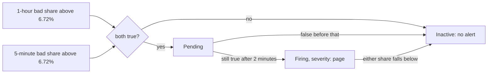

## Before you start

- [[devops.l4.burn-rate]] — you know the fast level of `alerts.md`, a burn rate of 13.44, is 6.72% of product reads failing over an hour, and the slow level, 5.6 over 6 hours, is 2.8%.
- [[devops.l4.recording-rules]] — you know `slo.rules.yml` records each SLI's bad share over 5 minutes, 30 minutes, 1 hour and 6 hours, such as `job:product_reads_bad:ratio_rate5m`.
- [[devops.l2.quality-gate]] — you know a quality gate is the set of automated checks a change must pass in CI before it goes further.

## The situation

You want Prometheus to call someone when product reads, S3, fail faster than 6.72% allows. The obvious check reads one recorded share. Pick the 5-minute share, and a two-minute hiccup during a release, every read failing and then all fine, crosses 6.72% and calls a person for nothing. Pick the 1-hour share instead, and after a real failure is fixed, the hour still remembers it: the check stays true for many minutes while customers are served again.

How does one check ignore a short spike yet stop soon after the errors do, and how do you know it behaves so before a real outage?

## Core concepts

- **alerting rule** — a rule Prometheus evaluates like a recording rule, where each result of its expression is an alert: pending while the expression keeps returning it, firing once it has returned it for the rule's `for` duration; when the expression stops returning it, the alert is gone (inactive): a pending alert is dropped, a firing one is resolved.
- Long and short window (plain words) — the two periods one alert reads together: 1 hour and 5 minutes for the fast level, 6 hours and 30 minutes for the slow one.
- Level label (plain words) — the label `severity` the rule puts on its alert, `page` or `ticket`; `alerts.md` says a `page` calls the person on duty at once and a `ticket` becomes a task for working hours.
- Rule test (plain words) — a unit test for rules: `promtool`, a tool shipped with Prometheus, feeds made-up series to the rules and compares the alerts that fire with the expected ones.

## How it works



In the situation above, the check you want is an alerting rule. It sits in the same rule group as the recording rules and is evaluated with them, every 15 seconds on staging. Its expression joins two comparisons with `and`. A comparison such as `> 0.0672` keeps a series only while it holds, so the expression returns a result only when both the 1-hour and the 5-minute share are above the threshold. Both recorded series carry the same label, `job="api"`, which is how `and` pairs them.

The first time the expression returns a result, Prometheus creates the alert in the pending state. If the result is still there after the rule's `for` duration, 2 minutes here, the alert is firing. If the result disappears before that, the alert is dropped, and the 2 minutes start again the next time.

Each window covers the other's weakness. A two-minute spike drives the 5-minute share up but adds too few failed reads to lift the 1-hour share over 6.72%, so `and` returns nothing. When errors stop after a long failure, the 1-hour share stays high for a while, but the 5-minute share falls within 5 minutes; the result disappears and the alert resolves.

Prometheus only keeps the alert's state. At this tag nothing on staging sends a message to anyone; who receives a `page`, and how, is the subject of a later lesson.

## In the Đơn Hàng system

The two alerting rules for S3, after its four recording rules:

```yaml file=deploy/gitops/config-repo/platform/monitoring/rules/slo.rules.yml tag=stage-4 lines=22-41
      # lesson: devops.l4.burn-rate-alerts
      # Fast burn: the 1-hour and the 5-minute bad share both above 13.44
      # times the 0.5% S3's SLO allows (6.72%), for 2 minutes: a person now.
      - alert: ProductReadsFastBurn
        expr: job:product_reads_bad:ratio_rate1h > (13.44 * 0.005) and job:product_reads_bad:ratio_rate5m > (13.44 * 0.005)
        for: 2m
        labels:
          severity: page
        annotations:
          summary: Product reads fail fast enough to spend 2% of S3's 28-day error budget in an hour
          runbook: docs/runbooks/product-reads-burn.md
      # Slow burn: the 6-hour and the 30-minute share above 5.6 times 0.5%
      # (2.8%), for 15 minutes: a ticket for working hours.
      - alert: ProductReadsSlowBurn
        expr: job:product_reads_bad:ratio_rate6h > (5.6 * 0.005) and job:product_reads_bad:ratio_rate30m > (5.6 * 0.005)
        for: 15m
        labels:
          severity: ticket
        annotations:
          summary: Product reads spend S3's error budget faster than it lasts (5% in 6 hours)
```

Line 25 names the alert with `alert` where a recording rule has `record`. Line 26 is the fast level: both shares above `13.44 * 0.005`, the burn rate times S3's allowed share. Line 27 holds it for 2 minutes. Lines 28–29 add the label `severity: page`; Prometheus gives the value no meaning of its own, the team's documents do. Lines 30–32 are annotations, text carried with the alert: a summary in words, and the path of the file with the first steps for this alert.

Lines 35–41 are the slow level: the 6-hour and the 30-minute share above 2.8%, held for 15 minutes, labelled `ticket`. The file has the same pair of alerting rules for S1, S2 and S4, the other three SLIs of `slo.md`, each with its own SLI's allowed share, eight alerting rules in all.

Pairing a long and a short window for each level follows the multi-window, multi-burn-rate approach of the Site Reliability Workbook, a book on running production services. Which level calls a person is Đơn Hàng's own choice: the Workbook's example also calls a person at the 6-hour level, while `alerts.md` keeps it for working hours.

One of the four tests in `slo.test.yml`:

```yaml file=deploy/gitops/config-repo/platform/monitoring/rules/slo.test.yml tag=stage-4 lines=30-46
  # lesson: devops.l4.burn-rate-alerts
  # A spike: every read fails for two minutes, among an hour of good ones.
  # The 5-minute share jumps, but the 1-hour share stays below 6.72%.
  - name: a two-minute spike does not page
    interval: 1m
    input_series:
      - series: 'http_requests_received_total{job="api", app="api", method="GET", endpoint="api/v1/products", code="200"}'
        values: '0+100x60 6000 6000 6000+100x60'
      - series: 'http_requests_received_total{job="api", app="api", method="GET", endpoint="api/v1/products", code="503"}'
        values: '0x60 100 200 200x60'
    alert_rule_test:
      - eval_time: 64m
        alertname: ProductReadsFastBurn
        exp_alerts: []
      - eval_time: 70m
        alertname: ProductReadsFastBurn
        exp_alerts: []
```

Lines 35–39 are the input: two counters of the raw series the recording rules read, one sample per minute (line 34). `0+100x60` starts at 0 and adds 100 at each of the next 60 samples; `0x60` repeats 0. So for an hour 100 reads a minute succeed and none fail. Then for two minutes no read succeeds and 200 fail, and the next minute has no reads.

Lines 40–46 are the checks. At minute 64 the 5-minute share is far above 6.72%, but 200 failures among about 5,900 reads keep the 1-hour share near 3.4%, so `ProductReadsFastBurn` must not be firing. Minute 64 leaves the rule's 2 minutes time to pass after the spike begins; minute 70 checks again once the spike has left the 5-minute window. `exp_alerts: []` means no `ProductReadsFastBurn` alert is expected to be firing at that minute; if one is, the test fails.

Outside this excerpt, the file's other tests cover a steady 10% failing that must call a person, a steady 3% that opens only a ticket, and errors that stop at minute 60, after which the alert must have resolved by minute 65 while the 1-hour share is still above 6.72%.

`scripts/devops/alert-rules-test.sh` runs `promtool check rules slo.rules.yml`, which checks that the file parses and each expression is valid, then `promtool test rules slo.test.yml`. It runs `promtool` from the same Prometheus image staging uses, so no install is needed. Its header says CI's `manifests` job runs the same script, so a rule change that breaks one of these cases fails in CI before staging loads it.

## Trade-offs

Which windows the fast alert reads:

| | 5-minute share only | 1-hour share only | 1-hour and 5-minute together |
|---|---|---|---|
| Fires on a two-minute spike | Yes | No | No |
| Resolves soon after errors stop | Yes | No, the hour remembers them | Yes, the short window drops first |
| Fires on a steady burn above the threshold | Yes | Yes | Yes |
| Fits when | Every short failure must be seen, by a dashboard rather than a call | A ticket that may stay open a while | A person is called and should be called only while it is still bad |

Đơn Hàng takes the third column at both levels.

And which level calls a person:

| | Both levels `page` | Fast `page`, slow `ticket` |
|---|---|---|
| A slow leak at night | Wakes someone | Waits for working hours, spending more budget meanwhile |
| Calls that need no action now | More | Fewer |
| Fits when | The budget is small, or a few hours of slow burn already hurt | Spending 5% in 6 hours can wait until morning, as `alerts.md` decides |

## What would you choose if…

- …a teammate proposes `for: 0m` on the fast alert, to call sooner: keep `for: 2m` if a short spike should never call anyone, since the 1-hour window already filters spikes and the 2 minutes ask for the same result in several evaluations in a row. Drop it when every minute of a total outage counts more than an occasional call for nothing.
- …the team lowers the fast threshold below 3%: expect `alert-rules-test.sh` to fail, because the slow-leak test expects no fast alert at 3%. Change the test only if the new behaviour is the intended one; the failing test is the point.
- …S3's slow burn should call someone at night, as the Workbook's example does: change its `severity` to `page`, add the annotation with the file of first steps, and update the slow-leak test's expected labels and annotations to match, accepting more calls at night.

## Seniors often assume…

- **"An alert should fire on the first bad request, so we hear about problems as early as possible."** → Actually a short spike spends almost none of the error budget, and an alert that fires on any spike calls people for it. You notice this when the spike test's 200 failures in an hour leave the 1-hour share about 3.4%, far below 6.72%.
- **"A longer window is always better, because it is more accurate."** → Actually a long window is slower to rise and slower to forget: after the errors stop, the 1-hour share stays above the threshold for many minutes. You notice this in the last test of `slo.test.yml`: at minute 65 the 1-hour share is still above 6.72%, yet the alert has resolved.
- **"The only way to know an alert works is to wait for a real outage."** → Actually `promtool test rules` feeds made-up series to the rules and checks which alerts fire at which minute, on your machine and in CI. You notice this when a change to a threshold or a `for` duration fails the `manifests` job, before Prometheus on staging has loaded it.

## Try it (3 minutes)

1. In `examples/don-hang` at `stage-4`, with Docker running, run `scripts/devops/alert-rules-test.sh`.
2. On line 26 of `deploy/gitops/config-repo/platform/monitoring/rules/slo.rules.yml`, replace both `13.44` with `5`, run the script again, then undo the change with `git checkout -- deploy/gitops/config-repo/platform/monitoring/rules/slo.rules.yml`.

Expected result: the first run prints `SUCCESS: 24 rules found` and then `SUCCESS` for the tests; the second run still finds 24 rules but the tests fail on the cases that expect no `ProductReadsFastBurn` alert.

<details><summary>Suggested answer</summary>

24 rules are the 16 recording rules and the 8 alerting rules. With a factor of 5, the fast threshold is `5 * 0.005`, 2.5%. The spike test's 1-hour share, about 3.4%, is now above it, and so is the steady 3% of the slow-leak test, so `ProductReadsFastBurn` fires where both tests expect no alert. The rules are still valid, which is why `check rules` passes; only the tests know what the alerts are supposed to do.

</details>

## Connections

- [[devops.l4.burn-rate]] — the source of 13.44 and 5.6; this lesson turns them into checks Prometheus runs.
- [[devops.l4.recording-rules]] — the recorded shares every alerting rule here reads, in the same groups.
- [[devops.l4.alerting-on-symptoms]] — the symptom alerts `alerts.md` lists; these rules are their implementation.
- [[devops.l2.quality-gate]] — rule tests join the checks a change must pass before it goes further.
- [[design.l4.fitness-functions]] — the same idea for alerts: an automated check, on every change, that the rules still behave as decided.
- [[devops.l4.progressive-delivery]] — a canary's failed reads count in the same shares, so a canary stopped early may never reach the fast threshold.
- [[devops.l4.on-call]] — the next step: who answers a `severity: page`, and what is still missing to call them.

## Five-line summary

1. A burn-rate alert fires only while a long window and a short one are both above the threshold, for the rule's `for` duration.
2. An alerting rule's results are alerts: pending at first, firing once held for `for`, resolved when the expression returns nothing.
3. The long window ignores a short spike; the short window lets the alert resolve within minutes after the errors stop.
4. Đơn Hàng labels the 1-hour and 5-minute alert `severity: page`, the 6-hour and 30-minute one `severity: ticket`, its own choice.
5. In CI, `promtool test rules` feeds made-up series: a steady burn must call a person, a spike must not, a slow leak opens a ticket.
