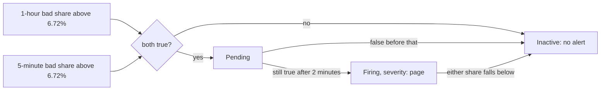

## Bạn cần biết trước

- [[devops.l4.burn-rate]] — bạn biết mức nhanh của `alerts.md`, burn rate 13,44, nghĩa là 6,72% lượt đọc sản phẩm lỗi trong một giờ, còn mức chậm, 5,6 trong 6 giờ, là 2,8%.
- [[devops.l4.recording-rules]] — bạn biết `slo.rules.yml` ghi tỉ lệ xấu của mỗi SLI trong 5 phút, 30 phút, 1 giờ và 6 giờ, như `job:product_reads_bad:ratio_rate5m`.
- [[devops.l2.quality-gate]] — bạn biết quality gate là tập phép kiểm tự động mà một thay đổi phải qua trong CI trước khi đi tiếp.

## Tình huống

Bạn muốn Prometheus gọi người khi lượt đọc sản phẩm, S3, lỗi nhanh hơn mức 6,72% cho phép. Phép kiểm dễ nghĩ ra nhất là đọc một tỉ lệ đã ghi. Chọn tỉ lệ 5 phút thì một lần trục trặc hai phút lúc release, mọi lượt đọc đều lỗi rồi lại ổn, cũng vượt 6,72% và gọi người dậy vô ích. Chọn tỉ lệ 1 giờ thì sau khi sự cố thật đã được sửa, cả giờ đó vẫn còn nhớ nó: phép kiểm đúng thêm nhiều phút trong khi khách đã được phục vụ lại bình thường.

Làm sao để một phép kiểm bỏ qua đợt lỗi ngắn mà vẫn dừng sớm ngay sau khi lỗi dừng, và làm sao biết nó chạy đúng như vậy trước khi có sự cố thật?

## Khái niệm cốt lõi

- **alerting rule** (Rule của Prometheus: khi biểu thức có kết quả đủ lâu (`for`) thì alert chuyển từ pending sang firing) — rule mà Prometheus tính giống một recording rule, nhưng mỗi kết quả của biểu thức là một cảnh báo: pending khi biểu thức còn trả về nó, firing khi biểu thức đã trả về nó suốt khoảng `for` của rule. Khi biểu thức không trả về nó nữa, cảnh báo biến mất (inactive): cảnh báo đang pending bị bỏ, cảnh báo đang firing được coi là resolved.
- Cửa sổ dài và cửa sổ ngắn (từ thông thường) — hai khoảng thời gian mà một cảnh báo đọc cùng lúc: 1 giờ và 5 phút cho mức nhanh, 6 giờ và 30 phút cho mức chậm.
- Label mức độ (từ thông thường) — label `severity` mà rule gắn vào cảnh báo, `page` hoặc `ticket`. `alerts.md` quy định `page` gọi ngay người đang trực, còn `ticket` thành một việc để xử lý trong giờ làm.
- Test cho rule (từ thông thường) — unit test dành cho rule: `promtool`, công cụ đi kèm Prometheus, đưa series giả vào các rule rồi so những cảnh báo đang firing với những cảnh báo mong đợi.

## Cơ chế hoạt động



Trong tình huống trên, phép kiểm bạn cần là một alerting rule. Nó nằm chung nhóm rule với các recording rule và được tính cùng chúng, cứ 15 giây một lần trên staging. Biểu thức của nó nối hai phép so sánh bằng `and`. Một phép so sánh như `> 0.0672` chỉ giữ lại series khi điều kiện còn đúng, nên biểu thức chỉ có kết quả khi cả tỉ lệ 1 giờ lẫn tỉ lệ 5 phút đều trên ngưỡng. Hai series đã ghi mang cùng label `job="api"`, và `and` ghép cặp chúng nhờ label đó.

Lần đầu biểu thức có kết quả, Prometheus tạo cảnh báo ở trạng thái pending. Nếu sau khoảng `for` của rule, ở đây là 2 phút, kết quả vẫn còn, cảnh báo chuyển sang firing. Nếu kết quả mất trước lúc đó, cảnh báo bị bỏ, và lần sau 2 phút lại đếm từ đầu.

Mỗi cửa sổ bù cho điểm yếu của cửa sổ kia. Một đợt lỗi hai phút đẩy tỉ lệ 5 phút lên, nhưng thêm quá ít lượt đọc lỗi để kéo tỉ lệ 1 giờ vượt 6,72%, nên `and` không trả về gì. Khi lỗi dừng sau một sự cố dài, tỉ lệ 1 giờ còn cao một lúc, nhưng tỉ lệ 5 phút tụt xuống trong vòng 5 phút. Kết quả biến mất và cảnh báo resolved.

Prometheus chỉ giữ trạng thái của cảnh báo. Ở tag này, trên staging chưa có gì gửi tin cho ai. Ai nhận một `page`, nhận bằng cách nào, là chủ đề của một bài sau.

## Trong hệ thống Đơn Hàng

Hai alerting rule cho S3, nằm sau bốn recording rule của nó:

```yaml file=deploy/gitops/config-repo/platform/monitoring/rules/slo.rules.yml tag=stage-4 lines=22-41
      # lesson: devops.l4.burn-rate-alerts
      # Fast burn: the 1-hour and the 5-minute bad share both above 13.44
      # times the 0.5% S3's SLO allows (6.72%), for 2 minutes: a person now.
      - alert: ProductReadsFastBurn
        expr: job:product_reads_bad:ratio_rate1h > (13.44 * 0.005) and job:product_reads_bad:ratio_rate5m > (13.44 * 0.005)
        for: 2m
        labels:
          severity: page
        annotations:
          summary: Product reads fail fast enough to spend 2% of S3's 28-day error budget in an hour
          runbook: docs/runbooks/product-reads-burn.md
      # Slow burn: the 6-hour and the 30-minute share above 5.6 times 0.5%
      # (2.8%), for 15 minutes: a ticket for working hours.
      - alert: ProductReadsSlowBurn
        expr: job:product_reads_bad:ratio_rate6h > (5.6 * 0.005) and job:product_reads_bad:ratio_rate30m > (5.6 * 0.005)
        for: 15m
        labels:
          severity: ticket
        annotations:
          summary: Product reads spend S3's error budget faster than it lasts (5% in 6 hours)
```

Dòng 25 đặt tên cảnh báo bằng `alert`, ở chỗ recording rule dùng `record`. Dòng 26 là mức nhanh: cả hai tỉ lệ trên `13.44 * 0.005`, tức burn rate nhân tỉ lệ cho phép của S3. Dòng 27 đòi điều kiện giữ 2 phút. Dòng 28–29 gắn label `severity: page`. Bản thân Prometheus không gán ý nghĩa gì cho giá trị này, tài liệu của đội mới gán. Dòng 30–32 là annotation, phần chữ đi kèm cảnh báo: một câu tóm tắt và đường dẫn tới file ghi các bước xử lý đầu tiên cho cảnh báo này.

Dòng 35–41 là mức chậm: tỉ lệ 6 giờ và tỉ lệ 30 phút trên 2,8%, giữ 15 phút, gắn label `ticket`. File có cùng cặp alerting rule đó cho S1, S2 và S4, ba SLI còn lại của `slo.md`, mỗi cặp với tỉ lệ cho phép của SLI mình, tổng cộng tám alerting rule.

Ghép một cửa sổ dài với một cửa sổ ngắn cho mỗi mức là theo cách tiếp cận nhiều cửa sổ, nhiều burn rate (multi-window, multi-burn-rate) của Site Reliability Workbook, một cuốn sách về vận hành dịch vụ production. Mức nào gọi người là lựa chọn riêng của Đơn Hàng: ví dụ trong Workbook gọi người cả ở mức 6 giờ, còn `alerts.md` để mức đó cho giờ làm.

Một trong bốn test của `slo.test.yml`:

```yaml file=deploy/gitops/config-repo/platform/monitoring/rules/slo.test.yml tag=stage-4 lines=30-46
  # lesson: devops.l4.burn-rate-alerts
  # A spike: every read fails for two minutes, among an hour of good ones.
  # The 5-minute share jumps, but the 1-hour share stays below 6.72%.
  - name: a two-minute spike does not page
    interval: 1m
    input_series:
      - series: 'http_requests_received_total{job="api", app="api", method="GET", endpoint="api/v1/products", code="200"}'
        values: '0+100x60 6000 6000 6000+100x60'
      - series: 'http_requests_received_total{job="api", app="api", method="GET", endpoint="api/v1/products", code="503"}'
        values: '0x60 100 200 200x60'
    alert_rule_test:
      - eval_time: 64m
        alertname: ProductReadsFastBurn
        exp_alerts: []
      - eval_time: 70m
        alertname: ProductReadsFastBurn
        exp_alerts: []
```

Dòng 35–39 là đầu vào: hai counter của series thô mà các recording rule đọc, mỗi phút một mẫu (dòng 34). `0+100x60` bắt đầu từ 0 và cộng thêm 100 ở mỗi mẫu trong 60 mẫu kế tiếp. `0x60` lặp lại 0. Vậy suốt một giờ, mỗi phút 100 lượt đọc thành công và không lượt nào lỗi. Sau đó hai phút không lượt đọc nào thành công và 200 lượt lỗi, rồi phút kế tiếp không có lượt đọc nào.

Dòng 40–46 là các phép kiểm. Ở phút 64, tỉ lệ 5 phút vượt xa 6,72%, nhưng 200 lượt lỗi trong khoảng 5.900 lượt đọc giữ tỉ lệ 1 giờ quanh 3,4%, nên `ProductReadsFastBurn` không được firing. Phút 64 chừa đủ 2 phút của rule trôi qua sau khi đợt lỗi bắt đầu. Phút 70 kiểm lại khi đợt lỗi đã ra khỏi cửa sổ 5 phút. `exp_alerts: []` nghĩa là ở phút đó không được có cảnh báo `ProductReadsFastBurn` nào đang firing. Nếu có, test thất bại.

Ngoài đoạn trích này, các test khác trong file phủ ba trường hợp: 10% lỗi đều đặn phải gọi người, 3% đều đặn chỉ mở ticket, và lỗi dừng ở phút 60, sau đó cảnh báo phải resolved trước phút 65 dù tỉ lệ 1 giờ vẫn trên 6,72%.

`scripts/devops/alert-rules-test.sh` chạy `promtool check rules slo.rules.yml`, lệnh kiểm file parse được và mọi biểu thức đều hợp lệ, rồi chạy `promtool test rules slo.test.yml`. Script chạy `promtool` từ chính image Prometheus mà staging dùng, nên không phải cài gì. Phần đầu script ghi rằng job `manifests` của CI chạy cùng script này, nên một thay đổi rule làm hỏng một trong các trường hợp trên sẽ thất bại trong CI trước khi staging nạp nó.

## Đánh đổi

Cảnh báo nhanh đọc cửa sổ nào:

| | Chỉ tỉ lệ 5 phút | Chỉ tỉ lệ 1 giờ | Tỉ lệ 1 giờ và 5 phút cùng lúc |
|---|---|---|---|
| Firing khi có đợt lỗi hai phút | Có | Không | Không |
| Resolved sớm sau khi lỗi dừng | Có | Không, cả giờ vẫn nhớ lỗi | Có, cửa sổ ngắn tụt xuống trước |
| Firing khi tiêu đều trên ngưỡng | Có | Có | Có |
| Hợp khi | Mọi lỗi ngắn đều phải được thấy, trên dashboard chứ không qua cuộc gọi | Một ticket có thể mở một thời gian | Có người bị gọi, và chỉ nên gọi khi tình hình còn tệ |

Đơn Hàng chọn cột thứ ba ở cả hai mức.

Còn mức nào gọi người:

| | Cả hai mức đều `page` | Mức nhanh `page`, mức chậm `ticket` |
|---|---|---|
| Rò rỉ chậm lúc nửa đêm | Đánh thức một người | Đợi tới giờ làm, trong lúc đó tiêu thêm budget |
| Cuộc gọi không cần xử lý ngay | Nhiều hơn | Ít hơn |
| Hợp khi | Budget nhỏ, hoặc vài giờ tiêu chậm đã gây hại | Tiêu 5% trong 6 giờ có thể đợi tới sáng, như `alerts.md` đã quyết |

## Bạn sẽ chọn gì nếu…

- …một đồng đội đề xuất `for: 0m` cho cảnh báo nhanh để gọi sớm hơn: giữ `for: 2m` nếu một đợt lỗi ngắn không bao giờ được gọi ai, vì cửa sổ 1 giờ đã lọc đợt lỗi ngắn, còn 2 phút đòi cùng một kết quả qua nhiều lần tính liên tiếp. Bỏ nó khi mỗi phút sập hoàn toàn đáng giá hơn thỉnh thoảng một cuộc gọi vô ích.
- …đội hạ ngưỡng nhanh xuống dưới 3%: hãy chờ `alert-rules-test.sh` thất bại, vì test rò rỉ chậm mong không có cảnh báo nhanh ở mức 3%. Chỉ sửa test nếu hành vi mới đúng là điều bạn muốn. Test thất bại chính là mục đích.
- …cảnh báo tiêu chậm của S3 cần gọi người cả ban đêm, như ví dụ trong Workbook: đổi `severity` của nó thành `page`, thêm annotation trỏ tới file các bước đầu tiên, và sửa label cùng annotation mong đợi trong test rò rỉ chậm cho khớp, chấp nhận nhiều cuộc gọi ban đêm hơn.

## Senior hay nhầm rằng…

- **"Cảnh báo nên firing ngay từ request lỗi đầu tiên, để biết vấn đề sớm nhất có thể."** → Thực ra một đợt lỗi ngắn gần như không tiêu error budget, và cảnh báo firing với mọi đợt lỗi ngắn sẽ gọi người vì nó. Bạn sẽ nhận ra khi 200 lượt lỗi trong một giờ của test đợt lỗi ngắn chỉ đưa tỉ lệ 1 giờ lên khoảng 3,4%, còn xa mới tới 6,72%.
- **"Cửa sổ càng dài càng tốt, vì chính xác hơn."** → Thực ra cửa sổ dài tăng chậm và quên cũng chậm: sau khi lỗi dừng, tỉ lệ 1 giờ còn trên ngưỡng thêm nhiều phút. Bạn sẽ nhận ra ở test cuối của `slo.test.yml`: ở phút 65, tỉ lệ 1 giờ vẫn trên 6,72% mà cảnh báo đã resolved.
- **"Chỉ có cách đợi một sự cố thật mới biết cảnh báo có chạy đúng không."** → Thực ra `promtool test rules` đưa series giả vào các rule và kiểm cảnh báo nào firing ở phút nào, ngay trên máy bạn và trong CI. Bạn sẽ nhận ra khi một thay đổi ngưỡng hay khoảng `for` làm job `manifests` thất bại, trước khi Prometheus trên staging nạp nó.

## Thử ngay (3 phút)

1. Trong `examples/don-hang` ở `stage-4`, bật Docker rồi chạy `scripts/devops/alert-rules-test.sh`.
2. Ở dòng 26 của `deploy/gitops/config-repo/platform/monitoring/rules/slo.rules.yml`, thay cả hai số `13.44` bằng `5`, chạy lại script, rồi hoàn tác bằng `git checkout -- deploy/gitops/config-repo/platform/monitoring/rules/slo.rules.yml`.

Kết quả mong đợi: lần chạy đầu in `SUCCESS: 24 rules found` rồi `SUCCESS` cho phần test. Lần chạy thứ hai vẫn tìm thấy 24 rule nhưng test thất bại ở những trường hợp mong không có cảnh báo `ProductReadsFastBurn`.

<details><summary>Gợi ý đáp án</summary>

24 rule gồm 16 recording rule và 8 alerting rule. Với hệ số 5, ngưỡng nhanh là `5 * 0.005`, tức 2,5%. Tỉ lệ 1 giờ của test đợt lỗi ngắn, khoảng 3,4%, giờ đã vượt ngưỡng đó, và mức 3% đều đặn của test rò rỉ chậm cũng vậy, nên `ProductReadsFastBurn` firing ở chỗ cả hai test mong không có cảnh báo nào. Các rule vẫn hợp lệ, nên `check rules` vẫn qua. Chỉ phần test mới biết cảnh báo phải hành xử thế nào.

</details>

## Liên hệ

- [[devops.l4.burn-rate]] — nguồn của 13,44 và 5,6. Bài này biến chúng thành phép kiểm mà Prometheus chạy.
- [[devops.l4.recording-rules]] — các tỉ lệ đã ghi mà mọi alerting rule ở đây đọc, trong cùng nhóm rule.
- [[devops.l4.alerting-on-symptoms]] — các cảnh báo theo triệu chứng mà `alerts.md` liệt kê. Các rule này là phần hiện thực của chúng.
- [[devops.l2.quality-gate]] — test cho rule gia nhập các phép kiểm mà một thay đổi phải qua trước khi đi tiếp.
- [[design.l4.fitness-functions]] — cùng ý tưởng, áp cho cảnh báo: một phép kiểm tự động, chạy với mỗi thay đổi, rằng các rule vẫn hành xử như đã quyết.
- [[devops.l4.progressive-delivery]] — lượt đọc lỗi của canary được tính vào cùng các tỉ lệ này, nên một canary bị dừng sớm có thể không bao giờ chạm ngưỡng nhanh.
- [[devops.l4.on-call]] — bước kế tiếp: ai trả lời một `severity: page`, và còn thiếu gì để gọi được họ.

## Tóm tắt 5 dòng

1. Cảnh báo theo burn rate chỉ firing khi cả cửa sổ dài lẫn cửa sổ ngắn đều trên ngưỡng, suốt khoảng `for` của rule.
2. Kết quả của alerting rule là cảnh báo: lúc đầu pending, firing khi giữ đủ `for`, resolved khi biểu thức không trả về gì.
3. Cửa sổ dài bỏ qua đợt lỗi ngắn. Cửa sổ ngắn cho cảnh báo resolved trong vài phút sau khi lỗi dừng.
4. Đơn Hàng gắn `severity: page` cho cảnh báo 1 giờ và 5 phút, `severity: ticket` cho cảnh báo 6 giờ và 30 phút, đó là lựa chọn riêng của dự án.
5. Trong CI, `promtool test rules` đưa series giả vào: tiêu đều phải gọi người, đợt lỗi ngắn thì không, rò rỉ chậm chỉ mở ticket.
