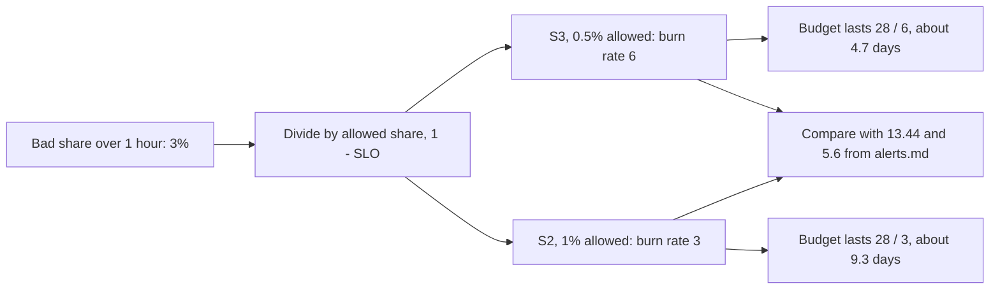

## Before you start

- [[devops.l4.recording-rules]] — you know `slo.rules.yml` records each SLI's bad share over 5 minutes, 30 minutes, 1 hour and 6 hours, such as `job:product_reads_bad:ratio_rate1h`.
- [[backend.l4.error-budget]] — you know the error budget is the share of requests an SLO allows to be bad over its window, 1 minus the target.
- [[backend.l4.service-level-objectives]] — you know `slo.md` sets a target below 100% for each SLI over a rolling 28-day window.

## The situation

You open staging's Prometheus and ask for two recorded series. Suppose `job:product_reads_bad:ratio_rate1h` reads `0.03`: 3% of product reads failed in the last hour. `job:order_placement_slow:ratio_rate1h` also reads `0.03`: 3% of order placements were too slow.

Both are small numbers. Most customers were served. Yet `slo.md` allows product reads only 0.5% bad over 28 days, and slow order placements 1%. The same 3% sits against two different allowances. Should either worry you, and does it worry you equally for both?

How do you tell how fast each SLI is spending its budget, on one scale that means the same for every SLI?

## Core concepts

- **burn rate** — the bad share of an SLI over some period divided by the share its SLO allows to be bad; at a burn rate of 1 the error budget runs out exactly at the end of the SLO's window.
- Bad share (plain words) — the share of requests an SLI counts as bad over a period, 1 minus the SLI; a recorded series such as `job:product_reads_bad:ratio_rate1h` holds it.
- Allowed share (plain words) — 1 minus the SLO: 0.5% for S1 and S3, 1% for S2 and S4 (S1 failed order placements, S2 slow order placements, S3 failed product reads, S4 slow refund requests).
- SLO window (plain words) — the period the SLO is measured over, 28 days for Đơn Hàng, which is 672 hours.
- Threshold (plain words) — the burn rate above which someone should look, written out as a bad share for each SLI; the team chooses its thresholds in `docs/design/alerts.md`, the document deciding when an alert should call someone.

## How it works



In the situation above, both SLIs show a bad share of 3% over the last hour. Burn rate divides that share by what the SLO allows. Product reads, S3, may be 0.5% bad, so 3% is a burn rate of 6. Slow order placements, S2, may be 1% bad, so the same 3% is a burn rate of 3.

A burn rate is a speed. At a burn rate of 1, the budget lasts exactly the 28 days of the window. At 2, it lasts half as long, 14 days. In general it lasts 28 days divided by the burn rate: about 4.7 days for S3 here, about 9.3 for S2. One hour at burn rate `b` spends `b / 672` of the budget, because the window has 672 hours.

The calculation also runs the other way. `alerts.md` starts from how much budget it is willing to see spent. Spending 2% of the budget in one hour means `0.02 × 672`, a burn rate of 13.44. The slow level, 5% of the budget in 6 hours, is `0.05 × 672 / 6`, a burn rate of 5.6. To turn a burn rate into a bad share for one SLI, multiply by its allowed share: for S3, `13.44 × 0.5%` is about 6.7% of product reads failing over the hour.

The `b / 672` conversion assumes requests arrive evenly over the window. 0.5% of all requests in 28 days is a fixed number of bad requests; an hour with more requests uses more of that number at the same bad share. So a bad hour at the busiest time spends more than the same bad share at night.

Neither burn rate reaches the fast threshold, 13.44. S3's 6 is above the slow one, 5.6, but that threshold is about 6 hours, not one; the next section shows why it exists.

## In the Đơn Hàng system

The burn rate section of `alerts.md`:

```markdown file=docs/design/alerts.md tag=stage-4 lines=25-43
### Burn rate

Burn rate là phần request xấu chia cho phần SLO cho phép xấu (1 − SLO). Burn
rate 1 tiêu hết error budget đúng vào cuối cửa sổ của SLO.

Cửa sổ SLO của Đơn Hàng là 28 ngày, tức 672 giờ. Hai mức đội chọn:

- Nhanh: tiêu 2% budget trong 1 giờ. Burn rate = 0,02 × 672 / 1 = 13,44. Giữ
  tốc độ này, budget 28 ngày hết trong khoảng 50 giờ.
- Chậm: tiêu 5% budget trong 6 giờ. Burn rate = 0,05 × 672 / 6 = 5,6. Giữ tốc
  độ này, budget hết trong 5 ngày.

Đây là lựa chọn của dự án, tính lại cho cửa sổ 28 ngày, không phải chuẩn
chung. Ngưỡng của một SLI là burn rate × (1 − SLO), ví dụ S3 (SLO 99,5%):
13,44 × 0,5% ≈ 6,7% request đọc sản phẩm lỗi.

Mỗi mức xét hai cửa sổ cùng lúc. Cửa sổ dài (1 giờ, 6 giờ) bỏ qua một đợt lỗi
ngắn; cửa sổ ngắn (5 phút, 30 phút) làm alert hết sớm sau khi lỗi dừng, thay vì
đợi cửa sổ dài trôi qua.
```

Lines 27–28 define burn rate as the bad share divided by `1 − SLO`, and say a burn rate of 1 spends the budget exactly by the window's end. Line 30 fixes the window at 28 days, 672 hours.

Lines 32–35 are the two levels the team picked. The fast one, 2% of the budget in 1 hour, is a burn rate of 13.44; the slow one, 5% in 6 hours, is 5.6, which empties the budget in 5 days. The same formula works for any period: the share of budget, times 672, divided by the hours.

Lines 37–39 say these numbers are the project's choice for a 28-day window, not a general standard, and show how a burn rate becomes a bad share for one SLI. Lines 41–43 mention a long and a short window for each level; why the short one is needed is the subject of the next lesson.

The two allowances the thresholds are multiplied by:

```markdown file=docs/design/slo.md tag=stage-4 lines=58-67
### SLO

Cửa sổ: 28 ngày trượt, để mỗi cửa sổ có cùng số ngày cuối tuần.

| SLI | SLO | Nguồn |
|---|---|---|
| S1 | 99,5% | Cửa hàng bán được hàng; SLA với cửa hàng ở mục dưới |
| S2 | 99% | CH-3 trong `docs/team/multi-shop-requirements.md`: ngày đông của một cửa hàng không làm chậm cửa hàng khác |
| S3 | 99,5% | CH-3, như S2 |
| S4 | 99% | YC-7 trong `docs/team/refund-requirements.md` |
```

Line 60 is the rolling 28-day window behind the 672 hours. Lines 64–67 give two SLOs, 99.5% for S1 and S3 and 99% for S2 and S4, so two allowed shares, 0.5% and 1%. A bad share of 1% is therefore a burn rate of 2 for S1 or S3 but 1 for S2 or S4.

Multiply the fast burn rate by each allowed share: 13.44 becomes 6.72% bad for S1 and S3, and 13.44% for S2 and S4. Every SLI is judged by the same burn rate, each at its own bad share.

A low burn rate that lasts can matter as much as a short high one. A burn rate of 6 never reaches the fast threshold of 13.44, yet in 6 hours it spends `6 × 6 / 672`, about 5.4% of the budget, more than an hour at 13.44 does. This is what the two levels of `alerts.md` cover between them: the fast one, 13.44, catches a sudden failure; the slow one, 5.6 over 6 hours, catches a burn rate like this 6 that lasts.

## Trade-offs

What to compare a bad share with:

| | One fixed bad share for every SLI, such as 5% | Burn rate, the bad share divided by `1 − SLO` |
|---|---|---|
| Same urgency across SLIs with different SLOs | No: 5% is ten times S3's allowance, five times S2's | Yes: 13.44 means 2% of any SLI's budget in an hour |
| Says how long the budget lasts | No | Yes: the window divided by the burn rate |
| Changes when an SLO changes | No, so it silently drifts out of line | Yes: the threshold as a bad share is recomputed from the new SLO |
| Easy to read on a graph at a glance | Yes, a plain percentage | Needs the division, or the threshold written as a percentage, as `alerts.md` does |
| Fits when | There is one SLI, or every SLO is the same | Several SLIs have different SLOs, as S1–S4 do |

Đơn Hàng takes the second column and writes each threshold out as a bad share, so a graph can still be read as a percentage.

## What would you choose if…

- …`slo.md` raised S3's SLO from 99.5% to 99.9%: keep the burn rates 13.44 and 5.6, and recompute the bad shares with an allowed share of 0.1%, so about 1.3% failing over an hour would cross the fast threshold.
- …the SLO window became 30 days, 720 hours: recompute the burn rates from the same choices; 2% of the budget in an hour is then `0.02 × 720`, 14.4. The thresholds belong to the window they were computed for.
- …a product manager asks whether 3% failing product reads last night was serious: answer with the burn rate, 6, and what it means, the 28-day budget gone in under five days if it had lasted, rather than with the 3% alone.

## Seniors often assume…

- **"Any error at all means the budget is burning too fast."** → Actually the budget exists to be spent; only a burn rate above 1, kept up, spends it before the window ends. A bad share of 0.3% for S3 is a burn rate of 0.6, which leaves budget at the end of the 28 days. You notice this when a few failed reads show on a dashboard and the SLI over the 28-day window stays above its SLO.
- **"A burn rate of 1 means the whole error budget is already gone."** → Actually a burn rate is a speed, not an amount: at 1, the budget runs out exactly at the end of the 28-day window, if that speed lasts the whole window. You notice this when the burn rate reads 1 for an hour and the budget has dropped by only 1/672.
- **"The same error percentage should trigger the same alert for every SLI."** → Actually 1% bad is a burn rate of 2 for S3, whose SLO is 99.5%, but 1 for S2, whose SLO is 99%. A fixed percentage means a different burn rate for each SLO, so it cannot be right for S1–S4 at once: set to suit S2 and S4, it fires too late for S1 and S3; set to suit S1 and S3, it fires too early for S2 and S4. You notice this in `alerts.md`, where the fast threshold is 6.72% for S1 and S3 but 13.44% for S2 and S4.

## Try it (3 minutes)

1. Suppose that over the last hour 8% of refund requests (S4, SLO 99%) were slower than S4's time limit, and 8% of order placements (S1, SLO 99.5%) failed.
2. For each, compute the burn rate, how many days the 28-day budget would last at that speed, and whether it is above the fast threshold of 13.44. Then check your answer against the thresholds `alerts.md` writes out for S1 and S4.

Expected result: two burn rates that differ by a factor of two for the same 8%, only one of them above 13.44.

<details><summary>Suggested answer</summary>

S4: 8% divided by 1% is a burn rate of 8. The budget would last 28 / 8, 3.5 days. 8 is below 13.44, and 8% is below S4's fast threshold of 13.44%.

S1: 8% divided by 0.5% is a burn rate of 16. The budget would last 28 / 16, 1.75 days. 16 is above 13.44, and 8% is above S1's fast threshold of 6.72%.

Both are above the slow threshold of 5.6, so both would matter if they lasted six hours.

</details>

## Connections

- [[backend.l4.error-budget]] — the amount burn rate measures the speed of spending.
- [[backend.l4.service-level-objectives]] — the targets whose allowed shares burn rate divides by.
- [[devops.l4.recording-rules]] — the recorded bad shares, the numerators of every burn rate here.
- [[backend.l4.service-level-indicators]] — the SLIs S1–S4 whose bad shares these are.
- [[devops.l4.progressive-delivery]] — a stopped canary step limits how much budget a bad release spends; burn rate is how that spending shows on the shared SLI.
- [[devops.l4.burn-rate-alerts]] — the next step: turning the thresholds 13.44 and 5.6 into checks Prometheus runs, each with a long and a short window.

## Five-line summary

1. Burn rate is the bad share divided by the share the SLO allows; at 1 the budget runs out exactly at the window's end.
2. The budget lasts the window divided by the burn rate: with 672 hours, burn rate 2 lasts 14 days, and 13.44 spends 2% per hour.
3. A burn rate becomes a bad share by multiplying by `1 − SLO`: for S3, 13.44 × 0.5% is about 6.7% failing.
4. The same bad share is a different burn rate per SLO: 1% bad is 2 against 99.5%, 1 against 99%.
5. `alerts.md` sets 13.44 over 1 hour for sudden failures and 5.6 over 6 hours for lasting lower burns; both are its choice for 28 days.
