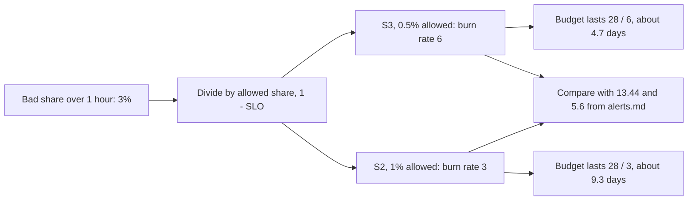

## Bạn cần biết trước

- [[devops.l4.recording-rules]] — bạn biết `slo.rules.yml` ghi tỉ lệ xấu của mỗi SLI trong 5 phút, 30 phút, 1 giờ và 6 giờ, như `job:product_reads_bad:ratio_rate1h`.
- [[backend.l4.error-budget]] — bạn biết error budget là tỉ lệ request mà SLO cho phép xấu trong cửa sổ của nó, bằng 1 trừ mục tiêu.
- [[backend.l4.service-level-objectives]] — bạn biết `slo.md` đặt cho mỗi SLI một mục tiêu dưới 100%, trên cửa sổ 28 ngày trượt.

## Tình huống

Bạn mở Prometheus của staging và hỏi hai series đã ghi. Giả sử `job:product_reads_bad:ratio_rate1h` đọc ra `0.03`: 3% lượt đọc sản phẩm lỗi trong giờ vừa qua. `job:order_placement_slow:ratio_rate1h` cũng ra `0.03`: 3% lượt đặt hàng quá chậm.

Cả hai đều là số nhỏ. Phần lớn khách vẫn được phục vụ. Nhưng `slo.md` chỉ cho lượt đọc sản phẩm xấu 0,5% trong 28 ngày, còn lượt đặt hàng chậm là 1%. Cùng con số 3% đứng trước hai mức cho phép khác nhau. Bạn có nên lo về cái nào không, và lo như nhau cho cả hai không?

Làm sao biết mỗi SLI đang tiêu budget nhanh tới đâu, trên một thang đo mang cùng ý nghĩa cho mọi SLI?

## Khái niệm cốt lõi

- **burn rate** (Tỉ lệ request xấu chia cho tỉ lệ SLO cho phép; bằng 1 thì error budget hết đúng cuối cửa sổ) — tỉ lệ xấu của một SLI trong một khoảng thời gian chia cho tỉ lệ mà SLO của nó cho phép xấu. Burn rate bằng 1 thì error budget hết đúng vào cuối cửa sổ của SLO.
- Tỉ lệ xấu (từ thông thường) — tỉ lệ request mà một SLI tính là xấu trong một khoảng thời gian, bằng 1 trừ SLI. Một series đã ghi như `job:product_reads_bad:ratio_rate1h` chứa con số này.
- Tỉ lệ cho phép (từ thông thường) — 1 trừ SLO: 0,5% cho S1 và S3, 1% cho S2 và S4 (S1 là lượt đặt hàng lỗi, S2 lượt đặt hàng chậm, S3 lượt đọc sản phẩm lỗi, S4 yêu cầu hoàn tiền chậm).
- Cửa sổ SLO (từ thông thường) — khoảng thời gian mà SLO được đo trên đó, với Đơn Hàng là 28 ngày, tức 672 giờ.
- Ngưỡng (từ thông thường) — mức burn rate mà vượt qua thì cần có người nhìn vào, được viết ra thành tỉ lệ xấu cho từng SLI. Đội chọn ngưỡng trong `docs/design/alerts.md`, tài liệu quyết định khi nào một cảnh báo phải gọi người.

## Cơ chế hoạt động



Trong tình huống trên, cả hai SLI có tỉ lệ xấu 3% trong giờ vừa qua. Burn rate lấy tỉ lệ đó chia cho mức SLO cho phép. Lượt đọc sản phẩm, S3, được phép xấu 0,5%, nên 3% là burn rate 6. Lượt đặt hàng chậm, S2, được phép xấu 1%, nên cùng 3% đó chỉ là burn rate 3.

Burn rate là một tốc độ. Ở burn rate 1, budget dùng được đúng 28 ngày của cửa sổ. Ở 2, nó chỉ dùng được một nửa, 14 ngày. Nói chung, budget dùng được 28 ngày chia cho burn rate: khoảng 4,7 ngày cho S3 ở đây, khoảng 9,3 ngày cho S2. Một giờ ở burn rate `b` tiêu `b / 672` budget, vì cửa sổ có 672 giờ.

Phép tính cũng chạy được theo chiều ngược lại. `alerts.md` bắt đầu từ lượng budget mà đội chấp nhận thấy bị tiêu. Tiêu 2% budget trong một giờ nghĩa là `0.02 × 672`, burn rate 13,44. Mức chậm, 5% budget trong 6 giờ, là `0.05 × 672 / 6`, burn rate 5,6. Muốn đổi burn rate thành tỉ lệ xấu của một SLI, nhân với tỉ lệ cho phép của SLI đó: với S3, `13.44 × 0.5%` là khoảng 6,7% lượt đọc sản phẩm lỗi trong giờ đó.

Phép đổi `b / 672` giả định request đến đều trong suốt cửa sổ. 0,5% của mọi request trong 28 ngày là một số request xấu cố định. Giờ nào nhiều request hơn thì dùng nhiều hơn phần số đó, dù tỉ lệ xấu như nhau. Vì vậy một giờ lỗi vào lúc đông khách nhất tiêu nhiều budget hơn cùng tỉ lệ xấu ấy vào ban đêm.

Không burn rate nào chạm ngưỡng nhanh, 13,44. Con số 6 của S3 vượt ngưỡng chậm, 5,6, nhưng ngưỡng đó tính cho 6 giờ chứ không phải một giờ. Phần tiếp theo cho thấy vì sao cần nó.

## Trong hệ thống Đơn Hàng

Mục burn rate trong `alerts.md`:

```markdown file=docs/design/alerts.md tag=stage-4 lines=25-43
### Burn rate

Burn rate là phần request xấu chia cho phần SLO cho phép xấu (1 − SLO). Burn
rate 1 tiêu hết error budget đúng vào cuối cửa sổ của SLO.

Cửa sổ SLO của Đơn Hàng là 28 ngày, tức 672 giờ. Hai mức đội chọn:

- Nhanh: tiêu 2% budget trong 1 giờ. Burn rate = 0,02 × 672 / 1 = 13,44. Giữ
  tốc độ này, budget 28 ngày hết trong khoảng 50 giờ.
- Chậm: tiêu 5% budget trong 6 giờ. Burn rate = 0,05 × 672 / 6 = 5,6. Giữ tốc
  độ này, budget hết trong 5 ngày.

Đây là lựa chọn của dự án, tính lại cho cửa sổ 28 ngày, không phải chuẩn
chung. Ngưỡng của một SLI là burn rate × (1 − SLO), ví dụ S3 (SLO 99,5%):
13,44 × 0,5% ≈ 6,7% request đọc sản phẩm lỗi.

Mỗi mức xét hai cửa sổ cùng lúc. Cửa sổ dài (1 giờ, 6 giờ) bỏ qua một đợt lỗi
ngắn; cửa sổ ngắn (5 phút, 30 phút) làm alert hết sớm sau khi lỗi dừng, thay vì
đợi cửa sổ dài trôi qua.
```

Dòng 27–28 định nghĩa burn rate là tỉ lệ xấu chia cho `1 − SLO`, và nói burn rate 1 tiêu hết budget đúng vào cuối cửa sổ. Dòng 30 chốt cửa sổ là 28 ngày, 672 giờ.

Dòng 32–35 là hai mức đội đã chọn. Mức nhanh, 2% budget trong 1 giờ, là burn rate 13,44. Mức chậm, 5% trong 6 giờ, là 5,6, đủ làm cạn budget trong 5 ngày. Cùng công thức dùng được cho mọi khoảng thời gian: phần budget, nhân 672, chia cho số giờ.

Dòng 37–39 nói các con số này là lựa chọn của dự án cho cửa sổ 28 ngày, không phải chuẩn chung, và chỉ cách đổi burn rate thành tỉ lệ xấu của một SLI. Dòng 41–43 nhắc tới một cửa sổ dài và một cửa sổ ngắn cho mỗi mức. Vì sao cần cửa sổ ngắn là chủ đề của bài sau.

Hai mức cho phép mà các ngưỡng được nhân với:

```markdown file=docs/design/slo.md tag=stage-4 lines=58-67
### SLO

Cửa sổ: 28 ngày trượt, để mỗi cửa sổ có cùng số ngày cuối tuần.

| SLI | SLO | Nguồn |
|---|---|---|
| S1 | 99,5% | Cửa hàng bán được hàng; SLA với cửa hàng ở mục dưới |
| S2 | 99% | CH-3 trong `docs/team/multi-shop-requirements.md`: ngày đông của một cửa hàng không làm chậm cửa hàng khác |
| S3 | 99,5% | CH-3, như S2 |
| S4 | 99% | YC-7 trong `docs/team/refund-requirements.md` |
```

Dòng 60 là cửa sổ 28 ngày trượt đứng sau con số 672 giờ. Dòng 64–67 cho hai mức SLO, 99,5% cho S1 và S3, 99% cho S2 và S4, tức hai tỉ lệ cho phép, 0,5% và 1%. Vì thế tỉ lệ xấu 1% là burn rate 2 với S1 hay S3, nhưng chỉ là 1 với S2 hay S4.

Nhân burn rate nhanh với từng tỉ lệ cho phép: 13,44 thành 6,72% xấu cho S1 và S3, và 13,44% cho S2 và S4. Mọi SLI được xét theo cùng một burn rate, mỗi SLI ở tỉ lệ xấu riêng của nó.

Một burn rate thấp kéo dài có thể đáng lo ngang một burn rate cao ngắn ngủi. Burn rate 6 không bao giờ chạm ngưỡng nhanh 13,44, vậy mà trong 6 giờ nó tiêu `6 × 6 / 672`, khoảng 5,4% budget, nhiều hơn một giờ ở 13,44. Đây là điều hai mức của `alerts.md` cùng nhau lo: mức nhanh, 13,44, bắt một sự cố đột ngột, còn mức chậm, 5,6 trong 6 giờ, bắt một burn rate kéo dài như con số 6 này.

## Đánh đổi

So tỉ lệ xấu với cái gì:

| | Một tỉ lệ xấu cố định cho mọi SLI, như 5% | Burn rate, tỉ lệ xấu chia cho `1 − SLO` |
|---|---|---|
| Mức khẩn cấp như nhau giữa các SLI có SLO khác nhau | Không: 5% gấp mười lần mức cho phép của S3, gấp năm lần của S2 | Có: 13,44 nghĩa là 2% budget của bất kỳ SLI nào trong một giờ |
| Cho biết budget còn dùng được bao lâu | Không | Có: cửa sổ chia cho burn rate |
| Thay đổi khi SLO đổi | Không, nên lặng lẽ lệch đi | Có: ngưỡng dạng tỉ lệ xấu được tính lại từ SLO mới |
| Dễ đọc nhanh trên đồ thị | Có, một phần trăm bình thường | Cần phép chia, hoặc viết ngưỡng ra thành phần trăm như `alerts.md` làm |
| Hợp khi | Chỉ có một SLI, hoặc mọi SLO như nhau | Nhiều SLI có SLO khác nhau, như S1–S4 |

Đơn Hàng chọn cột thứ hai và viết mỗi ngưỡng ra thành tỉ lệ xấu, để đồ thị vẫn đọc được như phần trăm.

## Bạn sẽ chọn gì nếu…

- …`slo.md` nâng SLO của S3 từ 99,5% lên 99,9%: giữ burn rate 13,44 và 5,6, rồi tính lại tỉ lệ xấu với tỉ lệ cho phép 0,1%. Khi đó chừng 1,3% lỗi trong một giờ là đã vượt ngưỡng nhanh.
- …cửa sổ SLO đổi thành 30 ngày, tức 720 giờ: tính lại burn rate từ cùng những lựa chọn. 2% budget trong một giờ khi đó là `0.02 × 720`, tức 14,4. Ngưỡng thuộc về cửa sổ mà nó được tính cho.
- …một product manager hỏi 3% lượt đọc sản phẩm lỗi đêm qua có nghiêm trọng không: trả lời bằng burn rate, 6, và ý nghĩa của nó, nếu kéo dài thì budget 28 ngày hết trong chưa tới năm ngày, chứ đừng chỉ đưa con số 3%.

## Senior hay nhầm rằng…

- **"Cứ có lỗi là budget đang bị tiêu quá nhanh."** → Thực ra budget có ra là để tiêu. Chỉ burn rate trên 1, giữ lâu, mới tiêu hết nó trước khi cửa sổ kết thúc. Tỉ lệ xấu 0,3% của S3 là burn rate 0,6, cuối 28 ngày vẫn còn budget. Bạn sẽ nhận ra khi dashboard hiện vài lượt đọc lỗi mà SLI trên cửa sổ 28 ngày vẫn trên SLO.
- **"Burn rate bằng 1 nghĩa là error budget đã hết sạch."** → Thực ra burn rate là tốc độ, không phải lượng: ở 1, budget hết đúng cuối cửa sổ 28 ngày, nếu tốc độ đó giữ suốt cửa sổ. Bạn sẽ nhận ra khi burn rate đọc 1 trong một giờ mà budget chỉ giảm 1/672.
- **"Cùng một phần trăm lỗi thì nên kích cùng một cảnh báo cho mọi SLI."** → Thực ra 1% xấu là burn rate 2 với S3, SLO 99,5%, nhưng chỉ là 1 với S2, SLO 99%. Một phần trăm cố định ứng với burn rate khác nhau cho mỗi SLO, nên không thể đúng cho cả S1–S4 cùng lúc. Đặt cho vừa S2 và S4 thì nó báo quá muộn cho S1 và S3, đặt cho vừa S1 và S3 thì nó báo quá sớm cho S2 và S4. Bạn sẽ nhận ra trong `alerts.md`, nơi ngưỡng nhanh là 6,72% cho S1 và S3 nhưng 13,44% cho S2 và S4.

## Thử ngay (3 phút)

1. Giả sử trong giờ vừa qua 8% yêu cầu hoàn tiền (S4, SLO 99%) chậm hơn giới hạn thời gian của S4, và 8% lượt đặt hàng (S1, SLO 99,5%) lỗi.
2. Với mỗi cái, tính burn rate, budget 28 ngày dùng được bao nhiêu ngày ở tốc độ đó, và nó có vượt ngưỡng nhanh 13,44 không. Rồi đối chiếu với ngưỡng mà `alerts.md` viết ra cho S1 và S4.

Kết quả mong đợi: hai burn rate chênh nhau gấp đôi cho cùng 8%, chỉ một trong hai vượt 13,44.

<details><summary>Gợi ý đáp án</summary>

S4: 8% chia 1% là burn rate 8. Budget dùng được 28 / 8, tức 3,5 ngày. 8 dưới 13,44, và 8% dưới ngưỡng nhanh 13,44% của S4.

S1: 8% chia 0,5% là burn rate 16. Budget dùng được 28 / 16, tức 1,75 ngày. 16 trên 13,44, và 8% trên ngưỡng nhanh 6,72% của S1.

Cả hai đều trên ngưỡng chậm 5,6, nên cả hai đều đáng lo nếu kéo dài sáu giờ.

</details>

## Liên hệ

- [[backend.l4.error-budget]] — lượng mà burn rate đo tốc độ tiêu.
- [[backend.l4.service-level-objectives]] — các mục tiêu cho ra tỉ lệ cho phép mà burn rate chia cho.
- [[devops.l4.recording-rules]] — các tỉ lệ xấu đã ghi, tử số của mọi burn rate trong bài.
- [[backend.l4.service-level-indicators]] — các SLI S1–S4 sở hữu những tỉ lệ xấu này.
- [[devops.l4.progressive-delivery]] — một bước canary bị dừng giới hạn lượng budget mà một bản release xấu tiêu. Burn rate là cách lượng tiêu đó hiện ra trên SLI dùng chung.
- [[devops.l4.burn-rate-alerts]] — bước kế tiếp: biến ngưỡng 13,44 và 5,6 thành phép kiểm mà Prometheus chạy, mỗi phép với một cửa sổ dài và một cửa sổ ngắn.

## Tóm tắt 5 dòng

1. Burn rate là tỉ lệ xấu chia cho tỉ lệ SLO cho phép. Ở 1, budget hết đúng vào cuối cửa sổ.
2. Budget dùng được bằng cửa sổ chia cho burn rate: với 672 giờ, burn rate 2 dùng được 14 ngày, còn 13,44 tiêu 2% mỗi giờ.
3. Burn rate thành tỉ lệ xấu khi nhân với `1 − SLO`: với S3, 13,44 × 0,5% là khoảng 6,7% lỗi.
4. Cùng tỉ lệ xấu là burn rate khác nhau theo từng SLO: 1% xấu là 2 với 99,5%, là 1 với 99%.
5. `alerts.md` đặt 13,44 trong 1 giờ cho sự cố đột ngột và 5,6 trong 6 giờ cho burn rate thấp kéo dài. Cả hai là lựa chọn của dự án cho 28 ngày.
