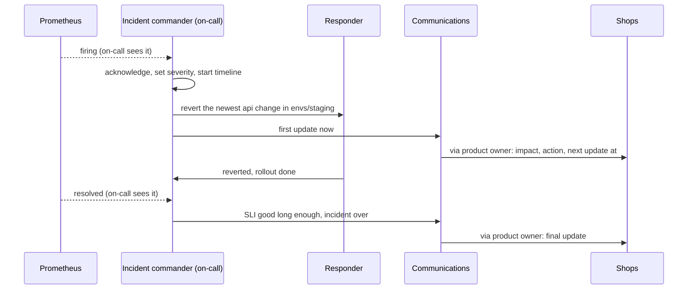

## Before you start

- [[devops.l4.runbooks]] — you know the runbook's first step for `ProductReadsFastBurn` is to revert the newest api change in the config repository, before anyone looks for a cause.
- [[management.l2.stakeholder-communication]] — you know an update to people outside the team is written in their words and says what the team needs from them.

## The situation

Imagine the drill's fault reaching real shops, with `envs/staging` standing in for their environment. `ProductReadsFastBurn` fires and three of you see it at once. You are on-call, so you revert the newest api change in `envs/staging`, as the runbook says. A teammate, without telling you, raises the `catalog-reads` limit on the Deployment with `kubectl`. The product owner, who speaks for the shops, asks in chat what to tell them; someone answers "probably the database".

The alert resolves. Nobody knows which change helped, the guess proves wrong, and an hour later nobody remembers who did what, or when.

When several people respond to one incident, how do they avoid working against each other and keep shops informed without guessing?

## Core concepts

- **incident commander** — the one person who coordinates an incident: decides what is tried next and who does it, keeps the timeline and calls in more people, but does not debug.
- **incident severity** — a level set by the impact on customers, not by the cause, that decides who is called and how often shops hear from the team.
- Responder (plain words) — someone doing the hands-on work the commander assigns: following the runbook, reverting, reading dashboards and logs.
- Communications role (plain words) — the person who writes the updates to shops, sends them through the product owner and answers questions from outside the team.
- Timeline (plain words) — a list kept during the incident of what was seen, decided and done, each line with a time.

## How it works



In the situation above, three people each decided alone. The diagram puts every decision with one person.

The person on-call sees the alert firing, acknowledges it and becomes the incident commander from that moment. The first decision is the severity. It looks only at what customers feel, so it can be set at once, before anyone knows the cause, and it decides who else is called.

The commander then hands out work. The responder runs the runbook's first step. Your teammate's hand edit would now go through the commander, who would see the revert running and say "wait". With one person deciding, two changes to the same Deployment do not land at once, and the team knows which change ended the alert.

In parallel, the communications role sends the first update. It says what shops see, what the team is doing and when the next update comes. It leaves the cause out, because nobody knows it yet; the "probably the database" answer is exactly what it avoids.

The responder tells the commander when the revert is done and the rollout has finished. Every line of this exchange goes into the timeline as it happens, with its time.

When the alert resolves, the commander does not end the incident at once. It ends when the SLI has stayed good for an agreed time (30 minutes in Đơn Hàng, below) with the revert in place. The commander then declares the end, and the communications role sends the final update. The cause may still be unknown, and that is fine: finding it is the work of the written review, built from the timeline.

## In the Đơn Hàng system

`docs/team/incident-response.md` holds the team's rules for an incident; lines 3–7 (not shown) say it was drilled with `incident-drill.sh` and every time in it is an assumption. Lines 11–12 (not shown) say the level follows the impact on customers, not the cause; the person on-call sets it when acknowledging the page and changes it when the impact changes. This level is not the alerting rule's `severity: page` or `severity: ticket` label, which only decides between paging the person on-call now and work for working hours; the label is one input to the level. S1–S4 are Đơn Hàng's four SLIs: orders placed without error, orders placed fast enough, product reads without error, refunds answered in time.

```markdown file=docs/team/incident-response.md tag=stage-4 lines=14-33
| Mức | Khi nào | Gọi ai | Cập nhật cho cửa hàng |
|---|---|---|---|
| SEV1 | Đặt đơn lỗi cho mọi cửa hàng (S1 gần như toàn bộ xấu) | Người trực, trưởng nhóm ngay; product owner để báo cửa hàng | 30 phút một lần |
| SEV2 | Một alert `severity: page` của S2, S3 hay S4 đang firing, hoặc của S1 khi chỉ một phần đơn lỗi | Người trực; thêm người khi cần (`on-call.md`) | 60 phút một lần, khi khách thấy được |
| SEV3 | Một alert `severity: ticket`: budget rò chậm, chưa ai gọi | Không gọi ai; việc trong giờ làm việc | Không gửi |

### Vai trò

- Người chỉ huy sự cố: điều phối. Quyết định thử gì tiếp và ai làm, giữ dòng
  thời gian, gọi thêm người. Người chỉ huy không tự gỡ lỗi; ai vừa chỉ huy vừa
  gỡ lỗi sẽ mất cái nhìn chung.
- Người xử lý: làm theo runbook và theo việc người chỉ huy giao: xác nhận
  alert, revert, xem dashboard và log.
- Người liên lạc: viết cập nhật cho cửa hàng theo mẫu dưới đây, gửi qua product
  owner, trả lời câu hỏi từ ngoài đội để người xử lý không bị cắt ngang.

Người trực giữ vai trò chỉ huy từ lúc xác nhận lần gọi tới khi bàn giao rõ cho
người khác ("từ giờ anh chỉ huy"). Một người quyết định thì hai người không làm
hai thay đổi trái nhau, như một người revert commit trong khi người kia sửa tay
cùng Deployment đó.
```

Lines 14–18 are the three levels: orders failing for every shop is SEV1, any `severity: page` alert of S2, S3 or S4 (or of S1 when only some orders fail) is SEV2, and a `severity: ticket` alert is SEV3. Each row says who is called and how often shops hear: every 30 minutes, every 60 minutes, or never. In the situation, `ProductReadsFastBurn` is a page alert of S3, so SEV2.

Lines 20–28 name the three roles. Lines 30–33 say the person on-call holds the command until handing it over explicitly, in words ("from now on you command"), and name the clash from the situation: one person reverting a commit while another edits the same Deployment by hand.

Lines 35–38, after the excerpt, fit this to a team of four: at SEV2 the person on-call often holds all three roles, and command is split off first when a second person joins. SEV1 always separates at least the commander and a responder.

```markdown file=docs/team/incident-response.md tag=stage-4 lines=40-50
### Cập nhật cho cửa hàng

Mỗi cập nhật nói bằng lời của cửa hàng, có ba phần, và không đoán nguyên nhân:

> Từ [giờ bắt đầu], [điều cửa hàng và khách đang gặp, ví dụ: một phần lượt xem
> danh sách sản phẩm báo lỗi]. Chúng tôi đang [việc đang làm, ví dụ: đưa cấu
> hình về bản trước]. Cập nhật tiếp theo lúc [giờ], sớm hơn nếu có thay đổi.

Nguyên nhân chỉ được nói sau khi đã chắc, thường là trong postmortem. Một
nguyên nhân đoán sai, đã gửi đi, phải rút lại và làm mất lòng tin. Cách viết cập
nhật cho các bên nói chung: `stakeholder-update-example.md`.
```

The template in lines 44–46 has three parts in the shops' words: since when and what shops and their customers see, what the team is doing, and when the next update comes. Lines 48–49 explain the missing cause: it is stated only once certain, usually in the review after the incident, because a wrong cause already sent must be taken back and costs trust.

Lines 52–65 (not shown) cover the timeline. The commander, or someone assigned, writes each thing seen, decided and done, with its time. The example in lines 58–61 follows the drill's fault with assumed times, from the alert firing at 10:02 to the alert gone at 10:15. Lines 64–65 give the reason: memory after an incident is incomplete and out of order, and the written review is built from this list.

Lines 69–71 (not shown) end the incident when the alert has resolved and the SLI has stayed good for 30 minutes (an assumption) with the mitigation in place, not when the cause is known. Lines 73–75 then require a written review for any incident that spent more than a quarter of an SLI's error budget, per `docs/design/slo.md`, within five working days.

## Trade-offs

Who leads when several people respond:

| | One commander, others fix | One person leads and debugs | Everyone fixes, nobody leads |
|---|---|---|---|
| Conflicting changes | Each change goes through one person | Fewer while the lead watches, more once the lead is deep in logs | Likely: two changes land at once |
| Overall picture | Kept by the commander | Lost while debugging | Nobody has it |
| Updates to shops | On schedule, from the communications role | Late or skipped | Whoever answers, often a guess |
| Cost | One person who could debug does not | The best debugger also carries coordination | Nothing up front, much afterwards |
| Fits when | Two or more people respond | Only one person responds, as SEV2 often is in a team of four | Rarely; split command off as soon as a second person joins |

What shops hear before the cause is known:

| | Scheduled update, no cause | Wait until the cause is known | Early guess at the cause |
|---|---|---|---|
| Shops know what is happening | Within minutes, then on a fixed rhythm | Only after hours, perhaps | Within minutes |
| Risk | Low: says only what is observed | Shops call the product owner, or customer care, to ask | A wrong guess must be taken back |
| Fits when | Customers can see the problem (SEV1, SEV2) | Never; at SEV3 shops get nothing at all | Rarely; a cause is stated once certain |

## What would you choose if…

- …`ProductReadsFastBurn` fires at night and only you answer: SEV2, and you hold all three roles. Keep the timeline in short lines as you go, run the runbook, and send an update only if customers can see the problem.
- …orders fail for every shop and the team lead joins you: SEV1. You stay commander unless you hand over explicitly; call a responder rather than debug yourself, and let the team lead or product owner take communications, with an update every 30 minutes.
- …the revert ended the alert ten minutes ago and nobody knows why the change broke reads: keep the incident open until the SLI has stayed good for the agreed time, then declare the end.

## Seniors often assume…

- **"The most senior engineer should lead the incident and fix it at the same time."** → Actually whoever debugs stops seeing who is changing what and which update is due. If the senior engineer wants to debug, they work as a responder while the person on-call commands; if they take command, they stop debugging. You notice this when a second fix lands that nobody approved while the lead reads logs.
- **"Shops should hear from us only once we know the cause."** → Actually shops need to know what they see, what is being done and when they will hear next; the cause can take hours, and a wrong guess must be taken back. You notice this when shops start calling the product owner during the incident to ask whether anyone is working on it.
- **"An incident is over only when we know exactly why it happened."** → Actually the incident ends when the alert has resolved and the SLI stays good with the mitigation in place; the cause is found later, calmly, in the written review. You notice this when the whole team stays on an incident for hours after the revert.

## Try it (3 minutes)

1. Read the drill output in `examples/don-hang/outputs/stage-4/scripts/devops/incident-drill.txt` at `stage-4`, as if shops were affected.
2. Using lines 14–18 of `incident-response.md`, choose the level, who is called and how often shops are updated.
3. Using the template in lines 44–46 and the start time 10:02 from the timeline example in line 58, write the first update to shops in three sentences.

Expected result: SEV2, because `ProductReadsFastBurn` is a `severity: page` alert of S3; the person on-call, plus more people when needed; an update every 60 minutes while customers can see it. The update names a start time, what customers see, the action and the next update time, and no cause.

<details><summary>Suggested answer</summary>

"Since 10:02, part of the product list views fail with an error. We are putting the configuration back to the previous version. Next update at 11:02, earlier if anything changes." The config commit just before the alert stays in the timeline: it is a likely trigger, not a confirmed cause.

</details>

## Connections

- [[devops.l4.runbooks]] — what one responder does; this lesson adds the roles around it.
- [[management.l2.stakeholder-communication]] — the same rule of writing in the reader's words, applied to updates during an incident.
- [[devops.l4.on-call]] — names the person who holds the command first.
- [[backend.l4.error-budget]] — what the incident spends; the share spent decides whether a written review is required.
- [[management.l3.service-level-agreement]] — the contract with shops; this lesson's updates are not its formal notices.
- [[devops.l4.blameless-postmortems]] — the next step: the written review built from the timeline.

## Five-line summary

1. During an incident one person, the incident commander, coordinates what is tried and by whom, while others fix.
2. Severity follows impact on customers, from orders failing for every shop down to a slow budget leak, and decides who is called and how often.
3. The person on-call commands until an explicit handover, so two people never make conflicting changes to the same Deployment.
4. Updates to shops state the impact, the action and the next update time in their words, and leave the cause out.
5. A timeline is kept as it happens, and the incident ends when the SLI stays good with the mitigation in place.
