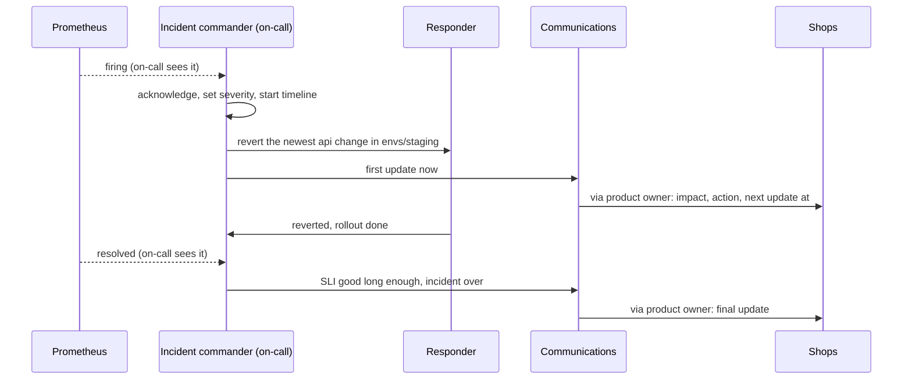

## Bạn cần biết trước

- [[devops.l4.runbooks]] — bạn biết bước đầu tiên của runbook cho `ProductReadsFastBurn` là revert thay đổi mới nhất của api trong repo cấu hình, trước khi ai đó đi tìm nguyên nhân.
- [[management.l2.stakeholder-communication]] — bạn biết một cập nhật gửi cho người ngoài đội phải viết bằng lời của họ, và nói rõ đội cần gì từ họ.

## Tình huống

Hãy hình dung lỗi trong buổi diễn tập chạm tới các cửa hàng thật, với `envs/staging` đóng vai môi trường của họ. `ProductReadsFastBurn` firing và ba người cùng thấy một lúc. Bạn đang trực, nên bạn revert thay đổi mới nhất của api trong `envs/staging`, đúng như runbook ghi. Một đồng nghiệp, không báo bạn, dùng `kubectl` nâng giới hạn `catalog-reads` ngay trên Deployment. Product owner, người thay mặt các cửa hàng, hỏi trong chat nên báo gì với họ. Có người trả lời "chắc là do database".

Cảnh báo hết. Không ai biết thay đổi nào đã giúp, câu đoán hóa ra sai, và một giờ sau không ai nhớ ai đã làm gì, lúc nào.

Khi nhiều người cùng xử lý một sự cố, làm sao để họ không làm ngược nhau, và vẫn báo cho cửa hàng mà không phải đoán?

## Khái niệm cốt lõi

- **người chỉ huy sự cố** (incident commander) — người duy nhất điều phối một sự cố: quyết định thử gì tiếp và ai làm, giữ dòng thời gian và gọi thêm người, nhưng không tự gỡ lỗi.
- **mức nghiêm trọng của sự cố** (incident severity) — một mức xếp theo ảnh hưởng tới khách chứ không theo nguyên nhân, quyết định ai được gọi và bao lâu cửa hàng nghe tin từ đội một lần.
- Người xử lý (từ thông thường) — người trực tiếp làm việc mà người chỉ huy giao: làm theo runbook, revert, đọc dashboard và log.
- Vai trò liên lạc (từ thông thường) — người viết cập nhật cho cửa hàng, gửi qua product owner, và trả lời câu hỏi từ ngoài đội.
- Dòng thời gian (từ thông thường) — danh sách ghi ngay trong lúc sự cố diễn ra: đã thấy gì, đã quyết gì, đã làm gì, mỗi dòng kèm giờ.

## Cơ chế hoạt động



Trong tình huống trên, ba người mỗi người tự quyết một kiểu. Sơ đồ đặt mọi quyết định vào tay một người.

Người trực thấy cảnh báo firing, xác nhận nó, và từ lúc đó trở thành người chỉ huy sự cố. Quyết định đầu tiên là mức nghiêm trọng. Mức này chỉ nhìn vào điều khách cảm thấy, nên đặt được ngay, trước khi ai biết nguyên nhân, và nó quyết định còn ai phải được gọi.

Sau đó người chỉ huy chia việc. Người xử lý chạy bước đầu tiên của runbook. Lần sửa tay của đồng nghiệp bạn giờ phải đi qua người chỉ huy, người thấy lần revert đang chạy và bảo "chờ đã". Khi chỉ một người quyết, hai thay đổi trên cùng một Deployment không rơi xuống cùng lúc, và đội biết thay đổi nào đã làm cảnh báo hết.

Song song, vai trò liên lạc gửi cập nhật đầu tiên. Cập nhật nói cửa hàng đang thấy gì, đội đang làm gì, và khi nào có cập nhật tiếp theo. Nó bỏ nguyên nhân ra ngoài, vì chưa ai biết. Câu "chắc là do database" chính là điều nó tránh.

Người xử lý báo người chỉ huy khi revert xong và rollout đã hoàn tất. Từng dòng trao đổi này được ghi vào dòng thời gian ngay khi xảy ra, kèm giờ.

Khi cảnh báo hết, người chỉ huy chưa kết thúc sự cố ngay. Sự cố kết thúc khi SLI đã tốt trong một khoảng thời gian thống nhất trước (30 phút ở Đơn Hàng, xem bên dưới) với lần revert vẫn giữ nguyên. Lúc đó người chỉ huy tuyên bố kết thúc, và vai trò liên lạc gửi cập nhật cuối. Nguyên nhân có thể vẫn chưa rõ, và điều đó không sao: tìm nguyên nhân là việc của bản xem lại viết sau sự cố, dựng từ dòng thời gian.

## Trong hệ thống Đơn Hàng

`docs/team/incident-response.md` chứa quy tắc của đội khi có sự cố. Dòng 3–7 (không trích) nói file đã được diễn tập bằng `incident-drill.sh` và mọi con số thời gian trong đó đều là giả định. Dòng 11–12 (không trích) nói mức đi theo ảnh hưởng tới khách, không theo nguyên nhân. Người trực đặt mức khi xác nhận lần gọi, và đổi mức khi ảnh hưởng thay đổi. Mức này không phải label `severity: page` hay `severity: ticket` của rule cảnh báo. Label đó chỉ quyết định giữa gọi người trực ngay và để thành việc trong giờ làm, nó là một đầu vào của mức. S1–S4 là bốn SLI của Đơn Hàng: đặt đơn không lỗi, đặt đơn đủ nhanh, đọc sản phẩm không lỗi, trả lời yêu cầu hoàn tiền đúng hạn.

```markdown file=docs/team/incident-response.md tag=stage-4 lines=14-33
| Mức | Khi nào | Gọi ai | Cập nhật cho cửa hàng |
|---|---|---|---|
| SEV1 | Đặt đơn lỗi cho mọi cửa hàng (S1 gần như toàn bộ xấu) | Người trực, trưởng nhóm ngay; product owner để báo cửa hàng | 30 phút một lần |
| SEV2 | Một alert `severity: page` của S2, S3 hay S4 đang firing, hoặc của S1 khi chỉ một phần đơn lỗi | Người trực; thêm người khi cần (`on-call.md`) | 60 phút một lần, khi khách thấy được |
| SEV3 | Một alert `severity: ticket`: budget rò chậm, chưa ai gọi | Không gọi ai; việc trong giờ làm việc | Không gửi |

### Vai trò

- Người chỉ huy sự cố: điều phối. Quyết định thử gì tiếp và ai làm, giữ dòng
  thời gian, gọi thêm người. Người chỉ huy không tự gỡ lỗi; ai vừa chỉ huy vừa
  gỡ lỗi sẽ mất cái nhìn chung.
- Người xử lý: làm theo runbook và theo việc người chỉ huy giao: xác nhận
  alert, revert, xem dashboard và log.
- Người liên lạc: viết cập nhật cho cửa hàng theo mẫu dưới đây, gửi qua product
  owner, trả lời câu hỏi từ ngoài đội để người xử lý không bị cắt ngang.

Người trực giữ vai trò chỉ huy từ lúc xác nhận lần gọi tới khi bàn giao rõ cho
người khác ("từ giờ anh chỉ huy"). Một người quyết định thì hai người không làm
hai thay đổi trái nhau, như một người revert commit trong khi người kia sửa tay
cùng Deployment đó.
```

Dòng 14–18 là ba mức: đặt đơn lỗi với mọi cửa hàng là SEV1, bất kỳ cảnh báo `severity: page` nào của S2, S3 hay S4 (hoặc của S1 khi chỉ một phần đơn lỗi) là SEV2, và một cảnh báo `severity: ticket` là SEV3. Mỗi dòng nói ai được gọi và bao lâu cửa hàng nghe tin một lần: 30 phút, 60 phút, hoặc không bao giờ. Trong tình huống, `ProductReadsFastBurn` là cảnh báo page của S3, nên là SEV2.

Dòng 20–28 đặt tên ba vai trò. Dòng 30–33 nói người trực giữ quyền chỉ huy tới khi bàn giao rõ ràng bằng lời ("từ giờ anh chỉ huy"), và gọi đúng tên xung đột trong tình huống: một người revert commit trong khi người kia sửa tay cùng Deployment đó.

Dòng 35–38, sau đoạn trích, áp điều này vào một đội bốn người: ở SEV2, người trực thường giữ cả ba vai trò, và khi có người thứ hai tham gia thì vai chỉ huy được tách ra trước. SEV1 luôn tách ít nhất người chỉ huy và một người xử lý.

```markdown file=docs/team/incident-response.md tag=stage-4 lines=40-50
### Cập nhật cho cửa hàng

Mỗi cập nhật nói bằng lời của cửa hàng, có ba phần, và không đoán nguyên nhân:

> Từ [giờ bắt đầu], [điều cửa hàng và khách đang gặp, ví dụ: một phần lượt xem
> danh sách sản phẩm báo lỗi]. Chúng tôi đang [việc đang làm, ví dụ: đưa cấu
> hình về bản trước]. Cập nhật tiếp theo lúc [giờ], sớm hơn nếu có thay đổi.

Nguyên nhân chỉ được nói sau khi đã chắc, thường là trong postmortem. Một
nguyên nhân đoán sai, đã gửi đi, phải rút lại và làm mất lòng tin. Cách viết cập
nhật cho các bên nói chung: `stakeholder-update-example.md`.
```

Mẫu ở dòng 44–46 có ba phần, viết bằng lời của cửa hàng: từ khi nào và cửa hàng cùng khách của họ đang thấy gì, đội đang làm gì, và khi nào có cập nhật tiếp theo. Dòng 48–49 giải thích vì sao không có nguyên nhân: nguyên nhân chỉ được nói khi đã chắc, thường là trong bản xem lại sau sự cố, vì một nguyên nhân sai đã gửi đi thì phải rút lại và làm mất lòng tin.

Dòng 52–65 (không trích) nói về dòng thời gian. Người chỉ huy, hoặc người được giao, ghi từng điều đã thấy, đã quyết và đã làm, kèm giờ. Ví dụ ở dòng 58–61 đi theo lỗi của buổi diễn tập với các mốc giờ giả định, từ lúc cảnh báo firing lúc 10:02 tới lúc cảnh báo hết lúc 10:15. Dòng 64–65 nêu lý do: trí nhớ sau sự cố thì thiếu và lộn thứ tự, còn bản xem lại viết sau sự cố được dựng từ danh sách này.

Dòng 69–71 (không trích) kết thúc sự cố khi cảnh báo đã hết và SLI đã tốt suốt 30 phút (một giả định) với biện pháp giảm thiểu vẫn giữ nguyên, chứ không phải khi đã biết nguyên nhân. Sau đó dòng 73–75 yêu cầu một bản xem lại viết trong vòng năm ngày làm việc cho mọi sự cố đã tiêu quá một phần tư error budget của một SLI, theo `docs/design/slo.md`.

## Đánh đổi

Ai dẫn dắt khi nhiều người cùng xử lý:

| | Một người chỉ huy, những người khác sửa | Một người vừa dẫn dắt vừa gỡ lỗi | Ai cũng sửa, không ai dẫn dắt |
|---|---|---|---|
| Thay đổi trái nhau | Mọi thay đổi đi qua một người | Ít khi người dẫn dắt còn để mắt, nhiều hơn khi người đó đã chìm vào log | Dễ xảy ra: hai thay đổi rơi xuống cùng lúc |
| Bức tranh chung | Người chỉ huy giữ | Mất trong lúc gỡ lỗi | Không ai có |
| Cập nhật cho cửa hàng | Đúng lịch, từ vai trò liên lạc | Trễ hoặc bị bỏ | Ai trả lời thì người đó nói, thường là đoán |
| Cái giá | Một người lẽ ra gỡ lỗi được thì không gỡ | Người gỡ lỗi giỏi nhất còn gánh thêm việc điều phối | Không tốn gì lúc đầu, tốn nhiều về sau |
| Hợp khi | Có từ hai người trở lên cùng xử lý | Chỉ một người xử lý, như SEV2 thường gặp ở đội bốn người | Hiếm khi. Tách vai chỉ huy ra ngay khi có người thứ hai |

Cửa hàng nghe gì trước khi biết nguyên nhân:

| | Cập nhật đúng lịch, không nêu nguyên nhân | Chờ tới khi biết nguyên nhân | Đoán sớm nguyên nhân |
|---|---|---|---|
| Cửa hàng biết chuyện gì đang xảy ra | Trong vài phút, rồi theo nhịp cố định | Có khi chỉ sau vài giờ | Trong vài phút |
| Rủi ro | Thấp: chỉ nói điều quan sát được | Cửa hàng gọi product owner, hoặc bộ phận chăm sóc khách hàng, để hỏi | Đoán sai thì phải rút lại |
| Hợp khi | Khách thấy được sự cố (SEV1, SEV2) | Không bao giờ. Ở SEV3 cửa hàng không nhận gì cả | Hiếm khi. Nguyên nhân chỉ được nói khi đã chắc |

## Bạn sẽ chọn gì nếu…

- …`ProductReadsFastBurn` firing lúc nửa đêm và chỉ mình bạn trả lời: SEV2, và bạn giữ cả ba vai trò. Vừa làm vừa ghi dòng thời gian bằng những dòng ngắn, chạy runbook, và chỉ gửi cập nhật nếu khách thấy được sự cố.
- …đặt đơn lỗi với mọi cửa hàng và trưởng nhóm tham gia cùng bạn: SEV1. Bạn vẫn là người chỉ huy trừ khi bàn giao rõ ràng. Hãy gọi một người xử lý thay vì tự gỡ lỗi, và để trưởng nhóm hoặc product owner nhận phần liên lạc, cứ 30 phút một cập nhật.
- …lần revert đã làm cảnh báo hết từ mười phút trước và chưa ai biết vì sao thay đổi đó làm hỏng lượt đọc: giữ sự cố mở tới khi SLI đã tốt đủ khoảng thời gian thống nhất, rồi mới tuyên bố kết thúc.

## Senior hay nhầm rằng…

- **"Kỹ sư senior nhất nên vừa dẫn dắt sự cố vừa tự sửa."** → Thực ra ai đang gỡ lỗi thì không còn thấy ai đang đổi gì và cập nhật nào sắp tới hạn. Nếu kỹ sư senior muốn gỡ lỗi, họ làm người xử lý trong khi người trực chỉ huy. Nếu họ nhận vai chỉ huy, họ thôi gỡ lỗi. Bạn sẽ nhận ra khi một bản sửa thứ hai được áp mà không ai duyệt, trong lúc người dẫn dắt đang đọc log.
- **"Chỉ nên báo cửa hàng khi đã biết nguyên nhân."** → Thực ra cửa hàng cần biết họ đang thấy gì, đội đang làm gì và khi nào có tin tiếp. Nguyên nhân có thể mất vài giờ, còn đoán sai thì phải rút lại. Bạn sẽ nhận ra khi các cửa hàng bắt đầu gọi product owner giữa sự cố để hỏi có ai đang xử lý không.
- **"Sự cố chỉ kết thúc khi biết chính xác vì sao nó xảy ra."** → Thực ra sự cố kết thúc khi cảnh báo đã hết và SLI vẫn tốt với biện pháp giảm thiểu giữ nguyên. Nguyên nhân được tìm sau, bình tĩnh, trong bản xem lại viết sau sự cố. Bạn sẽ nhận ra khi cả đội ngồi lại với sự cố hàng giờ sau lần revert.

## Thử ngay (3 phút)

1. Đọc output của buổi diễn tập trong `examples/don-hang/outputs/stage-4/scripts/devops/incident-drill.txt` ở `stage-4`, coi như các cửa hàng đang bị ảnh hưởng.
2. Dựa vào dòng 14–18 của `incident-response.md`, chọn mức, ai được gọi và bao lâu cập nhật cho cửa hàng một lần.
3. Dựa vào mẫu ở dòng 44–46 và giờ bắt đầu 10:02 trong ví dụ dòng thời gian ở dòng 58, viết cập nhật đầu tiên cho cửa hàng trong ba câu.

Kết quả mong đợi: SEV2, vì `ProductReadsFastBurn` là cảnh báo `severity: page` của S3. Người trực được gọi, thêm người khi cần. Cứ 60 phút một cập nhật trong lúc khách còn thấy được sự cố. Cập nhật nêu giờ bắt đầu, điều khách đang thấy, việc đang làm và giờ cập nhật tiếp theo, không nêu nguyên nhân.

<details><summary>Gợi ý đáp án</summary>

"Từ 10:02, một phần lượt xem danh sách sản phẩm báo lỗi. Chúng tôi đang đưa cấu hình về bản trước. Cập nhật tiếp theo lúc 11:02, sớm hơn nếu có thay đổi." Commit cấu hình ngay trước cảnh báo vẫn nằm trong dòng thời gian: nó là thủ phạm khả nghi, chưa phải nguyên nhân đã xác nhận.

</details>

## Liên hệ

- [[devops.l4.runbooks]] — việc một người xử lý làm. Bài này thêm các vai trò xung quanh nó.
- [[management.l2.stakeholder-communication]] — cùng quy tắc viết bằng lời của người đọc, áp cho cập nhật trong lúc có sự cố.
- [[devops.l4.on-call]] — chỉ ra người giữ quyền chỉ huy đầu tiên.
- [[backend.l4.error-budget]] — thứ sự cố tiêu vào. Phần đã tiêu quyết định có bắt buộc viết bản xem lại hay không.
- [[management.l3.service-level-agreement]] — hợp đồng với cửa hàng. Cập nhật trong bài này không phải thông báo chính thức theo hợp đồng đó.
- [[devops.l4.blameless-postmortems]] — bước kế tiếp: bản xem lại viết sau sự cố, dựng từ dòng thời gian.

## Tóm tắt 5 dòng

1. Khi có sự cố, một người, người chỉ huy sự cố, điều phối thử gì và ai làm, còn những người khác sửa.
2. Mức nghiêm trọng đi theo ảnh hưởng tới khách, từ đặt đơn lỗi với mọi cửa hàng tới budget rò chậm, và quyết định ai được gọi, bao lâu báo một lần.
3. Người trực chỉ huy tới khi bàn giao rõ ràng, nên hai người không bao giờ làm hai thay đổi trái nhau trên cùng một Deployment.
4. Cập nhật cho cửa hàng nêu ảnh hưởng, việc đang làm và giờ cập nhật tiếp theo bằng lời của họ, và bỏ nguyên nhân ra ngoài.
5. Dòng thời gian được ghi ngay khi sự việc xảy ra, và sự cố kết thúc khi SLI vẫn tốt với biện pháp giảm thiểu giữ nguyên.
