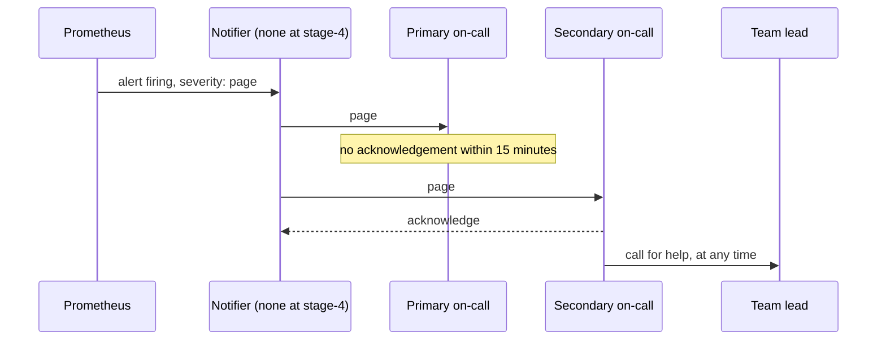

## Before you start

- [[devops.l4.burn-rate-alerts]] — you know `ProductReadsFastBurn` fires when the 1-hour and the 5-minute bad share of product reads have both stayed above 6.72% for 2 minutes, and that its rule labels it `severity: page`.
- [[devops.l4.alerting-on-symptoms]] — you know alerts in Đơn Hàng watch what customers feel, and that alerts needing no action lead to alert fatigue.

## The situation

Suppose `ProductReadsFastBurn` turns to firing at 23:00 on a Saturday. Four developers could deal with it. One notices it while checking something else in Prometheus, assumes whoever deployed last is already on it, and closes the tab. Another would act, but is asleep and hears nothing, and the other two never look. On Monday morning someone finds the alert has been firing for hours. Each of the four could have answered; none of them had to, and nothing reached any of them.

Who must answer an alert that fires outside working hours, how fast, and what happens when that person does not?

## Core concepts

- **on-call** — being the named person who, for an agreed period, answers within an agreed time; in Đơn Hàng, one developer for one week.
- **paging** — notifying the on-call person at once, by phone or app, so they act now, unlike a ticket read in working hours; in Đơn Hàng, only an alert labelled `severity: page` may page.
- **escalation** — the written order of whom to call next when the person paged does not acknowledge in time or needs help.
- Acknowledge (plain words) — telling the system "I have it", which stops it from paging the next person in the order.
- Page review (plain words) — after each shift, going through every page of the shift and asking whether it needed action.

## How it works



In the situation above, nobody was on-call, so the alert belonged to everyone and to no one. On-call fixes the "who": for this week, this person answers. Paging fixes the "how fast": the alert reaches that person at once instead of waiting until someone happens to look.

Read the diagram from the top. Prometheus evaluates the rule and keeps the alert's state. A separate component, the notifier in the diagram, would take each alert labelled `severity: page` and page the primary on-call, who should acknowledge within 15 minutes outside working hours and start work.

If no acknowledgement comes, escalation takes over. It is written down in advance, so a missed page or a phone on silent does not leave customers with nobody. The secondary is paged next, then the team lead if neither acknowledges. In the diagram the secondary acknowledges, which stops the paging, then calls the team lead for help, the other use of escalation: it needs no step to time out.

Every page then gets looked at again. A page that needed action stays. A page that needed none is lowered to a ticket or removed, because each useless page teaches the person on-call that pages can wait.

At this tag the notifier box does not exist. Prometheus keeps the alert firing, and no message leaves it.

## In the Đơn Hàng system

`docs/team/on-call.md` sets the plan. Its first sections, outside the excerpts below, set a rotation of the team's four developers, one-week shifts changing on Monday at 10:00. Each shift has two roles: the primary receives every page, and the secondary, the person of the next shift, receives the page the primary does not acknowledge. Nobody else rotates, including the product owner, the team member who tells the shops when something goes wrong.

A table, marked as assumed, gives 5 minutes to acknowledge in working hours and 15 outside. Only alerts labelled `severity: page` may page anyone: the fast-burn alert of each SLI in `slo.md`. A `severity: ticket` alert becomes a task the team picks up in working hours.

At the end of each shift the primary writes a handover note: the pages and what is still open, changes half done on staging or production, such as a canary at some step, and new tickets. Both read it together for fifteen minutes, and the shift passes only once the new person has accepted it.

The order of calls, and what happens to each page afterwards:

```markdown file=docs/team/on-call.md tag=stage-4 lines=58-81
### Chuyển cấp

Chuyển cấp là thứ tự gọi tiếp khi người được gọi không xác nhận kịp hoặc cần
thêm người. Thứ tự này viết sẵn để một lần gọi bị lỡ không bỏ khách lại không
có ai:

1. Người trực chính.
2. Người trực phụ, khi người trực chính không xác nhận trong thời gian ở bảng
   trên.
3. Trưởng nhóm, khi cả hai không xác nhận, hoặc khi sự cố ở mức SEV1
   (`docs/team/incident-response.md`).
4. Product owner, để báo cho cửa hàng, khi sự cố kéo dài quá 30 phút (giả
   định).

Người trực được gọi thêm người bất cứ lúc nào thấy cần, không phải đợi tới
bước sau. Gọi thêm người không bị coi là yếu kém.

### Xem lại mọi lần gọi

Sau mỗi ca, người trực và trưởng nhóm xem lại từng lần gọi trong ca:

- Lần gọi phải làm gì đó: giữ alert, xem runbook có đủ không.
- Lần gọi không cần làm gì: hạ alert xuống `ticket`, hoặc xóa nó. Mỗi lần gọi
  vô ích làm người trực quen bỏ qua alert, tới lúc bỏ qua cả alert quan trọng.
```

Lines 64–70 are the escalation order: the primary, then the secondary when the primary does not acknowledge in the table's time, then the team lead when neither does or the incident is of the most serious kind that `incident-response.md` lists, then the product owner, to tell the shops, when the incident lasts more than 30 minutes (assumed). Lines 72–73 let the person on-call call more people at any time, and say that doing so is not seen as weakness. Lines 77–81 are the page review: the person on-call and the team lead go through each page; one that needed action keeps its alert, one that needed none is lowered to `ticket` or removed.

The plan's last section says what is missing:

```markdown file=docs/team/on-call.md tag=stage-4 lines=87-96
### Khoảng trống

Kế hoạch này chưa gọi được ai thật:

- Prometheus giữ trạng thái alert (pending, firing) nhưng không tự gửi thông
  báo. Cần một thành phần nhận alert từ Prometheus, gom, tắt tạm và gửi tới
  người trực; Đơn Hàng chưa chọn thành phần đó.
- Staging không chạy thành phần gửi thông báo nào; alert chỉ xem được bằng cách
  hỏi Prometheus của staging.
- Production chưa có Prometheus, nên chưa có alert nào về production.
```

Lines 89–96 record that the plan pages nobody yet. Prometheus keeps alert states but sends no notification itself; a component that receives, groups, silences and sends alerts is needed, and Đơn Hàng has not chosen one. Staging runs none, and production has no Prometheus. After the excerpt, the file says that until then the week's on-call checks staging's Prometheus every morning, and the schedule is used only for practice runs.

## Trade-offs

Who answers an alert that may page:

| | Whoever is online | Everyone paged at once | One named person, with escalation |
|---|---|---|---|
| Someone answers at night | Only by chance | Usually, but each may assume another has it | Yes, or the next person within minutes |
| People disturbed per page | Nobody is told | The whole team | One, more only when needed |
| Knows what changed this week | By chance | Some, partly | The handover note says |
| Fits when | Nothing needs an answer outside working hours | A very small team with no rotation yet | Alerts may page at any hour and several people can share the weeks |

Đơn Hàng takes the third column.

What the page review does with a page that needed no action:

| | Keep it as a page | Lower it to `ticket` | Remove it |
|---|---|---|---|
| Night calls for nothing | Continue | Stop | Stop |
| The condition is still seen | Yes, at once | Yes, in working hours | No |
| Fits when | Rarely: the next one will be ignored too | Someone should still look, but not now | Nobody would act on it at any hour |

## What would you choose if…

- …your shift as primary falls on a week you are travelling: find someone to swap with and edit the schedule before the shift starts, as `on-call.md` asks. Telling the team on the day leaves a week where the first name in the escalation order may not answer.
- …you acknowledge a page at night and see orders failing as well as product reads: call the secondary or the team lead now, without waiting for a step to time out. If orders fail for every shop, the plan calls the team lead at once anyway. Otherwise wait only if you already know one thing to try that cannot make things worse, and can do it alone.
- …the same page fired three nights this month and was over before you opened your laptop: in the review, check what the SLI shows. If customers were hurt each time, the page needed action, so keep it and open a ticket for the cause; if the bad share barely moved the budget, lower the alert to `ticket`.

## Seniors often assume…

- **"Whoever happens to be online when an alert fires should handle it."** → Actually when nobody is named, each person who sees the alert can assume someone else has it, and at night nobody is online. You notice this when an alert has been firing for hours and several people say they saw it.
- **"Being on-call means fixing every problem alone, without waking anyone else."** → Actually on-call means answering and starting; escalation exists so the person paged can bring in more people at any step, and `on-call.md` says doing so is not weakness. You notice this when a night incident drags on because the person on-call did not want to wake the team lead, and nobody has told the shops.
- **"An alert that once paged at night with nothing to do is still worth keeping, just in case."** → Actually each useless page teaches the person on-call to ignore pages, until the one that matters is ignored too; a condition worth watching can be a ticket. You notice this when a page is acknowledged within seconds and nobody opens Prometheus.

## Try it (3 minutes)

1. In `examples/don-hang` at `stage-4`, open `docs/team/on-call.md` and read the response-time table and the escalation order.
2. Suppose `ProductReadsFastBurn` pages at 23:00 on a Saturday and the primary does not acknowledge. Write down who is paged next and from what time, who comes after that, and when the product owner is told if the incident lasts. If the document gives no time for a step, say so.
3. At the same moment `ProductReadsSlowBurn` (the 6-hour and 30-minute burn-rate alert of product reads) also fires. Write down who is paged for it, and whether anyone's phone actually rings at this tag.

Expected result: you name the primary at 23:00 and the secondary at about 23:15, note that `on-call.md` gives no time for the team-lead step (only "when neither acknowledges"), say the product owner is told once the incident has lasted more than 30 minutes, and say the slow alert pages nobody and no phone rings at this tag.

<details><summary>Suggested answer</summary>

The primary is paged at 23:00. Outside working hours the table gives 15 minutes to acknowledge, so the secondary is paged at about 23:15. The team lead comes when neither acknowledges; the document gives no time for that step. The product owner is told once the incident has lasted more than 30 minutes, around 23:30. `ProductReadsSlowBurn` is labelled `severity: ticket`, so it pages nobody and becomes a task for working hours. At this tag no phone rings for either alert: no component sends notifications.

</details>

## Connections

- [[devops.l4.burn-rate-alerts]] — where `severity: page` is set; this lesson names who answers it.
- [[devops.l4.alerting-on-symptoms]] — the same fight against alert fatigue, now applied to the person paged.
- [[devops.l4.runbooks]] — the next step: what the person paged does in the first minutes.
- [[devops.l4.incident-command]] — what happens when one person paged is not enough.
- [[management.l2.risk-responses]] — the same rule in planning: a risk everyone owns goes unchecked, as an alert everyone sees goes unanswered.
- [[management.l3.service-level-agreement]] — a vendor's promise about its service; on-call is how the team answers for its own.
- [[devops.l4.platform-engineering]] — staging's Prometheus, which evaluates every alert that may page, is one of the platform's shared capabilities.

## Five-line summary

1. On-call names one person who, for an agreed period, must answer pages within an agreed time, so an alert always has an owner.
2. Paging reaches that person at once; in Đơn Hàng only alerts labelled `severity: page`, each SLI's fast burn, may page.
3. Escalation is the written order of whom to page next, primary, secondary, team lead, and the person paged may call more any time.
4. After each shift every page is reviewed; one that needed no action is lowered to `ticket` or removed, against alert fatigue.
5. Prometheus only keeps alert states; with no notifier on staging and no Prometheus in production, `on-call.md` records that paging is not live.
