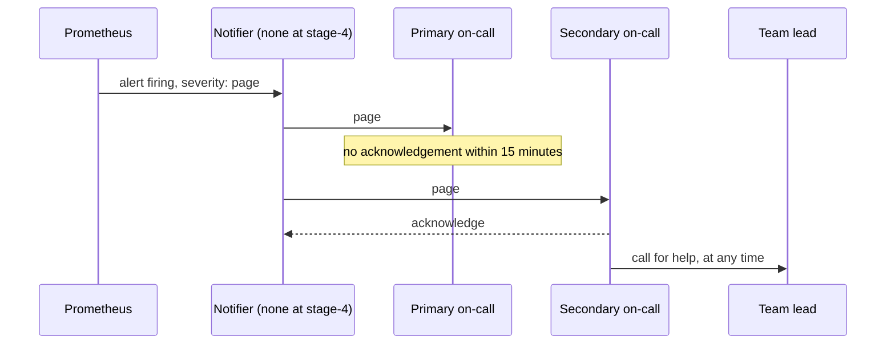

## Bạn cần biết trước

- [[devops.l4.burn-rate-alerts]] — bạn biết `ProductReadsFastBurn` firing khi tỉ lệ xấu 1 giờ và 5 phút của lượt đọc sản phẩm cùng ở trên 6,72% suốt 2 phút, và rule của nó gắn label `severity: page`.
- [[devops.l4.alerting-on-symptoms]] — bạn biết cảnh báo trong Đơn Hàng theo dõi điều khách cảm nhận được, và cảnh báo không cần làm gì sẽ dẫn tới nhờn cảnh báo.

## Tình huống

Giả sử `ProductReadsFastBurn` chuyển sang firing lúc 23:00 tối thứ Bảy. Bốn developer đều có thể xử lý. Một người thấy nó khi đang xem việc khác trên Prometheus, nghĩ rằng người deploy gần nhất đã lo rồi, và đóng tab. Một người khác sẵn sàng xử lý, nhưng đang ngủ và không nghe thấy gì. Hai người còn lại không hề nhìn tới. Sáng thứ Hai, có người phát hiện cảnh báo đã firing nhiều giờ. Cả bốn đều có thể trả lời, nhưng không ai buộc phải trả lời, và không có gì báo tới ai trong số họ.

Ai phải trả lời một cảnh báo firing ngoài giờ làm, trong bao lâu, và chuyện gì xảy ra nếu người đó không trả lời?

## Khái niệm cốt lõi

- **trực sự cố** (on-call) — là người được chỉ định, trong một khoảng thời gian thỏa thuận, phải trả lời trong thời hạn thỏa thuận. Ở Đơn Hàng là một developer trong một tuần.
- **gọi người trực** (paging) — báo ngay cho người đang trực sự cố, qua điện thoại hay ứng dụng, để họ xử lý liền, khác với ticket để đọc trong giờ làm. Ở Đơn Hàng, chỉ cảnh báo gắn label `severity: page` mới được gọi người trực.
- **chuyển cấp** (escalation) — thứ tự viết sẵn gọi người tiếp theo khi người được gọi không xác nhận kịp hoặc cần giúp.
- Xác nhận (từ thông thường) — báo cho hệ thống "tôi nhận rồi", để nó không gọi người kế tiếp trong thứ tự nữa.
- Xem lại lần gọi (từ thông thường) — sau mỗi ca, đi qua từng lần gọi trong ca và hỏi lần đó có cần làm gì không.

## Cơ chế hoạt động



Trong tình huống trên, không ai trực sự cố, nên cảnh báo thuộc về mọi người mà cũng chẳng thuộc về ai. Trực sự cố giải quyết câu hỏi "ai": tuần này, người này trả lời. Gọi người trực giải quyết câu hỏi "nhanh tới đâu": cảnh báo tới ngay người đó, thay vì đợi tới lúc có ai tình cờ nhìn thấy.

Đọc sơ đồ từ trên xuống. Prometheus tính rule và giữ trạng thái của cảnh báo. Một thành phần riêng, notifier trong sơ đồ, sẽ nhận từng cảnh báo gắn label `severity: page` và gọi người trực chính. Ngoài giờ làm, người này cần xác nhận trong 15 phút rồi bắt tay vào xử lý.

Nếu không có xác nhận, chuyển cấp vào cuộc. Thứ tự này viết sẵn từ trước, để một cuộc gọi bị lỡ hay một chiếc điện thoại để im lặng không bỏ khách lại không có ai. Người trực phụ được gọi tiếp, rồi tới trưởng nhóm nếu cả hai không xác nhận. Trong sơ đồ, người trực phụ xác nhận, nên việc gọi dừng lại, rồi người đó gọi trưởng nhóm tới giúp. Đó là công dụng thứ hai của chuyển cấp: không cần đợi bước nào hết giờ.

Sau đó mọi lần gọi đều được xem lại. Lần gọi cần làm gì đó thì giữ. Lần gọi không cần làm gì thì hạ xuống ticket hoặc xóa đi, vì mỗi lần gọi vô ích dạy người trực rằng lần gọi có thể đợi.

Ở tag này, ô notifier chưa tồn tại. Prometheus giữ cảnh báo ở trạng thái firing, và không tin nhắn nào rời khỏi nó.

## Trong hệ thống Đơn Hàng

`docs/team/on-call.md` đặt ra kế hoạch. Các mục đầu của file, nằm ngoài các đoạn trích dưới đây, đặt lịch luân phiên cho bốn developer của đội, mỗi ca một tuần, đổi ca lúc 10:00 sáng thứ Hai. Mỗi ca có hai vai: người trực chính nhận mọi cuộc gọi, còn người trực phụ, cũng là người của ca kế tiếp, nhận cuộc gọi mà người trực chính không xác nhận. Ngoài bốn người đó không ai luân phiên, kể cả product owner, thành viên của đội báo cho các cửa hàng khi có chuyện.

Một bảng, được ghi là giả định, cho 5 phút để xác nhận trong giờ làm và 15 phút ngoài giờ. Chỉ cảnh báo gắn label `severity: page` mới được gọi ai đó: đó là cảnh báo tiêu nhanh của mỗi SLI trong `slo.md`. Một cảnh báo `severity: ticket` thành một việc đội xử lý trong giờ làm.

Cuối mỗi ca, người trực chính viết ghi chú bàn giao: các lần gọi và việc còn dở, các thay đổi đang làm dở trên staging hay production, như một canary đang ở bước nào đó, và các ticket mới. Hai người cùng đọc trong mười lăm phút, và ca chỉ được chuyển khi người mới đã nhận.

Thứ tự gọi, và chuyện xảy ra với mỗi lần gọi sau đó:

```markdown file=docs/team/on-call.md tag=stage-4 lines=58-81
### Chuyển cấp

Chuyển cấp là thứ tự gọi tiếp khi người được gọi không xác nhận kịp hoặc cần
thêm người. Thứ tự này viết sẵn để một lần gọi bị lỡ không bỏ khách lại không
có ai:

1. Người trực chính.
2. Người trực phụ, khi người trực chính không xác nhận trong thời gian ở bảng
   trên.
3. Trưởng nhóm, khi cả hai không xác nhận, hoặc khi sự cố ở mức SEV1
   (`docs/team/incident-response.md`).
4. Product owner, để báo cho cửa hàng, khi sự cố kéo dài quá 30 phút (giả
   định).

Người trực được gọi thêm người bất cứ lúc nào thấy cần, không phải đợi tới
bước sau. Gọi thêm người không bị coi là yếu kém.

### Xem lại mọi lần gọi

Sau mỗi ca, người trực và trưởng nhóm xem lại từng lần gọi trong ca:

- Lần gọi phải làm gì đó: giữ alert, xem runbook có đủ không.
- Lần gọi không cần làm gì: hạ alert xuống `ticket`, hoặc xóa nó. Mỗi lần gọi
  vô ích làm người trực quen bỏ qua alert, tới lúc bỏ qua cả alert quan trọng.
```

Dòng 64–70 là thứ tự chuyển cấp: người trực chính, rồi người trực phụ khi người trực chính không xác nhận trong thời gian ở bảng, rồi trưởng nhóm khi cả hai không xác nhận hoặc khi sự cố thuộc mức nghiêm trọng nhất mà `incident-response.md` liệt kê, rồi product owner, để báo cho các cửa hàng, khi sự cố kéo dài quá 30 phút (giả định). Dòng 72–73 cho người trực gọi thêm người bất cứ lúc nào, và nói rằng làm vậy không bị coi là yếu kém. Dòng 77–81 là phần xem lại lần gọi: người trực và trưởng nhóm đi qua từng lần gọi. Lần nào cần làm gì đó thì giữ cảnh báo, lần nào không cần thì hạ xuống `ticket` hoặc xóa.

Mục cuối của kế hoạch ghi những gì còn thiếu:

```markdown file=docs/team/on-call.md tag=stage-4 lines=87-96
### Khoảng trống

Kế hoạch này chưa gọi được ai thật:

- Prometheus giữ trạng thái alert (pending, firing) nhưng không tự gửi thông
  báo. Cần một thành phần nhận alert từ Prometheus, gom, tắt tạm và gửi tới
  người trực; Đơn Hàng chưa chọn thành phần đó.
- Staging không chạy thành phần gửi thông báo nào; alert chỉ xem được bằng cách
  hỏi Prometheus của staging.
- Production chưa có Prometheus, nên chưa có alert nào về production.
```

Dòng 89–96 ghi rằng kế hoạch này chưa gọi được ai. Prometheus giữ trạng thái cảnh báo nhưng tự nó không gửi thông báo nào. Cần một thành phần nhận, gom, tắt tạm và gửi cảnh báo, và Đơn Hàng chưa chọn thành phần đó. Staging không chạy thành phần nào như vậy, còn production chưa có Prometheus. Sau đoạn trích, file ghi rằng tới lúc đó, người trực của tuần kiểm Prometheus của staging mỗi sáng, và lịch trực chỉ dùng cho các lần diễn tập.

## Đánh đổi

Ai trả lời một cảnh báo có thể gọi người:

| | Ai đang online thì trả lời | Gọi cả đội cùng lúc | Một người được chỉ định, có chuyển cấp |
|---|---|---|---|
| Ban đêm có người trả lời | Chỉ khi may mắn | Thường có, nhưng ai cũng có thể nghĩ người khác đã lo | Có, hoặc người kế tiếp trong vài phút |
| Số người bị làm phiền mỗi lần gọi | Không ai được báo | Cả đội | Một người, thêm người chỉ khi cần |
| Biết tuần này đã thay đổi gì | Tình cờ | Vài người, biết một phần | Ghi chú bàn giao có ghi |
| Hợp khi | Không có gì cần trả lời ngoài giờ làm | Đội rất nhỏ, chưa có lịch luân phiên | Cảnh báo có thể gọi người bất cứ giờ nào và nhiều người chia nhau được các tuần |

Đơn Hàng chọn cột thứ ba.

Phần xem lại làm gì với một lần gọi không cần làm gì:

| | Giữ là cảnh báo gọi người | Hạ xuống `ticket` | Xóa |
|---|---|---|---|
| Cuộc gọi ban đêm vô ích | Vẫn tiếp tục | Dừng | Dừng |
| Điều kiện vẫn được thấy | Có, ngay lập tức | Có, trong giờ làm | Không |
| Hợp khi | Hiếm khi: lần sau cũng sẽ bị bỏ qua | Vẫn nên có người xem, nhưng không phải lúc này | Không ai sẽ xử lý nó vào bất cứ giờ nào |

## Bạn sẽ chọn gì nếu…

- …ca trực chính của bạn rơi vào tuần bạn đi công tác: tìm người đổi ca và sửa lịch trước khi ca bắt đầu, như `on-call.md` yêu cầu. Báo cho đội ngay trong ngày sẽ để lại một tuần mà cái tên đầu tiên trong thứ tự chuyển cấp có thể không trả lời.
- …bạn xác nhận một cuộc gọi ban đêm và thấy đơn hàng cũng lỗi, không chỉ lượt đọc sản phẩm: gọi người trực phụ hoặc trưởng nhóm ngay, không đợi bước nào hết giờ. Nếu đơn hàng lỗi với mọi cửa hàng, kế hoạch vốn đã gọi trưởng nhóm ngay. Ngoài trường hợp đó, chỉ đợi nếu bạn đã biết một việc có thể thử, không thể làm tình hình tệ hơn, và tự làm được một mình.
- …cùng một cuộc gọi đã kêu ba đêm trong tháng này và đều kết thúc trước khi bạn kịp mở laptop: trong buổi xem lại, kiểm tra SLI cho thấy gì. Nếu mỗi lần khách đều bị ảnh hưởng thì lần gọi đó cần làm gì đó, hãy giữ nó và mở ticket cho nguyên nhân. Nếu tỉ lệ xấu gần như không làm suy suyển budget, hạ cảnh báo xuống `ticket`.

## Senior hay nhầm rằng…

- **"Cảnh báo firing lúc ai đang online thì người đó xử lý."** → Thực ra khi không ai được chỉ định, mỗi người thấy cảnh báo đều có thể nghĩ người khác đã lo, còn ban đêm thì không ai online. Bạn sẽ nhận ra khi một cảnh báo đã firing nhiều giờ và vài người nói họ có thấy nó.
- **"Trực sự cố nghĩa là tự sửa mọi vấn đề một mình, không đánh thức ai."** → Thực ra trực sự cố nghĩa là trả lời và bắt đầu xử lý. Chuyển cấp tồn tại để người bị gọi kéo thêm người ở bất cứ bước nào, và `on-call.md` nói làm vậy không phải yếu kém. Bạn sẽ nhận ra khi một sự cố ban đêm kéo dài vì người trực không muốn đánh thức trưởng nhóm, và chưa ai báo cho các cửa hàng.
- **"Một cảnh báo từng gọi người ban đêm mà không có gì phải làm vẫn đáng giữ, phòng khi cần."** → Thực ra mỗi lần gọi vô ích dạy người trực bỏ qua cuộc gọi, tới khi cuộc gọi quan trọng cũng bị bỏ qua. Một điều kiện đáng theo dõi có thể là ticket. Bạn sẽ nhận ra khi một cuộc gọi được xác nhận trong vài giây mà không ai mở Prometheus.

## Thử ngay (3 phút)

1. Trong `examples/don-hang` ở `stage-4`, mở `docs/team/on-call.md` và đọc bảng thời gian phản hồi cùng thứ tự chuyển cấp.
2. Giả sử `ProductReadsFastBurn` gọi người lúc 23:00 tối thứ Bảy và người trực chính không xác nhận. Ghi ra ai được gọi tiếp và từ lúc mấy giờ, ai tới sau đó, và khi nào product owner được báo nếu sự cố kéo dài. Nếu tài liệu không cho thời gian của một bước, hãy ghi rõ điều đó.
3. Cùng lúc đó `ProductReadsSlowBurn` (cảnh báo burn rate 6 giờ và 30 phút của lượt đọc sản phẩm) cũng firing. Ghi ra ai được gọi cho cảnh báo này, và ở tag này có điện thoại của ai thật sự đổ chuông không.

Kết quả mong đợi: bạn nêu người trực chính lúc 23:00 và người trực phụ vào khoảng 23:15, ghi chú rằng `on-call.md` không cho thời gian cho bước trưởng nhóm (chỉ ghi "khi cả hai không xác nhận"), nói rằng product owner được báo khi sự cố đã kéo dài quá 30 phút, và nói rằng cảnh báo chậm không gọi ai và ở tag này không điện thoại nào đổ chuông.

<details><summary>Gợi ý đáp án</summary>

Người trực chính được gọi lúc 23:00. Ngoài giờ làm, bảng cho 15 phút để xác nhận, nên người trực phụ được gọi vào khoảng 23:15. Trưởng nhóm được gọi khi cả hai không xác nhận, và tài liệu không cho thời gian cho bước đó. Product owner được báo khi sự cố đã kéo dài quá 30 phút, khoảng 23:30. `ProductReadsSlowBurn` gắn label `severity: ticket`, nên không gọi ai và thành một việc cho giờ làm. Ở tag này không điện thoại nào đổ chuông cho cả hai cảnh báo: chưa có thành phần nào gửi thông báo.

</details>

## Liên hệ

- [[devops.l4.burn-rate-alerts]] — nơi `severity: page` được gắn. Bài này chỉ ra ai trả lời nó.
- [[devops.l4.alerting-on-symptoms]] — cùng cuộc chiến chống nhờn cảnh báo, giờ áp vào người bị gọi.
- [[devops.l4.runbooks]] — bước kế tiếp: người bị gọi làm gì trong những phút đầu.
- [[devops.l4.incident-command]] — chuyện gì xảy ra khi một người bị gọi là không đủ.
- [[management.l2.risk-responses]] — cùng quy tắc trong lập kế hoạch: rủi ro ai cũng sở hữu thì không ai kiểm, như cảnh báo ai cũng thấy thì không ai trả lời.
- [[management.l3.service-level-agreement]] — lời hứa của nhà cung cấp về dịch vụ của họ. Trực sự cố là cách đội chịu trách nhiệm cho dịch vụ của chính mình.
- [[devops.l4.platform-engineering]] — Prometheus của staging, nơi tính mọi cảnh báo có thể gọi người, là một trong các năng lực dùng chung của platform.

## Tóm tắt 5 dòng

1. Trực sự cố chỉ định một người, trong một khoảng thời gian thỏa thuận, phải trả lời cuộc gọi trong thời hạn thỏa thuận, nên cảnh báo luôn có chủ.
2. Gọi người trực báo ngay tới người đó. Ở Đơn Hàng chỉ cảnh báo gắn `severity: page`, tức cảnh báo tiêu nhanh của mỗi SLI, mới được gọi.
3. Chuyển cấp là thứ tự viết sẵn gọi người tiếp theo: trực chính, trực phụ, trưởng nhóm, và người bị gọi được gọi thêm người bất cứ lúc nào.
4. Sau mỗi ca, mọi lần gọi được xem lại. Lần nào không cần làm gì thì hạ xuống `ticket` hoặc xóa, để chống nhờn cảnh báo.
5. Prometheus chỉ giữ trạng thái cảnh báo. Staging chưa có notifier, production chưa có Prometheus, nên `on-call.md` ghi rằng gọi người trực chưa chạy thật.
