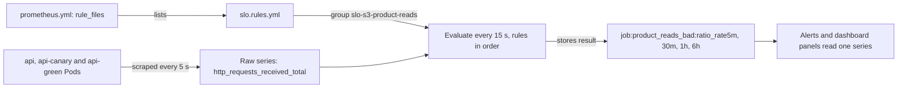

## Before you start

- [[devops.l4.alerting-on-symptoms]] — you know `alerts.md` gives each SLI of `slo.md` two alerts, and that each reads the share of bad requests over a period of time.
- [[devops.l2.counters-and-rate]] — you know `rate(...[5m])` gives a counter's per-second increase over 5 minutes, and `sum by (...)` adds the rates of many series.
- [[devops.l2.histograms-and-percentiles]] — you know a histogram bucket `le` counts the requests answered within its bound, and `_count` counts them all.
- [[backend.l4.service-level-indicators]] — you know an SLI is the share of good requests out of all valid ones, and `slo.md` writes the PromQL for S1–S4.

## The situation

The alerts for S3, product reads, read the share of bad product reads over four periods: the last 5 minutes, 30 minutes, 1 hour and 6 hours. Each of its two alerts compares a short and a long period; why comes in the burn-rate lesson. The query for S3 in `slo.md` is two long sums over `http_requests_received_total`, and the bad share is 1 minus it. Pasted into each alert, it appears four times for S3, sixteen for S1–S4, and again in every panel that shows it. Change the filter in one copy, forget another, and an alert and a panel disagree.

How can each share be computed once, in one place, and read by every alert and panel?

## Core concepts

- **recording rule** — a rule Prometheus evaluates on a schedule, storing the result of its PromQL expression as a new time series under the name the rule gives, such as `job:product_reads_bad:ratio_rate1h`.
- Rule file and rule group (plain words) — a rule file is a YAML file of named groups, and each group is a list of rules evaluated together.
- Evaluation interval (plain words) — how often Prometheus evaluates the rule groups; staging's Prometheus uses 15 seconds.
- Bad share (plain words) — the share of requests an SLI counts as bad, which is 1 minus the SLI.
- Sample (plain words) — one value of a time series together with the time it was measured or computed.
- Scrape job (plain words) — a named list of targets in `prometheus.yml`; Prometheus puts its name on every series it scrapes as the label `job`, here `job="api"`.

## How it works



In the situation above, the long query is written once, inside a recording rule. Prometheus scrapes every api Pod, of `api`, `api-canary` and `api-green`, every 5 seconds into the raw series `http_requests_received_total`. Its configuration lists rule files under `rule_files`; staging's Prometheus reads `slo.rules.yml` through that list. The file holds one group per SLI.

Every evaluation interval, Prometheus evaluates each group. Inside a group, the rules run one after another, all with the same evaluation time, so the four results of one evaluation carry the same timestamp. For each recording rule, Prometheus runs the expression over the raw series it has scraped. It then stores the result as a new sample of a new time series named by `record`. The result keeps the labels the expression leaves; `sum by (job)` leaves only `job`.

This happens whether or not anyone is looking. The recorded series grows by one sample every 15 seconds, like a scraped series. An alert or a panel that needs the 1-hour bad share now asks for `job:product_reads_bad:ratio_rate1h`, a short name, instead of repeating two sums.

The api itself is not involved. Its `/metrics` endpoint exports the same counters as before; the new series exist only inside Prometheus, computed from samples it already holds.

The rule records nothing for the time before it was loaded. Prometheus evaluates it from then on and does not fill in earlier values by itself. A new 1-hour rule therefore has only minutes of samples at first. On staging, Prometheus also keeps its data in a volume that lives only as long as its Pod (`emptyDir` in the file), and a rule change replaces the Pod. Its raw data then starts again from zero, and a 1-hour window covers a full hour only one hour later.

## In the Đơn Hàng system

The group for S3, product reads:

```yaml file=deploy/gitops/config-repo/platform/monitoring/rules/slo.rules.yml tag=stage-4 lines=6-21
groups:
  # lesson: devops.l4.recording-rules
  # S3, product reads: the share of GET requests to the two product
  # endpoints that got a 5xx, over 5 minutes, 30 minutes, 1 hour and 6
  # hours. sum by (job) adds up every Pod the job api scrapes, of api,
  # api-canary and api-green alike. The name says level:metric:operations.
  - name: slo-s3-product-reads
    rules:
      - record: job:product_reads_bad:ratio_rate5m
        expr: 1 - sum by (job) (rate(http_requests_received_total{method="GET", endpoint=~"api/v1/products.*", code!~"5.."}[5m])) / sum by (job) (rate(http_requests_received_total{method="GET", endpoint=~"api/v1/products.*"}[5m]))
      - record: job:product_reads_bad:ratio_rate30m
        expr: 1 - sum by (job) (rate(http_requests_received_total{method="GET", endpoint=~"api/v1/products.*", code!~"5.."}[30m])) / sum by (job) (rate(http_requests_received_total{method="GET", endpoint=~"api/v1/products.*"}[30m]))
      - record: job:product_reads_bad:ratio_rate1h
        expr: 1 - sum by (job) (rate(http_requests_received_total{method="GET", endpoint=~"api/v1/products.*", code!~"5.."}[1h])) / sum by (job) (rate(http_requests_received_total{method="GET", endpoint=~"api/v1/products.*"}[1h]))
      - record: job:product_reads_bad:ratio_rate6h
        expr: 1 - sum by (job) (rate(http_requests_received_total{method="GET", endpoint=~"api/v1/products.*", code!~"5.."}[6h])) / sum by (job) (rate(http_requests_received_total{method="GET", endpoint=~"api/v1/products.*"}[6h]))
```

Line 12 names the group. Lines 14–21 are four recording rules, one per period, each a `record` name and an `expr`. Each expression is the S3 query of `slo.md` turned around: good reads, those without a `5xx`, divided by all reads, subtracted from 1. `!~` keeps series whose label does not match, and `products.*` matches both product endpoints.

Lines 10–11 explain the `sum by (job)`. Every api Pod is scraped by the one scrape job `api`, whether it belongs to `api`, `api-canary` or `api-green`. Summing by `job` adds them into one number, so the requests a canary serves count against S3 like the others. Each scraped series also carries a label `app` with its Deployment's name; the canary lesson summed by `app` to tell them apart. Here the goal is the opposite.

Line 11 points to the naming form the Prometheus documentation recommends, `level:metric:operations`. `job` is the level: the labels the result keeps. `product_reads_bad` names what is measured, here the SLI's bad share. `ratio_rate5m` lists the operations, the last applied first: the rates are taken first, then their ratio, so `ratio` comes before `rate5m`. Prometheus reserves colons in metric names for recording rules, so a colon also tells a reader the series was recorded, not scraped.

The file repeats the pattern for S1, S2 and S4, as `order_placement_bad`, `order_placement_slow` and `refund_requests_slow`, sixteen recording rules in all; the slow ones count requests not answered within a histogram bucket bound. The same group goes on with the alerts that read these series, the subject of a later lesson.

Where Prometheus finds the file and how often it evaluates it:

```yaml file=deploy/gitops/config-repo/platform/monitoring/prometheus.yaml tag=stage-4 lines=47-55
  prometheus.yml: |
    global:
      scrape_interval: 5s
      # lesson: devops.l4.recording-rules
      # Every 15 s Prometheus evaluates the rules of the files below, group
      # by group: slo.rules.yml, mounted from the ConfigMap slo-rules.
      evaluation_interval: 15s
    rule_files:
      - /etc/prometheus/rules/*.yml
```

Line 53 sets the evaluation interval to 15 seconds. Lines 54–55 list the rule files by pattern: every `.yml` in `/etc/prometheus/rules`, where the ConfigMap `slo-rules` is mounted, as line 52 says. Outside this excerpt, the same file says a changed rule file renames that ConfigMap, changes the Pod template and restarts Prometheus with the new rules. The Pod is replaced, its `emptyDir` with it, so each rule change on staging starts the four windows from empty.

## Trade-offs

Where the bad share is computed:

| | The full query in every alert and panel | One recording rule per SLI and period |
|---|---|---|
| Places to change when the filter changes | Every copy | One line |
| What an alert or panel reads | Two long sums | One short name |
| Values for the time before it was added | Yes, as far back as raw data goes | No, only from when the rule was loaded |
| Extra series Prometheus stores | None | One per rule and label set, here 16 |
| Fits when | A query is run once, to look into something | Several alerts and panels read the same share, all the time |

Đơn Hàng takes the second column for S1–S4.

## What would you choose if…

- …you want to look once at yesterday's error share for one endpoint, during an investigation: run the query directly. A rule would store a series nobody reads again, and would not hold yesterday anyway.
- …`slo.md` adds an SLI S5: add a group with four recording rules named in the same form, so the alerts and panels for S5 read short names like the others.
- …a dashboard should show the bad share of each Deployment separately: that is a different question, by `app`, not by `job`; query it directly or add rules with `app` as the level, and leave the SLI's rules summing all of them.

## Seniors often assume…

- **"A recording rule is a saved query that only runs when someone opens a dashboard."** → Actually Prometheus evaluates it every evaluation interval, 15 seconds on staging, and stores each result, whether anyone is looking or not. You notice this when the recorded series has samples for a night when nobody opened anything.
- **"A recording rule changes the metrics the api itself exports."** → Actually Prometheus computes the new series from samples it has already scraped; the api's `/metrics` stays as it was. You notice this when you search the api's `/metrics` for `job:product_reads_bad` and find nothing, while Prometheus answers for that name.
- **"Once a 1-hour recording rule is added, its series already covers the hour before."** → Actually the rule records only from when it was loaded and fills in nothing before. On staging a rule change also replaces the Prometheus Pod, whose raw data starts from empty. You notice this when a graph of the new series starts at the time of the change, not an hour earlier.

## Try it (3 minutes)

1. In `examples/don-hang`, list the recorded names:
   `git show stage-4:deploy/gitops/config-repo/platform/monitoring/rules/slo.rules.yml | grep 'record:'`
2. Count them, and read the part after the last colon of each.

Expected result: 16 names, four per SLI; each starts with `job:`, and each ends in `ratio_rate` followed by one of `5m`, `30m`, `1h`, `6h`.

<details><summary>Suggested answer</summary>

Four groups of four: `order_placement_bad`, `order_placement_slow`, `product_reads_bad` and `refund_requests_slow`, each over the same four periods. The level `job` says every result is summed over all api Pods, and the operations part says each is a ratio of rates over that period. A panel showing whether product reads fail right now reads `job:product_reads_bad:ratio_rate5m`.

</details>

## Connections

- [[backend.l4.service-level-indicators]] — the queries of `slo.md` that these rules record, turned into bad shares.
- [[devops.l2.counters-and-rate]] — the `rate()` and `sum by` each rule is built from.
- [[devops.l4.alerting-on-symptoms]] — the symptom alerts whose input these rules compute.
- [[devops.l4.canary-release]] — the opposite sum: by `app` to compare Deployments, where these rules sum by `job` to count them together.
- [[devops.l2.prometheus-scraping]] — the scraped series a recording rule reads; a recorded series lives beside them in Prometheus.
- [[backend.l4.error-budget]] — the budget these bad shares are measured against.
- [[devops.l4.burn-rate]] — the next step: comparing these shares with what the SLO allows.

## Five-line summary

1. A recording rule has Prometheus evaluate an expression on a schedule and store its result as a new time series under the rule's name.
2. Prometheus evaluates the groups of the rule files its configuration lists, every 15 seconds on staging, rules in order within a group.
3. `slo.rules.yml` records each SLI's bad share over 5 minutes, 30 minutes, 1 hour and 6 hours, so alerts and panels read one name.
4. Each share sums by `job`, adding `api`, `api-canary` and `api-green`; names follow `level:metric:operations`, like `job:product_reads_bad:ratio_rate1h`.
5. A new rule's series has no values before it was loaded; on staging, loading it empties the raw data, so 1-hour shares need an hour.
