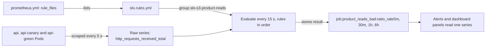

## Bạn cần biết trước

- [[devops.l4.alerting-on-symptoms]] — bạn biết `alerts.md` cho mỗi SLI của `slo.md` hai cảnh báo, và mỗi cảnh báo đọc tỉ lệ request xấu trong một khoảng thời gian.
- [[devops.l2.counters-and-rate]] — bạn biết `rate(...[5m])` cho mức tăng mỗi giây của một counter trong 5 phút, còn `sum by (...)` cộng rate của nhiều series.
- [[devops.l2.histograms-and-percentiles]] — bạn biết một bucket `le` của histogram đếm các request được trả lời trong ngưỡng của nó, còn `_count` đếm tất cả.
- [[backend.l4.service-level-indicators]] — bạn biết SLI là tỉ lệ request tốt trên mọi request hợp lệ, và `slo.md` viết truy vấn PromQL cho S1–S4.

## Tình huống

Các cảnh báo cho S3, lượt đọc sản phẩm, đọc tỉ lệ lượt đọc sản phẩm xấu trên bốn khoảng: 5 phút, 30 phút, 1 giờ và 6 giờ gần nhất. Mỗi cảnh báo trong hai cảnh báo của S3 so một khoảng ngắn với một khoảng dài, lý do nằm ở bài về burn rate. Truy vấn cho S3 trong `slo.md` là hai tổng dài trên `http_requests_received_total`, và tỉ lệ xấu bằng 1 trừ kết quả đó. Nếu dán truy vấn này vào từng cảnh báo, S3 có bốn bản, S1–S4 có mười sáu bản, chưa kể mỗi panel hiển thị tỉ lệ đó. Sửa bộ lọc ở một bản, quên một bản khác, thế là cảnh báo và panel nói hai điều khác nhau.

Làm sao để mỗi tỉ lệ được tính một lần, ở một chỗ, rồi mọi cảnh báo và panel cùng đọc?

## Khái niệm cốt lõi

- **recording rule** (Rule của Prometheus tính một biểu thức theo chu kỳ và lưu kết quả thành time series mới) — Prometheus tính biểu thức PromQL của rule theo lịch, rồi lưu kết quả thành time series mới dưới tên mà rule đặt, như `job:product_reads_bad:ratio_rate1h`.
- File rule và group (từ thông thường) — file rule là một file YAML gồm các group có tên, mỗi group là một danh sách rule được tính cùng nhau.
- Chu kỳ tính, evaluation interval (từ thông thường) — Prometheus tính các group rule bao lâu một lần. Prometheus của staging dùng 15 giây.
- Tỉ lệ xấu (từ thông thường) — tỉ lệ request mà một SLI tính là xấu, bằng 1 trừ SLI.
- Sample (từ thông thường) — một giá trị của time series, kèm thời điểm nó được đo hoặc được tính.
- Scrape job (từ thông thường) — một danh sách target có tên trong `prometheus.yml`. Prometheus gắn tên đó lên mọi series nó scrape, dưới label `job`, ở đây là `job="api"`.

## Cơ chế hoạt động



Trong tình huống trên, truy vấn dài chỉ cần viết một lần, bên trong một recording rule. Prometheus scrape mọi Pod api, dù thuộc `api`, `api-canary` hay `api-green`, mỗi 5 giây vào series thô `http_requests_received_total`. Cấu hình của Prometheus liệt kê các file rule dưới `rule_files`, và Prometheus của staging đọc `slo.rules.yml` qua danh sách đó. File này có một group cho mỗi SLI.

Cứ mỗi chu kỳ tính, Prometheus tính từng group. Trong một group, các rule chạy lần lượt, với cùng một thời điểm tính, nên bốn kết quả của một lần tính mang cùng mốc thời gian. Với mỗi recording rule, Prometheus chạy biểu thức trên các series thô đã scrape. Sau đó Prometheus lưu kết quả thành một sample mới của một time series mới, mang tên ghi ở `record`. Kết quả giữ những label mà biểu thức để lại: `sum by (job)` chỉ để lại `job`.

Điều này xảy ra dù có ai đang xem hay không. Series được ghi thêm một sample mỗi 15 giây, giống một series scrape được. Cảnh báo hay panel cần tỉ lệ xấu trong 1 giờ giờ đây chỉ hỏi `job:product_reads_bad:ratio_rate1h`, một cái tên ngắn, thay vì lặp lại hai tổng.

Bản thân api không tham gia. Endpoint `/metrics` của api vẫn xuất các counter như trước. Các series mới chỉ tồn tại bên trong Prometheus, tính từ những sample mà Prometheus đã có.

Rule không ghi gì cho khoảng thời gian trước khi được nạp. Prometheus tính rule từ lúc đó trở đi và không tự điền các giá trị trước đó. Vì thế một rule 1 giờ mới thêm lúc đầu chỉ có vài phút sample. Trên staging, Prometheus còn giữ dữ liệu trong một volume chỉ sống cùng Pod (`emptyDir` trong file), và mỗi lần đổi rule là Pod bị thay. Khi đó dữ liệu thô bắt đầu lại từ số không, và phải một giờ sau cửa sổ 1 giờ mới phủ đủ một giờ.

## Trong hệ thống Đơn Hàng

Group cho S3, lượt đọc sản phẩm:

```yaml file=deploy/gitops/config-repo/platform/monitoring/rules/slo.rules.yml tag=stage-4 lines=6-21
groups:
  # lesson: devops.l4.recording-rules
  # S3, product reads: the share of GET requests to the two product
  # endpoints that got a 5xx, over 5 minutes, 30 minutes, 1 hour and 6
  # hours. sum by (job) adds up every Pod the job api scrapes, of api,
  # api-canary and api-green alike. The name says level:metric:operations.
  - name: slo-s3-product-reads
    rules:
      - record: job:product_reads_bad:ratio_rate5m
        expr: 1 - sum by (job) (rate(http_requests_received_total{method="GET", endpoint=~"api/v1/products.*", code!~"5.."}[5m])) / sum by (job) (rate(http_requests_received_total{method="GET", endpoint=~"api/v1/products.*"}[5m]))
      - record: job:product_reads_bad:ratio_rate30m
        expr: 1 - sum by (job) (rate(http_requests_received_total{method="GET", endpoint=~"api/v1/products.*", code!~"5.."}[30m])) / sum by (job) (rate(http_requests_received_total{method="GET", endpoint=~"api/v1/products.*"}[30m]))
      - record: job:product_reads_bad:ratio_rate1h
        expr: 1 - sum by (job) (rate(http_requests_received_total{method="GET", endpoint=~"api/v1/products.*", code!~"5.."}[1h])) / sum by (job) (rate(http_requests_received_total{method="GET", endpoint=~"api/v1/products.*"}[1h]))
      - record: job:product_reads_bad:ratio_rate6h
        expr: 1 - sum by (job) (rate(http_requests_received_total{method="GET", endpoint=~"api/v1/products.*", code!~"5.."}[6h])) / sum by (job) (rate(http_requests_received_total{method="GET", endpoint=~"api/v1/products.*"}[6h]))
```

Dòng 12 đặt tên group. Dòng 14–21 là bốn recording rule, mỗi rule cho một khoảng, gồm một tên `record` và một `expr`. Mỗi biểu thức là truy vấn S3 của `slo.md` lật lại: lượt đọc tốt, tức không có `5xx`, chia cho mọi lượt đọc, rồi lấy 1 trừ đi. `!~` giữ các series có label không khớp, còn `products.*` khớp cả hai endpoint sản phẩm.

Dòng 10–11 giải thích `sum by (job)`. Cùng một scrape job `api` scrape mọi Pod api, dù Pod thuộc `api`, `api-canary` hay `api-green`. Cộng theo `job` gộp chúng thành một con số, nên các request mà canary phục vụ cũng tính vào S3 như mọi request khác. Mỗi series scrape được còn mang label `app` là tên Deployment của Pod, và bài canary đã cộng theo `app` để tách chúng ra. Ở đây mục tiêu ngược lại.

Dòng 11 chỉ tới dạng đặt tên mà tài liệu Prometheus khuyên dùng, `level:metric:operations`. `job` là level: các label mà kết quả giữ lại. `product_reads_bad` gọi tên thứ được đo, ở đây là tỉ lệ xấu của SLI. `ratio_rate5m` liệt kê các phép tính, phép áp dụng sau cùng đứng trước: rate được tính trước, rồi mới tới tỉ số giữa chúng, nên `ratio` đứng trước `rate5m`. Prometheus dành dấu hai chấm trong tên metric cho recording rule, nên dấu hai chấm cũng cho người đọc biết series này do rule ghi lại, không phải scrape được.

File lặp lại mẫu này cho S1, S2 và S4, với `order_placement_bad`, `order_placement_slow` và `refund_requests_slow`, tổng cộng mười sáu recording rule. Các rule "slow" đếm những request không được trả lời trong ngưỡng của một bucket histogram. Cũng group đó còn tiếp tục với các cảnh báo đọc những series này, chủ đề của một bài sau.

Prometheus tìm file ở đâu và tính nó bao lâu một lần:

```yaml file=deploy/gitops/config-repo/platform/monitoring/prometheus.yaml tag=stage-4 lines=47-55
  prometheus.yml: |
    global:
      scrape_interval: 5s
      # lesson: devops.l4.recording-rules
      # Every 15 s Prometheus evaluates the rules of the files below, group
      # by group: slo.rules.yml, mounted from the ConfigMap slo-rules.
      evaluation_interval: 15s
    rule_files:
      - /etc/prometheus/rules/*.yml
```

Dòng 53 đặt chu kỳ tính là 15 giây. Dòng 54–55 liệt kê các file rule theo mẫu: mọi file `.yml` trong `/etc/prometheus/rules`, nơi ConfigMap `slo-rules` được mount, như dòng 52 ghi. Ngoài đoạn trích này, cùng file đó nói rằng mỗi khi file rule đổi, ConfigMap đó đổi tên, Pod template đổi theo, và Prometheus khởi động lại với các rule mới. Pod bị thay, `emptyDir` của nó mất theo, nên trên staging mỗi lần đổi rule là bốn cửa sổ bắt đầu lại từ rỗng.

## Đánh đổi

Tỉ lệ xấu được tính ở đâu:

| | Truy vấn đầy đủ trong mọi cảnh báo và panel | Một recording rule cho mỗi SLI và mỗi khoảng |
|---|---|---|
| Số chỗ phải sửa khi bộ lọc đổi | Mọi bản sao | Một dòng |
| Cảnh báo hay panel đọc gì | Hai tổng dài | Một tên ngắn |
| Giá trị cho khoảng thời gian trước khi thêm | Có, lùi xa tới đâu dữ liệu thô còn tới đó | Không, chỉ từ lúc rule được nạp |
| Số series Prometheus lưu thêm | Không có | Một cho mỗi rule và mỗi bộ label, ở đây là 16 |
| Hợp khi | Một truy vấn chạy một lần, để điều tra một việc | Nhiều cảnh báo và panel đọc cùng một tỉ lệ, suốt thời gian |

Đơn Hàng chọn cột thứ hai cho S1–S4.

## Bạn sẽ chọn gì nếu…

- …bạn muốn xem một lần tỉ lệ lỗi hôm qua của một endpoint, trong lúc điều tra: chạy thẳng truy vấn. Một rule sẽ lưu một series không ai đọc lại, mà cũng chẳng có dữ liệu của hôm qua.
- …`slo.md` thêm SLI S5: thêm một group với bốn recording rule đặt tên cùng dạng, để cảnh báo và panel của S5 cũng đọc tên ngắn như các SLI khác.
- …một dashboard cần hiện tỉ lệ xấu của từng Deployment riêng: đó là câu hỏi khác, theo `app` chứ không theo `job`. Truy vấn trực tiếp, hoặc thêm rule lấy `app` làm level, và để nguyên các rule của SLI cộng gộp tất cả.

## Senior hay nhầm rằng…

- **"Recording rule là một truy vấn đã lưu, chỉ chạy khi có người mở dashboard."** → Thực ra Prometheus tính rule mỗi chu kỳ tính, 15 giây trên staging, và lưu từng kết quả, dù có ai xem hay không. Bạn sẽ nhận ra khi series được ghi có sample cho cả một đêm không ai mở gì.
- **"Recording rule thay đổi các metric mà chính api xuất ra."** → Thực ra Prometheus tính series mới từ những sample đã scrape, còn `/metrics` của api vẫn như cũ. Bạn sẽ nhận ra khi tìm `job:product_reads_bad` trong `/metrics` của api mà không thấy gì, trong khi Prometheus vẫn trả lời cho tên đó.
- **"Vừa thêm một recording rule 1 giờ là series của nó đã phủ cả giờ trước đó."** → Thực ra rule chỉ ghi từ lúc được nạp và không điền gì cho trước đó. Trên staging, đổi rule còn thay Pod Prometheus, và dữ liệu thô của Pod mới bắt đầu từ rỗng. Bạn sẽ nhận ra khi đồ thị của series mới bắt đầu đúng lúc thay đổi, không phải một giờ trước đó.

## Thử ngay (3 phút)

1. Trong `examples/don-hang`, liệt kê các tên được ghi:
   `git show stage-4:deploy/gitops/config-repo/platform/monitoring/rules/slo.rules.yml | grep 'record:'`
2. Đếm chúng, và đọc phần sau dấu hai chấm cuối cùng của mỗi tên.

Kết quả mong đợi: 16 tên, bốn tên cho mỗi SLI. Tên nào cũng bắt đầu bằng `job:` và kết thúc bằng `ratio_rate`, theo sau là một trong `5m`, `30m`, `1h`, `6h`.

<details><summary>Gợi ý đáp án</summary>

Bốn nhóm, mỗi nhóm bốn tên: `order_placement_bad`, `order_placement_slow`, `product_reads_bad` và `refund_requests_slow`, nhóm nào cũng trên cùng bốn khoảng. Level `job` cho biết mọi kết quả được cộng trên tất cả Pod api, còn phần phép tính cho biết mỗi tên là tỉ số của các rate trong khoảng đó. Một panel cho biết lượt đọc sản phẩm có đang lỗi ngay lúc này hay không sẽ đọc `job:product_reads_bad:ratio_rate5m`.

</details>

## Liên hệ

- [[backend.l4.service-level-indicators]] — các truy vấn của `slo.md` mà các rule này ghi lại, đã đổi thành tỉ lệ xấu.
- [[devops.l2.counters-and-rate]] — `rate()` và `sum by`, hai viên gạch dựng nên mỗi rule.
- [[devops.l4.alerting-on-symptoms]] — các cảnh báo theo triệu chứng, với đầu vào do các rule này tính.
- [[devops.l4.canary-release]] — phép cộng ngược lại: theo `app` để so các Deployment, trong khi các rule này cộng theo `job` để tính chung.
- [[devops.l2.prometheus-scraping]] — các series scrape được mà recording rule đọc. Series được ghi nằm ngay cạnh chúng trong Prometheus.
- [[backend.l4.error-budget]] — budget làm mốc để đo các tỉ lệ xấu này.
- [[devops.l4.burn-rate]] — bước kế tiếp: so các tỉ lệ này với mức mà SLO cho phép.

## Tóm tắt 5 dòng

1. Recording rule cho Prometheus tính một biểu thức theo lịch và lưu kết quả thành time series mới mang tên của rule.
2. Prometheus tính các group của những file rule mà cấu hình liệt kê, mỗi 15 giây trên staging, và các rule trong một group chạy theo thứ tự.
3. `slo.rules.yml` ghi tỉ lệ xấu của mỗi SLI trong 5 phút, 30 phút, 1 giờ và 6 giờ, để cảnh báo và panel chỉ cần đọc một tên.
4. Mỗi tỉ lệ cộng theo `job`, gộp `api`, `api-canary` và `api-green`. Tên theo dạng `level:metric:operations`, như `job:product_reads_bad:ratio_rate1h`.
5. Series của rule mới không có giá trị trước lúc nạp. Trên staging, nạp rule còn làm dữ liệu thô bắt đầu lại từ rỗng, nên tỉ lệ 1 giờ cần đủ một giờ.
