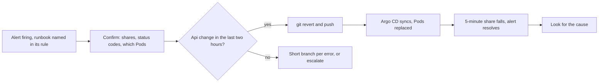

## Before you start

- [[devops.l4.on-call]] — you know the week's on-call person must answer an alert labelled `severity: page`, and may escalate at any time.
- [[devops.l3.rollback-by-revert]] — you know the way back from a bad change on staging is a `git revert` in the config repository, which Argo CD then syncs.
- [[devops.l3.disaster-recovery-drill]] — you know a drill breaks an environment on purpose to find what written steps miss before a real disaster.
- [[devops.l4.progressive-delivery]] — you know a canary's weight is set by a commit, and that a one-at-a-time `catalog-reads` limit makes product reads fail.

## The situation

Suppose you are this week's on-call. At your morning check of staging's Prometheus, `ProductReadsFastBurn` is firing: more than 6.72% of product reads failed over both the last hour and the last 5 minutes. You open `Program.cs`, then the api's logs, and build a theory about the database. Forty minutes later you are still reading code, and every failed read meanwhile spends the error budget. A teammate then sees that someone changed an api setting on staging an hour before the alert. Nothing had told you to look there first.

What should the person who answers an alert do in the first minutes, before anyone knows the cause, and how do they know that step works?

## Core concepts

- **runbook** — a written procedure for one alert: what it means for customers, how to confirm it, the first safe actions and when to escalate.
- **mitigation** — an action that stops the harm to customers before anyone knows the cause, such as reverting the most recent change.
- First safe action (plain words) — a step the person paged can take alone, that is recorded and can be undone, and whose effect shows within minutes in the alert's own numbers.
- Drill (plain words) — causing a known fault on staging on purpose and following the runbook against it, to see whether its steps work.

## How it works



In the situation above, the alert came with no instructions, so you started where habit led: the code. A runbook moves that choice to a calm moment before the incident.

From the left: the person paged opens the runbook the alert names and confirms the shares, the status codes and which Pods fail.

The decision node asks a question with a fast answer: did anything change in the api's environment in the two hours before the alert? The config repository's history answers it, because every change to staging is a commit there. If something did, the first safe action is to revert that commit. That is mitigation: it explains nothing, it removes the most likely trigger. The revert is itself a commit, so it is recorded and can be reverted in turn.

Argo CD then syncs the reverted state and the api's Pods are replaced. The alert's own numbers say whether it worked: the 5-minute share falls within minutes. The alert needs both the 1-hour and the 5-minute share above the threshold, so the 5-minute share falling is enough to end it. Only then does anyone look for the cause, with the bad commit still in the history to study.

If nothing changed, the runbook gives a short branch per kind of error, and otherwise one instruction: escalate.

## In the Đơn Hàng system

Each alert labelled `severity: page` in `slo.rules.yml` carries an annotation `runbook:` with a path under `docs/runbooks/`; for `ProductReadsFastBurn` it is `docs/runbooks/product-reads-burn.md` (line 32). An annotation is a note attached to the alert for the person reading it, unlike a label, which Prometheus uses to tell alerts apart. `docs/design/alerts.md` requires a runbook for every `page` alert.

The first sections of `product-reads-burn.md`, outside the excerpt below, say what the alert means for customers: at this rate the product-read budget for 28 days is gone in about 50 hours (lines 8–13). Four checks follow (lines 15–34): the 5-minute and 1-hour shares, `503` or other `5xx`, whether the failures come from one value of the `app` label or from all, and whether the api's Pods are Ready. A `503` means the `catalog-reads` limit refused the read; a `500` points into the api or what it calls.

Step 1 opens at line 38: mitigate first, look for the cause afterwards. The rest of step 1:

```markdown file=docs/runbooks/product-reads-burn.md tag=stage-4 lines=45-53
Có commit trong khoảng hai giờ trước khi alert bật mà đổi api (image, cấu
hình, biến môi trường, số replica): `git revert` commit đó và push, như
`devops.l3.rollback-by-revert`. Đang có canary thì đặt trọng số `api-canary` về
0 trước (`docs/design/canary-checks.md`). Không sửa tay Deployment trên
cluster: Argo CD sẽ đưa nó về theo Git, và người khác không biết đã đổi gì.

Sau revert, chờ rollout xong (`kubectl rollout status deployment/api -n donhang`)
và xem tỉ lệ 5 phút giảm. Alert hết khi tỉ lệ 5 phút xuống dưới ngưỡng, trong
khi tỉ lệ 1 giờ có thể còn trên ngưỡng một lúc: đó là đúng thiết kế.
```

Lines 45–47: revert a commit from the two hours before the alert that changed the api (image, configuration, environment variables, replicas) and push; a canary in progress has its `api-canary` weight set to 0 first. Lines 48–49 forbid editing the Deployment by hand: staging's Argo CD Application has self-heal on, so it would put the Deployment back to what Git says, and nobody else would know what changed.

After the excerpt, step 2 covers no recent change: one line per kind of error, "escalate" for anything unclear. Escalation also comes after 15 minutes (a figure the runbook marks as an assumption) without the 5-minute share falling, or when placing orders fails too.

`incident-drill.sh` checks this runbook against a real fault. Its lines 50–76, outside the excerpt, patch `envs/staging/kustomization.yaml` to add two environment variables to the Deployment `api`, `RateLimiting__CatalogReads__PermitLimit` = `1` and `RateLimiting__CatalogReads__QueueLimit` = `0`: one product read at a time, none waiting. `Program.cs` does not change: it already reads the `RateLimiting:CatalogReads` config section into the limit's options, and an environment variable with `__` in its name fills that section. The script commits, waits for the rollout, and reads products until the alert is firing.

```bash file=scripts/devops/incident-drill.sh tag=stage-4 lines=87-110
# lesson: devops.l4.runbooks
# The runbook's first step (docs/runbooks/product-reads-burn.md): the
# newest change to envs/staging, reverted, before anyone looks for a cause.
echo "== runbook step 1: the newest commits that changed envs/staging"
git -C "$config_repo" log --format='%h %an: %s' "$run_start..HEAD" -- envs/staging
change=$(git -C "$config_repo" log --format=%H -n 1 -- envs/staging)
config_revert incident-drill.sh "$change"
echo "reverted:"
git -C "$config_repo" log --format='%h %an: %s' -n 1 --author=incident-drill.sh
sync_app staging
kubectl rollout status deployment/api -n donhang --timeout=300s >/dev/null
echo

# lesson: devops.l4.runbooks
# Reads go on. The 5-minute share falls first; the alert resolves while the
# 1-hour share, still holding the failed reads, stays above the threshold.
echo "== reading products until the alert resolves"
wait_for inactive 1200
five=$(bad_share 5m)
hour=$(bad_share 1h)
touch "$work/stop"
wait "$load_pid"
echo "bad share over 5 minutes: $(percent "$five"), above $(percent $threshold): $(above "$five" && echo yes || echo no)"
echo "bad share over 1 hour: $(percent "$hour"), above $(percent $threshold): $(above "$hour" && echo yes || echo no)"
```

```text output=true
...
== reading products until the alert fires
ProductReadsFastBurn: pending
ProductReadsFastBurn: firing
bad share of product reads over 5 minutes above 6.7%: yes
bad share of product reads over 1 hour above 6.7%: yes

== runbook step 1: the newest commits that changed envs/staging
... incident-drill.sh: api: catalog-reads one read at a time, none waiting
reverted:
... incident-drill.sh: Revert "api: catalog-reads one read at a time, none waiting"

== reading products until the alert resolves
ProductReadsFastBurn: inactive
bad share over 5 minutes: ...%, above 6.7%: no
bad share over 1 hour: ...%, above 6.7%: yes
...
```

Lines 91–93 are runbook step 1 done literally: list the commits that changed `envs/staging` during this run, take the newest, and revert it with `config_revert`, a helper outside the excerpt that runs `git revert` and pushes. Nothing here looks for a cause. Lines 96–97 wait for Argo CD and the rollout. Lines 104–110 wait until the alert is inactive, then print both shares against the threshold. The reads come from a background process started outside the excerpt; lines 107–108 tell it to stop and wait for it to end.

The output shows the alert pending, then firing; the script rounds the 6.72% threshold to 6.7% when printing. After the revert the alert turns inactive while the 1-hour window still holds the failed reads: this is what the short window is for. The script's last line, outside the excerpt, makes the drill fail unless the 1-hour share is still above, so each run checks that runbook sentence. The runbook's header records that it was tried in this drill (lines 5–6).

## Trade-offs

What the person paged does in the first minutes:

| | Revert the recent change first | Find the cause first | Try fixes as ideas come |
|---|---|---|---|
| Customers see errors | Until the rollout after the revert ends | Until the cause is fixed | Unknown; a wrong try can add errors |
| What you learn about the cause | Later, from the commit kept in the history | Sooner | Little: several changes blur which one helped |
| Cost | Another rollout; data changes are not undone | Harm continues while you read | Changes nobody recorded |
| Fits when | The api's environment changed just before the alert | Nothing changed in the last hours, or a revert cannot undo the change | Rarely; the runbook says escalate instead |

What a runbook holds:

| | First safe steps for one alert | Every cause and its fix | No runbook |
|---|---|---|---|
| Time to a first action | Minutes | Spent searching the list | Depends on who is paged |
| Steps actually run before | Few, and drilled | Many, most never run | None |
| A cause nobody predicted | Escalate | Missing from the list anyway | The person paged guesses |
| Fits when | Anyone in the rotation may be paged | As a reference, not for the page | One person built and runs everything |

## What would you choose if…

- …the newest commit to `envs/staging` is three days old and the errors are `503`: nothing to revert, so step 2 applies: more reads than the limit allows for the current Pods. Add api replicas by a commit, not by raising the limit on the cluster. Each api Pod keeps its own set of database connections, and `capacity-plan.md` requires their total to stay under PostgreSQL's `max_connections`, so check that first.
- …the commit from an hour ago changed the api's image, and that version's migration has already run: the revert restores manifests, not data, so the older api will run against the newer schema. If the migration only added tables, or columns the older api can ignore (nullable or with a default), revert as usual; if you cannot tell, escalate.
- …a canary is at its 50% step when the alert fires: set the `api-canary` weight to 0 first and watch whether the 5-minute share falls before reverting anything else.

## Seniors often assume…

- **"Before changing anything, find the root cause, or the fix may hide it."** → Actually a revert hides nothing: the bad commit stays in the history next to its revert, and the fault can be brought back on staging on purpose, as the drill does. Meanwhile customers see errors. You notice this when a long investigation ends with the same revert that could have come first.
- **"A good runbook lists every possible cause and its fix."** → Actually the person paged needs a first action in minutes. `product-reads-burn.md` has one first step, a line per kind of error and "escalate" for the rest. You notice this when the person paged scrolls a long list, tries the closest match, then another.
- **"A runbook written carefully once stays correct."** → Actually the system it describes keeps changing: Deployment names, labels, the files it points to. A step nobody has run since may fail at the worst moment; a drill runs it on staging first. You notice this when a command copied from the runbook returns "not found" during an incident.

## Try it (3 minutes)

1. In `examples/don-hang` at `stage-4`, run `grep -n "runbook:" deploy/gitops/config-repo/platform/monitoring/rules/slo.rules.yml`, then list the folder `docs/runbooks/`.
2. Match each path printed to a file in the folder, and note which alerts in the rule file have no `runbook:` line and what their `severity` is.
3. In `docs/runbooks/product-reads-burn.md`, find the sentence that predicts the two `bad share over …` lines at the end of the drill output above.

Expected result: four lines, 32, 62, 90 and 118, each naming one of the four files in `docs/runbooks/`; the four alerts without a `runbook:` line are the slow-burn ones, all `severity: ticket`; the sentence is at lines 52–53.

<details><summary>Suggested answer</summary>

The `SlowBurn` alerts page nobody, so they have no runbook. Lines 52–53 say the 1-hour share may stay above the threshold after the alert ends, by design; the drill prints exactly that.

</details>

## Connections

- [[devops.l4.on-call]] — names who is paged; this lesson gives that person the first steps.
- [[devops.l3.rollback-by-revert]] — the revert step 1 reuses.
- [[devops.l3.disaster-recovery-drill]] — the same idea for recovery.
- [[devops.l4.progressive-delivery]] — the same `catalog-reads` fault, caught there on a canary.
- [[devops.l3.deploying-by-commit]] — why the runbook looks for a change in `envs/staging`'s history.
- [[devops.l4.feature-flags]] — a kill switch is another mitigation.
- [[backend.l3.bulkhead]] — where the `catalog-reads` limit comes from.
- [[devops.l4.incident-command]] — the next step: when one person following a runbook is not enough.

## Five-line summary

1. A runbook gives one alert's meaning for customers, how to confirm it, the first safe actions and when to escalate.
2. Mitigation comes first: `product-reads-burn.md` reverts a recent api change in the config repository, and the cause is looked for afterwards.
3. `incident-drill.sh` commits a one-read-at-a-time `catalog-reads` setting to staging, waits for `ProductReadsFastBurn` to fire, then reverts the newest commit.
4. After the revert the 5-minute share falls first, so the alert resolves while the 1-hour share is still above the threshold.
5. A step nobody has run may be wrong; drilling the runbook on staging finds that out before a real incident does.
