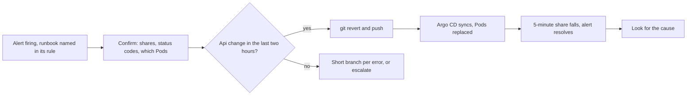

## Bạn cần biết trước

- [[devops.l4.on-call]] — bạn biết người trực sự cố của tuần phải trả lời cảnh báo gắn label `severity: page`, và được chuyển cấp bất cứ lúc nào.
- [[devops.l3.rollback-by-revert]] — bạn biết đường lui khỏi một thay đổi hỏng trên staging là một lệnh `git revert` trong repo cấu hình, rồi Argo CD sync nó.
- [[devops.l3.disaster-recovery-drill]] — bạn biết diễn tập là cố ý làm hỏng một môi trường, để tìm ra chỗ các bước viết sẵn còn thiếu trước khi thảm họa thật xảy ra.
- [[devops.l4.progressive-delivery]] — bạn biết trọng số của canary được đặt bằng một commit, và giới hạn `catalog-reads` chỉ cho một lượt đọc mỗi lúc sẽ làm lượt đọc sản phẩm lỗi.

## Tình huống

Giả sử bạn là người trực sự cố tuần này. Sáng nay mở Prometheus của staging ra kiểm, bạn thấy `ProductReadsFastBurn` đang firing: hơn 6,72% lượt đọc sản phẩm đã lỗi, cả trong 1 giờ qua lẫn 5 phút qua. Bạn mở `Program.cs`, rồi log của api, và dựng một giả thuyết về database. Bốn mươi phút sau bạn vẫn đang đọc code, và trong lúc đó mỗi lượt đọc lỗi lại tiêu vào error budget. Rồi một đồng nghiệp phát hiện có người đã đổi một thiết lập của api trên staging một giờ trước khi cảnh báo bật. Không có gì bảo bạn nhìn vào đó trước tiên.

Trong những phút đầu, khi chưa ai biết nguyên nhân, người trả lời cảnh báo nên làm gì, và làm sao họ biết bước đó có tác dụng?

## Khái niệm cốt lõi

- **runbook** (hướng dẫn viết sẵn cho một alert: ý nghĩa, cách xác nhận, bước an toàn đầu tiên, khi nào chuyển cấp) — quy trình viết sẵn cho một cảnh báo: cảnh báo đó có nghĩa gì với khách, cách xác nhận nó, các hành động an toàn đầu tiên, và khi nào chuyển cấp.
- **giảm thiểu** (mitigation) — hành động chặn ảnh hưởng tới khách trước khi ai biết nguyên nhân, chẳng hạn revert thay đổi gần nhất.
- Hành động an toàn đầu tiên (từ thông thường) — một bước người bị gọi tự làm được một mình, có ghi lại, hoàn tác được, và hiệu quả hiện ra trong vài phút trên chính các số đo của cảnh báo.
- Diễn tập (từ thông thường) — cố ý gây ra một lỗi đã biết trên staging rồi làm theo runbook để xử lý nó, xem các bước có chạy đúng không.

## Cơ chế hoạt động



Trong tình huống trên, cảnh báo tới mà không kèm chỉ dẫn nào, nên bạn bắt đầu từ chỗ thói quen dẫn tới: code. Runbook đưa lựa chọn đó về một lúc bình tĩnh, trước khi sự cố xảy ra.

Đọc từ trái sang. Người bị gọi mở runbook mà cảnh báo chỉ tới, rồi xác nhận các tỉ lệ, các status code, và Pod nào đang lỗi.

Nút quyết định hỏi một câu trả lời được nhanh: trong hai giờ trước khi cảnh báo bật, môi trường của api có gì thay đổi không? Lịch sử của repo cấu hình trả lời câu đó, vì mọi thay đổi trên staging đều là một commit ở đó. Nếu có, hành động an toàn đầu tiên là revert commit ấy. Đó là giảm thiểu: nó không giải thích gì cả, nó gỡ đi thủ phạm khả nghi nhất. Bản thân lần revert cũng là một commit, nên nó được ghi lại và có thể revert ngược lại.

Sau đó Argo CD sync trạng thái đã revert và các Pod của api được thay mới. Chính các số đo của cảnh báo cho biết cách làm có hiệu quả không: tỉ lệ 5 phút giảm trong vài phút. Cảnh báo cần cả tỉ lệ 1 giờ lẫn tỉ lệ 5 phút ở trên ngưỡng, nên chỉ cần tỉ lệ 5 phút giảm là cảnh báo hết. Chỉ tới lúc đó mới có người đi tìm nguyên nhân, với commit hỏng vẫn nằm trong lịch sử để xem xét.

Nếu không có gì thay đổi, runbook cho mỗi loại lỗi một nhánh ngắn, ngoài ra chỉ có một chỉ dẫn: chuyển cấp.

## Trong hệ thống Đơn Hàng

Mỗi cảnh báo gắn label `severity: page` trong `slo.rules.yml` có một annotation `runbook:` chứa đường dẫn trong `docs/runbooks/`. Với `ProductReadsFastBurn`, đó là `docs/runbooks/product-reads-burn.md` (dòng 32). Annotation là ghi chú gắn vào cảnh báo cho người đọc nó, khác với label, thứ Prometheus dùng để phân biệt các cảnh báo với nhau. `docs/design/alerts.md` yêu cầu mọi cảnh báo `page` phải có runbook.

Các mục đầu của `product-reads-burn.md`, nằm ngoài đoạn trích dưới đây, nói cảnh báo có nghĩa gì với khách: ở tốc độ này, budget đọc sản phẩm của 28 ngày hết sau khoảng 50 giờ (dòng 8–13). Tiếp theo là bốn bước kiểm (dòng 15–34): tỉ lệ 5 phút và 1 giờ, lỗi là `503` hay `5xx` khác, lỗi đến từ một giá trị của label `app` hay từ tất cả, và các Pod của api có Ready không. `503` nghĩa là giới hạn `catalog-reads` đã từ chối lượt đọc. `500` chỉ vào bên trong api hoặc thứ api gọi tới.

Bước 1 mở đầu ở dòng 38: giảm thiểu trước, tìm nguyên nhân sau. Phần còn lại của bước 1:

```markdown file=docs/runbooks/product-reads-burn.md tag=stage-4 lines=45-53
Có commit trong khoảng hai giờ trước khi alert bật mà đổi api (image, cấu
hình, biến môi trường, số replica): `git revert` commit đó và push, như
`devops.l3.rollback-by-revert`. Đang có canary thì đặt trọng số `api-canary` về
0 trước (`docs/design/canary-checks.md`). Không sửa tay Deployment trên
cluster: Argo CD sẽ đưa nó về theo Git, và người khác không biết đã đổi gì.

Sau revert, chờ rollout xong (`kubectl rollout status deployment/api -n donhang`)
và xem tỉ lệ 5 phút giảm. Alert hết khi tỉ lệ 5 phút xuống dưới ngưỡng, trong
khi tỉ lệ 1 giờ có thể còn trên ngưỡng một lúc: đó là đúng thiết kế.
```

Dòng 45–47: revert commit trong hai giờ trước khi cảnh báo bật mà đã đổi api (image, cấu hình, biến môi trường, số replica) rồi push. Nếu đang có canary thì đặt trọng số `api-canary` về 0 trước. Dòng 48–49 cấm sửa tay Deployment: Application của Argo CD trên staging bật self-heal, nên nó sẽ đưa Deployment về đúng như Git ghi, và không ai khác biết đã đổi gì.

Sau đoạn trích, bước 2 xử lý trường hợp không có thay đổi gần đây: mỗi loại lỗi một dòng, việc gì không rõ thì "chuyển cấp". Cũng phải chuyển cấp sau 15 phút (con số runbook ghi là giả định) mà tỉ lệ 5 phút không giảm, hoặc khi đặt đơn hàng cũng lỗi.

`incident-drill.sh` kiểm runbook này bằng một lỗi thật. Dòng 50–76 của nó, nằm ngoài đoạn trích, patch `envs/staging/kustomization.yaml` để thêm hai biến môi trường vào Deployment `api`: `RateLimiting__CatalogReads__PermitLimit` = `1` và `RateLimiting__CatalogReads__QueueLimit` = `0`, tức mỗi lúc một lượt đọc sản phẩm, không lượt nào được chờ. `Program.cs` không đổi: nó vốn đã đọc mục cấu hình `RateLimiting:CatalogReads` vào options của giới hạn, và biến môi trường có `__` trong tên sẽ điền vào mục đó. Script commit, chờ rollout xong, rồi đọc sản phẩm liên tục cho tới khi cảnh báo firing.

```bash file=scripts/devops/incident-drill.sh tag=stage-4 lines=87-110
# lesson: devops.l4.runbooks
# The runbook's first step (docs/runbooks/product-reads-burn.md): the
# newest change to envs/staging, reverted, before anyone looks for a cause.
echo "== runbook step 1: the newest commits that changed envs/staging"
git -C "$config_repo" log --format='%h %an: %s' "$run_start..HEAD" -- envs/staging
change=$(git -C "$config_repo" log --format=%H -n 1 -- envs/staging)
config_revert incident-drill.sh "$change"
echo "reverted:"
git -C "$config_repo" log --format='%h %an: %s' -n 1 --author=incident-drill.sh
sync_app staging
kubectl rollout status deployment/api -n donhang --timeout=300s >/dev/null
echo

# lesson: devops.l4.runbooks
# Reads go on. The 5-minute share falls first; the alert resolves while the
# 1-hour share, still holding the failed reads, stays above the threshold.
echo "== reading products until the alert resolves"
wait_for inactive 1200
five=$(bad_share 5m)
hour=$(bad_share 1h)
touch "$work/stop"
wait "$load_pid"
echo "bad share over 5 minutes: $(percent "$five"), above $(percent $threshold): $(above "$five" && echo yes || echo no)"
echo "bad share over 1 hour: $(percent "$hour"), above $(percent $threshold): $(above "$hour" && echo yes || echo no)"
```

```text output=true
...
== reading products until the alert fires
ProductReadsFastBurn: pending
ProductReadsFastBurn: firing
bad share of product reads over 5 minutes above 6.7%: yes
bad share of product reads over 1 hour above 6.7%: yes

== runbook step 1: the newest commits that changed envs/staging
... incident-drill.sh: api: catalog-reads one read at a time, none waiting
reverted:
... incident-drill.sh: Revert "api: catalog-reads one read at a time, none waiting"

== reading products until the alert resolves
ProductReadsFastBurn: inactive
bad share over 5 minutes: ...%, above 6.7%: no
bad share over 1 hour: ...%, above 6.7%: yes
...
```

Dòng 91–93 làm đúng từng chữ bước 1 của runbook: liệt kê các commit đã đổi `envs/staging` trong lần chạy này, lấy commit mới nhất, và revert nó bằng `config_revert`, một hàm phụ nằm ngoài đoạn trích, chạy `git revert` rồi push. Không dòng nào ở đây đi tìm nguyên nhân. Dòng 96–97 chờ Argo CD và rollout. Dòng 104–110 chờ tới khi cảnh báo inactive, rồi in cả hai tỉ lệ so với ngưỡng. Các lượt đọc đến từ một process chạy nền, khởi động ngoài đoạn trích. Dòng 107–108 bảo nó dừng và chờ nó kết thúc.

Output cho thấy cảnh báo pending, rồi firing. Khi in, script làm tròn ngưỡng 6,72% thành 6,7%. Sau lần revert, cảnh báo chuyển sang inactive trong khi cửa sổ 1 giờ vẫn còn giữ các lượt đọc lỗi: cửa sổ ngắn có mặt chính là để làm việc này. Dòng cuối của script, nằm ngoài đoạn trích, cho diễn tập thất bại nếu tỉ lệ 1 giờ không còn ở trên ngưỡng, nên mỗi lần chạy đều kiểm câu đó của runbook. Phần đầu của runbook ghi rằng nó đã được thử trong diễn tập này (dòng 5–6).

## Đánh đổi

Người bị gọi làm gì trong những phút đầu:

| | Revert thay đổi gần đây trước | Tìm nguyên nhân trước | Nghĩ ra cách nào thử cách đó |
|---|---|---|---|
| Khách thấy lỗi | Tới khi rollout sau lần revert xong | Tới khi nguyên nhân được sửa | Không biết trước. Thử sai có thể thêm lỗi |
| Biết được gì về nguyên nhân | Biết sau, từ commit còn giữ trong lịch sử | Biết sớm hơn | Ít: nhiều thay đổi chồng lên nhau làm mờ cái nào đã giúp |
| Cái giá | Thêm một lần rollout. Thay đổi dữ liệu không được hoàn tác | Khách vẫn bị ảnh hưởng trong lúc bạn đọc | Những thay đổi không ai ghi lại |
| Hợp khi | Môi trường của api vừa đổi ngay trước cảnh báo | Mấy giờ qua không có gì đổi, hoặc revert không hoàn tác được thay đổi | Hiếm khi. Runbook bảo chuyển cấp thay vào đó |

Runbook chứa gì:

| | Các bước an toàn đầu tiên cho một cảnh báo | Mọi nguyên nhân và cách sửa | Không có runbook |
|---|---|---|---|
| Thời gian tới hành động đầu tiên | Vài phút | Tốn vào việc dò danh sách | Tùy người bị gọi |
| Các bước đã thật sự chạy trước đó | Ít, và đã diễn tập | Nhiều, phần lớn chưa từng chạy | Không có |
| Một nguyên nhân không ai lường trước | Chuyển cấp | Dù sao cũng không có trong danh sách | Người bị gọi đoán |
| Hợp khi | Ai trong lịch luân phiên cũng có thể bị gọi | Làm tài liệu tham khảo, không phải cho lúc bị gọi | Một người dựng và vận hành mọi thứ |

## Bạn sẽ chọn gì nếu…

- …commit mới nhất vào `envs/staging` đã ba ngày tuổi và lỗi là `503`: không có gì để revert, nên áp bước 2: số lượt đọc vượt quá mức giới hạn cho phép với số Pod hiện có. Thêm replica cho api bằng một commit, đừng nâng giới hạn trên cluster. Mỗi Pod api giữ một bộ kết nối database riêng, và `capacity-plan.md` yêu cầu tổng số kết nối luôn dưới `max_connections` của PostgreSQL, nên hãy kiểm điều đó trước.
- …commit một giờ trước đã đổi image của api, và migration của phiên bản đó đã chạy: revert khôi phục manifest, không khôi phục dữ liệu, nên api cũ sẽ chạy trên schema mới. Nếu migration chỉ thêm bảng, hoặc thêm cột mà api cũ bỏ qua được (cho phép null hoặc có giá trị mặc định), hãy revert như thường. Nếu không chắc, hãy chuyển cấp.
- …một canary đang ở bước 50% khi cảnh báo firing: đặt trọng số `api-canary` về 0 trước, và xem tỉ lệ 5 phút có giảm không trước khi revert thứ gì khác.

## Senior hay nhầm rằng…

- **"Trước khi đổi bất cứ thứ gì, phải tìm ra nguyên nhân gốc, không thì cách sửa có thể che mất nó."** → Thực ra revert không che gì cả: commit hỏng vẫn nằm trong lịch sử cạnh lần revert của nó, và lỗi có thể được cố ý đưa trở lại trên staging, như diễn tập vẫn làm. Trong lúc chờ, khách vẫn thấy lỗi. Bạn sẽ nhận ra khi một cuộc điều tra dài kết thúc bằng đúng lần revert lẽ ra đã làm được ngay từ đầu.
- **"Runbook tốt phải liệt kê mọi nguyên nhân có thể và cách sửa từng cái."** → Thực ra người bị gọi cần một hành động đầu tiên trong vài phút. `product-reads-burn.md` có một bước đầu tiên, mỗi loại lỗi một dòng, và "chuyển cấp" cho phần còn lại. Bạn sẽ nhận ra khi người bị gọi cuộn một danh sách dài, thử mục gần giống nhất, rồi thử mục khác.
- **"Runbook viết cẩn thận một lần thì đúng mãi."** → Thực ra hệ thống mà nó mô tả luôn thay đổi: tên Deployment, label, các file nó trỏ tới. Một bước không ai chạy lại từ đó có thể hỏng vào lúc tệ nhất, còn diễn tập chạy nó trên staging trước. Bạn sẽ nhận ra khi một lệnh chép từ runbook trả về "not found" giữa lúc đang có sự cố.

## Thử ngay (3 phút)

1. Trong `examples/don-hang` ở `stage-4`, chạy `grep -n "runbook:" deploy/gitops/config-repo/platform/monitoring/rules/slo.rules.yml`, rồi liệt kê thư mục `docs/runbooks/`.
2. Ghép mỗi đường dẫn in ra với một file trong thư mục, và ghi lại những cảnh báo nào trong file rule không có dòng `runbook:` cùng `severity` của chúng.
3. Trong `docs/runbooks/product-reads-burn.md`, tìm câu dự đoán hai dòng `bad share over …` ở cuối output của diễn tập phía trên.

Kết quả mong đợi: bốn dòng, 32, 62, 90 và 118, mỗi dòng chỉ tới một trong bốn file trong `docs/runbooks/`. Bốn cảnh báo không có dòng `runbook:` là các cảnh báo tiêu chậm, đều `severity: ticket`. Câu đó ở dòng 52–53.

<details><summary>Gợi ý đáp án</summary>

Các cảnh báo `SlowBurn` không gọi ai, nên chúng không có runbook. Dòng 52–53 nói tỉ lệ 1 giờ có thể còn trên ngưỡng sau khi cảnh báo hết, và đó là đúng thiết kế. Diễn tập in ra đúng như vậy.

</details>

## Liên hệ

- [[devops.l4.on-call]] — chỉ ra ai bị gọi. Bài này cho người đó các bước đầu tiên.
- [[devops.l3.rollback-by-revert]] — lần revert mà bước 1 dùng lại.
- [[devops.l3.disaster-recovery-drill]] — cùng ý tưởng, áp cho khôi phục.
- [[devops.l4.progressive-delivery]] — cùng lỗi `catalog-reads`, ở đó bị bắt trên một canary.
- [[devops.l3.deploying-by-commit]] — vì sao runbook tìm thay đổi trong lịch sử của `envs/staging`.
- [[devops.l4.feature-flags]] — kill switch là thêm một kiểu giảm thiểu.
- [[backend.l3.bulkhead]] — nơi giới hạn `catalog-reads` ra đời.
- [[devops.l4.incident-command]] — bước kế tiếp: khi một người làm theo runbook là không đủ.

## Tóm tắt 5 dòng

1. Runbook nêu ý nghĩa của một cảnh báo với khách, cách xác nhận nó, các hành động an toàn đầu tiên và khi nào chuyển cấp.
2. Giảm thiểu đi trước: `product-reads-burn.md` revert thay đổi gần đây của api trong repo cấu hình, rồi mới tìm nguyên nhân.
3. `incident-drill.sh` commit lên staging thiết lập `catalog-reads` chỉ cho một lượt đọc mỗi lúc, chờ `ProductReadsFastBurn` firing, rồi revert commit mới nhất.
4. Sau lần revert, tỉ lệ 5 phút giảm trước, nên cảnh báo hết trong khi tỉ lệ 1 giờ vẫn còn trên ngưỡng.
5. Một bước chưa ai chạy có thể sai. Diễn tập runbook trên staging phát hiện điều đó trước khi một sự cố thật làm thay.
