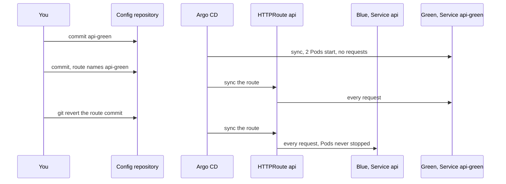

## Before you start

- [[devops.l3.rollback-by-revert]] — you know the way back with GitOps is a `git revert` commit, and that a revert restores manifests, not data.
- [[k8s.l2.gateway-api]] — you know the HTTPRoute `api` sends the requests it matches to the Service its `backendRefs` names.
- [[backend.l4.expand-and-contract]] — you know old and new code share one schema, so a schema change goes in compatible steps.
- [[backend.l4.capacity-planning]] — you know the capacity plan keeps Pods times connections per Pod below PostgreSQL's `max_connections`.

## The situation

A new api build has passed CI, and you are about to put it on staging the way you learned: a commit that changes the image tag, then a rolling update. During the rollout, the first new Pod gets requests as soon as it is ready, while an old Pod still answers others. For a while a customer's product list may come from either version, and nobody picked the moment the new one took over. If it misbehaves, going back is another rolling update that has to start Pods again. How can the new version be fully running before it gets a single request, then take every request at once, with a way back that starts nothing?

## Core concepts

- Deploying (not a new term) — putting a version on running Pods; in the situation above, the rolling update deploys Pod by Pod.
- Releasing (a plain word, used in this sense here) — sending customers' requests to a version; a rolling update releases each new Pod the moment it is ready, so deploying and releasing happen together.
- **blue-green deployment** — running the new version as a second full set of Pods, green, beside the current set, blue, and releasing it by moving every request at once, while blue keeps running so you can move back.
- Blue and green (not new terms) — in Đơn Hàng, blue is the Deployment `api` with its Service `api`, and green is the Deployment and Service `api-green`.
- The switch (not a new term) — one commit that changes the Service the HTTPRoute `api` names, from `api` to `api-green`.

## How it works



In the situation above, a rolling update deploys and releases in one motion: each new Pod gets requests once it is ready. Blue-green splits the two steps.

The first commit deploys. It adds green, the Deployment and Service `api-green`, with as many replicas as `api`. Argo CD syncs it, and green's Pods start and become ready. No request reaches them yet: the route still names the Service `api`, and the Service `api-green` selects only Pods labelled `app: api-green`.

The second commit releases. It changes one line of the route, the Service in `backendRefs`, from `api` to `api-green`. Once Argo CD syncs it, the route names only `api-green`, and a route naming one Service sends it every request it matches. No half-finished rollout shares the requests; the moment is the commit you chose.

Blue is not touched. Its Deployment keeps its 2 Pods running, now with no requests. Going back is one more commit, a `git revert` of the route change, and the requests return to Pods that are already ready. A rolling update back to the old image has to start Pods again and wait for them.

Two things stay shared. While both colours run, the api has twice its Pods, each with its own set of open database connections, which it keeps and reuses; all of them count against one server's connection limit. And both colours use one database, so whatever migration green brings, blue's code must still work with it, or the way back breaks.

## In the Đơn Hàng system

The first half of the release script, from green's commit to the switch:

```bash file=scripts/devops/blue-green.sh tag=stage-4 lines=31-55
echo "== commit api-green, as many replicas as api"
overlay_add deploy/gitops/lessons/api-green.yaml
config_commit blue-green.sh "api-green beside api, no traffic yet"
sync_app staging
kubectl rollout status deployment/api-green -n donhang --timeout=300s
kubectl get deployments api api-green -n donhang -o custom-columns='NAME:.metadata.name,REPLICAS:.spec.replicas,READY:.status.readyReplicas'
echo "route api: $(route_backends)"
before=$(blue_pods)
echo

load &
load_pid=$!
sleep 10

# lesson: devops.l4.blue-green-deployment
# The release: one commit that changes the Service the HTTPRoute api names,
# from api to api-green. Every request after Traefik applies it goes to
# green; blue keeps running, with no requests.
echo "== commit the route api -> api-green, while reads keep coming"
echo "switch" > "$work/phase"
set_backends api-green
config_commit blue-green.sh "Release: the route api sends to api-green"
release=$(config_head --verify)
git -C "$config_repo" show --format= HEAD -- "$routes" | grep -E '^[-+] '
sync_app edge-staging
```

```text output=true
== commit api-green, as many replicas as api
deployment "api-green" successfully rolled out
NAME        REPLICAS   READY
api         2          2
api-green   2          2
route api: api weight 1

== commit the route api -> api-green, while reads keep coming
-        - name: api
+        - name: api-green
route api: api-green weight 1

== git revert the release commit
route api: api weight 1

== product reads by phase and status code
  blue: 200 x...
  switch: 200 x...
  green: 200 x...
  switch back: 200 x...
  blue again: 200 x...
requests without a 2xx answer: 0
blue's Pods: the same 2 Pods as before the release, none restarted
...
```

Line 32 copies `api-green.yaml` into `envs/staging` of the config repository, and line 33 commits and pushes it. Line 34 waits until Argo CD's Application `staging` has synced that commit, and line 35 waits until green's Pods are ready. Line 38 records blue's Pods and their restart counts. Lines 41–42 start, in the background, the reads defined at lines 18–23: `GET /api/v1/products` through the Gateway, 5 at a time, until the end. Line 43 lets them reach blue for 10 seconds first.

Line 50 labels the reads that follow as phase `switch`, which the output groups by. Line 51 rewrites the route's `backendRefs` to name `api-green`, line 52 commits and pushes, line 53 keeps that commit's id for the later revert, and line 54 prints the lines it changed. Line 55 waits for a second Application, `edge-staging`, which holds the Gateway and its routes apart from the api's Deployments in `staging`; the helper functions live in `scripts/lib/release.sh`, outside the excerpt.

In the output, green has the same 2 replicas as `api`, both ready, while the route still names `api`. The `-` and `+` lines are the whole release. The commit sets no weight; the route's weight defaults to 1, and the script prints each Service the route names with its weight. With one Service named, it gets every request.

Lines 66–70 of the script, outside the excerpt, revert the release commit and wait for the route to name `api` again. The counts per phase vary per run and show as `...`; what matters is `0` requests without a `2xx` answer and blue's same 2 Pods, never restarted. The comment at the top of `api-green.yaml` says the overlay gives green its tag and digest as it does for `api`, so on staging both colours run the same image: the run shows the route changing and every read answered, not which colour answered each one.

What the capacity plan says about connections:

```markdown file=docs/design/capacity-plan.md tag=stage-4 lines=44-49
- Kết nối database: mỗi Pod api giữ một pool kết nối của Npgsql cho
  `ConnectionStrings:Default`, kích thước mặc định vì connection string không
  đặt. Payments, Notifications, các migration và job backup mở kết nối tới
  cùng server. Tổng số Pod × kết nối tối đa mỗi Pod của mọi service phải nhỏ
  hơn `max_connections` của PostgreSQL; đọc giá trị đó bằng
  `SHOW max_connections`, không đoán.
```

The plan says each api Pod keeps its own set of open connections through Npgsql, the library the api uses to talk to PostgreSQL, and that every service's Pods times the most connections each Pod may open must stay below `max_connections`. Lines 41–42 of the same file, outside the excerpt, count 2 api Pods. During a blue-green release the api has 4 while both colours run, so the sum must hold with both, or the release itself can push the server near its limit, where it starts refusing new connections. You check that before the first commit.

## Trade-offs

| | Rolling update | Blue-green, blue kept until you trust green | Blue-green, blue removed right after the switch |
|---|---|---|---|
| Who picks the moment customers meet the new version | Nobody; it follows each Pod's readiness | You, with the route commit | You, with the route commit |
| api Pods during the release | A few above the usual count | Twice the usual count | Twice, briefly |
| Way back | Another rolling update; Pods start | Revert the route commit; no Pod starts | Bring blue back first; Pods start |
| Database connections | Close to usual | Both colours' connections at once | Both, briefly |
| Schema change released with it | Must work with the old code during the rollout | Must work with blue's code until blue is gone | Must work with blue's code as long as you may bring blue back |

## What would you choose if…

- …the capacity plan's connection sum still holds with both colours, and the release's migration only adds columns: blue-green, keeping blue until green has served real requests for a while, because the way back costs one revert.
- …the connection sum is already close to `max_connections`: a rolling update, which adds only a few Pods at a time, unless you first redo the capacity plan for twice the api's Pods.
- …the release drops a column blue's code still reads: neither strategy gives a safe way back. Split the change with expand and contract first, so the release that drops the column comes after one whose code no longer reads it.

## Seniors often assume…

- **"Blue-green is just a faster rolling update."** → Actually it does not skip the wait: green's Pods start like any new Pods, and all of them must be ready before any request reaches them. What changes is who picks the moment of release and what going back costs. You notice this when most of the script's first step is `kubectl rollout status` for green, before the route changes at all.
- **"Switching back to blue also undoes the schema changes green's migration made."** → Actually the revert changes the route in the config repository; both colours use one database, which stays as green's migration left it. Blue then runs against the newer schema, which works only if that migration was a compatible step. You notice this when blue's requests fail with database errors right after the switch back, while the route correctly names `api`.
- **"Blue should be deleted as soon as the requests go to green, to free its resources."** → Actually blue's running Pods are the way back: while they run, going back is one revert and no Pod has to start. Remove the colour you leave only once you no longer need that way back, and budget its Pods and connections until then. You notice this when a problem appears after blue is gone, and going back means waiting for Pods to start, as with a rolling update.

## Try it (3 minutes)

With `donhang-staging` running from the GitOps lessons, in the `don-hang` repository folder:

1. Run `scripts/devops/blue-green.sh`. It waits for several syncs, so it can take a few minutes beyond the 3 in the heading; each sync wait gives up after 10 minutes with an error. If it stops and prints a command to run first, run that command and try again.
2. Read the line `requests without a 2xx answer:`, the line about blue's Pods and the line after `== remove api-green`.

Expected result: `requests without a 2xx answer: 0`, then `blue's Pods: the same 2 Pods as before the release, none restarted`, and `the api's Deployments now: api`, because the script removes green once blue is back.

## Connections

- [[k8s.l1.rolling-updates]] — the opposite approach: deploying and releasing together, Pod by Pod.
- [[k8s.l1.rollbacks]] — the way back one layer down, which starts Pods; blue-green's way back starts none.
- [[devops.l3.deploying-by-commit]] — the same commit-based flow, now with two commits: one deploys green, one releases it.
- [[backend.l4.expand-and-contract]] — still needed: blue-green moves requests, not schema, so both colours must work with one database.
- [[devops.l4.canary-release]] — next: the same route, sending only a small share of requests to the new version.

## Five-line summary

1. Blue-green runs the new version as a second full set of Pods beside the old, then moves every request to it in one step.
2. A rolling update deploys and releases together, Pod by Pod; blue-green deploys green first and releases it with one route commit.
3. In Đơn Hàng the switch changes the Service the HTTPRoute `api` names, from `api` to `api-green`; in the recorded run no product read failed.
4. Going back is a revert of that commit; blue's Pods never stopped, so no Pod has to start.
5. Both colours run at once on one database: budget twice the connections, and keep migrations compatible with blue's code.
