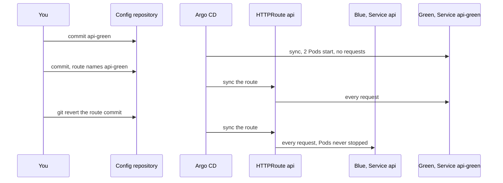

## Bạn cần biết trước

- [[devops.l3.rollback-by-revert]] — bạn biết với GitOps, đường quay lui là một commit `git revert`, và revert khôi phục manifest chứ không khôi phục dữ liệu.
- [[k8s.l2.gateway-api]] — bạn biết HTTPRoute `api` gửi các request nó khớp tới Service mà `backendRefs` của nó ghi tên.
- [[backend.l4.expand-and-contract]] — bạn biết code cũ và code mới dùng chung một schema, nên mỗi lần đổi schema phải đi qua các bước tương thích.
- [[backend.l4.capacity-planning]] — bạn biết kế hoạch dung lượng giữ số Pod × số kết nối mỗi Pod dưới `max_connections` của PostgreSQL.

## Tình huống

Một bản build api mới đã qua CI, và bạn sắp đưa nó lên staging theo cách đã học: một commit đổi tag image, rồi một rolling update. Trong lúc rollout, Pod mới đầu tiên nhận request ngay khi sẵn sàng, trong khi một Pod cũ vẫn trả lời các request khác. Trong một khoảng thời gian, danh sách sản phẩm khách nhận được có thể đến từ bản nào cũng được, và không ai chọn thời điểm bản mới tiếp quản. Nếu bản mới chạy sai, quay lại là thêm một rolling update nữa, lại phải khởi động Pod. Làm sao để bản mới chạy đầy đủ trước khi nhận request nào, rồi nhận mọi request cùng lúc, với một đường quay lui không phải khởi động gì?

## Khái niệm cốt lõi

- Deploy (không phải term mới) — đưa một phiên bản lên các Pod đang chạy. Trong tình huống trên, rolling update deploy từng Pod một.
- Phát hành (từ thông thường, ở đây dùng theo nghĩa này) — gửi request của khách tới một phiên bản. Rolling update phát hành mỗi Pod mới ngay lúc Pod đó sẵn sàng, nên deploy và phát hành diễn ra cùng nhau.
- **blue-green deployment** (chạy bản mới thành một bộ đầy đủ bên cạnh bản cũ rồi chuyển mọi request sang cùng lúc; bản cũ còn chạy để chuyển lại) — chạy phiên bản mới thành bộ Pod đầy đủ thứ hai, gọi là green, bên cạnh bộ hiện tại, gọi là blue, rồi phát hành bằng cách chuyển mọi request trong một lần. Blue vẫn chạy để bạn chuyển lại được.
- Blue và green (không phải term mới) — trong Đơn Hàng, blue là Deployment `api` cùng Service `api`, còn green là Deployment và Service `api-green`.
- Lần chuyển (không phải term mới) — một commit đổi Service mà HTTPRoute `api` ghi tên, từ `api` sang `api-green`.

## Cơ chế hoạt động



Trong tình huống trên, rolling update deploy và phát hành trong cùng một động tác: mỗi Pod mới nhận request ngay khi sẵn sàng. Blue-green tách hai bước đó ra.

Commit đầu tiên là deploy. Nó thêm green, tức Deployment và Service `api-green`, với số replica bằng `api`. Argo CD sync commit này, các Pod của green khởi động và sẵn sàng. Chưa request nào tới được chúng: route vẫn ghi tên Service `api`, còn Service `api-green` chỉ chọn các Pod mang nhãn `app: api-green`.

Commit thứ hai là phát hành. Nó đổi một dòng của route, Service trong `backendRefs`, từ `api` sang `api-green`. Khi Argo CD sync xong, route chỉ còn ghi tên `api-green`, và một route chỉ ghi tên một Service sẽ gửi cho Service đó mọi request nó khớp. Không có rollout dở dang nào chia request. Thời điểm phát hành chính là commit bạn chọn.

Blue không bị đụng tới. Deployment của blue vẫn giữ 2 Pod chạy, giờ không còn request nào. Quay lại chỉ cần thêm một commit, một lần `git revert` thay đổi route, và request trở về các Pod đã sẵn sàng từ trước. Một rolling update về image cũ thì phải khởi động lại Pod và chờ chúng.

Có hai thứ vẫn dùng chung. Trong lúc cả hai màu cùng chạy, api có gấp đôi số Pod, mỗi Pod có bộ kết nối database đang mở của riêng nó, giữ lại và dùng lại. Tất cả số kết nối đó đều tính vào giới hạn kết nối của cùng một server. Và hai màu dùng chung một database, nên migration nào green mang theo, code của blue cũng phải chạy được với nó, nếu không đường quay lui sẽ hỏng.

## Trong hệ thống Đơn Hàng

Nửa đầu của script phát hành, từ commit của green tới lần chuyển:

```bash file=scripts/devops/blue-green.sh tag=stage-4 lines=31-55
echo "== commit api-green, as many replicas as api"
overlay_add deploy/gitops/lessons/api-green.yaml
config_commit blue-green.sh "api-green beside api, no traffic yet"
sync_app staging
kubectl rollout status deployment/api-green -n donhang --timeout=300s
kubectl get deployments api api-green -n donhang -o custom-columns='NAME:.metadata.name,REPLICAS:.spec.replicas,READY:.status.readyReplicas'
echo "route api: $(route_backends)"
before=$(blue_pods)
echo

load &
load_pid=$!
sleep 10

# lesson: devops.l4.blue-green-deployment
# The release: one commit that changes the Service the HTTPRoute api names,
# from api to api-green. Every request after Traefik applies it goes to
# green; blue keeps running, with no requests.
echo "== commit the route api -> api-green, while reads keep coming"
echo "switch" > "$work/phase"
set_backends api-green
config_commit blue-green.sh "Release: the route api sends to api-green"
release=$(config_head --verify)
git -C "$config_repo" show --format= HEAD -- "$routes" | grep -E '^[-+] '
sync_app edge-staging
```

```text output=true
== commit api-green, as many replicas as api
deployment "api-green" successfully rolled out
NAME        REPLICAS   READY
api         2          2
api-green   2          2
route api: api weight 1

== commit the route api -> api-green, while reads keep coming
-        - name: api
+        - name: api-green
route api: api-green weight 1

== git revert the release commit
route api: api weight 1

== product reads by phase and status code
  blue: 200 x...
  switch: 200 x...
  green: 200 x...
  switch back: 200 x...
  blue again: 200 x...
requests without a 2xx answer: 0
blue's Pods: the same 2 Pods as before the release, none restarted
...
```

Dòng 32 chép `api-green.yaml` vào `envs/staging` của repo cấu hình, và dòng 33 commit rồi push nó. Dòng 34 chờ tới khi Application `staging` của Argo CD đã sync commit đó, và dòng 35 chờ các Pod của green sẵn sàng. Dòng 38 ghi lại các Pod của blue cùng số lần khởi động lại của chúng. Dòng 41–42 chạy nền các lượt đọc định nghĩa ở dòng 18–23: `GET /api/v1/products` qua Gateway, 5 request song song, cho tới cuối script. Dòng 43 để chúng tới blue trong 10 giây trước đã.

Dòng 50 gắn nhãn phase `switch` cho các lượt đọc tiếp theo, output nhóm kết quả theo nhãn này. Dòng 51 viết lại `backendRefs` của route để ghi tên `api-green`, dòng 52 commit và push, dòng 53 giữ id của commit đó cho lần revert sau, và dòng 54 in các dòng đã đổi. Dòng 55 chờ một Application thứ hai, `edge-staging`, nơi giữ Gateway và các route, tách khỏi các Deployment của api trong `staging`. Các hàm hỗ trợ nằm trong `scripts/lib/release.sh`, ngoài đoạn trích.

Trong output, green có cùng 2 replica như `api`, cả hai đều sẵn sàng, trong khi route vẫn ghi tên `api`. Hai dòng `-` và `+` là toàn bộ lần phát hành. Commit không đặt weight nào: weight của route mặc định là 1, và script in mỗi Service mà route ghi tên kèm weight của nó. Khi chỉ một Service được ghi tên, Service đó nhận mọi request.

Dòng 66–70 của script, ngoài đoạn trích, revert commit phát hành và chờ tới khi route ghi tên `api` trở lại. Số lượt đọc mỗi phase thay đổi theo từng lần chạy nên hiện thành `...`. Điều quan trọng là `0` request không nhận được câu trả lời `2xx`, và vẫn 2 Pod cũ của blue, chưa từng khởi động lại. Comment ở đầu `api-green.yaml` cho biết overlay gán cho green tag và digest giống như cho `api`, nên trên staging cả hai màu chạy cùng một image. Lần chạy cho thấy route đổi và mọi lượt đọc đều được trả lời, chứ không cho thấy màu nào trả lời lượt nào.

Kế hoạch dung lượng nói gì về kết nối:

```markdown file=docs/design/capacity-plan.md tag=stage-4 lines=44-49
- Kết nối database: mỗi Pod api giữ một pool kết nối của Npgsql cho
  `ConnectionStrings:Default`, kích thước mặc định vì connection string không
  đặt. Payments, Notifications, các migration và job backup mở kết nối tới
  cùng server. Tổng số Pod × kết nối tối đa mỗi Pod của mọi service phải nhỏ
  hơn `max_connections` của PostgreSQL; đọc giá trị đó bằng
  `SHOW max_connections`, không đoán.
```

Theo kế hoạch, mỗi Pod api giữ bộ kết nối đang mở của riêng nó qua Npgsql, thư viện api dùng để nói chuyện với PostgreSQL, và tổng số Pod × số kết nối tối đa mỗi Pod của mọi service phải nhỏ hơn `max_connections`. Dòng 41–42 của cùng file, ngoài đoạn trích, tính 2 Pod api. Trong một lần phát hành blue-green, api có 4 Pod khi hai màu cùng chạy, nên tổng phải đủ cho cả hai. Nếu không, chính lần phát hành có thể đẩy server tới gần giới hạn, lúc nó bắt đầu từ chối kết nối mới. Bạn kiểm tra điều đó trước commit đầu tiên.

## Đánh đổi

| | Rolling update | Blue-green, giữ blue tới khi tin được green | Blue-green, gỡ blue ngay sau lần chuyển |
|---|---|---|---|
| Ai chọn thời điểm khách gặp bản mới | Không ai, nó theo trạng thái sẵn sàng của từng Pod | Bạn, bằng commit đổi route | Bạn, bằng commit đổi route |
| Số Pod api trong lúc phát hành | Nhiều hơn bình thường vài Pod | Gấp đôi bình thường | Gấp đôi, trong thời gian ngắn |
| Đường quay lui | Thêm một rolling update, Pod phải khởi động | Revert commit đổi route, không Pod nào khởi động | Phải đưa blue trở lại trước, Pod phải khởi động |
| Kết nối database | Gần như bình thường | Kết nối của cả hai màu cùng lúc | Cả hai, trong thời gian ngắn |
| Thay đổi schema phát hành kèm | Phải chạy được với code cũ trong lúc rollout | Phải chạy được với code của blue tới khi blue bị gỡ | Phải chạy được với code của blue chừng nào bạn còn có thể đưa blue trở lại |

## Bạn sẽ chọn gì nếu…

- …tổng kết nối trong kế hoạch dung lượng vẫn đủ khi chạy cả hai màu, và migration của lần phát hành chỉ thêm cột: blue-green, giữ blue tới khi green đã phục vụ request thật một thời gian, vì quay lại chỉ tốn một lần revert.
- …tổng kết nối đã gần chạm `max_connections`: rolling update, vốn mỗi lần chỉ thêm vài Pod, trừ khi bạn làm lại kế hoạch dung lượng cho gấp đôi số Pod của api trước.
- …lần phát hành xóa một cột mà code của blue vẫn đọc: không chiến lược nào cho đường quay lui an toàn. Hãy tách thay đổi bằng expand and contract trước, để lần phát hành xóa cột đến sau một lần phát hành mà code đã không còn đọc cột đó.

## Senior hay nhầm rằng…

- **"Blue-green chỉ là một rolling update nhanh hơn."** → Thực ra nó không bỏ qua thời gian chờ: Pod của green khởi động như mọi Pod mới, và tất cả phải sẵn sàng trước khi request nào tới được chúng. Điều thay đổi là ai chọn thời điểm phát hành và quay lại tốn bao nhiêu. Bạn sẽ nhận ra khi phần lớn bước đầu của script là `kubectl rollout status` cho green, trước cả khi route đổi.
- **"Chuyển về blue thì cũng hoàn tác luôn các thay đổi schema mà migration của green đã làm."** → Thực ra revert chỉ đổi route trong repo cấu hình. Hai màu dùng chung một database, và database vẫn giữ nguyên như migration của green để lại. Khi đó blue chạy trên schema mới hơn, và chỉ chạy được nếu migration đó là một bước tương thích. Bạn sẽ nhận ra khi request của blue lỗi database ngay sau lần chuyển về, trong khi route đã ghi đúng tên `api`.
- **"Nên xóa blue ngay khi request đã chuyển sang green, để giải phóng tài nguyên."** → Thực ra các Pod đang chạy của blue chính là đường quay lui: khi chúng còn chạy, quay lại chỉ là một lần revert và không Pod nào phải khởi động. Chỉ gỡ màu bạn rời đi khi không còn cần đường quay lui đó nữa, và tới lúc đó vẫn phải tính Pod và kết nối của nó vào ngân sách. Bạn sẽ nhận ra khi một lỗi xuất hiện sau khi blue đã bị gỡ, và quay lại nghĩa là chờ Pod khởi động, giống như với rolling update.

## Thử ngay (3 phút)

Với `donhang-staging` đang chạy từ các bài GitOps, trong thư mục repository `don-hang`:

1. Chạy `scripts/devops/blue-green.sh`. Script chờ nhiều lần sync, nên có thể mất thêm vài phút ngoài 3 phút ở tiêu đề. Mỗi lần chờ sync sẽ bỏ cuộc sau 10 phút và báo lỗi. Nếu script dừng và in ra một lệnh cần chạy trước, hãy chạy lệnh đó rồi thử lại.
2. Đọc dòng `requests without a 2xx answer:`, dòng nói về các Pod của blue và dòng ngay sau `== remove api-green`.

Kết quả mong đợi: `requests without a 2xx answer: 0`, rồi `blue's Pods: the same 2 Pods as before the release, none restarted`, và `the api's Deployments now: api`, vì script gỡ green khi blue đã trở lại.

## Liên hệ

- [[k8s.l1.rolling-updates]] — cách làm ngược lại: deploy và phát hành cùng lúc, từng Pod một.
- [[k8s.l1.rollbacks]] — đường quay lui ở tầng bên dưới, phải khởi động Pod. Đường quay lui của blue-green không khởi động Pod nào.
- [[devops.l3.deploying-by-commit]] — cùng luồng dựa trên commit đó, giờ với hai commit: một commit deploy green, một commit phát hành nó.
- [[backend.l4.expand-and-contract]] — vẫn cần: blue-green chuyển request, không chuyển schema, nên cả hai màu phải chạy được với một database.
- [[devops.l4.canary-release]] — bài kế: cùng route đó, chỉ gửi một phần nhỏ request tới bản mới.

## Tóm tắt 5 dòng

1. Blue-green chạy bản mới thành bộ Pod đầy đủ thứ hai bên cạnh bản cũ, rồi chuyển mọi request sang trong một bước.
2. Rolling update deploy và phát hành cùng lúc, từng Pod một, còn blue-green deploy green trước rồi phát hành bằng một commit đổi route.
3. Trong Đơn Hàng, lần chuyển đổi Service mà HTTPRoute `api` ghi tên, từ `api` sang `api-green`, và trong lần chạy được ghi lại không lượt đọc sản phẩm nào lỗi.
4. Quay lại là revert commit đó. Các Pod của blue chưa từng dừng, nên không Pod nào phải khởi động.
5. Hai màu chạy cùng lúc trên một database: tính gấp đôi số kết nối, và giữ migration tương thích với code của blue.
