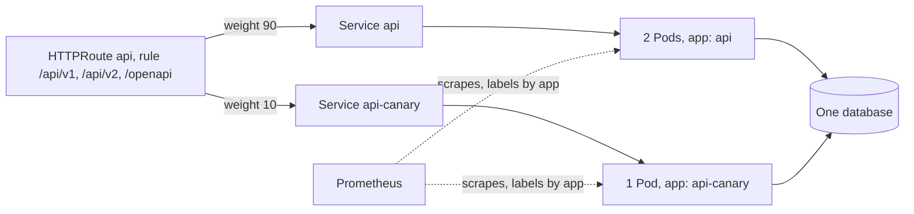

## Before you start

- [[devops.l4.blue-green-deployment]] — you know that a version is released by a commit that changes which Service the HTTPRoute `api` names, and that both versions share one database.
- [[devops.l2.prometheus-scraping]] — you know Prometheus scrapes each target's `/metrics` every `scrape_interval` and stores one time series per set of label values.
- [[devops.l2.counters-and-rate]] — you know a counter only goes up, so you read it through its growth, and `sum by (...)` adds series per label value.
- [[k8s.l1.labels]] — you know a Service finds its Pods through a label selector, never by their names.

## The situation

With blue-green, one commit moved every api request on staging from `api` to `api-green`. Had green been broken, every customer would have met the fault at once, until the revert. The next api build changes how product reads are answered, and you would rather it met a few requests first. You also want a number, not a feeling: how many requests the new version actually served, next to the current one. How can a small, fixed share of the requests reach the new version while the rest stay on the current one, and how do you count what each version served?

## Core concepts

- **canary release** — sending a small share of the requests to the new version while the rest stays on the current one, so a fault in the new version reaches only that share.
- The canary (not a new term) — in Đơn Hàng, the Deployment `api-canary`, one Pod labelled `app: api-canary`, and its Service `api-canary`, running beside the Deployment `api`.
- Weight (a plain word, used in this sense here) — a number on each Service an HTTPRoute rule names; each Service gets requests in proportion to its weight over the sum of the rule's weights.
- The count per Deployment (not a new term) — Prometheus's series of `http_requests_received_total`, each carrying the `app` label of the Pod it was scraped from.

## How it works



In the situation above, blue-green's route named one Service at a time. A canary release names two in the same rule, each with a weight. `canary.sh` sets 90 for `api` and 10 for `api-canary`, so `api` gets 90/(90+10) of the requests and `api-canary` gets 10/(90+10), a tenth.

The two Deployments stay apart through their labels. The canary's Pod carries `app: api-canary`, so the Service `api`, which selects `app: api`, never takes it; only the route's weight decides how many requests it gets.

Prometheus on staging, added at stage-4, scrapes every api Pod, including the canary, and copies each Pod's `app` label onto its series. One query, `sum by (app)`, then gives one count for `api` and one for `api-canary`.

The weights are a proportion of requests, not of customers. Nothing on the route keeps one customer's requests on one backend, so one customer's product list may come from `api` and the next read from `api-canary`, within a single visit. Both versions also read and write one database. Whatever one version writes, the other must accept.

A rolling update also runs two versions for a while, but there the share follows how many Pods have been replaced so far, and it keeps rising until every Pod runs the new version. A canary's share stays where you set it until someone commits a new weight. Here that commit sets `api-canary` to 0, which sends it nothing, and then removes it.

## In the Đơn Hàng system

How staging's Prometheus finds the api's Pods and labels their series:

```yaml file=deploy/gitops/config-repo/platform/monitoring/prometheus.yaml tag=stage-4 lines=57-78
    scrape_configs:
      # lesson: devops.l4.canary-release
      # Targets from the API server: every Pod in donhang. Only Pods whose
      # label app is api, api-canary or api-green are kept, on their port
      # 8080, and each series gets the Pod's app label, so one query
      # tells the Deployments apart.
      - job_name: api
        kubernetes_sd_configs:
          - role: pod
            namespaces:
              names: [donhang]
        relabel_configs:
          - source_labels: [__meta_kubernetes_pod_label_app]
            regex: api|api-canary|api-green
            action: keep
          - source_labels: [__meta_kubernetes_pod_container_port_number]
            regex: "8080"
            action: keep
          - source_labels: [__meta_kubernetes_pod_label_app]
            target_label: app
          - source_labels: [__meta_kubernetes_pod_name]
            target_label: pod
```

Lines 64–67 have Prometheus ask the API server for the Pods of the namespace `donhang`, instead of a fixed target as in Compose. It hands over each Pod's labels and ports under names starting with `__meta_kubernetes_pod_`, which the rules read. Lines 69–74 keep only Pods whose `app` label is one of the three api Deployments, on port `8080`. Lines 75–76 copy the Pod's `app` label onto every series scraped from it, as a label also called `app`; lines 77–78 add the Pod's name as `pod`, which the per-`app` query does not use. Without lines 75–76, the canary's requests and `api`'s would be one sum.

The canary itself, from the weights to the counts:

```bash file=scripts/devops/canary.sh tag=stage-4 lines=30-53
set_backends api 90 api-canary 10
config_commit canary.sh "Canary: api 90, api-canary 10"
git -C "$config_repo" show --format= HEAD -- "$routes" | grep -E '^[-+] '
sync_app edge-staging
wait_route "api weight 90, api-canary weight 10"
sleep 5
echo "route api: $(route_backends)"
echo

# lesson: devops.l4.canary-release
# Prometheus's counter of product reads per Deployment, before and after
# the 200 reads. The difference is what each Deployment served; increase()
# would estimate it from the samples instead of reading it.
query='sum by (app) (http_requests_received_total{method="GET", endpoint="api/v1/products"})'
echo "promql> $query"
before=$(requests_by app)
echo "== 200 product reads through the Gateway, 20 at a time"
read_products 200 | sort | uniq -c | awk '{print "  HTTP " $2 ": " $1}'
sleep 12 # two more scrapes, every 5 s
after=$(requests_by app)
echo "== product reads each Deployment served"
served=$(join -a 2 -e 0 -o 0,1.2,2.2 <(echo "$before" | sort) <(echo "$after" | sort) \
  | awk '{printf "%s %d\n", $1, $3 - $2}')
echo "$served" | awk '{printf "  %-11s %d\n", $1 ":", $2}'
```

```text output=true
...
== commit the route api: api 90, api-canary 10
+          weight: 90
+        - name: api-canary
+          port: 8080
+          weight: 10
route api: api weight 90, api-canary weight 10

promql> sum by (app) (http_requests_received_total{method="GET", endpoint="api/v1/products"})
== 200 product reads through the Gateway, 20 at a time
  HTTP 200: 200
== product reads each Deployment served
  api:        180
  api-canary: 20
  together:   200
...
```

The script first commits `api-canary.yaml` and waits until its Pod is ready and scraped (lines 18–23, outside the excerpt). It rewrites the route's `backendRefs` to name both Services with their weights (line 30). It commits and pushes (line 31), then prints the changed lines (line 32): the `+` lines add a weight to `api` and a second Service with weight 10, under the heading line 29 prints. It waits until Argo CD's Application `edge-staging` has synced and the route in the cluster names both weights (lines 33–34).

Then it counts. It reads the counter of product reads per `app` (line 45). It sends 200 reads through the Gateway, 20 at a time, and counts the answers by status code, printing `HTTP 200: 200` (line 47). It reads the counter again after two more scrapes (line 49) and subtracts before from after per `app` (lines 51–52). That difference is the exact count; `increase()`, named in the comment, works from the stored samples, so it would give an estimate. Lines 54–55, after the excerpt, print the total as `together`.

`api` served 180 reads and `api-canary` 20. The tenth came out exact in this run; the weights promise only a proportion, so another run may differ by a few requests. Here both Deployments run the same image, from the overlay's `images` field: the script shows the split and the counts, and a real canary would give `api-canary` the new build's tag. Lines 58–70 set the canary's weight to 0, remove it, and write `api` without a weight; a backend without one counts as weight 1.

## Trade-offs

| | Rolling update | Blue-green | Canary by weights |
|---|---|---|---|
| Share of requests on the new version | Follows the Pods replaced so far, rising to all | None, then all at once | The weight you commit, until you change it |
| Who sets that share | Nobody; each Pod's readiness | You, with one route commit | You, with each weight commit |
| Extra Pods during the release | Up to a quarter above the usual count by default, rounded up; here one | Twice the usual count | Here, one |
| What a fault in the new version reaches | A growing share as the rollout goes on | Every request after the switch | The canary's share |
| Way back | A rollback, itself a rolling update; Pods start | Revert the route commit; no Pod starts | Weight 0 for the canary; no Pod starts |
| Both versions serve at once | During the rollout | Only around the switch | For as long as the canary runs |

## What would you choose if…

- …the new build changes behaviour you cannot fully check before real requests meet it, and both versions accept each other's data: a canary with a small weight, comparing the two counts per `app`, because only that share meets a fault.
- …the new build writes data the current version cannot read: neither a canary nor blue-green yet. With a canary both versions write at the same time, so make them compatible first with expand and contract.
- …one customer must see one version for every request of a visit, such as a changed checkout spread over several calls: weights alone cannot give that, since they place each request on its own. Blue-green, which moves every request at once, fits better.

## Seniors often assume…

- **"With weight 10, the same tenth of the customers always gets the new version."** → Actually the route places each request on its own, so the canary gets a tenth of the requests, drawn from any customer. A customer who makes many requests in one visit may reach both versions. You notice this when one screen of the app shows data shaped by one version next to data from the other.
- **"A canary is a test environment that only the team can reach."** → Actually it sits behind the same Gateway and route as `api`, gets real requests through its weight, and writes to the same database. What it serves is what customers get. You notice this when an order placed through the canary's Pod shows up in `orders`, like any other order.
- **"Errors on the canary do not matter, because it serves so few requests."** → Actually each failed request is a real customer's, and the canary's errors are the very signal you run it for. Added to `api`'s, they look small; counted by `app`, they stand out. You notice this when an error count summed over every Pod barely moves, while the same query `by (app)` shows most failures come from `api-canary`.

## Try it (3 minutes)

With the cluster `donhang-staging`, which OpenTofu created and Argo CD syncs, running from the GitOps lessons, in the `don-hang` repository folder:

1. Run `scripts/devops/canary.sh`. It waits for several syncs, so it can take a few minutes beyond the 3 in the heading. If it stops and prints a command to run first, run that command and try again.
2. Read the lines under `== product reads each Deployment served` and the last `route api:` line.

Expected result: `api: 180`, `api-canary: 20` and `together: 200`, then `route api: api weight 1`, because the script removes the canary and writes `api` without a weight.

## Connections

- [[devops.l4.blue-green-deployment]] — the same route, moving every request at once; a canary moves only a share.
- [[k8s.l1.rolling-updates]] — the other way two versions serve together, where the share follows the Pods replaced instead of a weight you set.
- [[k8s.l2.gateway-api]] — the HTTPRoute whose `backendRefs` now carry a weight each.
- [[backend.l4.error-budget]] — where the failed requests a canary may cost are counted against an agreed limit.
- [[devops.l4.progressive-delivery]] — next: raising the canary's share step by step, only while its numbers stay within limits set in advance.

## Five-line summary

1. A canary release sends a small share of requests to the new version, so a fault in it reaches only that share.
2. An HTTPRoute rule may name several Services with weights; `canary.sh` gives `api` 90 and `api-canary` 10.
3. Staging's Prometheus copies each Pod's `app` label onto its series, so `sum by (app)` counts each Deployment's requests.
4. In the recorded run, 200 reads split into 180 and 20, measured as the counter's value after minus before.
5. Weights split requests, not customers, so both versions must accept each other's data while the canary runs.
