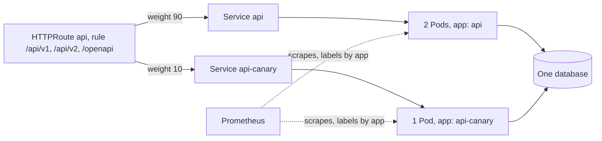

## Bạn cần biết trước

- [[devops.l4.blue-green-deployment]] — bạn biết một phiên bản được phát hành bằng một commit đổi Service mà HTTPRoute `api` ghi tên, và hai phiên bản dùng chung một database.
- [[devops.l2.prometheus-scraping]] — bạn biết Prometheus scrape `/metrics` của từng target sau mỗi `scrape_interval` và lưu một time series cho mỗi bộ giá trị label.
- [[devops.l2.counters-and-rate]] — bạn biết counter chỉ tăng, nên bạn đọc nó qua mức tăng, và `sum by (...)` cộng các series theo từng giá trị label.
- [[k8s.l1.labels]] — bạn biết Service tìm Pod của nó qua label selector, không bao giờ qua tên Pod.

## Tình huống

Với blue-green, một commit đã chuyển mọi request api trên staging từ `api` sang `api-green`. Giả sử green hỏng, mọi khách sẽ gặp lỗi cùng lúc, cho tới khi revert. Bản build api kế tiếp đổi cách trả lời các lượt đọc sản phẩm, và bạn muốn nó gặp vài request trước đã. Bạn cũng muốn có con số chứ không phải cảm giác: bản mới thực sự phục vụ bao nhiêu request, đặt cạnh bản hiện tại. Làm sao để một phần nhỏ, cố định của request tới bản mới trong khi phần còn lại vẫn ở bản hiện tại, và làm sao đếm được mỗi bản đã phục vụ bao nhiêu?

## Khái niệm cốt lõi

- **canary release** (gửi một phần nhỏ request tới phiên bản mới trong khi phần còn lại vẫn ở phiên bản đang chạy) — gửi một phần nhỏ request tới phiên bản mới, phần còn lại vẫn ở phiên bản hiện tại, để lỗi của bản mới chỉ chạm tới phần đó.
- Canary (không phải term mới) — trong Đơn Hàng, đó là Deployment `api-canary`, một Pod mang nhãn `app: api-canary`, cùng Service `api-canary`, chạy bên cạnh Deployment `api`.
- Weight (từ thông thường, ở đây dùng theo nghĩa này) — một con số gắn trên mỗi Service mà một rule của HTTPRoute ghi tên. Mỗi Service nhận request theo tỉ lệ weight của nó trên tổng weight của rule.
- Số đếm theo Deployment (không phải term mới) — các series `http_requests_received_total` của Prometheus, mỗi series mang label `app` của Pod mà nó được scrape từ đó.

## Cơ chế hoạt động



Trong tình huống trên, route của blue-green mỗi lúc chỉ ghi tên một Service. Canary release ghi tên hai Service trong cùng một rule, mỗi Service một weight. `canary.sh` đặt 90 cho `api` và 10 cho `api-canary`, nên `api` nhận 90/(90+10) số request, còn `api-canary` nhận 10/(90+10), tức một phần mười.

Hai Deployment tách biệt nhờ nhãn. Pod của canary mang nhãn `app: api-canary`, nên Service `api`, vốn chọn `app: api`, không bao giờ lấy nó. Chỉ weight của route quyết định canary nhận bao nhiêu request.

Prometheus trên staging, thêm vào ở stage-4, scrape mọi Pod api, kể cả canary, và chép label `app` của từng Pod sang các series của Pod đó. Khi đó chỉ một truy vấn `sum by (app)` cho ra một số đếm cho `api` và một cho `api-canary`.

Weight là tỉ lệ request, không phải tỉ lệ khách. Trên route không có gì giữ các request của một khách ở cùng một backend, nên danh sách sản phẩm của một khách có thể đến từ `api`, còn lượt đọc kế tiếp đến từ `api-canary`, ngay trong một lần ghé. Hai phiên bản cũng đọc và ghi cùng một database. Bản này ghi gì, bản kia phải chấp nhận được.

Rolling update cũng chạy hai phiên bản trong một khoảng thời gian, nhưng ở đó phần request đi theo số Pod đã được thay tới lúc đó, và nó tăng dần cho tới khi mọi Pod chạy bản mới. Phần request của canary giữ nguyên ở mức bạn đặt cho tới khi có người commit weight mới. Ở đây commit đó đặt `api-canary` về 0, tức không gửi gì cho nó, rồi gỡ nó đi.

## Trong hệ thống Đơn Hàng

Cách Prometheus của staging tìm các Pod của api và gắn label cho series của chúng:

```yaml file=deploy/gitops/config-repo/platform/monitoring/prometheus.yaml tag=stage-4 lines=57-78
    scrape_configs:
      # lesson: devops.l4.canary-release
      # Targets from the API server: every Pod in donhang. Only Pods whose
      # label app is api, api-canary or api-green are kept, on their port
      # 8080, and each series gets the Pod's app label, so one query
      # tells the Deployments apart.
      - job_name: api
        kubernetes_sd_configs:
          - role: pod
            namespaces:
              names: [donhang]
        relabel_configs:
          - source_labels: [__meta_kubernetes_pod_label_app]
            regex: api|api-canary|api-green
            action: keep
          - source_labels: [__meta_kubernetes_pod_container_port_number]
            regex: "8080"
            action: keep
          - source_labels: [__meta_kubernetes_pod_label_app]
            target_label: app
          - source_labels: [__meta_kubernetes_pod_name]
            target_label: pod
```

Dòng 64–67 cho Prometheus hỏi API server danh sách Pod của namespace `donhang`, thay vì một target cố định như trong Compose. API server trả về label và port của từng Pod dưới các tên bắt đầu bằng `__meta_kubernetes_pod_`, và các rule đọc những tên đó. Dòng 69–74 chỉ giữ các Pod có label `app` là một trong ba Deployment của api, trên port `8080`. Dòng 75–76 chép label `app` của Pod sang mọi series scrape từ Pod đó, thành một label cũng tên `app`. Dòng 77–78 thêm tên Pod thành `pod`, truy vấn theo `app` không dùng tới. Không có dòng 75–76, request của canary và của `api` sẽ gộp thành một tổng.

Bản thân canary, từ weight tới số đếm:

```bash file=scripts/devops/canary.sh tag=stage-4 lines=30-53
set_backends api 90 api-canary 10
config_commit canary.sh "Canary: api 90, api-canary 10"
git -C "$config_repo" show --format= HEAD -- "$routes" | grep -E '^[-+] '
sync_app edge-staging
wait_route "api weight 90, api-canary weight 10"
sleep 5
echo "route api: $(route_backends)"
echo

# lesson: devops.l4.canary-release
# Prometheus's counter of product reads per Deployment, before and after
# the 200 reads. The difference is what each Deployment served; increase()
# would estimate it from the samples instead of reading it.
query='sum by (app) (http_requests_received_total{method="GET", endpoint="api/v1/products"})'
echo "promql> $query"
before=$(requests_by app)
echo "== 200 product reads through the Gateway, 20 at a time"
read_products 200 | sort | uniq -c | awk '{print "  HTTP " $2 ": " $1}'
sleep 12 # two more scrapes, every 5 s
after=$(requests_by app)
echo "== product reads each Deployment served"
served=$(join -a 2 -e 0 -o 0,1.2,2.2 <(echo "$before" | sort) <(echo "$after" | sort) \
  | awk '{printf "%s %d\n", $1, $3 - $2}')
echo "$served" | awk '{printf "  %-11s %d\n", $1 ":", $2}'
```

```text output=true
...
== commit the route api: api 90, api-canary 10
+          weight: 90
+        - name: api-canary
+          port: 8080
+          weight: 10
route api: api weight 90, api-canary weight 10

promql> sum by (app) (http_requests_received_total{method="GET", endpoint="api/v1/products"})
== 200 product reads through the Gateway, 20 at a time
  HTTP 200: 200
== product reads each Deployment served
  api:        180
  api-canary: 20
  together:   200
...
```

Trước tiên script commit `api-canary.yaml` và chờ tới khi Pod của nó sẵn sàng và đã được scrape (dòng 18–23, ngoài đoạn trích). Nó viết lại `backendRefs` của route để ghi tên cả hai Service kèm weight (dòng 30). Nó commit và push (dòng 31), rồi in các dòng đã đổi (dòng 32): các dòng `+` thêm weight cho `api` và một Service thứ hai với weight 10, dưới dòng tiêu đề mà dòng 29 in ra. Nó chờ tới khi Application `edge-staging` của Argo CD đã sync và route trong cluster ghi đủ cả hai weight (dòng 33–34).

Sau đó nó đếm. Nó đọc counter lượt đọc sản phẩm theo từng `app` (dòng 45). Nó gửi 200 lượt đọc qua Gateway, mỗi lần 20, và đếm câu trả lời theo status code, in ra `HTTP 200: 200` (dòng 47). Nó đọc lại counter sau hai lần scrape nữa (dòng 49) và lấy giá trị sau trừ giá trị trước cho từng `app` (dòng 51–52). Hiệu đó là số đếm chính xác. `increase()`, được nhắc trong comment, tính từ các mẫu đã lưu, nên chỉ cho ra một ước lượng. Dòng 54–55, sau đoạn trích, in tổng thành `together`.

`api` phục vụ 180 lượt đọc, `api-canary` phục vụ 20. Trong lần chạy này, một phần mười ra đúng tuyệt đối. Weight chỉ hứa một tỉ lệ, nên lần chạy khác có thể lệch vài request. Ở đây cả hai Deployment chạy cùng một image, lấy từ trường `images` của overlay: script cho thấy cách chia và số đếm, còn một canary thật sẽ gán cho `api-canary` tag của bản build mới. Dòng 58–70 đặt weight của canary về 0, gỡ nó, và ghi `api` không kèm weight. Backend không có weight được tính là weight 1.

## Đánh đổi

| | Rolling update | Blue-green | Canary theo weight |
|---|---|---|---|
| Phần request ở bản mới | Theo số Pod đã thay tới lúc đó, tăng dần tới toàn bộ | Không có, rồi toàn bộ cùng lúc | Weight bạn commit, cho tới khi bạn đổi |
| Ai đặt phần đó | Không ai, nó theo trạng thái sẵn sàng của từng Pod | Bạn, bằng một commit đổi route | Bạn, bằng mỗi commit đổi weight |
| Pod thêm trong lúc phát hành | Mặc định tối đa một phần tư so với số thường lệ, làm tròn lên, ở đây là một | Gấp đôi số thường lệ | Ở đây, một |
| Lỗi của bản mới chạm tới đâu | Một phần lớn dần theo tiến độ rollout | Mọi request sau lần chuyển | Phần request của canary |
| Đường quay lui | Rollback, bản thân nó là một rolling update, Pod phải khởi động | Revert commit đổi route, không Pod nào khởi động | Weight 0 cho canary, không Pod nào khởi động |
| Hai bản cùng phục vụ | Trong lúc rollout | Chỉ quanh lần chuyển | Suốt thời gian canary chạy |

## Bạn sẽ chọn gì nếu…

- …bản build mới đổi hành vi mà bạn không kiểm tra hết được trước khi gặp request thật, và hai phiên bản chấp nhận dữ liệu của nhau: canary với weight nhỏ, so sánh hai số đếm theo `app`, vì chỉ phần request đó gặp lỗi.
- …bản build mới ghi dữ liệu mà bản hiện tại không đọc được: chưa nên dùng canary hay blue-green. Với canary, hai phiên bản ghi cùng lúc, nên trước hết hãy làm chúng tương thích bằng expand and contract.
- …một khách phải thấy cùng một phiên bản cho mọi request trong một lần ghé, như một luồng checkout đã đổi trải qua nhiều lần gọi: chỉ dùng weight thì không làm được, vì weight đặt từng request riêng rẽ. Blue-green, vốn chuyển mọi request cùng lúc, hợp hơn.

## Senior hay nhầm rằng…

- **"Với weight 10, luôn là cùng một phần mười khách nhận bản mới."** → Thực ra route đặt từng request riêng rẽ, nên canary nhận một phần mười số request, đến từ bất kỳ khách nào. Một khách gửi nhiều request trong một lần ghé có thể chạm tới cả hai phiên bản. Bạn sẽ nhận ra khi trên cùng một màn hình của app, dữ liệu theo cách của bản này nằm cạnh dữ liệu từ bản kia.
- **"Canary là môi trường thử mà chỉ team truy cập được."** → Thực ra nó đứng sau cùng Gateway và route với `api`, nhận request thật qua weight của nó, và ghi vào cùng database. Nó phục vụ gì thì khách nhận đúng cái đó. Bạn sẽ nhận ra khi một đơn hàng đặt qua Pod của canary xuất hiện trong `orders`, như mọi đơn khác.
- **"Lỗi trên canary không quan trọng, vì nó phục vụ quá ít request."** → Thực ra mỗi request lỗi là của một khách thật, và lỗi của canary chính là tín hiệu bạn chạy nó để thấy. Cộng chung với lỗi của `api` thì chúng trông nhỏ, đếm theo `app` thì chúng nổi rõ. Bạn sẽ nhận ra khi số lỗi cộng trên mọi Pod gần như không nhúc nhích, trong khi cùng truy vấn đó `by (app)` cho thấy phần lớn lỗi đến từ `api-canary`.

## Thử ngay (3 phút)

Với cluster `donhang-staging`, do OpenTofu tạo và Argo CD sync, đang chạy từ các bài GitOps, trong thư mục repository `don-hang`:

1. Chạy `scripts/devops/canary.sh`. Script chờ nhiều lần sync, nên có thể mất thêm vài phút ngoài 3 phút ở tiêu đề. Nếu script dừng và in ra một lệnh cần chạy trước, hãy chạy lệnh đó rồi thử lại.
2. Đọc các dòng dưới `== product reads each Deployment served` và dòng `route api:` cuối cùng.

Kết quả mong đợi: `api: 180`, `api-canary: 20` và `together: 200`, rồi `route api: api weight 1`, vì script gỡ canary và ghi `api` không kèm weight.

## Liên hệ

- [[devops.l4.blue-green-deployment]] — cùng route đó, chuyển mọi request trong một lần. Canary chỉ chuyển một phần.
- [[k8s.l1.rolling-updates]] — cách khác để hai phiên bản cùng phục vụ, ở đó phần request theo số Pod đã thay chứ không theo weight bạn đặt.
- [[k8s.l2.gateway-api]] — HTTPRoute mà giờ mỗi mục trong `backendRefs` mang một weight.
- [[backend.l4.error-budget]] — nơi các request lỗi mà canary có thể gây ra được tính vào một giới hạn đã thống nhất.
- [[devops.l4.progressive-delivery]] — bài kế: tăng dần phần request của canary theo từng bước, chỉ khi số đo của nó còn trong giới hạn đặt trước.

## Tóm tắt 5 dòng

1. Canary release gửi một phần nhỏ request tới bản mới, nên lỗi của bản mới chỉ chạm tới phần đó.
2. Một rule của HTTPRoute có thể ghi tên nhiều Service kèm weight. `canary.sh` cho `api` 90 và `api-canary` 10.
3. Prometheus của staging chép label `app` của từng Pod sang các series của nó, nên `sum by (app)` đếm request của từng Deployment.
4. Trong lần chạy được ghi lại, 200 lượt đọc chia thành 180 và 20, đo bằng giá trị counter sau trừ giá trị trước.
5. Weight chia request chứ không chia khách, nên hai phiên bản phải chấp nhận dữ liệu của nhau trong suốt thời gian canary chạy.
