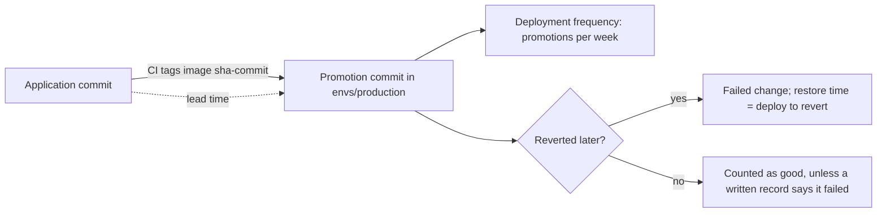

## Before you start

- [[devops.l4.release-strategy-per-component]] — you know ADR `0019` sets how each component is released; this lesson measures how those releases go.
- [[devops.l3.promoting-between-environments]] — you know a promotion is one commit to `envs/production` that names the image tag staging checked.
- [[devops.l3.rollback-by-revert]] — you know the way back from a bad deploy is a `git revert` of the deploy commit.

## The situation

The quarter ends. A teammate wants to promote to production every day instead of about once a week, so changes reach shops sooner. Another teammate objects: two promotions this quarter were reverted the same day, so releasing faster would only break things more often. Each has an opinion and no numbers.

You open the config repository. Its history holds every promotion to `envs/production` and every revert, each with a time. The application repository holds the commits those images were built from.

What should you count in these two histories to tell whether releasing faster is costing stability?

## Core concepts

- **DORA metrics** — the four measures of software delivery that Đơn Hàng's `delivery-metrics.md` takes from a long-running research program: deployment frequency, lead time for changes, change failure rate and time to restore service.
- Deployment frequency (a plain phrase, used in this sense here) — how many deploys reach production per week.
- **lead time for changes** — the time from a commit to its running in production.
- **change failure rate** — the share of production deploys that later turn out to cause a failure that needs a fix, such as a revert.
- Time to restore service (a plain phrase, used in this sense here) — how long production runs a failed deploy before it is back on a version that works.

## How it works



The four measures come in two pairs. Deployment frequency and lead time for changes measure throughput: how often and how quickly changes reach production. Change failure rate and time to restore measure stability: how often a deploy goes wrong and how long it stays wrong.

In the situation above, every measure is already in the two histories. Each promotion commit in `envs/production` is one deploy, so counting them per week gives deployment frequency. The promotion names an image tag `sha-<commit>`, and that commit in the application repository has its own time. The gap between the two times is the lead time for that change. The Đơn Hàng script `delivery-metrics.sh` (next section) takes the promotion commit's time as the moment the change reached production.

A revert commit undoes one promotion. That promotion is a failed change, and the script takes the revert's time as when production was back on a working version. Two reverts give two failed changes and two restore times.

The "no" branch of the diagram, "Counted as good", is the gap. A failure fixed by a later deploy (a forward fix, or fixing forward), or by a setting changed on the cluster, leaves no revert. The history counts that deploy as good. Only a written record of the failure can move it to the failed side.

The teammates argue about one pair at a time. The DORA metrics are read as a set: more deploys a week while the change failure rate rises is not progress, and a low failure rate bought by deploying once a month is not progress either.

## In the Đơn Hàng system

The counting loop of `delivery-metrics.sh`, which builds a made-up quarter of history with fixed dates and then reads it back:

```bash file=scripts/devops/delivery-metrics.sh tag=stage-4 lines=67-88
# lesson: devops.l4.delivery-metrics
# Every number comes from git log. A deploy is a commit that changes the
# image in envs/production, other than a revert; a revert marks the deploy
# it undoes as a failed change, and its time is when service was restored.
# Lead time runs from the application commit the sha- tag names.
deploys=0 failed=0 leads=() restores=()
declare -A deployed_at
while read -r commit time subject; do
  if [[ $subject == Revert* ]]; then
    undone=$(git -C "$work/config" show -s --format=%b "$commit" | sed -nE 's/^This reverts commit ([0-9a-f]+)\.$/\1/p')
    failed=$((failed + 1))
    restores+=($(( (time - deployed_at[$undone]) / 60 )))
    continue
  fi
  tag=$(git -C "$work/config" show --format= "$commit" -- envs/production | sed -nE 's/^\+ *newTag: sha-([0-9a-f]+)$/\1/p')
  [ -n "$tag" ] || continue
  [ "$(git -C "$work/config" rev-list --count "$commit")" -eq 1 ] && continue # the repository's first commit
  deploys=$((deploys + 1))
  deployed_at[$commit]=$time
  app_time=$(git -C "$work/app" show -s --format=%ct "$tag")
  leads+=($(( (time - app_time) / 60 )))
done < <(git -C "$work/config" log --reverse --format='%H %ct %s' -- envs/production)
```

The block starts at line 67 of the file, the `# lesson:` line. Line 88 feeds the loop every commit that touched `envs/production`, oldest first, with its commit time in seconds. Lines 75–79 handle a revert: they read the id of the undone commit from the revert's message, count one failed change, and store the minutes from that deploy to the revert. Lines 81–83 keep only commits that add a new `newTag: sha-` line and skip the repository's first commit, which set up production rather than deployed to it. Lines 86–87 look up the application commit the tag names and store the lead time in minutes. Lines 84–85 count the deploy and keep its time for the restore calculation.

```text output=true
== the config repository: git log -- envs/production
2026-07-03 17:00 d75cc92 gitops-repo.sh: Production as Đơn Hàng runs it
2026-07-07 15:00 b769d36 gitops-promote.sh: Promote api sha-cd15c56... to production
2026-07-14 10:00 78c3c11 gitops-promote.sh: Promote api sha-6fe331c... to production
2026-07-23 16:00 160d885 gitops-promote.sh: Promote api sha-28e2849... to production
2026-07-23 16:45 c2b7e50 gitops-revert.sh: Revert "Promote api sha-28e2849... to production"
2026-07-28 10:00 f68d95d gitops-promote.sh: Promote api sha-4098fb0... to production
2026-08-05 09:30 f23561a gitops-promote.sh: Promote api sha-9c5b48f... to production
2026-08-18 10:00 b34200f gitops-promote.sh: Promote api sha-c6b5527... to production
2026-08-26 14:00 4e889a7 gitops-promote.sh: Promote api sha-d86574a... to production
2026-08-26 17:10 b662a01 gitops-revert.sh: Revert "Promote api sha-d86574a... to production"
2026-09-01 10:00 e0f28ad gitops-promote.sh: Promote api sha-6659dec... to production
2026-09-09 11:00 cad9720 gitops-promote.sh: Promote api sha-eb3c42d... to production
2026-09-28 15:00 420d84b gitops-promote.sh: Promote api sha-4d2348e... to production

== the four metrics, for 13 weeks
deploys: 10, 0.8 a week
lead time for changes, median: 51.5 hours (each deploy, in hours: 29.0 24.5 74.0 97.0 22.5 139.0 28.0 121.0 22.0 173.0)
change failure rate: 2 of 10 deploys reverted, 20%
time to restore, median: 117.5 minutes (each failed deploy: 45 190 minutes)
```

The quarter has 10 deploys and 2 reverts, so the change failure rate is 20%. Lead time and restore time are reported as medians: the middle value, or with an even count, the mean of the two middle ones. So 29.0 and 74.0 give 51.5, and 45 and 190 give 117.5. One change that waited a long time does not pull lead time up.

The data sources section of `docs/team/delivery-metrics.md`:

```markdown file=docs/team/delivery-metrics.md tag=stage-4 lines=22-34
### Nguồn dữ liệu

- Repo cấu hình: mỗi commit đổi image ở `envs/production` là một deploy, theo
  cách `scripts/devops/gitops-promote.sh` promote. Commit `git revert` của
  một deploy đánh dấu deploy đó hỏng và là thời điểm khôi phục.
- Repo Đơn Hàng: thời điểm của commit ứng dụng mà tag `sha-` trỏ tới, để tính
  lead time.
- Bản ghi sự cố (`docs/postmortems/`): sự cố được sửa không bằng revert, như
  một bản sửa lỗi đi tiếp, hay một cấu hình sửa trên cluster. Bản ghi cho biết
  deploy nào gây ra và lúc nào dịch vụ trở lại bình thường.

`delivery-metrics.sh` chỉ đọc `git log`, nên chỉ thấy phần thứ nhất và thứ
hai.
```

Lines 24–28 are the two sources the script reads: the config repository for deploys and reverts, the application repository for commit times. Lines 29–31 add a third source the script cannot read: the team's written records of failures, for a failure fixed by a forward fix or by a setting changed on the cluster. Each record names the deploy that caused it and when service was back. Lines 33–34 say it directly: the script reads only `git log`, so it sees only the first two sources.

Further down, the document gives the cost of a missing record: the change failure rate comes out lower than it really is. It also says the metrics describe the delivery system, meaning the pipeline, review, tests and how deploys are done, and are never used to rank or judge developers.

## Trade-offs

Where the failed changes come from:

| | Config repository history only | History plus written failure records |
|---|---|---|
| Effort per quarter | None beyond running the script | Someone writes a record for each failure not fixed by a revert |
| Failures fixed by a revert | Counted | Counted |
| Failures fixed by a forward fix or a cluster setting | Missed, so the change failure rate looks lower | Counted, if the record names the deploy |
| Time to restore | From deploy to revert | From deploy to the time the record gives for service being back; more precise than the revert time when the record has it |
| Can be gamed by | Fixing forward instead of reverting | Not writing the record |

`delivery-metrics.md` takes the second column. The script covers what Git can see; the records cover the rest.

## What would you choose if…

- …a manager asks for each developer's lead time to find who is slow: report the team's median and where changes wait, for example between the application commit and the promotion. Numbers per person get gamed, for example by splitting one change into many small deploys, while the waiting stays where it was.
- …next quarter shows more deploys a week and the change failure rate rises from 20% to 30%: do not call it progress. Look at the reverted changes before releasing faster again, and check next quarter whether the rise holds, since with few deploys one failure moves the rate a lot.
- …a failure was fixed by the next deploy instead of a revert: write the record with the deploy that caused it and the time service was back, because the script will count that deploy as good.

## Seniors often assume…

- **"Deploying more often always means more failures in production."** → Actually the change failure rate is a share of deploys, so more deploys need not raise it; the four measures exist to check that instead of assuming it. When releases are rare, each one bundles many changes. You notice this when the team proposes fewer releases to "be safe" while each bundled release makes the change that failed harder to find.
- **"Lead time is how long the team took to build a feature from the first idea."** → Actually lead time for changes starts at a commit, not at the idea. In Đơn Hàng it runs from the application commit the `sha-` tag names to the promotion commit. You notice this when someone reports weeks of lead time for a change whose commit reached production in two days.
- **"These metrics are a good way to compare developers inside the team."** → Actually they describe the delivery system, and ranking people by them makes people change the numbers instead of the system. You notice this when deploys a week jump while each deploy carries a fraction of a change, or when failures stop being written down.

## Try it (3 minutes)

1. In `examples/don-hang` at `stage-4`, run `scripts/devops/delivery-metrics.sh`. Run it from a terminal at the repository root; it needs no cluster.
2. Compare its output with the block above.
3. Suppose the second failed promotion, the one reverted after 190 minutes, had been fixed by the next promotion instead of a revert. Without changing the script, write down what each of its four result lines would say.

Expected result: the output matches the block above line for line, because every date in the history is fixed.

<details><summary>Suggested answer</summary>

Without that revert the history holds 10 promotions and one revert. Deploys: 10, 0.8 a week. Lead time: unchanged, 51.5 hours, since no promotion moved. Change failure rate: 1 of 10, 10%. Time to restore: 45 minutes. The failure is still real, but only a written record would bring it back into the numbers.

</details>

## Connections

- [[devops.l3.promoting-between-environments]] — the promotion commit is what the script counts as a deploy.
- [[devops.l3.rollback-by-revert]] — the revert commit is what the script counts as a failed change and its restore time.
- [[devops.l2.deployment-environments]] — why only commits to `envs/production` count, not those to staging.
- [[devops.l2.cutting-a-release]] — the `sha-` image tag that links a deploy back to its application commit.
- [[backend.l4.error-budget]] — the same question one layer down: the budget measures one service against its SLO, these measures the way changes reach it.
- [[devops.l4.release-strategy-per-component]] — the release choices whose results these four measures show over a quarter.
- [[devops.l4.platform-engineering]] — next: a platform is judged partly by the delivery metrics of the teams that use it.

## Five-line summary

1. The DORA metrics are read as a set so that a team cannot buy release speed with more failures.
2. Deployment frequency and lead time for changes measure throughput; change failure rate and time to restore measure stability.
3. `delivery-metrics.sh` counts promotions to `envs/production` as deploys and reverted ones as failed changes, all from `git log`.
4. Git history sees only failures fixed by a revert, so `delivery-metrics.md` adds the team's written failure records.
5. The measures describe the delivery system, not people; used to rank developers they get gamed.
