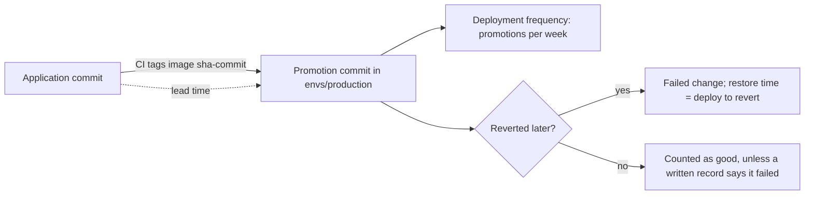

## Bạn cần biết trước

- [[devops.l4.release-strategy-per-component]] — bạn biết ADR `0019` quy định mỗi thành phần được phát hành theo cách nào, còn bài này đo xem các lần phát hành đó diễn ra ra sao.
- [[devops.l3.promoting-between-environments]] — bạn biết một lần promotion là một commit vào `envs/production`, ghi đúng image tag mà staging đã kiểm tra.
- [[devops.l3.rollback-by-revert]] — bạn biết cách quay lại sau một lần deploy hỏng là `git revert` commit deploy đó.

## Tình huống

Quý sắp kết thúc. Một đồng nghiệp muốn promote lên production mỗi ngày thay vì khoảng một lần mỗi tuần, để thay đổi tới tay các cửa hàng sớm hơn. Một đồng nghiệp khác phản đối: quý này có hai lần promotion bị revert ngay trong ngày, nên phát hành nhanh hơn chỉ khiến hệ thống hỏng thường xuyên hơn. Mỗi người có một ý kiến, nhưng không ai có số liệu.

Bạn mở repo cấu hình. Lịch sử của nó chứa mọi lần promotion vào `envs/production` và mọi lần revert, kèm thời điểm. Repository ứng dụng chứa các commit mà những image đó được build từ.

Bạn nên đếm gì trong hai lịch sử này để biết phát hành nhanh hơn có đang phải trả bằng độ ổn định không?

## Khái niệm cốt lõi

- **DORA metrics** (bốn số đo việc giao phần mềm: tần suất deploy, lead time for changes, tỉ lệ thay đổi gây lỗi, thời gian khôi phục) — bốn số đo việc giao phần mềm mà `delivery-metrics.md` của Đơn Hàng lấy từ một chương trình nghiên cứu kéo dài nhiều năm: tần suất deploy, lead time for changes, tỉ lệ thay đổi gây lỗi và thời gian khôi phục dịch vụ.
- Tần suất deploy (cụm từ thông thường, ở đây dùng theo nghĩa này) — số lần deploy lên tới production trong một tuần.
- **lead time for changes** (thời gian từ khi một commit được tạo tới khi nó chạy trên production) — khoảng thời gian từ một commit tới lúc nó chạy trên production.
- **tỉ lệ thay đổi gây lỗi** (change failure rate) — phần các lần deploy lên production về sau hóa ra gây lỗi cần khắc phục, chẳng hạn bằng một lần revert.
- Thời gian khôi phục dịch vụ (cụm từ thông thường, ở đây dùng theo nghĩa này) — production chạy một bản deploy hỏng bao lâu trước khi trở về một phiên bản hoạt động được.

## Cơ chế hoạt động



Bốn số đo chia thành hai cặp. Tần suất deploy và lead time for changes đo thông lượng: thay đổi tới production thường xuyên tới đâu và nhanh tới đâu. Tỉ lệ thay đổi gây lỗi và thời gian khôi phục đo độ ổn định: một lần deploy hỏng thường xuyên tới đâu và hỏng trong bao lâu.

Trong tình huống trên, mọi số đo đã có sẵn trong hai lịch sử. Mỗi commit promotion trong `envs/production` là một lần deploy, nên đếm chúng theo tuần sẽ ra tần suất deploy. Lần promotion ghi một image tag `sha-<commit>`, và commit đó trong repository ứng dụng có thời điểm riêng. Khoảng cách giữa hai thời điểm là lead time của thay đổi đó. Script `delivery-metrics.sh` của Đơn Hàng (phần sau) lấy thời điểm của commit promotion làm lúc thay đổi tới production.

Một commit revert hoàn tác một lần promotion. Lần promotion đó là một thay đổi hỏng, và script lấy thời điểm của revert làm lúc production trở về một phiên bản hoạt động được. Hai lần revert cho hai thay đổi hỏng và hai thời gian khôi phục.

Nhánh "no" của sơ đồ, "Counted as good", chính là chỗ hổng. Một lỗi được sửa bằng lần deploy sau (một bản sửa đi tiếp, hay sửa tiến) hoặc bằng một thiết lập đổi trực tiếp trên cluster thì không để lại revert nào. Lịch sử tính lần deploy đó là tốt. Chỉ một bản ghi sự cố viết ra mới chuyển được nó sang phía hỏng.

Hai đồng nghiệp mỗi người chỉ cãi về một cặp. DORA metrics được đọc như một bộ: số lần deploy mỗi tuần tăng trong khi tỉ lệ thay đổi gây lỗi cũng tăng thì không phải tiến bộ, và tỉ lệ lỗi thấp nhờ mỗi tháng chỉ deploy một lần cũng không phải tiến bộ.

## Trong hệ thống Đơn Hàng

Vòng lặp đếm của `delivery-metrics.sh`, script dựng một quý lịch sử giả với các ngày cố định rồi đọc lại:

```bash file=scripts/devops/delivery-metrics.sh tag=stage-4 lines=67-88
# lesson: devops.l4.delivery-metrics
# Every number comes from git log. A deploy is a commit that changes the
# image in envs/production, other than a revert; a revert marks the deploy
# it undoes as a failed change, and its time is when service was restored.
# Lead time runs from the application commit the sha- tag names.
deploys=0 failed=0 leads=() restores=()
declare -A deployed_at
while read -r commit time subject; do
  if [[ $subject == Revert* ]]; then
    undone=$(git -C "$work/config" show -s --format=%b "$commit" | sed -nE 's/^This reverts commit ([0-9a-f]+)\.$/\1/p')
    failed=$((failed + 1))
    restores+=($(( (time - deployed_at[$undone]) / 60 )))
    continue
  fi
  tag=$(git -C "$work/config" show --format= "$commit" -- envs/production | sed -nE 's/^\+ *newTag: sha-([0-9a-f]+)$/\1/p')
  [ -n "$tag" ] || continue
  [ "$(git -C "$work/config" rev-list --count "$commit")" -eq 1 ] && continue # the repository's first commit
  deploys=$((deploys + 1))
  deployed_at[$commit]=$time
  app_time=$(git -C "$work/app" show -s --format=%ct "$tag")
  leads+=($(( (time - app_time) / 60 )))
done < <(git -C "$work/config" log --reverse --format='%H %ct %s' -- envs/production)
```

Đoạn trích bắt đầu ở dòng 67 của file, dòng `# lesson:`. Dòng 88 đưa vào vòng lặp mọi commit từng chạm tới `envs/production`, cũ nhất trước, kèm thời điểm commit tính bằng giây. Dòng 75–79 xử lý một lần revert: đọc id của commit bị hoàn tác từ message của revert, đếm thêm một thay đổi hỏng, và lưu số phút từ lần deploy đó tới lúc revert. Dòng 81–83 chỉ giữ những commit thêm một dòng `newTag: sha-` mới, và bỏ qua commit đầu tiên của repository, vì commit đó dựng production chứ không deploy lên nó. Dòng 86–87 tìm commit ứng dụng mà tag trỏ tới và lưu lead time tính bằng phút. Dòng 84–85 đếm lần deploy và giữ thời điểm của nó để tính thời gian khôi phục.

```text output=true
== the config repository: git log -- envs/production
2026-07-03 17:00 d75cc92 gitops-repo.sh: Production as Đơn Hàng runs it
2026-07-07 15:00 b769d36 gitops-promote.sh: Promote api sha-cd15c56... to production
2026-07-14 10:00 78c3c11 gitops-promote.sh: Promote api sha-6fe331c... to production
2026-07-23 16:00 160d885 gitops-promote.sh: Promote api sha-28e2849... to production
2026-07-23 16:45 c2b7e50 gitops-revert.sh: Revert "Promote api sha-28e2849... to production"
2026-07-28 10:00 f68d95d gitops-promote.sh: Promote api sha-4098fb0... to production
2026-08-05 09:30 f23561a gitops-promote.sh: Promote api sha-9c5b48f... to production
2026-08-18 10:00 b34200f gitops-promote.sh: Promote api sha-c6b5527... to production
2026-08-26 14:00 4e889a7 gitops-promote.sh: Promote api sha-d86574a... to production
2026-08-26 17:10 b662a01 gitops-revert.sh: Revert "Promote api sha-d86574a... to production"
2026-09-01 10:00 e0f28ad gitops-promote.sh: Promote api sha-6659dec... to production
2026-09-09 11:00 cad9720 gitops-promote.sh: Promote api sha-eb3c42d... to production
2026-09-28 15:00 420d84b gitops-promote.sh: Promote api sha-4d2348e... to production

== the four metrics, for 13 weeks
deploys: 10, 0.8 a week
lead time for changes, median: 51.5 hours (each deploy, in hours: 29.0 24.5 74.0 97.0 22.5 139.0 28.0 121.0 22.0 173.0)
change failure rate: 2 of 10 deploys reverted, 20%
time to restore, median: 117.5 minutes (each failed deploy: 45 190 minutes)
```

Quý này có 10 lần deploy và 2 lần revert, nên tỉ lệ thay đổi gây lỗi là 20%. Lead time và thời gian khôi phục được báo bằng trung vị: giá trị ở giữa, hoặc khi số giá trị là chẵn thì lấy trung bình của hai giá trị giữa. Vì vậy 29,0 và 74,0 cho ra 51,5, còn 45 và 190 cho ra 117,5. Một thay đổi phải chờ rất lâu không kéo lead time lên được.

Phần nguồn dữ liệu của `docs/team/delivery-metrics.md`:

```markdown file=docs/team/delivery-metrics.md tag=stage-4 lines=22-34
### Nguồn dữ liệu

- Repo cấu hình: mỗi commit đổi image ở `envs/production` là một deploy, theo
  cách `scripts/devops/gitops-promote.sh` promote. Commit `git revert` của
  một deploy đánh dấu deploy đó hỏng và là thời điểm khôi phục.
- Repo Đơn Hàng: thời điểm của commit ứng dụng mà tag `sha-` trỏ tới, để tính
  lead time.
- Bản ghi sự cố (`docs/postmortems/`): sự cố được sửa không bằng revert, như
  một bản sửa lỗi đi tiếp, hay một cấu hình sửa trên cluster. Bản ghi cho biết
  deploy nào gây ra và lúc nào dịch vụ trở lại bình thường.

`delivery-metrics.sh` chỉ đọc `git log`, nên chỉ thấy phần thứ nhất và thứ
hai.
```

Dòng 24–28 là hai nguồn mà script đọc: repo cấu hình cho các lần deploy và revert, repository ứng dụng cho thời điểm commit. Dòng 29–31 thêm một nguồn thứ ba mà script không đọc được: các bản ghi sự cố team viết ra, cho những lỗi được sửa bằng một bản sửa đi tiếp hoặc bằng một thiết lập đổi trên cluster. Mỗi bản ghi nêu lần deploy gây ra lỗi và lúc dịch vụ trở lại. Dòng 33–34 nói thẳng: script chỉ đọc `git log`, nên chỉ thấy hai nguồn đầu.

Ở phía dưới, tài liệu nêu cái giá của một bản ghi bị thiếu: tỉ lệ thay đổi gây lỗi ra thấp hơn thực tế. Tài liệu cũng nói các số đo mô tả hệ thống giao phần mềm, tức pipeline, review, test và cách deploy, và không bao giờ được dùng để xếp hạng hay đánh giá developer.

## Đánh đổi

Các thay đổi hỏng được lấy từ đâu:

| | Chỉ lịch sử repo cấu hình | Lịch sử cộng bản ghi sự cố viết ra |
|---|---|---|
| Công sức mỗi quý | Không có gì ngoài chạy script | Có người viết bản ghi cho mỗi lỗi không được sửa bằng revert |
| Lỗi được sửa bằng revert | Được đếm | Được đếm |
| Lỗi được sửa bằng bản sửa đi tiếp hoặc thiết lập trên cluster | Bị bỏ sót, nên tỉ lệ thay đổi gây lỗi trông thấp hơn | Được đếm, nếu bản ghi nêu lần deploy |
| Thời gian khôi phục | Từ lúc deploy tới lúc revert | Từ lúc deploy tới thời điểm bản ghi ghi dịch vụ trở lại, chính xác hơn thời điểm revert khi bản ghi có thông tin đó |
| Có thể bị lách bằng cách | Sửa tiến thay vì revert | Không viết bản ghi |

`delivery-metrics.md` chọn cột thứ hai. Script lo phần Git nhìn thấy, bản ghi lo phần còn lại.

## Bạn sẽ chọn gì nếu…

- …một quản lý muốn xem lead time của từng developer để tìm ai chậm: báo trung vị của cả team và chỗ thay đổi phải chờ, chẳng hạn giữa commit ứng dụng và lần promotion. Số liệu theo từng người sẽ bị lách, ví dụ bằng cách chia một thay đổi thành nhiều lần deploy nhỏ, trong khi chỗ phải chờ vẫn nằm nguyên đó.
- …quý sau có nhiều lần deploy mỗi tuần hơn và tỉ lệ thay đổi gây lỗi tăng từ 20% lên 30%: đừng gọi đó là tiến bộ. Xem lại các thay đổi bị revert trước khi phát hành nhanh hơn nữa, và kiểm tra ở quý tiếp theo xem mức tăng có giữ nguyên không, vì khi ít lần deploy thì chỉ một lỗi cũng làm tỉ lệ thay đổi nhiều.
- …một lỗi được sửa bằng lần deploy kế tiếp thay vì revert: viết bản ghi, nêu lần deploy gây ra lỗi và lúc dịch vụ trở lại, vì script sẽ tính lần deploy đó là tốt.

## Senior hay nhầm rằng…

- **"Deploy thường xuyên hơn thì lúc nào cũng có nhiều lỗi trên production hơn."** → Thực ra tỉ lệ thay đổi gây lỗi là một tỉ lệ trên số lần deploy, nên deploy nhiều hơn chưa chắc làm nó tăng. Bốn số đo có mặt chính là để kiểm tra điều đó thay vì mặc định nó đúng. Khi ít phát hành, mỗi lần gom nhiều thay đổi. Bạn sẽ nhận ra khi team đề xuất phát hành ít đi cho "an toàn", trong khi mỗi lần phát hành gom nhiều thay đổi lại khiến việc tìm ra thay đổi gây lỗi khó hơn.
- **"Lead time là thời gian team cần để làm một tính năng, tính từ lúc có ý tưởng."** → Thực ra lead time for changes bắt đầu từ một commit, không phải từ ý tưởng. Ở Đơn Hàng, nó chạy từ commit ứng dụng mà tag `sha-` trỏ tới cho tới commit promotion. Bạn sẽ nhận ra khi có người báo lead time vài tuần cho một thay đổi mà commit của nó tới production trong hai ngày.
- **"Các số đo này là cách tốt để so sánh developer trong team."** → Thực ra chúng mô tả hệ thống giao phần mềm, và xếp hạng người theo chúng khiến người ta đổi con số thay vì đổi hệ thống. Bạn sẽ nhận ra khi số lần deploy mỗi tuần vọt lên trong khi mỗi lần chỉ mang một mẩu của một thay đổi, hoặc khi không ai viết bản ghi sự cố nữa.

## Thử ngay (3 phút)

1. Trong `examples/don-hang` ở `stage-4`, chạy `scripts/devops/delivery-metrics.sh`. Chạy từ terminal ở thư mục gốc của repository, script không cần cluster.
2. So output của nó với khối ở trên.
3. Giả sử lần promotion hỏng thứ hai, lần bị revert sau 190 phút, đã được sửa bằng lần promotion kế tiếp thay vì revert. Không sửa script, hãy ghi ra mỗi dòng trong bốn dòng kết quả sẽ nói gì.

Kết quả mong đợi: output khớp với khối ở trên từng dòng một, vì mọi ngày trong lịch sử đều cố định.

<details><summary>Gợi ý đáp án</summary>

Không có lần revert đó, lịch sử còn 10 lần promotion và một lần revert. Deploy: 10, 0,8 lần một tuần. Lead time: không đổi, 51,5 giờ, vì không lần promotion nào bị dịch đi. Tỉ lệ thay đổi gây lỗi: 1 trên 10, tức 10%. Thời gian khôi phục: 45 phút. Lỗi vẫn có thật, nhưng chỉ một bản ghi sự cố mới đưa nó trở lại con số.

</details>

## Liên hệ

- [[devops.l3.promoting-between-environments]] — commit promotion là thứ script đếm là một lần deploy.
- [[devops.l3.rollback-by-revert]] — commit revert là thứ script đếm là một thay đổi hỏng, kèm thời gian khôi phục của nó.
- [[devops.l2.deployment-environments]] — vì sao chỉ commit vào `envs/production` được đếm, không phải commit vào staging.
- [[devops.l2.cutting-a-release]] — image tag `sha-` nối một lần deploy về commit ứng dụng của nó.
- [[backend.l4.error-budget]] — cùng câu hỏi ở một tầng thấp hơn: budget đo một service so với SLO của nó, còn bốn số đo này đo con đường thay đổi đi tới service đó.
- [[devops.l4.release-strategy-per-component]] — các lựa chọn phát hành mà bốn số đo này cho thấy kết quả qua một quý.
- [[devops.l4.platform-engineering]] — bài kế: một platform được đánh giá một phần qua DORA metrics của các team dùng nó.

## Tóm tắt 5 dòng

1. DORA metrics được đọc như một bộ để team không thể đổi tốc độ phát hành lấy nhiều lỗi hơn.
2. Tần suất deploy và lead time for changes đo thông lượng, còn tỉ lệ thay đổi gây lỗi và thời gian khôi phục đo độ ổn định.
3. `delivery-metrics.sh` đếm các lần promotion vào `envs/production` là deploy và các lần bị revert là thay đổi hỏng, tất cả từ `git log`.
4. Lịch sử Git chỉ thấy những lỗi được sửa bằng revert, nên `delivery-metrics.md` thêm các bản ghi sự cố team viết ra.
5. Các số đo mô tả hệ thống giao phần mềm, không phải con người. Khi bị dùng để xếp hạng developer thì chúng sẽ bị lách.
