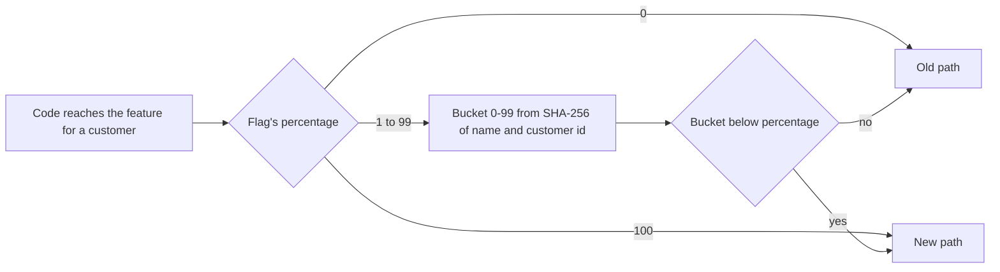

## Before you start

- [[devops.l4.progressive-delivery]] — you know the canary steps send a growing share of requests to a new build and stop it at limits written in advance.
- [[backend.l4.expand-and-contract]] — you know old and new code share one schema, so a schema change goes in compatible steps.
- [[management.l3.technical-debt-register]] — you know the register lists the debt the team carries, each row with someone who watches it.
- [[backend.l3.graceful-degradation]] — you know Đơn Hàng decides in advance what still works when a dependency fails, and loses only what needs it.

## The situation

You are about to merge the first part of a new checkout, the flow a customer follows to place an order; the rest needs several more sprints. Merged api code reaches production through the canary steps, and at 100 every customer gets it, unfinished parts included. A branch kept for weeks means one large, late merge. And the day customers see the new checkout belongs to the release calendar, the team's fixed launch days, one per sprint (`docs/team/release-calendar.md`), not to whichever deploy carries it. How do you ship the code now and let customers meet the feature only when the team chooses, with no deploy on that day?

## Core concepts

- **feature flag** — a setting the code reads while it runs to choose between two paths, so a feature can be deployed switched off and released later with no new deploy.
- A release flag (a plain phrase, used in this sense here) — a feature flag that hides one unfinished feature, lives only until that feature is on for every customer, and is then removed together with the old path.
- **kill switch** — a feature flag kept for good that turns off a costly feature when the system is overloaded, so placing and viewing orders keep working; a form of graceful degradation.
- The percentage (a plain word, used in this sense here) — the share of customers a flag is on for: 0 is off for all, 100 is on for all.
- A customer's bucket (a plain word, used in this sense here) — a number from 0 to 99 computed from the flag's name and the customer id with SHA-256, a standard function that turns any text into 32 bytes, always the same bytes for the same text; the flag is on for that customer when the bucket is below the percentage.

## How it works



In the situation above, the new checkout goes out inside an ordinary release behind a feature flag set to 0. Every customer takes the old path, so the deploy changes nothing they can see. On the calendar's day, the team raises the percentage. That changes a setting the code reads while it runs, not the code: no new build and no new deploy.

The diagram follows one decision. At 0 the answer is off and at 100 it is on, with nothing to compute. In between, the customer's bucket decides. The bucket comes from SHA-256 of the flag's name and the customer id, so it is the same on every run and every machine. Because the flag is on when the bucket is below the percentage, raising 10 to 50 keeps everyone below 10 and adds the buckets from 10 to 49. Nobody who already had the new checkout loses it.

This is a split by customer, not by request. A canary's weight sends each request to either version, so one customer can meet both within a few clicks. A flag computed from the customer id gives each customer one answer for as long as the percentage stays the same. The flag's name is part of the computation, so two flags at 10% do not land on the same group of customers.

A release flag and a kill switch look the same in code and differ only in how long they live.

## In the Đơn Hàng system

Above the excerpt, `FeatureFlag` (lines 10–15) holds a flag's `Name` and `PercentOfCustomers`; `FeatureFlag.Off(name)` is 0% and `FeatureFlag.On(name)` is 100%. How `FeatureFlags` answers for one customer:

```csharp file=samples/DonHang.Samples/Samples/Release/FeatureFlags.cs tag=stage-4 lines=17-37
public static class FeatureFlags
{
    // lesson: devops.l4.feature-flags
    // Each customer gets a number from 0 to 99 for each flag, and the flag is
    // on for them when that number is below the percentage: raising it only
    // adds customers. The number comes from SHA-256 of the flag's name and
    // the customer id, the same on every run and every machine; a string's
    // GetHashCode changes from one process to the next.
    public static bool IsOn(FeatureFlag flag, int customerId) => flag.PercentOfCustomers switch
    {
        <= 0 => false,
        >= 100 => true,
        var percent => Bucket(flag.Name, customerId) < percent,
    };

    public static int Bucket(string flagName, int customerId)
    {
        var hash = SHA256.HashData(Encoding.UTF8.GetBytes($"{flagName}:{customerId}"));
        return (int)(BinaryPrimitives.ReadUInt32BigEndian(hash) % 100);
    }
}
```

Lines 25–30 are the diagram: `<= 0` gives `false`, `>= 100` gives `true`, and any other percentage is compared with the customer's bucket. Lines 32–36 build the bucket: the text `new-checkout:42` for customer 42, its SHA-256, the first four bytes read as an unsigned number, and the remainder after dividing by 100. The comment says why not `GetHashCode`: a string's hash code is not guaranteed to be stable, and two runs of the same program may return different values, so a customer could change sides after a restart. Above the excerpt, lines 7–9 say the api has no flags at stage-4; this sample and `docs/design/feature-flags.md` are the convention the first one will follow.

What its tests check:

```csharp file=samples/DonHang.Samples.Tests/FeatureFlagsTests.cs tag=stage-4 lines=20-39
    // lesson: devops.l4.feature-flags
    // Raising the percentage only adds customers: nobody who had the feature
    // at 10% loses it at 50%.
    [Fact]
    public void CustomersOnAt10Percent_AreStillOnAt50Percent()
    {
        var at10 = Customers.Where(c => FeatureFlags.IsOn(new FeatureFlag("new-checkout", 10), c)).ToList();
        var at50 = Customers.Where(c => FeatureFlags.IsOn(new FeatureFlag("new-checkout", 50), c)).ToHashSet();

        Assert.NotEmpty(at10);
        Assert.True(at50.Count > at10.Count);
        Assert.All(at10, customer => Assert.Contains(customer, at50));
    }

    [Fact]
    public void ZeroPercent_IsOffForAll_AndHundredPercent_IsOnForAll()
    {
        Assert.DoesNotContain(Customers, c => FeatureFlags.IsOn(FeatureFlag.Off("new-checkout"), c));
        Assert.All(Customers, c => Assert.True(FeatureFlags.IsOn(FeatureFlag.On("new-checkout"), c)));
    }
```

`Customers` holds the ids 1 to 1,000 (line 8). Lines 26–31 take the customers on at 10% and at 50% and check three things: some customer is on at 10%, more are on at 50%, and every one from 10% is among them. Lines 37–38 check the ends, no customer at 0% and every customer at 100%. The first test, lines 11–18 above the excerpt, asks the same question twice for each customer and expects the same answer.

`feature-flags.md` is the convention around this code:

- each release flag gets, when added, an owner named by role and a removal date, usually one sprint after the planned day it reaches every customer;
- each flag doubles the paths that must work, two flags make four combinations, and the feature's tests run both the on and the off path;
- a flag still in the code after its date goes into the technical debt register, `docs/team/tech-debt-register.md`, with its owner watching it;
- a release flag is not kept as a kill switch "just in case": the two jobs need two names and two owners, and a switch meant to stay has no removal date;
- code behind a flag that is off still runs against the current schema, so a schema change still goes through expand and contract, and turning the flag off does not put the schema back.

## Trade-offs

| | Keep it on a branch until done | Ship behind a release flag | Ship with no flag, through the canary |
|---|---|---|---|
| When the code reaches production | Once the whole feature is merged | With each release, switched off | With each release |
| When customers see it | From the first canary step after the merge; everyone at 100 | When the team raises the percentage | From the first canary step; everyone at 100 |
| Who sees it first | A share of requests, from any customer, once merged | A chosen share of customers, each kept on one side | A share of requests, from any customer |
| Turning it off | Weight 0 during the steps; afterwards a new release | Lower the percentage, no deploy | Weight 0 during the steps; afterwards a new release |
| What it adds | One large, late merge | A second path to test, an owner, a removal date | Nothing beyond the canary steps |

## What would you choose if…

- …the change fixes a bug in an existing path: no flag. Every customer should get the fix, the canary steps already limit who meets a broken build, and a flag would add a path to test with no launch day to choose.
- …the new feature needs a new column: add the column first, in a release whose code does not need it yet, then ship the feature behind its flag.
- …a feature you are adding is useful but adds load the system may not carry at its busiest: a kill switch, kept for good under its own name and owner, with both paths tested; not a release flag left in place after launch.

## Seniors often assume…

- **"A feature flag is just an if statement, so keeping it costs nothing."** → Actually each flag doubles the paths that must work: two flags make four combinations, and the feature's tests must run both the on and the off path. A release flag left in place keeps an old path alive that nobody plans to use. You notice this when a bug report comes from a customer outside the bucket of a flag stuck at 90%, on a path nobody has opened since launch.
- **"Turning a feature on for 10% of requests is the same as turning it on for 10% of customers."** → Actually a share of requests sends each request to either side, so one customer can see the new checkout on one click and the old one on the next. `FeatureFlags` computes the answer from the customer id, so a customer stays on one side until the percentage changes. You notice this when a customer reports that a screen changed back while they were using it.
- **"Code behind a flag that is off need not be tested, since it can be switched off again."** → Actually the flag is meant to be turned on, and until then the code runs against today's schema with every deploy. Switching off helps only if the off path still works. You notice this when the percentage is raised on the calendar's day and the first customers in the bucket hit an error no test ever reached.

## Try it (3 minutes)

In `samples/DonHang.Samples.Tests/FeatureFlagsTests.cs` at stage-4:

1. In line 27, change the percentage `50` to `5`, so `at50` now holds the customers who are on at 5%.
2. Run `dotnet test samples/DonHang.Samples.Tests --filter FeatureFlagsTests`, then undo your change.

Expected result: the summary shows 1 failed and 2 passed, and the failed test is `CustomersOnAt10Percent_AreStillOnAt50Percent`. It stops at line 30: no more customers are on at 5% than at 10%, so `at50.Count > at10.Count` is false. Every bucket below 5 is also below 10, so lowering a percentage only removes customers: those with buckets 5 to 9 lose a feature they already had.

## Connections

- [[devops.l4.progressive-delivery]] — the other half of a release: the canary steps decide which requests meet a new build, a flag decides which customers meet a feature inside it.
- [[backend.l3.graceful-degradation]] — a kill switch is one planned way to lose a feature and keep placing orders working.
- [[management.l3.technical-debt-register]] — where a release flag past its removal date goes, with its owner watching it.
- [[backend.l4.expand-and-contract]] — still needed: a flag switches code paths, not the schema both paths run on.
- [[backend.l4.shop-id-rollout]] — the schema side a flag cannot cover: three releases, each working with the code before it.
- [[devops.l1.twelve-factor-config]] — the idea this builds on: one build, with settings outside the code.
- [[design.l1.test-doubles]] — how a test hands code a value it would read from outside, such as a flag's.
- [[devops.l4.release-strategy-per-component]] — next: ADR 0019 uses feature flags for the changes customers see.

## Five-line summary

1. A feature flag is a setting the code reads while running, so a feature ships switched off and turns on later without a deploy.
2. A release flag lives until its feature is on for everyone; a kill switch stays, to turn off a costly feature under load.
3. `FeatureFlags` gives each customer a bucket from SHA-256 of the flag's name and id, so one customer always gets one answer.
4. The flag is on below the percentage, so raising it only adds customers; 0% is off for all and 100% on for all.
5. Each flag doubles the paths to test, needs an owner and removal date, and runs against today's schema, so expand and contract remains.
