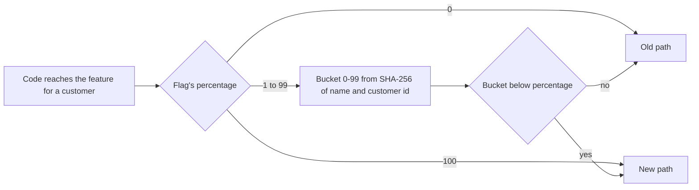

## Bạn cần biết trước

- [[devops.l4.progressive-delivery]] — bạn biết các bước canary gửi cho bản build mới một phần request ngày càng lớn, và dừng nó lại theo các giới hạn đã ghi ra từ trước.
- [[backend.l4.expand-and-contract]] — bạn biết code cũ và code mới dùng chung một schema, nên một thay đổi schema phải đi qua các bước tương thích.
- [[management.l3.technical-debt-register]] — bạn biết sổ nợ kỹ thuật liệt kê các khoản nợ team đang mang, mỗi dòng có một người theo dõi.
- [[backend.l3.graceful-degradation]] — bạn biết Đơn Hàng quyết định từ trước những gì vẫn chạy khi một phụ thuộc hỏng, và chỉ mất phần cần phụ thuộc đó.

## Tình huống

Bạn sắp merge phần đầu của luồng checkout mới, tức các bước khách đi qua để đặt một đơn hàng. Phần còn lại cần thêm vài sprint nữa. Code api đã merge sẽ lên production qua các bước canary, và ở 100 thì mọi khách đều nhận nó, kể cả những phần chưa xong. Giữ một branch vài tuần nghĩa là một lần merge lớn và muộn. Ngoài ra, ngày khách thấy luồng checkout mới thuộc về lịch phát hành, tức các ngày ra mắt cố định của team, mỗi sprint một ngày (`docs/team/release-calendar.md`), chứ không thuộc về lần deploy nào tình cờ mang nó. Làm sao đưa code lên ngay bây giờ mà khách chỉ gặp tính năng vào lúc team chọn, và hôm đó không cần deploy?

## Khái niệm cốt lõi

- **feature flag** (Thiết lập code đọc lúc chạy để chọn giữa hai nhánh, cho bật tính năng mà không deploy lại) — một thiết lập code đọc trong lúc chạy để chọn giữa hai nhánh, nhờ đó một tính năng có thể được deploy ở trạng thái tắt và ra mắt sau mà không cần deploy mới.
- Release flag (cụm từ thông thường, ở đây dùng theo nghĩa này) — một feature flag che một tính năng chưa xong, chỉ sống tới khi tính năng đó bật cho mọi khách, rồi bị gỡ cùng với nhánh cũ.
- **kill switch** (Feature flag giữ lâu dài để tắt nhanh một tính năng tốn tài nguyên hoặc đang gây lỗi) — một feature flag giữ lại lâu dài để tắt một tính năng tốn tài nguyên khi hệ thống quá tải, nhờ đó đặt hàng và xem đơn hàng vẫn chạy. Đây là một dạng graceful degradation.
- Tỉ lệ phần trăm (từ thông thường, ở đây dùng theo nghĩa này) — phần khách mà flag bật cho: 0 là tắt với mọi người, 100 là bật với mọi người.
- Bucket của một khách (từ thông thường, ở đây dùng theo nghĩa này) — một số từ 0 tới 99, tính từ tên flag và id của khách bằng SHA-256, một hàm chuẩn biến mọi đoạn text thành 32 byte, cùng một text thì luôn ra cùng các byte đó. Flag bật cho khách khi bucket nhỏ hơn tỉ lệ phần trăm.

## Cơ chế hoạt động



Trong tình huống trên, luồng checkout mới đi ra trong một lần phát hành bình thường, nằm sau một feature flag đặt ở 0. Mọi khách đều đi nhánh cũ, nên lần deploy không đổi gì mà họ nhìn thấy. Tới ngày trên lịch, team nâng tỉ lệ phần trăm. Thứ thay đổi là một thiết lập code đọc lúc chạy, không phải code: không build mới, không deploy mới.

Sơ đồ đi theo một quyết định. Ở 0 câu trả lời là tắt, ở 100 là bật, không cần tính gì. Ở giữa thì bucket của khách quyết định. Bucket đến từ SHA-256 của tên flag và id khách, nên nó giống nhau ở mọi lần chạy và trên mọi máy. Vì flag bật khi bucket nhỏ hơn tỉ lệ phần trăm, nâng 10 lên 50 sẽ giữ nguyên mọi khách dưới 10 và thêm các bucket từ 10 tới 49. Không ai đã có luồng checkout mới lại mất nó.

Đây là cách chia theo khách, không phải theo request. Weight của canary gửi mỗi request tới một trong hai phiên bản, nên một khách có thể gặp cả hai chỉ sau vài cú bấm. Một flag tính từ id khách cho mỗi khách một câu trả lời duy nhất, chừng nào tỉ lệ phần trăm còn giữ nguyên. Tên flag nằm trong phép tính, nên hai flag cùng ở 10% không rơi vào cùng một nhóm khách.

Release flag và kill switch trông giống hệt nhau trong code, chỉ khác ở thời gian chúng tồn tại.

## Trong hệ thống Đơn Hàng

Phía trên đoạn trích, `FeatureFlag` (dòng 10–15) giữ `Name` và `PercentOfCustomers` của một flag. `FeatureFlag.Off(name)` là 0%, còn `FeatureFlag.On(name)` là 100%. Cách `FeatureFlags` trả lời cho một khách:

```csharp file=samples/DonHang.Samples/Samples/Release/FeatureFlags.cs tag=stage-4 lines=17-37
public static class FeatureFlags
{
    // lesson: devops.l4.feature-flags
    // Each customer gets a number from 0 to 99 for each flag, and the flag is
    // on for them when that number is below the percentage: raising it only
    // adds customers. The number comes from SHA-256 of the flag's name and
    // the customer id, the same on every run and every machine; a string's
    // GetHashCode changes from one process to the next.
    public static bool IsOn(FeatureFlag flag, int customerId) => flag.PercentOfCustomers switch
    {
        <= 0 => false,
        >= 100 => true,
        var percent => Bucket(flag.Name, customerId) < percent,
    };

    public static int Bucket(string flagName, int customerId)
    {
        var hash = SHA256.HashData(Encoding.UTF8.GetBytes($"{flagName}:{customerId}"));
        return (int)(BinaryPrimitives.ReadUInt32BigEndian(hash) % 100);
    }
}
```

Dòng 25–30 chính là sơ đồ: `<= 0` cho `false`, `>= 100` cho `true`, còn mọi tỉ lệ khác được so với bucket của khách. Dòng 32–36 dựng bucket: text `new-checkout:42` cho khách 42, SHA-256 của nó, bốn byte đầu đọc thành một số không dấu, rồi lấy phần dư khi chia cho 100. Comment giải thích vì sao không dùng `GetHashCode`: hash code của một string không được bảo đảm ổn định, hai lần chạy cùng một chương trình có thể trả về hai giá trị khác nhau, nên sau một lần khởi động lại, một khách có thể đổi phía. Phía trên đoạn trích, dòng 7–9 nói api chưa có flag nào ở stage-4. Sample này và `docs/design/feature-flags.md` là quy ước mà flag đầu tiên sẽ theo.

Các test của nó kiểm tra gì:

```csharp file=samples/DonHang.Samples.Tests/FeatureFlagsTests.cs tag=stage-4 lines=20-39
    // lesson: devops.l4.feature-flags
    // Raising the percentage only adds customers: nobody who had the feature
    // at 10% loses it at 50%.
    [Fact]
    public void CustomersOnAt10Percent_AreStillOnAt50Percent()
    {
        var at10 = Customers.Where(c => FeatureFlags.IsOn(new FeatureFlag("new-checkout", 10), c)).ToList();
        var at50 = Customers.Where(c => FeatureFlags.IsOn(new FeatureFlag("new-checkout", 50), c)).ToHashSet();

        Assert.NotEmpty(at10);
        Assert.True(at50.Count > at10.Count);
        Assert.All(at10, customer => Assert.Contains(customer, at50));
    }

    [Fact]
    public void ZeroPercent_IsOffForAll_AndHundredPercent_IsOnForAll()
    {
        Assert.DoesNotContain(Customers, c => FeatureFlags.IsOn(FeatureFlag.Off("new-checkout"), c));
        Assert.All(Customers, c => Assert.True(FeatureFlags.IsOn(FeatureFlag.On("new-checkout"), c)));
    }
```

`Customers` chứa các id từ 1 tới 1.000 (dòng 8). Dòng 26–31 lấy các khách được bật ở 10% và ở 50%, rồi kiểm tra ba điều: có ít nhất một khách được bật ở 10%, ở 50% có nhiều khách hơn, và mọi khách từ nhóm 10% đều nằm trong đó. Dòng 37–38 kiểm tra hai đầu: không khách nào ở 0%, mọi khách ở 100%. Test đầu tiên, dòng 11–18 phía trên đoạn trích, hỏi cùng một câu hai lần cho mỗi khách và chờ cùng một câu trả lời.

`feature-flags.md` là quy ước bao quanh code này:

- Mỗi release flag, lúc được thêm vào, có một người phụ trách gọi theo vai trò và một ngày gỡ, thường là một sprint sau ngày dự kiến nó bật cho mọi khách.
- Mỗi flag nhân đôi số nhánh phải chạy đúng, hai flag thành bốn tổ hợp, và test của tính năng chạy cả nhánh bật lẫn nhánh tắt.
- Một flag vẫn còn trong code sau ngày gỡ sẽ được ghi vào sổ nợ kỹ thuật, `docs/team/tech-debt-register.md`, với người phụ trách theo dõi nó.
- Không giữ một release flag làm kill switch "phòng khi cần": hai việc cần hai cái tên và hai người phụ trách, còn một switch định giữ lâu dài thì không có ngày gỡ.
- Code nằm sau một flag đang tắt vẫn chạy trên schema hiện tại, nên một thay đổi schema vẫn phải đi qua expand and contract, và tắt flag không đưa schema về như cũ.

## Đánh đổi

| | Giữ trên branch tới khi xong | Đưa lên sau một release flag | Đưa lên không flag, qua canary |
|---|---|---|---|
| Lúc code lên production | Khi cả tính năng đã merge | Theo mỗi lần phát hành, ở trạng thái tắt | Theo mỗi lần phát hành |
| Lúc khách thấy nó | Từ bước canary đầu tiên sau khi merge, mọi người ở 100 | Khi team nâng tỉ lệ phần trăm | Từ bước canary đầu tiên, mọi người ở 100 |
| Ai thấy trước | Một phần request, từ bất kỳ khách nào, sau khi merge | Một phần khách được chọn, mỗi người giữ ở một phía | Một phần request, từ bất kỳ khách nào |
| Tắt nó đi | Weight 0 trong lúc đi các bước, sau đó là một lần phát hành mới | Hạ tỉ lệ phần trăm, không deploy | Weight 0 trong lúc đi các bước, sau đó là một lần phát hành mới |
| Thêm vào gì | Một lần merge lớn và muộn | Một nhánh thứ hai cần test, một người phụ trách, một ngày gỡ | Không gì ngoài các bước canary |

## Bạn sẽ chọn gì nếu…

- …thay đổi sửa một lỗi trên nhánh đang có: không dùng flag. Mọi khách nên nhận bản sửa, các bước canary đã giới hạn ai gặp một bản build hỏng, còn flag chỉ thêm một nhánh cần test mà không có ngày ra mắt nào để chọn.
- …tính năng mới cần một cột mới: thêm cột trước, trong một lần phát hành mà code chưa cần tới nó, rồi mới đưa tính năng lên sau flag của nó.
- …tính năng bạn đang thêm có ích nhưng tạo thêm tải mà hệ thống có thể không gánh nổi lúc đông nhất: dùng một kill switch, giữ lâu dài với tên và người phụ trách riêng, test cả hai nhánh. Đừng để một release flag nằm lại sau ngày ra mắt.

## Senior hay nhầm rằng…

- **"Feature flag chỉ là một câu lệnh if, nên giữ nó không tốn gì."** → Thực ra mỗi flag nhân đôi số nhánh phải chạy đúng: hai flag thành bốn tổ hợp, và test của tính năng phải chạy cả nhánh bật lẫn nhánh tắt. Một release flag để lại sẽ giữ sống một nhánh cũ mà không ai định dùng. Bạn sẽ nhận ra khi một báo lỗi đến từ một khách nằm ngoài bucket của một flag kẹt ở 90%, trên một nhánh không ai mở ra từ ngày ra mắt.
- **"Bật một tính năng cho 10% request cũng như bật nó cho 10% khách."** → Thực ra chia theo phần request sẽ gửi mỗi request tới một trong hai phía, nên một khách có thể thấy luồng checkout mới ở cú bấm này và luồng cũ ở cú bấm sau. `FeatureFlags` tính câu trả lời từ id khách, nên một khách ở yên một phía cho tới khi tỉ lệ phần trăm đổi. Bạn sẽ nhận ra khi một khách báo rằng màn hình tự đổi lại ngay lúc họ đang dùng.
- **"Code sau một flag đang tắt thì không cần test, vì lúc nào cũng tắt lại được."** → Thực ra flag sinh ra là để bật, và trước lúc đó code vẫn chạy trên schema hôm nay qua mỗi lần deploy. Tắt đi chỉ giúp được khi nhánh tắt vẫn chạy. Bạn sẽ nhận ra khi tỉ lệ phần trăm được nâng vào ngày trên lịch và những khách đầu tiên trong bucket gặp một lỗi mà chưa test nào chạm tới.

## Thử ngay (3 phút)

Trong `samples/DonHang.Samples.Tests/FeatureFlagsTests.cs` ở stage-4:

1. Ở dòng 27, đổi tỉ lệ `50` thành `5`, để `at50` giờ chứa các khách được bật ở 5%.
2. Chạy `dotnet test samples/DonHang.Samples.Tests --filter FeatureFlagsTests`, rồi hoàn tác thay đổi.

Kết quả mong đợi: phần tổng kết cho 1 test fail và 2 test pass, test fail là `CustomersOnAt10Percent_AreStillOnAt50Percent`. Nó dừng ở dòng 30: ở 5% không có nhiều khách được bật hơn ở 10%, nên `at50.Count > at10.Count` là false. Mọi bucket dưới 5 cũng dưới 10, nên hạ tỉ lệ phần trăm chỉ bớt khách đi: những người có bucket từ 5 tới 9 mất một tính năng họ đang có.

## Liên hệ

- [[devops.l4.progressive-delivery]] — nửa kia của một lần phát hành: các bước canary quyết định request nào gặp bản build mới, flag quyết định khách nào gặp một tính năng bên trong nó.
- [[backend.l3.graceful-degradation]] — kill switch là đường lui định sẵn: mất một tính năng mà đặt hàng vẫn chạy.
- [[management.l3.technical-debt-register]] — nơi một release flag quá ngày gỡ được ghi vào, với người phụ trách theo dõi nó.
- [[backend.l4.expand-and-contract]] — vẫn cần: flag chuyển nhánh code, không chuyển schema mà cả hai nhánh cùng chạy trên đó.
- [[backend.l4.shop-id-rollout]] — phía schema mà flag không che được: ba lần phát hành, mỗi lần chạy được với code của lần trước.
- [[devops.l1.twelve-factor-config]] — ý tưởng mà bài này dựa vào: một bản build, thiết lập nằm ngoài code.
- [[design.l1.test-doubles]] — cách một test đưa cho code một giá trị mà lẽ ra nó đọc từ bên ngoài, như giá trị của một flag.
- [[devops.l4.release-strategy-per-component]] — bài kế: ADR 0019 dùng feature flag cho những thay đổi khách nhìn thấy.

## Tóm tắt 5 dòng

1. Feature flag là một thiết lập code đọc lúc chạy, nên tính năng được đưa lên ở trạng thái tắt và bật sau mà không cần deploy.
2. Release flag sống tới khi tính năng bật cho mọi người, còn kill switch ở lại để tắt một tính năng tốn tài nguyên khi quá tải.
3. `FeatureFlags` cho mỗi khách một bucket từ SHA-256 của tên flag và id, nên một khách luôn nhận một câu trả lời.
4. Flag bật khi bucket dưới tỉ lệ phần trăm, nên nâng tỉ lệ chỉ thêm khách. 0% là tắt với mọi người, 100% là bật với mọi người.
5. Mỗi flag nhân đôi số nhánh cần test, cần người phụ trách và ngày gỡ, và chạy trên schema hôm nay, nên vẫn cần expand and contract.
