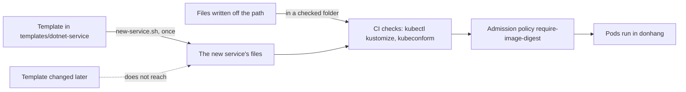

## Before you start

- [[devops.l4.platform-engineering]] — you know Đơn Hàng's platform is the rows of `platform-capabilities.md`, and that its last row is a template and a script for new services.
- [[k8s.l3.admission-policies]] — you know `require-image-digest` refuses a Pod in `donhang` whose Đơn Hàng image is not named by an `@sha256:` digest.
- [[k8s.l2.kustomize-overlays]] — you know `kustomization.yaml` lists the files to include, `images` sets an image's digest, and `kubectl kustomize` prints the result without applying it.
- [[design.l4.fitness-functions]] — you know a fitness function is an automated check, run with every change, that a quality attribute still holds.

## The situation

Your lead asks you to prepare the manifests for the next .NET service. The script you meet below calls it `invoices` by default, only as an example. The previous lesson showed that Payments needed 23 files outside its own code. The fastest start is to copy `payments.yaml` and rename things. But that file holds whatever its authors chose when they wrote it, and only a line-by-line read tells you which of the platform's rules it meets: probes, a security context, NetworkPolicies, an image named by digest.

What gives a new service the platform's rules from its first commit, without forbidding a team to do it another way?

## Core concepts

- Template (a plain word, used in this sense here) — a folder of files with placeholders, such as `__SERVICE__`, that a script fills in to produce one service's files.
- **golden path** — the supported, documented way to build and run a service on the platform, whose defaults already meet the platform's rules.
- Leaving the path (a plain word, used in this sense here) — producing a service's files another way; the team then keeps by itself what the path would have given.

## How it works



In the situation above, the golden path is the template, the script `new-service.sh` and the document `golden-path.md` that says how to use them. Instead of copying Payments, you run the script with the new service's name. It fills in the template and gives you files that already carry the defaults the platform's keeper chose. Then it runs on them the checks the config repository already gets in CI, so you see them pass before anyone reviews them.

Read the diagram from the template box. The template reaches the new service's files once. After that the files are the team's: they live in the config repository and change by pull request like any other file. A later change to the template, the dotted arrow, does not reach them.

That is why the template does not carry the rules alone. The path is also a default, not a rule: `golden-path.md` lets a team with a reason write its files another way, the box "Files written off the path". Both kinds of files meet the same checks once they sit in a folder the CI manifests job checks: there they must build with `kubectl kustomize` and pass kubeconform, a tool that checks each object against the Kubernetes API's schemas, so an unknown field fails; in the cluster the admission policy refuses a Pod whose Đơn Hàng image has no digest. The template makes it easy to be right at the start; the checks catch a mistake later, whatever produced the file.

What the path gives has a limit too. It gives the defaults that are the same for every service. What differs from one service to the next, its code, its migrations and its SLO, stays the team's own.

## In the Đơn Hàng system

`scripts/devops/new-service.sh` takes a name and, optionally, the two image digests CI published for the service. Its two commented parts produce the files and check them:

```bash file=scripts/devops/new-service.sh tag=stage-4 lines=21-42
# lesson: devops.l4.golden-path
# Rendering is copying the template and filling in the name and the
# digests. The files are the team's from then on: a later change to the
# template does not reach them.
for file in templates/dotnet-service/*.yaml; do
  sed -e "s/__SERVICE__/$name/g" -e "s/__DIGEST__/${digest#sha256:}/" -e "s/__MIGRATE_DIGEST__/${migrate_digest#sha256:}/" \
    "$file" > "$out/$(basename "$file")"
done
echo "== rendered for $name"
(cd "$out" && ls -1 | sed 's/^/  /')
echo

# lesson: devops.l4.golden-path
# The checks the config repository already gets in CI: the folder builds
# with kubectl kustomize, and kubeconform, the same pinned image as the
# manifests job, validates every object against Kubernetes 1.34.
kubeconform=$(sed -n 's/^ *KUBECONFORM: //p' .github/workflows/ci.yml)
echo "== kubectl kustomize | kubeconform"
kubectl kustomize "$out" > "$out.rendered.yaml"
# Pulled first and quietly, so a first run prints no download progress.
docker pull --quiet "$kubeconform" >/dev/null
docker run --rm -i "$kubeconform" -strict -summary -kubernetes-version 1.34.0 - < "$out.rendered.yaml"
```

```text output=true
== rendered for invoices
  deployment.yaml
  kustomization.yaml
  migrate-hook.yaml
  network-policies.yaml
  service.yaml

== kubectl kustomize | kubeconform
Summary: 5 resources found parsing stdin - Valid: 5, Invalid: 0, Errors: 0, Skipped: 0

== images in the rendered Pods
  ghcr.io/duyan11110/donhang-invoices@sha256:<placeholder>
  ghcr.io/duyan11110/donhang-invoices-migrate@sha256:<placeholder>
every image of Đơn Hàng named by digest: require-image-digest admits these Pods
```

The loop copies every `.yaml` file of `templates/dotnet-service/` into a temporary folder, replacing `__SERVICE__` with the name and the two digest placeholders with the digests given. `sed`, a command-line tool that edits text, does the replacing, as the `invoices` names in the output show. `${digest#sha256:}` drops a leading `sha256:` from the digest given, because the template already writes `sha256:` before the placeholder. The second part runs the config repository's CI checks: `kubectl kustomize` must build the folder, and kubeconform, from the image pinned in `ci.yml` (read out of it with `sed`), validates every object against Kubernetes 1.34. Outside the excerpt, the script stops with an error if an image from `ghcr.io/duyan11110/` has no digest; given no digests, it uses a placeholder of zeros, printed as `<placeholder>`. The output shows five files, five valid objects and two images named by digest.

The template's own `kustomization.yaml` names what the path gives:

```yaml file=templates/dotnet-service/kustomization.yaml tag=stage-4 lines=1-22
# lesson: devops.l4.golden-path
# The golden path's Kustomize files for one .NET service, as
# scripts/devops/new-service.sh renders them: __SERVICE__ becomes the
# service's name, the two digests those of the images CI published for it.
# What a service needs that this folder cannot give (its Secret, its
# database, its place in the shared policies, CI jobs) is listed in
# docs/team/platform-capabilities.md under "Chưa tự phục vụ".
apiVersion: kustomize.config.k8s.io/v1beta1
kind: Kustomization
resources:
  - deployment.yaml
  - service.yaml
  - migrate-hook.yaml
  - network-policies.yaml
# lesson: devops.l4.golden-path
# Images by digest, as the overlays name Đơn Hàng's images: the admission
# policy require-image-digest refuses a Pod that names one by tag only.
images:
  - name: ghcr.io/duyan11110/donhang-__SERVICE__
    digest: sha256:__DIGEST__
  - name: ghcr.io/duyan11110/donhang-__SERVICE__-migrate
    digest: sha256:__MIGRATE_DIGEST__
```

The `images` list names both images by digest, so `require-image-digest` admits the Pods. The top comment lists what the folder cannot give, kept under "Chưa tự phục vụ" ("not yet self-service") in `platform-capabilities.md`: the Secret, the database, the CI jobs, and the service's place in shared policies, such as PostgreSQL's NetworkPolicy, which must name the new service too.

`docs/team/golden-path.md` turns the template into a path. Its steps: write the code with a Dockerfile that builds a service image and a migration image, as Payments' does; run `new-service.sh`; copy the files into the config repository with the real digests and open a pull request; do each step not yet self-service as one pull request to its keeper; write the SLO into `docs/design/slo.md` before real traffic.

The document then splits the work in two. The path gives:

- a Deployment with `/health/live` and `/health/ready` probes and the same security context as the `api`, and a Service;
- a migration that runs as an Argo CD hook before the Deployment;
- NetworkPolicies that by default let nothing in, and let the service and its migration reach only PostgreSQL (DNS comes from the namespace's own policy);
- images by digest, and files that pass the CI checks.

The team keeps:

- its code and tests;
- its migrations, and keeping the database working with the previous version;
- its SLO, and what to do when the error budget runs out;
- its CPU and memory requests, which the template sets small for the team to measure and adjust.

The last two sections state the diagram's two rules. A team with a reason, such as a service not built on .NET, may leave the path, records why in the pull request, and then writes and checks its own manifests. And because produced files do not follow the template, a rule every service must keep is held by a check on every manifest, such as `require-image-digest` or kubeconform, not by the template alone.

## Trade-offs

How a new service gets its manifests:

| | Copy another service's files | Golden path: template, checks, document | Template as the only allowed way | Checks only, no template |
|---|---|---|---|---|
| Rules met on the first commit | Only those the copied service met | Yes, through the template's defaults | Yes | Found one by one as checks fail |
| Rules held after later changes | Only by checks, if any exist | By the checks, not the template | By the checks, or by making every team run the script again after each change | By the checks |
| A service with an unusual need | Edits its copy | Leaves the path, records why, keeps its own checks | Waits until the template supports it | Writes what it needs |
| Upkeep | Every copy kept on its own | The template, the document and the checks | A template that must cover every case | The checks only |
| Fits when | Rarely: it copies the other service's mistakes and old defaults too | Most new services share one shape | Rarely: when no service may differ | Few services, each very different |

Đơn Hàng takes the second column: the path is a default, and the checks hold the rules for every service.

## What would you choose if…

- …a team wants a new service not built on .NET: let it leave the path, as `golden-path.md` allows, with the reason recorded in the pull request; the team then keeps its own manifests. The admission policy, and the CI checks on the folders they cover, still apply.
- …the lead changes a default in the template, for example a tighter NetworkPolicy: services produced earlier keep their old files. If the new default must hold for every service, add a check that runs on every manifest; if it need not, tell the teams and let each update its own files.
- …teams ask for a switch in the template for each thing one service does differently: keep the template to what most services share; when a service differs a lot, leaving the path with a recorded reason costs less than one more switch.

## Seniors often assume…

- **"A golden path forbids every other way to deploy a service."** → Actually it is a default: `golden-path.md` lets a team leave it with the reason recorded in the pull request, and the team then keeps the checks and upkeep the path would have given. You notice this when a team with an unusual service waits for the template to support it instead of writing its own files.
- **"A service generated from the template stays up to date with the platform."** → Actually `new-service.sh` copies the template once, and its comment says a later change to the template does not reach the files. You notice this when the template gains a better default and the services produced before it still have the old one.
- **"The more options the template offers, the better the golden path."** → Actually each option is a decision every team must make and a combination the checks must cover, so a template full of options stops being a default. You notice this when teams copy each other's answers to the template's options instead of trusting its defaults.

## Try it (3 minutes)

1. In `examples/don-hang` at `stage-4`, run `scripts/devops/new-service.sh` on your own machine: it needs `kubectl` and Docker there, but no cluster.
2. Compare its output with the block above.
3. Then think: the lead later adds a new default to the template's `deployment.yaml`. Which services get it, and what would make it hold for all of them?

Expected result: the output matches the block above line for line.

<details><summary>Suggested answer</summary>

Only services produced after the change get it. Earlier services' files were copied into the config repository once and belong to their teams; the loop never runs on them again. If the default must hold for every service, it needs a check that runs on every manifest, in CI or in the cluster, the way `require-image-digest` holds the digest rule.

</details>

## Connections

- [[devops.l4.platform-engineering]] — the platform this path belongs to; the path is the last row of its capabilities table.
- [[design.l4.fitness-functions]] — the same idea for architecture: a rule that must keep holding is kept by an automated check.
- [[k8s.l3.admission-policies]] — the check in the cluster that holds the digest rule for every Pod, produced by the path or not.
- [[k8s.l2.kustomize-overlays]] — how the template's `kustomization.yaml` and its `images` digests work.
- [[k8s.l3.security-context]] — the security context the template copies from the `api`.
- [[k8s.l3.network-policies]] — the deny-by-default policies the template gives every service.
- [[devops.l3.verifying-before-deploy]] — where the digests a team writes into its files are verified before they are deployed.

## Five-line summary

1. A golden path is the supported, documented way to add a service, with defaults that already meet the platform's rules.
2. `new-service.sh` fills in `templates/dotnet-service/`: a Deployment, a Service, a migration hook and NetworkPolicies, with images by digest.
3. The files pass `kubectl kustomize` and kubeconform as in CI, and `require-image-digest` admits their Pods.
4. `golden-path.md` splits the work: the path gives shared defaults; the team keeps its code, migrations and SLO.
5. The path is a default a team may leave; files never follow later template changes, so rules every service must keep live in checks.
