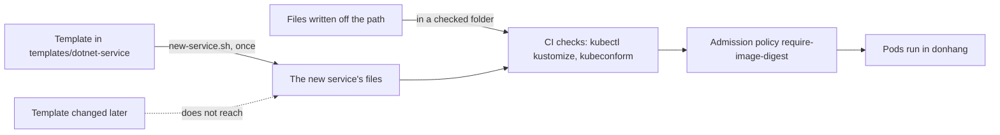

## Bạn cần biết trước

- [[devops.l4.platform-engineering]] — bạn biết platform của Đơn Hàng là các dòng của `platform-capabilities.md`, và dòng cuối là một template cùng một script cho service mới.
- [[k8s.l3.admission-policies]] — bạn biết `require-image-digest` từ chối một Pod trong `donhang` khi image Đơn Hàng của nó không được ghi bằng digest `@sha256:`.
- [[k8s.l2.kustomize-overlays]] — bạn biết `kustomization.yaml` liệt kê các file cần đưa vào, `images` đặt digest cho một image, và `kubectl kustomize` in kết quả ra mà không apply.
- [[design.l4.fitness-functions]] — bạn biết fitness function là một phép kiểm tự động, chạy với mỗi thay đổi, để xác nhận một thuộc tính chất lượng vẫn còn đúng.

## Tình huống

Trưởng nhóm giao bạn chuẩn bị manifest cho service .NET tiếp theo. Script bạn sẽ gặp bên dưới mặc định gọi nó là `invoices`, chỉ để làm ví dụ. Bài trước cho thấy Payments cần 23 file nằm ngoài code của nó. Cách bắt đầu nhanh nhất là chép `payments.yaml` rồi đổi tên. Nhưng file đó chứa những gì người viết đã chọn lúc viết nó, và phải đọc từng dòng mới biết nó đáp ứng luật nào của platform: probe, security context, NetworkPolicy, image ghi bằng digest.

Điều gì cho một service mới các luật của platform ngay từ commit đầu tiên, mà không cấm nhóm làm theo cách khác?

## Khái niệm cốt lõi

- Template (từ thông thường, ở đây dùng theo nghĩa này) — một thư mục các file có chỗ giữ chỗ, như `__SERVICE__`, mà một script điền vào để tạo ra file của một service.
- **golden path** (cách được hỗ trợ và có tài liệu để làm và chạy một service trên platform, mặc định đã đúng luật) — con đường được hỗ trợ, có tài liệu, để build và chạy một service trên platform, với các mặc định đã đáp ứng luật của platform.
- Rời con đường (cụm từ thông thường, ở đây dùng theo nghĩa này) — tạo file của một service theo cách khác; khi đó nhóm tự lo những gì con đường lẽ ra đã cho.

## Cơ chế hoạt động



Trong tình huống trên, golden path là template, script `new-service.sh` và tài liệu `golden-path.md` hướng dẫn cách dùng chúng. Thay vì chép Payments, bạn chạy script với tên của service mới. Script điền vào template và trả cho bạn những file đã mang sẵn các mặc định mà người giữ platform đã chọn. Sau đó nó chạy trên các file này đúng những phép kiểm repo cấu hình vẫn chạy trong CI, nên bạn thấy chúng qua trước khi ai đó review.

Đọc sơ đồ bắt đầu từ ô template. Template chỉ đến được file của service mới một lần. Từ đó trở đi, file thuộc về nhóm: chúng nằm trong repo cấu hình và thay đổi qua pull request như mọi file khác. Một thay đổi sau này ở template, mũi tên nét đứt, không đến được chúng.

Vì vậy template không tự mình giữ luật. Con đường cũng chỉ là mặc định, không phải luật: `golden-path.md` cho phép nhóm có lý do viết file theo cách khác, tức ô "Files written off the path". Cả hai loại file đều gặp cùng những phép kiểm khi chúng nằm trong một thư mục mà job CI `manifests` kiểm. Ở đó chúng phải build được bằng `kubectl kustomize` và qua kubeconform, một công cụ kiểm từng object theo schema của Kubernetes API, nên một field lạ sẽ làm phép kiểm thất bại. Trong cluster, admission policy từ chối Pod có image Đơn Hàng không ghi digest. Template giúp làm đúng ngay từ đầu, còn các phép kiểm bắt lỗi về sau, bất kể file từ đâu ra.

Những gì con đường cho cũng có giới hạn. Nó cho các mặc định giống nhau ở mọi service. Những gì khác nhau giữa các service, như code, migration và SLO, vẫn thuộc về nhóm.

## Trong hệ thống Đơn Hàng

`scripts/devops/new-service.sh` nhận một tên và, nếu có, hai image digest mà CI đã publish cho service. Hai phần có comment của nó tạo file rồi kiểm chúng:

```bash file=scripts/devops/new-service.sh tag=stage-4 lines=21-42
# lesson: devops.l4.golden-path
# Rendering is copying the template and filling in the name and the
# digests. The files are the team's from then on: a later change to the
# template does not reach them.
for file in templates/dotnet-service/*.yaml; do
  sed -e "s/__SERVICE__/$name/g" -e "s/__DIGEST__/${digest#sha256:}/" -e "s/__MIGRATE_DIGEST__/${migrate_digest#sha256:}/" \
    "$file" > "$out/$(basename "$file")"
done
echo "== rendered for $name"
(cd "$out" && ls -1 | sed 's/^/  /')
echo

# lesson: devops.l4.golden-path
# The checks the config repository already gets in CI: the folder builds
# with kubectl kustomize, and kubeconform, the same pinned image as the
# manifests job, validates every object against Kubernetes 1.34.
kubeconform=$(sed -n 's/^ *KUBECONFORM: //p' .github/workflows/ci.yml)
echo "== kubectl kustomize | kubeconform"
kubectl kustomize "$out" > "$out.rendered.yaml"
# Pulled first and quietly, so a first run prints no download progress.
docker pull --quiet "$kubeconform" >/dev/null
docker run --rm -i "$kubeconform" -strict -summary -kubernetes-version 1.34.0 - < "$out.rendered.yaml"
```

```text output=true
== rendered for invoices
  deployment.yaml
  kustomization.yaml
  migrate-hook.yaml
  network-policies.yaml
  service.yaml

== kubectl kustomize | kubeconform
Summary: 5 resources found parsing stdin - Valid: 5, Invalid: 0, Errors: 0, Skipped: 0

== images in the rendered Pods
  ghcr.io/duyan11110/donhang-invoices@sha256:<placeholder>
  ghcr.io/duyan11110/donhang-invoices-migrate@sha256:<placeholder>
every image of Đơn Hàng named by digest: require-image-digest admits these Pods
```

Vòng lặp chép mọi file `.yaml` của `templates/dotnet-service/` vào một thư mục tạm, thay `__SERVICE__` bằng tên và hai chỗ giữ chỗ digest bằng các digest được truyền vào. `sed`, một công cụ dòng lệnh để sửa văn bản, làm việc thay thế này, như các tên `invoices` trong output cho thấy. `${digest#sha256:}` bỏ tiền tố `sha256:` ở đầu digest truyền vào, vì template đã viết sẵn `sha256:` trước chỗ giữ chỗ. Phần thứ hai chạy các phép kiểm CI của repo cấu hình: `kubectl kustomize` phải build được thư mục, và kubeconform, lấy từ image được ghim trong `ci.yml` (đọc ra bằng `sed`), kiểm mọi object theo Kubernetes 1.34. Ngoài đoạn trích, script dừng với lỗi nếu một image từ `ghcr.io/duyan11110/` không có digest. Nếu không truyền digest, nó dùng một giá trị giữ chỗ toàn số 0, in ra thành `<placeholder>`. Output cho thấy năm file, năm object hợp lệ và hai image ghi bằng digest.

Chính `kustomization.yaml` của template nêu những gì con đường cho:

```yaml file=templates/dotnet-service/kustomization.yaml tag=stage-4 lines=1-22
# lesson: devops.l4.golden-path
# The golden path's Kustomize files for one .NET service, as
# scripts/devops/new-service.sh renders them: __SERVICE__ becomes the
# service's name, the two digests those of the images CI published for it.
# What a service needs that this folder cannot give (its Secret, its
# database, its place in the shared policies, CI jobs) is listed in
# docs/team/platform-capabilities.md under "Chưa tự phục vụ".
apiVersion: kustomize.config.k8s.io/v1beta1
kind: Kustomization
resources:
  - deployment.yaml
  - service.yaml
  - migrate-hook.yaml
  - network-policies.yaml
# lesson: devops.l4.golden-path
# Images by digest, as the overlays name Đơn Hàng's images: the admission
# policy require-image-digest refuses a Pod that names one by tag only.
images:
  - name: ghcr.io/duyan11110/donhang-__SERVICE__
    digest: sha256:__DIGEST__
  - name: ghcr.io/duyan11110/donhang-__SERVICE__-migrate
    digest: sha256:__MIGRATE_DIGEST__
```

Danh sách `images` ghi cả hai image bằng digest, nên `require-image-digest` cho các Pod vào. Comment ở đầu liệt kê những gì thư mục không cho được, được ghi ở mục "Chưa tự phục vụ" trong `platform-capabilities.md`: Secret, database, các job CI, và chỗ của service trong các policy dùng chung, chẳng hạn NetworkPolicy của PostgreSQL, vốn cũng phải ghi tên service mới.

`docs/team/golden-path.md` biến template thành một con đường. Các bước của nó: viết code kèm một Dockerfile build một image service và một image migration, như Dockerfile của Payments; chạy `new-service.sh`; chép các file vào repo cấu hình với digest thật rồi mở pull request; làm mỗi bước chưa tự phục vụ thành một pull request tới người giữ phần đó; ghi SLO vào `docs/design/slo.md` trước khi service nhận traffic thật.

Sau đó tài liệu chia công việc làm hai. Con đường cho:

- một Deployment có probe `/health/live` và `/health/ready`, cùng security context giống `api`, và một Service;
- một migration chạy như một hook của Argo CD trước Deployment;
- các NetworkPolicy mặc định không cho gì vào, và chỉ cho service cùng migration của nó tới PostgreSQL (DNS do policy riêng của namespace cho);
- image ghi bằng digest, và các file qua được phép kiểm CI.

Nhóm tự giữ:

- code và test;
- migration, và việc giữ database chạy được với phiên bản trước;
- SLO, và việc phải làm khi error budget cạn;
- request CPU và bộ nhớ, mà template đặt nhỏ để nhóm đo rồi chỉnh.

Hai mục cuối của tài liệu nói ra hai luật trong sơ đồ. Một nhóm có lý do, như một service không viết bằng .NET, được rời con đường, ghi lý do trong pull request, rồi tự viết và kiểm manifest của mình. Và vì file đã tạo ra không theo template, một luật mà mọi service phải giữ được đảm bảo bằng một phép kiểm trên mọi manifest, như `require-image-digest` hay kubeconform, chứ không chỉ bằng template.

## Đánh đổi

Một service mới có manifest bằng cách nào:

| | Chép file của service khác | Golden path: template, phép kiểm, tài liệu | Template là cách duy nhất được phép | Chỉ có phép kiểm, không template |
|---|---|---|---|---|
| Luật đúng ngay từ commit đầu | Chỉ những luật service được chép đã đúng | Có, nhờ mặc định của template | Có | Phát hiện từng luật khi phép kiểm thất bại |
| Luật còn đúng sau các thay đổi về sau | Chỉ nhờ phép kiểm, nếu có | Nhờ phép kiểm, không nhờ template | Nhờ phép kiểm, hoặc bắt mọi nhóm chạy lại script sau mỗi lần đổi | Nhờ phép kiểm |
| Service có nhu cầu khác thường | Sửa bản chép của mình | Rời con đường, ghi lý do, tự giữ phép kiểm | Chờ tới khi template hỗ trợ | Viết thứ nó cần |
| Công giữ | Mỗi bản chép tự giữ riêng | Template, tài liệu và phép kiểm | Một template phải bao mọi trường hợp | Chỉ phép kiểm |
| Hợp khi | Hiếm khi: nó chép luôn lỗi và mặc định cũ của service kia | Phần lớn service mới có cùng một dạng | Hiếm khi: khi không service nào được khác | Ít service, mỗi cái rất khác nhau |

Đơn Hàng chọn cột thứ hai: con đường là mặc định, còn phép kiểm giữ luật cho mọi service.

## Bạn sẽ chọn gì nếu…

- …một nhóm muốn có service mới không viết bằng .NET: cho nhóm rời con đường, như `golden-path.md` cho phép, với lý do ghi trong pull request. Khi đó nhóm tự giữ manifest của mình. Admission policy, và các phép kiểm CI trên những thư mục chúng bao, vẫn áp dụng.
- …trưởng nhóm đổi một mặc định trong template, ví dụ một NetworkPolicy chặt hơn: các service tạo ra trước đó giữ nguyên file cũ. Nếu mặc định mới phải đúng với mọi service, thêm một phép kiểm chạy trên mọi manifest. Nếu không cần, báo cho các nhóm và để mỗi nhóm tự cập nhật file của mình.
- …các nhóm xin thêm một công tắc trong template cho mỗi điều một service làm khác: giữ template ở phần mà đa số service dùng chung. Khi một service khác nhiều, rời con đường với lý do được ghi lại tốn ít hơn thêm một công tắc nữa.

## Senior hay nhầm rằng…

- **"Golden path cấm mọi cách deploy service khác."** → Thực ra nó là mặc định: `golden-path.md` cho nhóm rời nó với lý do ghi trong pull request, và khi đó nhóm tự lo phép kiểm và công giữ mà con đường lẽ ra đã cho. Bạn sẽ nhận ra khi một nhóm có service khác thường ngồi chờ template hỗ trợ thay vì tự viết file của mình.
- **"Service tạo ra từ template sẽ luôn theo kịp platform."** → Thực ra `new-service.sh` chép template một lần, và comment của nó nói một thay đổi sau này ở template không đến được các file. Bạn sẽ nhận ra khi template có một mặc định tốt hơn mà các service tạo ra trước đó vẫn mang mặc định cũ.
- **"Template càng nhiều tùy chọn thì golden path càng tốt."** → Thực ra mỗi tùy chọn là một quyết định mọi nhóm phải đưa ra và một tổ hợp mà phép kiểm phải bao, nên một template đầy tùy chọn không còn là mặc định nữa. Bạn sẽ nhận ra khi các nhóm chép câu trả lời của nhau cho các tùy chọn của template thay vì tin vào mặc định của nó.

## Thử ngay (3 phút)

1. Trong `examples/don-hang` ở `stage-4`, chạy `scripts/devops/new-service.sh` trên máy của bạn: nó cần `kubectl` và Docker trên máy, nhưng không cần cluster.
2. So output của nó với khối ở trên.
3. Rồi nghĩ xem: sau này trưởng nhóm thêm một mặc định mới vào `deployment.yaml` của template. Service nào nhận được nó, và điều gì khiến nó đúng với tất cả?

Kết quả mong đợi: output khớp với khối ở trên từng dòng một.

<details><summary>Gợi ý đáp án</summary>

Chỉ các service tạo ra sau thay đổi đó mới nhận được. File của các service trước đã được chép vào repo cấu hình một lần và thuộc về nhóm của chúng, vòng lặp không bao giờ chạy lại trên chúng. Nếu mặc định đó phải đúng với mọi service, cần một phép kiểm chạy trên mọi manifest, trong CI hoặc trong cluster, giống cách `require-image-digest` giữ luật digest.

</details>

## Liên hệ

- [[devops.l4.platform-engineering]] — platform mà con đường này thuộc về; con đường là dòng cuối của bảng năng lực.
- [[design.l4.fitness-functions]] — cùng ý tưởng cho kiến trúc: một luật phải luôn đúng được giữ bằng một phép kiểm tự động.
- [[k8s.l3.admission-policies]] — phép kiểm trong cluster giữ luật digest cho mọi Pod, dù có đi qua con đường hay không.
- [[k8s.l2.kustomize-overlays]] — cách `kustomization.yaml` của template và các digest trong `images` hoạt động.
- [[k8s.l3.security-context]] — security context mà template chép từ `api`.
- [[k8s.l3.network-policies]] — các policy mặc định chặn hết mà template cho mọi service.
- [[devops.l3.verifying-before-deploy]] — nơi các digest nhóm ghi vào file được xác minh trước khi deploy.

## Tóm tắt 5 dòng

1. Golden path là cách được hỗ trợ, có tài liệu, để thêm một service, với các mặc định đã đúng luật của platform.
2. `new-service.sh` điền vào `templates/dotnet-service/`: một Deployment, một Service, một migration hook và các NetworkPolicy, với image ghi bằng digest.
3. Các file qua `kubectl kustomize` và kubeconform như trong CI, và `require-image-digest` cho Pod của chúng vào.
4. `golden-path.md` chia công việc: con đường cho các mặc định dùng chung, nhóm giữ code, migration và SLO.
5. Con đường là mặc định mà nhóm được rời. File không bao giờ theo các thay đổi sau này của template, nên luật mọi service phải giữ nằm trong phép kiểm.
