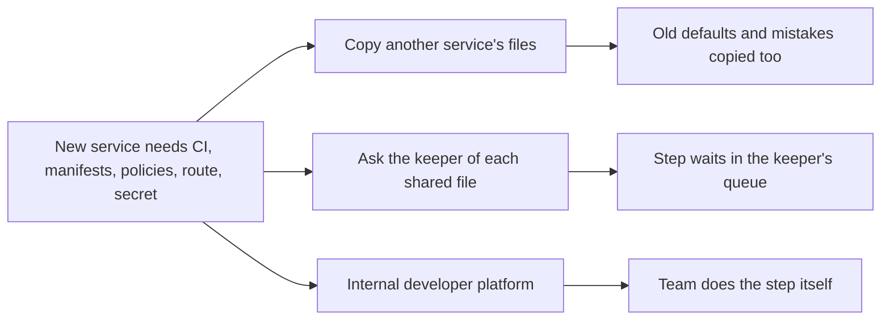

## Before you start

- [[devops.l4.delivery-metrics]] — you know the four DORA metrics describe the delivery system; this lesson uses them to judge a platform.
- [[design.l4.conways-law]] — you know Đơn Hàng's docs describe one team for all its services, which decides whether a separate group should own the platform.
- [[devops.l3.one-state-per-environment]] — you know each environment has a `cluster` layer and a `platform` layer in OpenTofu, two of the shared pieces listed here.
- [[k8s.l2.gateway-api]] — you know the Gateway belongs to the shared entry point while each service attaches its own HTTPRoutes.

## The situation

Your lead asks you to add the next .NET service to Đơn Hàng. You start by looking at how Payments was added. Its code lives in one folder, `DonHang.Payments/`. Running it took much more: lines in the CI workflow, a database in Compose, Kustomize files, entries in shared NetworkPolicies, a route, a sealed secret. Many of those files are shared with other services, and some are kept by the lead.

A template already generates part of this, but left as it is, the next service would repeat much of the rest. What would let the team do those steps itself, without copying another service and without waiting for someone else?

## Core concepts

- Footprint (a plain word, used in this sense here) — every file outside a service's own code that had to change for it to build, deploy and run.
- Self-service (a plain word, used in this sense here) — a step a team can do on its own, without asking another person to change a shared file.
- **platform engineering** — the work of building and running an internal platform so that product teams can do the steps every service shares themselves.
- **internal developer platform** — the shared tools, defaults and documents that let a team build, deploy and run its services without asking another team for each step.

## How it works



In the situation above, Payments' footprint is the list of steps on the left.

Without a platform, a team takes one of the two upper paths. Copying is fast, but it copies everything the source service had, including a default nobody would choose today and a mistake nobody noticed. Asking the keeper of the shared file is safer, but every step then joins that person's queue, and the new service waits. In Đơn Hàng the keeper is the lead for most shared files and the backend developer for the CI jobs and Prometheus.

The lower path is the internal developer platform. In Đơn Hàng that means OpenTofu's layers, Argo CD and the config repository, the Gateway, Sealed Secrets, the admission policy and the CI jobs. Each holds one shared step in one place, with defaults its keeper already checked; some already let a team do the step on its own, others still need the keeper, as the table below shows. Platform engineering is the work of building those pieces and keeping them right.

Because the users of a platform are other teams, it is run as a product for them. Its success is not how many tools it holds. It is whether teams choose it over copying, and whether their delivery metrics improve, for example whether lead time for changes shortens once steps stop waiting.

## In the Đơn Hàng system

`scripts/devops/service-footprint.sh` approximates the footprint: it lists every file outside the service's code that names it, sorted into an area. Most of them had to change for the service to run; a few, such as `keycloak.yaml`, only mention it in a comment.

```bash file=scripts/devops/service-footprint.sh tag=stage-4 lines=13-27
# lesson: devops.l4.platform-engineering
# Every file that names the service, ignoring case (payments, donhang_payments,
# DonHang.Payments), sorted into the area it belongs to. Docs, tests and the
# lessons' own scripts are left out: they did not have to change to run it.
area() {
  case "$1" in
    .github/*) echo "CI" ;;
    deploy/tofu/*) echo "OpenTofu" ;;
    deploy/*/httproutes.yaml | Caddyfile | deploy/*/Caddyfile) echo "route" ;;
    deploy/*) if grep -q '^kind: NetworkPolicy' "$1"; then echo "NetworkPolicy"; else echo "Kustomize and manifests"; fi ;;
    docker-compose*.yml | db/databases.sql) echo "Compose" ;;
    scripts/devops/seal-secrets.sh) echo "sealed secret" ;;
    scripts/up.sh | scripts/dev-secrets.sh | scripts/devops/*) echo "script" ;;
  esac
}
```

```text output=true
== files outside DonHang.Payments/ that name payments
CI: 3
  .github/dependabot.yml
  .github/workflows/ci.yml
  .github/workflows/release.yml
Compose: 1
  docker-compose.yml
Kustomize and manifests: 12
  deploy/gitops/config-repo-kustomize/base/db-backup.yaml
  deploy/gitops/config-repo-kustomize/base/db-init.yaml
  deploy/gitops/config-repo-kustomize/base/db.yaml
  deploy/gitops/config-repo-kustomize/base/fake-gateway.yaml
  deploy/gitops/config-repo-kustomize/base/keycloak.yaml
  deploy/gitops/config-repo-kustomize/base/kustomization.yaml
  deploy/gitops/config-repo-kustomize/base/payments.yaml
  deploy/gitops/config-repo-kustomize/base/rabbitmq.yaml
  deploy/gitops/config-repo-kustomize/envs/production/kustomization.yaml
  deploy/gitops/config-repo-kustomize/envs/staging/kustomization.yaml
  deploy/gitops/config-repo/envs/production/db-init.yaml
  deploy/gitops/config-repo/envs/staging/db-init.yaml
NetworkPolicy: 2
  deploy/gitops/config-repo-kustomize/base/egress-policies.yaml
  deploy/gitops/config-repo-kustomize/base/network-policies.yaml
route: 2
  Caddyfile
  deploy/gitops/config-repo/platform/edge/httproutes.yaml
sealed secret: 1
  scripts/devops/seal-secrets.sh
OpenTofu: none
script: 2
  scripts/dev-secrets.sh
  scripts/devops/backup-logical.sh
total: 23 files
```

The comment at the top says what counts: any file that names the service, in any letter case. Outside the excerpt, a `find` decides where the script looks: CI, `deploy/`, Compose and its database setup, the Caddyfile and the lab and devops scripts, so docs and tests are never read. The `case` arms put each file in one area by its path; a file under `deploy/` counts as a NetworkPolicy when it declares one. The output gives 23 files for Payments, and only `payments.yaml` is named after it. Many of the others belong to components every service uses, such as `db.yaml`, `rabbitmq.yaml` and `keycloak.yaml`. `OpenTofu: none` means no OpenTofu file names Payments: the cluster and the `donhang` namespace serve it as they are.

`docs/team/platform-capabilities.md` lists the platform Đơn Hàng already has:

```markdown file=docs/team/platform-capabilities.md tag=stage-4 lines=10-23
### Năng lực đang có

| Năng lực | Dùng để làm gì | Ai giữ | Nhóm tự làm được? |
|---|---|---|---|
| Lớp cluster của OpenTofu (`deploy/tofu/envs/*/cluster`, module `kind-cluster`) | Tạo cluster của mỗi môi trường | Trưởng nhóm | Không: phải nhờ |
| Lớp platform của OpenTofu (module `donhang-platform`) | Namespace `donhang` với nhãn Pod Security, khóa niêm secret | Trưởng nhóm | Không: phải nhờ |
| Argo CD và repo cấu hình | Deploy bằng commit vào `envs/`; Argo CD đồng bộ và tự sửa khi cluster lệch Git | Trưởng nhóm | Có: commit overlay của service mình, qua pull request |
| Gateway và HTTPRoute (`platform/edge/`) | Đưa request từ ngoài vào service theo host và đường dẫn | Trưởng nhóm | Một phần: sửa `httproutes.yaml` qua pull request, người giữ review |
| Sealed Secrets (`scripts/devops/seal-secrets.sh`) | Giữ secret trong repo cấu hình ở dạng đã mã hóa (ADR 0006) | Trưởng nhóm | Một phần: niêm bằng chứng chỉ công khai thì ai cũng làm được, nhưng script liệt kê từng Secret nên thêm Secret mới phải sửa script |
| Admission policy `require-image-digest` (`platform/policies/`) | Từ chối Pod dùng image của Đơn Hàng mà không ghi digest | Trưởng nhóm | Có: không phải làm gì nếu manifest ghi digest |
| Các job CI `image` và `publish` | Build image, viết SBOM, quét lỗ hổng, đẩy lên registry, ký digest và ghi provenance | Lập trình viên backend | Không: service mới phải thêm vào các job này trong `ci.yml` |
| Job CI `manifests` | Kiểm mọi manifest và overlay bằng kubeconform | Lập trình viên backend | Có: file mới nằm trong thư mục đã kiểm thì được kiểm |
| Prometheus của staging (namespace `monitoring`) | Đếm request theo Deployment cho canary (`canary-checks.md`); đánh giá recording rule và alert burn rate (`alerts.md`) | Lập trình viên backend | Không: chỉ scrape các Pod api, service mới phải sửa cấu hình |
| Golden path (`templates/dotnet-service/`, `scripts/devops/new-service.sh`) | Sinh sẵn manifest cho một service .NET mới (`golden-path.md`) | Trưởng nhóm | Có |
```

The last column says whether a team can do the step on its own. Deploying by a pull request to the config repository is "yes", and so is the admission policy, which needs nothing when the manifest names the image by digest. The `manifests` job is "yes" too: it checks every manifest with a manifest checker, so a new file in a checked folder needs nothing. A route and a new Secret are "partly": a team edits the file, but the keeper reviews it or must change a script. Adding the image to the CI jobs `image` and `publish` is "no", and so is staging's Prometheus, which reads numbers only from the api's Pods until someone changes its configuration.

The last row, a template and a script that generate a new .NET service's manifests, is the next lesson. The rest of the document lists the steps that are not yet self-service, such as adding the service's `app` label to each shared NetworkPolicy. The other components the team runs itself, and their regular work, are in `self-run-components.md`.

The document ends with the lead's view, with its condition: one team, three .NET services and a new service every few quarters do not need a separate group for the platform yet; writing the steps down and keeping them right is enough. That changes when two or more product teams repeat the same steps, or when requests to the platform's keepers start to queue. Then the platform is run as a product, judged by whether teams choose it and by the four measures in `delivery-metrics.md`, not by the number of tools.

## Trade-offs

How a new service gets through the shared steps:

| | Copy another service | Ask the keeper of each shared file | Steps written down, kept current | A separate group runs the platform as a product |
|---|---|---|---|---|
| Who does the step | The new service's team | The keeper | The new service's team, from the document | The new service's team, with tools the group runs |
| Waiting | None | Each step waits in the keeper's queue | None, until a step needs the keeper | Little, for steps made self-service |
| Old defaults and mistakes | Copied with the files | Caught by the keeper, if noticed | Fixed once in the document | Fixed once in the tool or default |
| Cost | Nothing up front | The keeper's time on every service | Someone keeps the document right | People whose work is the platform |
| Fits when | Only as a stopgap, when no steps are written down | One team, rare services | One team, a service every few quarters | Several teams repeating the same steps |

`platform-capabilities.md` takes the third column for Đơn Hàng today and names when to move to the fourth.

## What would you choose if…

- …Đơn Hàng stays one team adding a service every few quarters: keep the capabilities table and the written steps current, and turn into self-service only a step that keeps causing a mistake. The lead's view is that a separate group is not needed yet: with a service every few quarters, the waiting it would remove is small.
- …a second product team starts adding services, and both teams wait for the same person to edit `ci.yml` and the shared NetworkPolicies: that is the condition the document names. Start with the "no" rows both teams wait on, and check lead time for changes to see whether the waiting drops.
- …someone proposes buying a developer portal (a web product where teams find the platform's tools and steps): ask which "no" or "partly" row it turns into "yes". A portal that lists the same steps leaves each step as it was.

## Seniors often assume…

- **"Platform engineering means buying a developer portal product."** → Actually the platform is the shared tools, defaults and documents that let a team do a step itself, and a portal is at most one way in to them. Đơn Hàng's platform has no portal: it is the rows of `platform-capabilities.md`. You notice this when a portal is installed and a new service still needs the same edits to `ci.yml` and the shared NetworkPolicies.
- **"The people who run the platform should do every deploy for the product teams."** → Actually the platform exists so a team deploys on its own: in Đơn Hàng a team commits its overlay to the config repository through a pull request and Argo CD syncs it. A deploy done by someone else waits in that person's queue. You notice this when lead time for changes is mostly the gap between a merged commit and a promotion that another person has to make.
- **"Every company needs a separate team for its platform as soon as it uses Kubernetes."** → Actually a separate group pays off when several teams repeat the same steps, not when a tool is adopted. Đơn Hàng runs Kubernetes with one team, and its lead's view is that written steps are enough for now. You notice this when a group builds tools that the one team could have used from written steps, and the team's delivery metrics do not move.

## Try it (3 minutes)

1. In `examples/don-hang` at `stage-4`, start the lab (`scripts/up.sh`), then run `scripts/devops/service-footprint.sh payments`. The script runs inside the lab's container, so the lab must be up, but it only reads the repository's files and needs no cluster.
2. Compare its output with the block above.
3. For each of `ci.yml`, `network-policies.yaml`, `httproutes.yaml` and `seal-secrets.sh` in the output, find the row of the capabilities table that covers it and say whether a new service's team could change it on its own.

Expected result: the output matches the block above line for line.

<details><summary>Suggested answer</summary>

`ci.yml`: the CI jobs `image` and `publish`, "no"; the new service must be added to them. `network-policies.yaml`: no row of its own; the document's list of steps that are not self-service says each shared policy names every `app` label it lets in, so someone must add the new one. `httproutes.yaml`: Gateway and HTTPRoute, "partly"; the team edits it in a pull request and the keeper reviews. `seal-secrets.sh`: Sealed Secrets, "partly"; anyone can seal with the public certificate, but a new Secret means editing the script.

</details>

## Connections

- [[devops.l4.delivery-metrics]] — the four measures a platform is judged by, through the teams that use it.
- [[design.l4.conways-law]] — why the number of teams, not the number of tools, decides when a separate group owns the platform.
- [[devops.l3.argo-cd-applications]] — the self-service deploy: a team commits, Argo CD syncs.
- [[k8s.l3.network-policies]] — the shared policies that make every new service a "no" step today.
- [[management.l3.self-hosting-costs]] — the regular work behind each component the platform runs itself.
- [[devops.l4.golden-path]] — next: the supported default way to add a service, the last row of the table.

## Five-line summary

1. A platform turns the steps every service repeats into steps each team can do itself, without copying or waiting.
2. `service-footprint.sh payments` lists 23 files outside Payments' code that name it, from CI and manifests to policies, routes and secrets.
3. Copying those steps copies old defaults and mistakes; asking a keeper for each step puts it in a queue.
4. `platform-capabilities.md` lists Đơn Hàng's platform and marks which steps a team can do on its own.
5. A platform is a product for internal users, judged by adoption and delivery metrics; a separate group pays off only with several teams.
