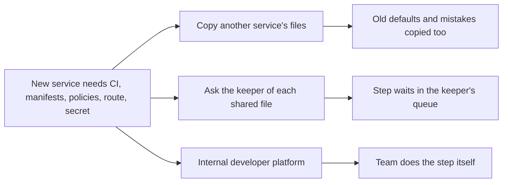

## Bạn cần biết trước

- [[devops.l4.delivery-metrics]] — bạn biết bốn DORA metrics mô tả hệ thống giao phần mềm, và bài này dùng chúng để đánh giá một platform.
- [[design.l4.conways-law]] — bạn biết tài liệu của Đơn Hàng mô tả một nhóm duy nhất cho mọi service, và điều đó quyết định có nên để một nhóm riêng giữ platform hay không.
- [[devops.l3.one-state-per-environment]] — bạn biết mỗi môi trường có một tầng `cluster` và một tầng `platform` trong OpenTofu, hai trong số các phần dùng chung được liệt kê ở đây.
- [[k8s.l2.gateway-api]] — bạn biết Gateway thuộc về lối vào dùng chung, còn mỗi service tự gắn HTTPRoute của mình.

## Tình huống

Trưởng nhóm giao bạn thêm service .NET tiếp theo vào Đơn Hàng. Bạn bắt đầu bằng cách xem Payments đã được thêm vào ra sao. Code của nó nằm gọn trong một thư mục, `DonHang.Payments/`. Để chạy được nó thì cần nhiều hơn thế: vài dòng trong CI workflow, một database trong Compose, các file Kustomize, các mục trong những NetworkPolicy dùng chung, một route, một sealed secret. Nhiều file trong số đó dùng chung với các service khác, và vài file do trưởng nhóm giữ.

Đã có một template sinh sẵn một phần, nhưng nếu để nguyên như vậy thì service tiếp theo vẫn phải lặp lại phần lớn chỗ còn lại. Cần gì để nhóm tự làm được những bước đó, không phải chép từ service khác và không phải chờ người khác?

## Khái niệm cốt lõi

- Dấu chân (cụm từ thông thường, ở đây dùng theo nghĩa này) — mọi file nằm ngoài code riêng của một service mà phải sửa thì service đó mới build, deploy và chạy được.
- Tự phục vụ (cụm từ thông thường, ở đây dùng theo nghĩa này) — một bước mà nhóm tự làm được, không phải nhờ người khác sửa một file dùng chung.
- **platform engineering** (xây và vận hành platform nội bộ để các nhóm sản phẩm tự làm các bước chung) — công việc xây dựng và vận hành một platform nội bộ để các nhóm sản phẩm tự làm được những bước mà mọi service đều có.
- **internal developer platform** (bộ công cụ, mặc định và tài liệu dùng chung để nhóm tự build, deploy và vận hành service) — các công cụ, mặc định và tài liệu dùng chung giúp một nhóm build, deploy và vận hành service của mình mà không phải nhờ nhóm khác ở từng bước.

## Cơ chế hoạt động



Trong tình huống trên, dấu chân của Payments chính là danh sách các bước ở bên trái.

Khi chưa có platform, nhóm đi theo một trong hai nhánh trên. Chép thì nhanh, nhưng chép luôn mọi thứ service gốc có, kể cả một mặc định hôm nay không ai chọn nữa và một lỗi chưa ai để ý. Nhờ người giữ file dùng chung thì an toàn hơn, nhưng khi đó mỗi bước phải xếp vào hàng chờ của người đó, và service mới phải đợi. Ở Đơn Hàng, người giữ phần lớn file dùng chung là trưởng nhóm, còn các job CI và Prometheus do lập trình viên backend giữ.

Nhánh dưới là internal developer platform. Ở Đơn Hàng, đó là các tầng của OpenTofu, Argo CD cùng repo cấu hình, Gateway, Sealed Secrets, admission policy và các job CI. Mỗi thứ giữ một bước dùng chung ở một chỗ, với những mặc định người giữ đã kiểm tra. Vài thứ đã cho nhóm tự làm bước đó, số khác vẫn cần người giữ, như bảng bên dưới cho thấy. Platform engineering là công việc xây những phần đó và giữ cho chúng luôn đúng.

Người dùng của một platform là các nhóm khác, nên nó được vận hành như một sản phẩm dành cho họ. Thành công của nó không nằm ở số công cụ nó có. Nó nằm ở chỗ các nhóm có chọn nó thay vì chép không, và các số đo giao phần mềm của họ có tốt lên không, ví dụ lead time for changes có ngắn lại khi các bước thôi phải chờ không.

## Trong hệ thống Đơn Hàng

`scripts/devops/service-footprint.sh` tính gần đúng dấu chân: nó liệt kê mọi file ngoài code của service có nhắc tên service, xếp theo khu vực. Phần lớn số file đó phải sửa thì service mới chạy được. Vài file, như `keycloak.yaml`, chỉ nhắc tên trong một comment.

```bash file=scripts/devops/service-footprint.sh tag=stage-4 lines=13-27
# lesson: devops.l4.platform-engineering
# Every file that names the service, ignoring case (payments, donhang_payments,
# DonHang.Payments), sorted into the area it belongs to. Docs, tests and the
# lessons' own scripts are left out: they did not have to change to run it.
area() {
  case "$1" in
    .github/*) echo "CI" ;;
    deploy/tofu/*) echo "OpenTofu" ;;
    deploy/*/httproutes.yaml | Caddyfile | deploy/*/Caddyfile) echo "route" ;;
    deploy/*) if grep -q '^kind: NetworkPolicy' "$1"; then echo "NetworkPolicy"; else echo "Kustomize and manifests"; fi ;;
    docker-compose*.yml | db/databases.sql) echo "Compose" ;;
    scripts/devops/seal-secrets.sh) echo "sealed secret" ;;
    scripts/up.sh | scripts/dev-secrets.sh | scripts/devops/*) echo "script" ;;
  esac
}
```

```text output=true
== files outside DonHang.Payments/ that name payments
CI: 3
  .github/dependabot.yml
  .github/workflows/ci.yml
  .github/workflows/release.yml
Compose: 1
  docker-compose.yml
Kustomize and manifests: 12
  deploy/gitops/config-repo-kustomize/base/db-backup.yaml
  deploy/gitops/config-repo-kustomize/base/db-init.yaml
  deploy/gitops/config-repo-kustomize/base/db.yaml
  deploy/gitops/config-repo-kustomize/base/fake-gateway.yaml
  deploy/gitops/config-repo-kustomize/base/keycloak.yaml
  deploy/gitops/config-repo-kustomize/base/kustomization.yaml
  deploy/gitops/config-repo-kustomize/base/payments.yaml
  deploy/gitops/config-repo-kustomize/base/rabbitmq.yaml
  deploy/gitops/config-repo-kustomize/envs/production/kustomization.yaml
  deploy/gitops/config-repo-kustomize/envs/staging/kustomization.yaml
  deploy/gitops/config-repo/envs/production/db-init.yaml
  deploy/gitops/config-repo/envs/staging/db-init.yaml
NetworkPolicy: 2
  deploy/gitops/config-repo-kustomize/base/egress-policies.yaml
  deploy/gitops/config-repo-kustomize/base/network-policies.yaml
route: 2
  Caddyfile
  deploy/gitops/config-repo/platform/edge/httproutes.yaml
sealed secret: 1
  scripts/devops/seal-secrets.sh
OpenTofu: none
script: 2
  scripts/dev-secrets.sh
  scripts/devops/backup-logical.sh
total: 23 files
```

Comment ở đầu nói cái gì được tính: mọi file nhắc tên service, viết hoa hay thường đều được. Ngoài đoạn trích, một lệnh `find` quyết định script tìm ở đâu: CI, `deploy/`, Compose và phần dựng database của nó, Caddyfile, các script của lab và của devops, nên tài liệu và test không bao giờ bị đọc. Các nhánh `case` xếp mỗi file vào một khu vực theo đường dẫn. Một file dưới `deploy/` được tính là NetworkPolicy khi nó khai báo một NetworkPolicy. Output cho ra 23 file với Payments, và chỉ `payments.yaml` mang tên của nó. Nhiều file khác thuộc về những thành phần mọi service đều dùng, như `db.yaml`, `rabbitmq.yaml` và `keycloak.yaml`. `OpenTofu: none` nghĩa là không file OpenTofu nào nhắc tên Payments: cluster và namespace `donhang` phục vụ nó mà không phải đổi gì.

`docs/team/platform-capabilities.md` liệt kê platform mà Đơn Hàng đang có:

```markdown file=docs/team/platform-capabilities.md tag=stage-4 lines=10-23
### Năng lực đang có

| Năng lực | Dùng để làm gì | Ai giữ | Nhóm tự làm được? |
|---|---|---|---|
| Lớp cluster của OpenTofu (`deploy/tofu/envs/*/cluster`, module `kind-cluster`) | Tạo cluster của mỗi môi trường | Trưởng nhóm | Không: phải nhờ |
| Lớp platform của OpenTofu (module `donhang-platform`) | Namespace `donhang` với nhãn Pod Security, khóa niêm secret | Trưởng nhóm | Không: phải nhờ |
| Argo CD và repo cấu hình | Deploy bằng commit vào `envs/`; Argo CD đồng bộ và tự sửa khi cluster lệch Git | Trưởng nhóm | Có: commit overlay của service mình, qua pull request |
| Gateway và HTTPRoute (`platform/edge/`) | Đưa request từ ngoài vào service theo host và đường dẫn | Trưởng nhóm | Một phần: sửa `httproutes.yaml` qua pull request, người giữ review |
| Sealed Secrets (`scripts/devops/seal-secrets.sh`) | Giữ secret trong repo cấu hình ở dạng đã mã hóa (ADR 0006) | Trưởng nhóm | Một phần: niêm bằng chứng chỉ công khai thì ai cũng làm được, nhưng script liệt kê từng Secret nên thêm Secret mới phải sửa script |
| Admission policy `require-image-digest` (`platform/policies/`) | Từ chối Pod dùng image của Đơn Hàng mà không ghi digest | Trưởng nhóm | Có: không phải làm gì nếu manifest ghi digest |
| Các job CI `image` và `publish` | Build image, viết SBOM, quét lỗ hổng, đẩy lên registry, ký digest và ghi provenance | Lập trình viên backend | Không: service mới phải thêm vào các job này trong `ci.yml` |
| Job CI `manifests` | Kiểm mọi manifest và overlay bằng kubeconform | Lập trình viên backend | Có: file mới nằm trong thư mục đã kiểm thì được kiểm |
| Prometheus của staging (namespace `monitoring`) | Đếm request theo Deployment cho canary (`canary-checks.md`); đánh giá recording rule và alert burn rate (`alerts.md`) | Lập trình viên backend | Không: chỉ scrape các Pod api, service mới phải sửa cấu hình |
| Golden path (`templates/dotnet-service/`, `scripts/devops/new-service.sh`) | Sinh sẵn manifest cho một service .NET mới (`golden-path.md`) | Trưởng nhóm | Có |
```

Cột cuối cho biết nhóm có tự làm được bước đó không. Deploy bằng một pull request vào repo cấu hình là "có", admission policy cũng vậy, vì nó không đòi gì khi manifest ghi image bằng digest. Job `manifests` cũng là "có": nó kiểm mọi manifest bằng một công cụ kiểm manifest, nên file mới trong một thư mục đã được kiểm không cần làm thêm gì. Route và Secret mới là "một phần": nhóm sửa file, nhưng người giữ review hoặc phải sửa một script. Thêm image vào các job CI `image` và `publish` là "không", Prometheus của staging cũng vậy, vì nó chỉ đọc số liệu từ các Pod của api cho tới khi có người sửa cấu hình của nó.

Dòng cuối, một template và một script sinh sẵn manifest cho service .NET mới, là bài kế tiếp. Phần còn lại của tài liệu liệt kê những bước chưa tự phục vụ được, chẳng hạn thêm label `app` của service vào từng NetworkPolicy dùng chung. Các thành phần khác mà nhóm tự vận hành, cùng công việc định kỳ của chúng, nằm trong `self-run-components.md`.

Tài liệu kết thúc bằng quan điểm của trưởng nhóm, kèm điều kiện: một nhóm, ba service .NET và vài quý mới có một service mới thì chưa cần một nhóm riêng cho platform. Viết các bước ra và giữ chúng luôn đúng là đủ. Điều đó thay đổi khi từ hai nhóm sản phẩm trở lên lặp lại cùng những bước, hoặc khi các yêu cầu gửi tới người giữ platform bắt đầu xếp hàng. Lúc đó platform được vận hành như một sản phẩm, đánh giá bằng việc các nhóm có chọn nó không và bằng bốn số đo trong `delivery-metrics.md`, không phải bằng số công cụ.

## Đánh đổi

Một service mới đi qua các bước dùng chung bằng cách nào:

| | Chép từ service khác | Nhờ người giữ từng file dùng chung | Các bước được viết ra, giữ luôn mới | Một nhóm riêng vận hành platform như một sản phẩm |
|---|---|---|---|---|
| Ai làm bước đó | Nhóm của service mới | Người giữ | Nhóm của service mới, theo tài liệu | Nhóm của service mới, bằng công cụ nhóm platform vận hành |
| Phải chờ | Không | Mỗi bước chờ trong hàng của người giữ | Không, trừ khi một bước cần người giữ | Ít, với các bước đã tự phục vụ được |
| Mặc định cũ và lỗi | Bị chép theo file | Người giữ bắt được, nếu để ý thấy | Sửa một lần trong tài liệu | Sửa một lần trong công cụ hoặc mặc định |
| Chi phí | Không tốn gì lúc đầu | Thời gian của người giữ cho mỗi service | Có người giữ tài liệu luôn đúng | Những người có công việc là platform |
| Hợp khi | Chỉ để chữa cháy, khi chưa bước nào được viết ra | Một nhóm, hiếm khi có service mới | Một nhóm, vài quý mới có một service | Nhiều nhóm lặp lại cùng những bước |

`platform-capabilities.md` chọn cột thứ ba cho Đơn Hàng hiện nay và nêu khi nào chuyển sang cột thứ tư.

## Bạn sẽ chọn gì nếu…

- …Đơn Hàng vẫn là một nhóm, vài quý mới thêm một service: giữ bảng năng lực và các bước đã viết luôn mới, và chỉ biến thành tự phục vụ bước nào cứ gây ra lỗi. Quan điểm của trưởng nhóm là chưa cần một nhóm riêng: vài quý mới có một service thì thời gian chờ mà nhóm đó bỏ được là nhỏ.
- …một nhóm sản phẩm thứ hai bắt đầu thêm service, và cả hai nhóm cùng chờ một người sửa `ci.yml` và các NetworkPolicy dùng chung: đó đúng là điều kiện tài liệu nêu. Bắt đầu từ các dòng "không" mà cả hai nhóm đều phải chờ, và xem lead time for changes để biết thời gian chờ có giảm không.
- …có người đề xuất mua một developer portal (sản phẩm web nơi các nhóm tìm công cụ và các bước của platform): hỏi xem nó biến dòng "không" hay "một phần" nào thành "có". Một portal chỉ liệt kê lại cùng những bước thì mỗi bước vẫn y như cũ.

## Senior hay nhầm rằng…

- **"Platform engineering nghĩa là mua một sản phẩm developer portal."** → Thực ra platform là các công cụ, mặc định và tài liệu dùng chung giúp nhóm tự làm một bước, còn portal nhiều nhất chỉ là một lối vào chúng. Platform của Đơn Hàng không có portal nào: nó là các dòng của `platform-capabilities.md`. Bạn sẽ nhận ra khi một portal đã được cài mà service mới vẫn cần đúng những chỗ sửa đó trong `ci.yml` và các NetworkPolicy dùng chung.
- **"Người vận hành platform nên deploy hộ các nhóm sản phẩm mọi lần."** → Thực ra platform tồn tại để nhóm tự deploy: ở Đơn Hàng, nhóm commit overlay của mình vào repo cấu hình qua một pull request và Argo CD sync nó. Một lần deploy do người khác làm sẽ phải chờ trong hàng của người đó. Bạn sẽ nhận ra khi lead time for changes chủ yếu là khoảng giữa một commit đã merge và một lần promotion mà người khác phải làm.
- **"Công ty nào cũng cần một nhóm riêng cho platform ngay khi dùng Kubernetes."** → Thực ra một nhóm riêng chỉ đáng khi nhiều nhóm lặp lại cùng những bước, không phải khi áp dụng một công cụ. Đơn Hàng chạy Kubernetes với một nhóm, và quan điểm của trưởng nhóm là hiện giờ các bước viết ra là đủ. Bạn sẽ nhận ra khi một nhóm xây những công cụ mà nhóm duy nhất kia lẽ ra đã dùng được từ các bước viết ra, và các số đo giao phần mềm của nhóm đó không nhúc nhích.

## Thử ngay (3 phút)

1. Trong `examples/don-hang` ở `stage-4`, khởi động lab (`scripts/up.sh`), rồi chạy `scripts/devops/service-footprint.sh payments`. Script chạy bên trong container của lab nên lab phải đang chạy, nhưng nó chỉ đọc file của repository và không cần cluster.
2. So output của nó với khối ở trên.
3. Với mỗi file `ci.yml`, `network-policies.yaml`, `httproutes.yaml` và `seal-secrets.sh` trong output, tìm dòng của bảng năng lực tương ứng và cho biết nhóm của một service mới có tự sửa được nó không.

Kết quả mong đợi: output khớp với khối ở trên từng dòng một.

<details><summary>Gợi ý đáp án</summary>

`ci.yml`: các job CI `image` và `publish`, "không", service mới phải được thêm vào các job này. `network-policies.yaml`: không có dòng riêng. Danh sách những bước chưa tự phục vụ được trong tài liệu nói mỗi policy dùng chung liệt kê mọi label `app` nó cho vào, nên phải có người thêm label mới. `httproutes.yaml`: Gateway và HTTPRoute, "một phần", nhóm sửa nó trong một pull request và người giữ review. `seal-secrets.sh`: Sealed Secrets, "một phần", ai cũng niêm được bằng chứng chỉ công khai, nhưng thêm một Secret mới nghĩa là phải sửa script.

</details>

## Liên hệ

- [[devops.l4.delivery-metrics]] — bốn số đo dùng để đánh giá một platform, qua các nhóm dùng nó.
- [[design.l4.conways-law]] — vì sao số nhóm, chứ không phải số công cụ, quyết định khi nào một nhóm riêng giữ platform.
- [[devops.l3.argo-cd-applications]] — deploy tự phục vụ: nhóm commit, Argo CD sync.
- [[k8s.l3.network-policies]] — các policy dùng chung khiến mỗi service mới hiện nay là một bước "không".
- [[management.l3.self-hosting-costs]] — công việc định kỳ đằng sau mỗi thành phần platform tự vận hành.
- [[devops.l4.golden-path]] — bài kế: cách mặc định được hỗ trợ để thêm một service, dòng cuối của bảng.

## Tóm tắt 5 dòng

1. Platform biến các bước mọi service lặp lại thành các bước mỗi nhóm tự làm được, không phải chép và không phải chờ.
2. `service-footprint.sh payments` liệt kê 23 file ngoài code của Payments có nhắc tên nó, từ CI và manifest tới policy, route và secret.
3. Chép các bước đó là chép luôn mặc định cũ và lỗi, còn nhờ người giữ ở từng bước thì bước đó phải xếp hàng.
4. `platform-capabilities.md` liệt kê platform của Đơn Hàng và đánh dấu những bước nhóm tự làm được.
5. Platform là một sản phẩm cho người dùng nội bộ, đánh giá bằng mức được chọn dùng và các số đo giao phần mềm. Một nhóm riêng chỉ đáng khi có nhiều nhóm.
