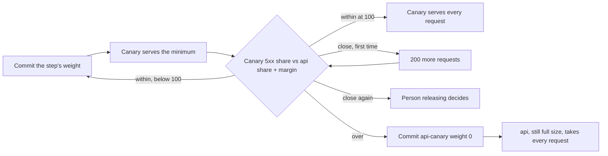

## Before you start

- [[devops.l4.canary-release]] — you know an HTTPRoute rule splits requests between `api` and `api-canary` by weight, and Prometheus counts each Deployment's requests through the Pod's `app` label.
- [[backend.l4.error-budget]] — you know the error budget is the share of requests the SLO allows to fail, and a release that causes failures spends it.
- [[backend.l4.service-level-indicators]] — you know `slo.md` counts every `5xx` as a bad answer, including the `503` the `catalog-reads` limit gives.
- [[backend.l3.bulkhead]] — you know the `catalog-reads` limit lets a fixed number of product reads run and wait, and answers any read beyond that with `503` at once.

## The situation

The canary at weight 10 served 20 product reads, all answered `200`. The next api build is ready, and a teammate wants to give it every request straight away, since twenty out of twenty worked, and you hesitate. Twenty is a small sample; one failure among them would already be 5%. If you wait for more, how many is enough, and how many failures are too many? Deciding that while the numbers arrive invites you to read them the way you hope. How do you decide, before the release starts, when a canary may get a bigger share and when it must stop?

## Core concepts

- **progressive delivery** — raising a canary's share of the requests in steps, and moving to the next step only while the canary's measurements stay within limits written down before the release starts.
- A step (a plain word, used in this sense here) — one weight for `api-canary`, committed to the config repository; Đơn Hàng's steps are 10, 50 and 100.
- The minimum (a plain word, used in this sense here) — how many requests the canary must serve in a step before that step is judged.
- The margin (a plain word, used in this sense here) — how far the canary's `5xx` share may rise above the stable version's, measured over the same period.
- The stable version (not a new term) — the Deployment `api`, which keeps running at full size while the canary goes through the steps.

## How it works



In the situation above, the decision you hesitated over moves to before the release. `canary-checks.md` writes down three steps, a minimum of 200 requests and a margin of one percentage point. Progressive delivery applies them in order: commit a weight, wait until the canary has served the minimum, compare, and only then commit the next weight. Each bigger weight sends the canary a bigger share of the same requests, so 50 tests it under more at once before it gets 100.

The minimum exists because a share computed over a few requests says more about chance than about the version. After 20 requests one failure is 5%; after 200 the same failure is 0.5%. Time does not replace the count: ten quiet minutes may bring only a few dozen requests.

The canary is compared with the stable version over the same period, not with zero. A fault in something both versions use, such as PostgreSQL or Redis, raises both shares together; only the difference speaks about the new build.

Each judgement has three outcomes. Within the limit, the next weight is committed. Over it, the canary's weight goes back to 0 at once, without asking anyone. Less than half a point below it (for a 1.2% limit, above 0.7% up to 1.2%) is close: the canary serves 200 more requests and is judged again; still close, and the person releasing decides.

Stopping is cheap. The stable Deployment never shrank, so it takes back every request with no Pod to start. Only the requests the canary served met the fault, and each `5xx` among them spends the api's error budget like any other failed request.

## In the Đơn Hàng system

Why `canary-checks.md` waits for a minimum and compares with the stable version:

```markdown file=docs/design/canary-checks.md tag=stage-4 lines=25-44
### Vì sao phải đợi đủ số request

Một bước chỉ được xét khi canary đã phục vụ đủ số request tối thiểu của bước
đó. Với ít request, một lỗi lẻ đã là một tỉ lệ lớn: sau 20 request, một lỗi
là 5%; sau 200 request, cùng một lỗi là 0,5%. Xét sớm hơn thì quyết định
dựa vào may rủi chứ không dựa vào bản mới.

Thời gian không thay cho số request: một bước để mười phút lúc vắng khách có
thể chỉ có vài chục request.

### Giới hạn 5xx

Canary qua một bước khi tỉ lệ `5xx` của nó, tính trên các request của bước
đó, không vượt tỉ lệ `5xx` của bản stable trong cùng khoảng thời gian quá 1
điểm phần trăm (giả định). Ví dụ: bản stable có 0,2% `5xx` thì canary được
tới 1,2%.

Canary được so với bản stable chứ không so với 0, vì lỗi của thứ cả hai bản
cùng dùng (PostgreSQL, Redis, Keycloak) chạm cả hai bản như nhau; chỉ phần
chênh lệch mới nói về bản mới.
```

Lines 27–30 judge a step only after the minimum, with the 20 and 200 arithmetic. Lines 37–40 set the margin: with the stable version at 0.2% `5xx`, the canary may reach 1.2%. Outside the excerpt, the step table (lines 15–19) asks for 200 requests at each of the three steps, and lines 6–7 call every number an assumption, to be revisited once production has measurements.

How `canary-steps.sh` judges one step:

```bash file=scripts/devops/canary-steps.sh tag=stage-4 lines=77-101
    sleep 11 # two more scrapes, every 5 s
    after=$(requests_by "app, code")
    read -r canary_all canary_bad < <(served "$before" "$after" api-canary)
    read -r stable_all stable_bad < <(served "$before" "$after" api)
    [ "$canary_all" -lt "$needed" ] && continue
    canary_share=$(share "$canary_all" "$canary_bad")
    stable_share=$(share "$stable_all" "$stable_bad")
    limit=$(awk -v s="$stable_share" -v m="$margin" 'BEGIN {printf "%.1f", s + m}')
    echo "  api-canary served $canary_all, 5xx $canary_share%; api served $stable_all, 5xx $stable_share%; limit $limit%"
    verdict=$(awk -v c="$canary_share" -v l="$limit" -v n="$close" 'BEGIN {print (c > l) ? "over" : (c > l - n) ? "close" : "within"}')
    if [ "$verdict" = close ] && [ "$needed" -eq "$minimum" ]; then
      echo "  close to the limit: $minimum more requests, then judge again"
      needed=$((canary_all + minimum))
      continue
    fi
    break
  done
  case "$verdict" in
    within)
      [ "$canary_weight" -lt 100 ] && echo "  within the limit: next step" || echo "  within the limit: the canary serves every request" ;;
    over)
      echo "  over the limit: api-canary back to weight 0, the release stops"
      stop_canary
      result=stopped
      break ;;
```

```text output=true
...
== step 1: commit the route api: api 90, api-canary 10
  api-canary served 200, 5xx 0.0%; api served 1800, 5xx 0.0%; limit 1.0%
  within the limit: next step
...
== step 3: commit the route api: api 0, api-canary 100
  api-canary served 200, 5xx 0.0%; api served 0, 5xx 0.0%; limit 1.0%
  within the limit: the canary serves every request
...
release: passed
```

Before the excerpt, lines 17–19 copy the document's numbers into `minimum=200`, `margin=1.0` and `close=0.5`, and line 64 loops over the weights 10, 50 and 100. For each, lines 66–70 commit the weights and wait until Argo CD has synced them, and lines 75–76 send product reads, sized so the canary should get the minimum.

In the excerpt, lines 78–80 read each Deployment's requests and `5xx` since the step began, and line 81 goes back to lines 75–76 for another batch if the canary has served fewer than `needed`, which starts at the minimum. Lines 82–84 compute both shares and the limit, the stable share plus the margin; line 86 uses `awk` to turn them into `over`, `close` or `within`. A first `close` raises the target by 200 and loops (lines 87–90). `within` lets the loop commit the next weight; `over` calls `stop_canary` (lines 97–101), which commits `api` 100 and `api-canary` 0. A second `close`, after the excerpt (lines 102–106), prints `still close to the limit: the person releasing decides; the script stops here` and calls `stop_canary` too. At step 3 `api` served nothing, so `share` (line 48) gives it 0.0% and the limit is a plain 1.0%: with no stable share to compare with, a fault in something both versions use would count against the canary there.

With `--bad`, lines 23–30 give `api-canary` alone two settings: `RateLimiting__CatalogReads__PermitLimit` set to `1` and `RateLimiting__CatalogReads__QueueLimit` set to `0`. The image and `Program.cs` are the same; only the `catalog-reads` limit changes, so one product read runs at a time and a second one at once gets `503`. The script sends reads 20 at a time, so the canary turns some away. Its capture, `canary-steps-bad.txt`, prints at step 1 `api-canary served 200` and `limit 1.0%`, then `over the limit: api-canary back to weight 0, the release stops`. The capture prints `...` where the canary's share would be; your own run prints a number, above 1.0% since the verdict is `over`. There is no step 2, and the last line is `release: stopped`.

`canary-checks.md` says the team runs nothing in the cluster that steps the canary by itself; `versions.yaml` pins none. Its script commits each weight, so every step is a commit that Argo CD applies, and the config repository's history shows which step ran when.

## Trade-offs

| | One weight, judged by eye | Steps with preset limits, by commit | Steps run by a tool in the cluster |
|---|---|---|---|
| Who decides to move on | You, looking at the counts | The numbers in `canary-checks.md`, applied by the script | The same kind of numbers, applied by the tool |
| Written before the release | Nothing | Steps, minimum, margin, what counts as close | The same, in the tool's own configuration |
| When a step is judged | Whenever you look | After the canary has served the minimum | Whatever the tool's configuration sets |
| On a number over the limit | Whatever you decide then | Weight 0, committed at once | What its configuration says, applied by the tool |
| Where each step shows up | One commit | A commit per step in the config repository | Depends on the tool |
| What you add | Nothing | A script and a written document | One more component, not in Đơn Hàng's pinned versions |

## What would you choose if…

- …the change is to Notifications: not these steps. `canary-checks.md` covers only the api, the component behind the Gateway's route, and ADR 0019 releases Notifications and Payments by rolling update.
- …staging gets so few requests that a step would take hours to reach 200: send reads yourself, as the script does, or accept a slow step. Do not lower the minimum during the release, because the limits are fixed before it starts.
- …the api's error budget is already spent and the change is a fix: still all three steps, because a broken fix would spend more of a budget that is already gone.

## Seniors often assume…

- **"If the canary shows no errors in its first minute, it can take all the requests."** → Actually a minute is a time, not a count: at weight 10 the canary gets one request in ten, so on a quiet staging its first minute may hold only a handful, and with 20 requests one failure is already 5%. `canary-checks.md` judges each step only after 200 requests, and passes through 50 before 100. You notice this when a canary that looked clean at 10 starts failing at 50, under more requests at once than it had met.
- **"A fixed error limit is enough; the stable version's own errors do not matter."** → Actually a fault in PostgreSQL, Redis or Keycloak raises both versions' `5xx` together, and a fixed limit would blame the new build for it. Comparing with `api` over the same period leaves only the difference. You notice this when a short database outage during a step pushes both shares up and the canary still passes, because the gap stayed under half a point, well inside the one-point margin.
- **"Automatic rollback means nobody has to decide in advance what a bad canary looks like."** → Actually the script only applies numbers people wrote in `canary-checks.md`, and a tool in the cluster needs the same decisions in its own configuration. Automation makes stopping fast, not right. You notice this when you look for the limit in `canary-steps.sh` and find it at lines 17–19, copied from the document, with lines 13–16 marking the numbers as assumed.

## Try it (3 minutes)

With the cluster `donhang-staging` running from the GitOps lessons, in the `don-hang` repository folder:

1. Run `scripts/devops/canary-steps.sh --bad`. It waits for several syncs, so it can take a few minutes beyond the 3 in the heading. If it stops and prints a command to run first, run that command and try again.
2. Read the lines under `== step 1` and the last line.

Expected result: `api-canary served 200`, then `over the limit: api-canary back to weight 0, the release stops`, no `== step 2` line, and `release: stopped` at the end.

## Connections

- [[devops.l4.canary-release]] — the single weight this lesson raises in steps, and the counts per `app` it judges by.
- [[backend.l4.error-budget]] — what each failed canary request spends, and why stopping at the first step spends little.
- [[devops.l3.deploying-by-commit]] — the same mechanism as each step: a commit to the config repository that Argo CD applies.
- [[devops.l3.rollback-by-revert]] — the other way back; here the stop is a new commit setting the weight to 0, and the stable Pods never left.
- [[backend.l4.load-testing]] — how the api behaves as requests grow, which a canary meets only as its share rises.
- [[devops.l4.feature-flags]] — next: shipping code switched off and turning it on with no deploy.

## Five-line summary

1. Progressive delivery raises a canary's share in steps and moves on only while its measurements stay within limits written before the release.
2. `canary-checks.md` sets Đơn Hàng's steps, 10, 50 and 100, a minimum of 200 requests and a one-point margin over the stable version.
3. A step is judged only after the minimum, because after 20 requests one failure is already 5%.
4. With `--bad`, the canary's one-at-a-time `catalog-reads` limit crosses the margin at step 1, and the script commits its weight back to 0.
5. Stopping is cheap: `api` still runs at full size, every step is a commit, and only the canary's failed requests spend the budget.
