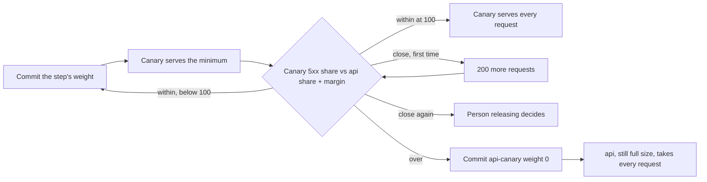

## Bạn cần biết trước

- [[devops.l4.canary-release]] — bạn biết một rule của HTTPRoute chia request giữa `api` và `api-canary` theo weight, và Prometheus đếm request của từng Deployment qua label `app` của Pod.
- [[backend.l4.error-budget]] — bạn biết error budget là phần request mà SLO cho phép lỗi, và một lần phát hành gây lỗi sẽ tiêu vào nó.
- [[backend.l4.service-level-indicators]] — bạn biết `slo.md` tính mọi `5xx` là một câu trả lời xấu, kể cả `503` mà giới hạn `catalog-reads` trả về.
- [[backend.l3.bulkhead]] — bạn biết giới hạn `catalog-reads` cho một số cố định lượt đọc sản phẩm chạy và chờ, còn lượt đọc nào vượt quá thì nhận `503` ngay.

## Tình huống

Canary ở weight 10 đã phục vụ 20 lượt đọc sản phẩm, tất cả đều trả `200`. Bản build api kế tiếp đã sẵn sàng. Một đồng nghiệp muốn cho nó nhận mọi request ngay, vì hai mươi trên hai mươi đều chạy, còn bạn thì ngần ngừ. Hai mươi là mẫu nhỏ: chỉ một lỗi trong số đó đã là 5%. Nếu chờ thêm, bao nhiêu là đủ, và bao nhiêu lỗi là quá nhiều? Quyết định chuyện đó trong lúc các con số đang đổ về thì rất dễ đọc chúng theo cách mình mong. Làm sao quyết định, ngay trước khi phát hành, lúc nào canary được nhận phần lớn hơn và lúc nào nó phải dừng?

## Khái niệm cốt lõi

- **progressive delivery** (Tăng dần phần request của bản mới theo từng bước, chỉ đi tiếp khi số đo còn trong giới hạn đặt trước) — tăng phần request của canary theo từng bước, và chỉ sang bước kế khi số đo của canary còn nằm trong các giới hạn đã ghi ra trước lúc phát hành.
- Bước (từ thông thường, ở đây dùng theo nghĩa này) — một weight cho `api-canary`, được commit vào repo cấu hình. Các bước của Đơn Hàng là 10, 50 và 100.
- Mức tối thiểu (từ thông thường, ở đây dùng theo nghĩa này) — số request canary phải phục vụ trong một bước trước khi bước đó được xét.
- Biên (từ thông thường, ở đây dùng theo nghĩa này) — tỉ lệ `5xx` của canary được phép cao hơn tỉ lệ của bản stable bao nhiêu, đo trong cùng một khoảng thời gian.
- Bản stable (không phải term mới) — Deployment `api`, vẫn chạy đủ quy mô trong suốt lúc canary đi qua các bước.

## Cơ chế hoạt động



Trong tình huống trên, quyết định khiến bạn ngần ngừ được dời lên trước lúc phát hành. `canary-checks.md` ghi ra ba bước, mức tối thiểu 200 request và biên một điểm phần trăm. Progressive delivery áp chúng theo thứ tự: commit một weight, chờ tới khi canary phục vụ đủ mức tối thiểu, so sánh, rồi mới commit weight kế tiếp. Mỗi weight lớn hơn gửi cho canary một phần lớn hơn của cùng dòng request, nên ở 50 nó bị thử với nhiều request cùng lúc hơn trước khi nhận 100.

Mức tối thiểu tồn tại vì một tỉ lệ tính trên vài request nói về may rủi nhiều hơn là về phiên bản. Sau 20 request, một lỗi là 5%. Sau 200 request, cùng lỗi đó là 0,5%. Thời gian không thay được số đếm: mười phút yên ắng có thể chỉ mang tới vài chục request.

Canary được so với bản stable trong cùng khoảng thời gian, không so với 0. Lỗi ở thứ mà cả hai bản cùng dùng, như PostgreSQL hay Redis, đẩy cả hai tỉ lệ lên cùng nhau. Chỉ phần chênh lệch mới nói về bản build mới.

Mỗi lần xét có ba kết quả. Trong giới hạn thì weight kế tiếp được commit. Vượt giới hạn thì weight của canary về 0 ngay, không hỏi ai. Thấp hơn giới hạn chưa tới nửa điểm (với giới hạn 1,2%, tức trên 0,7% tới 1,2%) là sát: canary phục vụ thêm 200 request rồi được xét lại. Vẫn sát thì người đang phát hành quyết định.

Dừng lại rất rẻ. Deployment stable chưa bao giờ thu nhỏ, nên nó nhận lại mọi request mà không cần khởi động Pod nào. Chỉ các request canary đã phục vụ mới gặp lỗi, và mỗi `5xx` trong số đó tiêu vào error budget của api như mọi request lỗi khác.

## Trong hệ thống Đơn Hàng

Vì sao `canary-checks.md` chờ đủ mức tối thiểu và so với bản stable:

```markdown file=docs/design/canary-checks.md tag=stage-4 lines=25-44
### Vì sao phải đợi đủ số request

Một bước chỉ được xét khi canary đã phục vụ đủ số request tối thiểu của bước
đó. Với ít request, một lỗi lẻ đã là một tỉ lệ lớn: sau 20 request, một lỗi
là 5%; sau 200 request, cùng một lỗi là 0,5%. Xét sớm hơn thì quyết định
dựa vào may rủi chứ không dựa vào bản mới.

Thời gian không thay cho số request: một bước để mười phút lúc vắng khách có
thể chỉ có vài chục request.

### Giới hạn 5xx

Canary qua một bước khi tỉ lệ `5xx` của nó, tính trên các request của bước
đó, không vượt tỉ lệ `5xx` của bản stable trong cùng khoảng thời gian quá 1
điểm phần trăm (giả định). Ví dụ: bản stable có 0,2% `5xx` thì canary được
tới 1,2%.

Canary được so với bản stable chứ không so với 0, vì lỗi của thứ cả hai bản
cùng dùng (PostgreSQL, Redis, Keycloak) chạm cả hai bản như nhau; chỉ phần
chênh lệch mới nói về bản mới.
```

Dòng 27–30 chỉ xét một bước sau khi đủ mức tối thiểu, kèm phép tính với 20 và 200. Dòng 37–40 đặt biên: bản stable ở 0,2% `5xx` thì canary được tới 1,2%. Ngoài đoạn trích, bảng các bước (dòng 15–19) đòi 200 request ở cả ba bước, và dòng 6–7 gọi mọi con số là giả định, sẽ xem lại khi production có số đo.

Cách `canary-steps.sh` xét một bước:

```bash file=scripts/devops/canary-steps.sh tag=stage-4 lines=77-101
    sleep 11 # two more scrapes, every 5 s
    after=$(requests_by "app, code")
    read -r canary_all canary_bad < <(served "$before" "$after" api-canary)
    read -r stable_all stable_bad < <(served "$before" "$after" api)
    [ "$canary_all" -lt "$needed" ] && continue
    canary_share=$(share "$canary_all" "$canary_bad")
    stable_share=$(share "$stable_all" "$stable_bad")
    limit=$(awk -v s="$stable_share" -v m="$margin" 'BEGIN {printf "%.1f", s + m}')
    echo "  api-canary served $canary_all, 5xx $canary_share%; api served $stable_all, 5xx $stable_share%; limit $limit%"
    verdict=$(awk -v c="$canary_share" -v l="$limit" -v n="$close" 'BEGIN {print (c > l) ? "over" : (c > l - n) ? "close" : "within"}')
    if [ "$verdict" = close ] && [ "$needed" -eq "$minimum" ]; then
      echo "  close to the limit: $minimum more requests, then judge again"
      needed=$((canary_all + minimum))
      continue
    fi
    break
  done
  case "$verdict" in
    within)
      [ "$canary_weight" -lt 100 ] && echo "  within the limit: next step" || echo "  within the limit: the canary serves every request" ;;
    over)
      echo "  over the limit: api-canary back to weight 0, the release stops"
      stop_canary
      result=stopped
      break ;;
```

```text output=true
...
== step 1: commit the route api: api 90, api-canary 10
  api-canary served 200, 5xx 0.0%; api served 1800, 5xx 0.0%; limit 1.0%
  within the limit: next step
...
== step 3: commit the route api: api 0, api-canary 100
  api-canary served 200, 5xx 0.0%; api served 0, 5xx 0.0%; limit 1.0%
  within the limit: the canary serves every request
...
release: passed
```

Trước đoạn trích, dòng 17–19 chép các con số của tài liệu thành `minimum=200`, `margin=1.0` và `close=0.5`, còn dòng 64 lặp qua các weight 10, 50 và 100. Với mỗi weight, dòng 66–70 commit các weight và chờ tới khi Argo CD đã sync chúng, rồi dòng 75–76 gửi các lượt đọc sản phẩm, với số lượng tính sao cho canary nhận đủ mức tối thiểu.

Trong đoạn trích, dòng 78–80 đọc số request và số `5xx` của từng Deployment kể từ lúc bước bắt đầu. Dòng 81 quay lại dòng 75–76 để gửi thêm một đợt nếu canary phục vụ ít hơn `needed`, vốn bắt đầu bằng mức tối thiểu. Dòng 82–84 tính hai tỉ lệ và giới hạn, tức tỉ lệ stable cộng biên. Dòng 86 dùng `awk` để đổi chúng thành `over`, `close` hoặc `within`. Lần `close` đầu tiên nâng mục tiêu thêm 200 rồi lặp lại (dòng 87–90). `within` cho vòng lặp commit weight kế tiếp. `over` gọi `stop_canary` (dòng 97–101), hàm commit `api` 100 và `api-canary` 0. Lần `close` thứ hai, sau đoạn trích (dòng 102–106), in `still close to the limit: the person releasing decides; the script stops here` rồi cũng gọi `stop_canary`. Ở bước 3, `api` không phục vụ gì, nên `share` (dòng 48) cho nó 0.0% và giới hạn chỉ còn 1.0%: không có tỉ lệ stable để so, lỗi ở thứ mà cả hai bản cùng dùng sẽ bị tính hết cho canary ở bước đó.

Với `--bad`, dòng 23–30 cho riêng `api-canary` hai thiết lập: `RateLimiting__CatalogReads__PermitLimit` bằng `1` và `RateLimiting__CatalogReads__QueueLimit` bằng `0`. Image và `Program.cs` vẫn như cũ. Chỉ giới hạn `catalog-reads` đổi, nên mỗi lúc chỉ một lượt đọc sản phẩm chạy, lượt thứ hai nhận `503` ngay. Script gửi mỗi lần 20 lượt đọc, nên canary từ chối một số. Bản ghi của lần chạy này, `canary-steps-bad.txt`, in ở bước 1 `api-canary served 200` và `limit 1.0%`, rồi `over the limit: api-canary back to weight 0, the release stops`. Bản ghi in `...` ở chỗ tỉ lệ của canary. Lần chạy của bạn sẽ in một con số, cao hơn 1.0% vì kết luận là `over`. Không có bước 2, và dòng cuối là `release: stopped`.

`canary-checks.md` nói team không chạy gì trong cluster để tự đẩy canary qua các bước, và `versions.yaml` không ghim công cụ nào như vậy. Script của nó commit từng weight, nên mỗi bước là một commit mà Argo CD áp vào, và lịch sử của repo cấu hình cho thấy bước nào chạy lúc nào.

## Đánh đổi

| | Một weight, xét bằng mắt | Các bước với giới hạn đặt trước, bằng commit | Các bước do một công cụ trong cluster chạy |
|---|---|---|---|
| Ai quyết định đi tiếp | Bạn, nhìn vào các số đếm | Các con số trong `canary-checks.md`, do script áp | Cùng loại con số, do công cụ áp |
| Ghi ra trước lúc phát hành | Không gì cả | Các bước, mức tối thiểu, biên, thế nào là sát | Như vậy, trong cấu hình riêng của công cụ |
| Lúc nào một bước được xét | Bất cứ khi nào bạn nhìn | Sau khi canary phục vụ đủ mức tối thiểu | Theo cấu hình của công cụ |
| Khi một con số vượt giới hạn | Tùy bạn quyết lúc đó | Weight 0, commit ngay | Theo cấu hình của nó, do công cụ áp |
| Mỗi bước hiện ra ở đâu | Một commit | Mỗi bước một commit trong repo cấu hình | Tùy công cụ |
| Bạn thêm gì | Không gì cả | Một script và một tài liệu viết ra | Thêm một thành phần, không có trong các phiên bản Đơn Hàng ghim |

## Bạn sẽ chọn gì nếu…

- …thay đổi nằm ở Notifications: không dùng các bước này. `canary-checks.md` chỉ áp cho api, thành phần đứng sau route của Gateway, và ADR 0019 phát hành Notifications và Payments bằng rolling update.
- …staging có ít request tới mức một bước phải mất hàng giờ mới đủ 200: tự gửi các lượt đọc, như script làm, hoặc chấp nhận một bước chậm. Đừng hạ mức tối thiểu giữa lúc phát hành, vì các giới hạn đã cố định từ trước khi bắt đầu.
- …error budget của api đã tiêu hết và thay đổi là một bản sửa lỗi: vẫn đi đủ ba bước, vì một bản sửa hỏng sẽ tiêu thêm vào một budget vốn đã cạn.

## Senior hay nhầm rằng…

- **"Nếu canary không có lỗi nào trong phút đầu, nó có thể nhận mọi request."** → Thực ra một phút là thời gian, không phải số đếm: ở weight 10, canary nhận một trong mười request, nên trên một staging vắng, phút đầu có thể chỉ có vài request, và với 20 request thì một lỗi đã là 5%. `canary-checks.md` chỉ xét mỗi bước sau 200 request, và đi qua 50 trước khi tới 100. Bạn sẽ nhận ra khi một canary trông sạch ở 10 bắt đầu lỗi ở 50, lúc nhận nhiều request cùng lúc hơn mức nó từng gặp.
- **"Một giới hạn lỗi cố định là đủ, lỗi của chính bản stable không quan trọng."** → Thực ra lỗi ở PostgreSQL, Redis hay Keycloak đẩy `5xx` của cả hai bản lên cùng nhau, và một giới hạn cố định sẽ đổ lỗi đó cho bản build mới. So với `api` trong cùng khoảng thời gian thì chỉ còn lại phần chênh lệch. Bạn sẽ nhận ra khi database ngừng một lúc ngắn trong một bước, đẩy cả hai tỉ lệ lên, mà canary vẫn qua, vì khoảng cách giữ dưới nửa điểm, nằm gọn trong biên một điểm.
- **"Rollback tự động nghĩa là không ai phải quyết trước thế nào là một canary xấu."** → Thực ra script chỉ áp các con số người ta đã viết trong `canary-checks.md`, và một công cụ trong cluster cũng cần đúng những quyết định đó trong cấu hình riêng của nó. Tự động hóa làm việc dừng lại nhanh, không làm nó đúng. Bạn sẽ nhận ra khi tìm giới hạn trong `canary-steps.sh` và thấy nó ở dòng 17–19, chép từ tài liệu, với dòng 13–16 đánh dấu các con số là giả định.

## Thử ngay (3 phút)

Với cluster `donhang-staging` đang chạy từ các bài GitOps, trong thư mục repository `don-hang`:

1. Chạy `scripts/devops/canary-steps.sh --bad`. Script chờ nhiều lần sync, nên có thể mất thêm vài phút ngoài 3 phút ở tiêu đề. Nếu script dừng và in ra một lệnh cần chạy trước, hãy chạy lệnh đó rồi thử lại.
2. Đọc các dòng dưới `== step 1` và dòng cuối cùng.

Kết quả mong đợi: `api-canary served 200`, rồi `over the limit: api-canary back to weight 0, the release stops`, không có dòng `== step 2`, và `release: stopped` ở cuối.

## Liên hệ

- [[devops.l4.canary-release]] — weight đơn lẻ mà bài này tăng theo từng bước, và các số đếm theo `app` dùng để xét.
- [[backend.l4.error-budget]] — thứ mà mỗi request lỗi của canary tiêu vào, và vì sao dừng ở bước đầu chỉ tiêu ít.
- [[devops.l3.deploying-by-commit]] — cùng cơ chế với mỗi bước: một commit vào repo cấu hình mà Argo CD áp vào.
- [[devops.l3.rollback-by-revert]] — đường quay lui còn lại. Ở đây việc dừng là một commit mới đặt weight về 0, và các Pod stable chưa từng rời đi.
- [[backend.l4.load-testing]] — api hoạt động ra sao khi request tăng lên, điều mà canary chỉ gặp khi phần của nó tăng.
- [[devops.l4.feature-flags]] — bài kế: deploy code đang tắt rồi bật lên mà không deploy lại.

## Tóm tắt 5 dòng

1. Progressive delivery tăng phần của canary theo từng bước và chỉ đi tiếp khi số đo của nó còn trong các giới hạn ghi ra trước lúc phát hành.
2. `canary-checks.md` đặt các bước của Đơn Hàng là 10, 50 và 100, mức tối thiểu 200 request và biên một điểm so với bản stable.
3. Một bước chỉ được xét sau khi đủ mức tối thiểu, vì sau 20 request một lỗi đã là 5%.
4. Với `--bad`, giới hạn `catalog-reads` mỗi lúc một lượt của canary vượt biên ở bước 1, và script commit weight của nó về 0.
5. Dừng lại rất rẻ: `api` vẫn chạy đủ quy mô, mỗi bước là một commit, và chỉ các request lỗi của canary tiêu vào budget.
