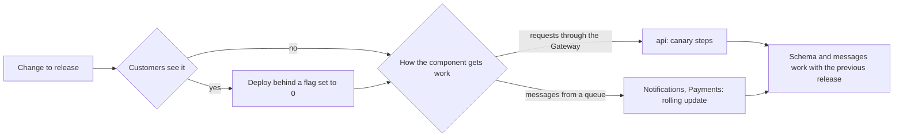

## Before you start

- [[devops.l4.feature-flags]] — you know a feature flag ships code switched off and turns it on later with no deploy.
- [[design.l4.one-deployment-for-all-shops]] — you know ADR `0012` serves every shop from one shared deployment instead of a copy per shop.
- [[backend.l4.message-schema-evolution]] — you know a message may change only in ways every reader can still read, because old-shaped messages still arrive after a deploy.
- [[management.l3.weighing-options-in-an-adr]] — you know an ADR judges each real option against the same needs and names what would reopen the decision.

## The situation

The module so far gave you three ways to release the api: blue-green, a canary in steps, and feature flags. The next release also changes Notifications and Payments. A teammate proposes one rule for everything: every service goes out as a canary, with 10% of its traffic first.

You open the HTTPRoutes to add the weights. The api has one. Notifications has none, because its work arrives as messages from RabbitMQ. Payments has one rule in the api's HTTPRoute, `/api/v1/refunds` for staff, and most of its work also arrives as messages. Which way should each component be released, and where does the team write that down so the next release does not argue it again?

## Core concepts

- How a component gets its work (a plain phrase, used in this sense here) — either requests that come through the Gateway on an HTTPRoute, or messages it takes from a RabbitMQ queue.
- A release strategy (a plain phrase, used in this sense here) — the way a new version of one component starts doing real work: a rolling update, blue-green, a canary in steps, or code shipped behind a feature flag.
- Compatible with the previous release (a plain phrase, used in this sense here) — the new version reads the data and messages the old version writes, and the old version reads what the new one writes.
- ADR `0019` — Đơn Hàng's record that chooses one release strategy per component and names what would reopen that choice.

## How it works



The diagram asks two questions, in this order. First: will customers see the change? If yes, the code ships behind a feature flag set to 0, whichever component it is in. Second: how does the component get its work? The api answers requests through the Gateway, so it can go out as a canary and stop at 10%. Notifications and Payments work mainly from queues, so they use rolling updates.

In the situation above, the teammate's rule fails at the second question. An HTTPRoute can list two backends, the old and the new version, each with a weight; the weights set the share of matching requests each one gets. They split those requests and nothing else. Messages never pass through the Gateway, so no weight can send 10% of them anywhere. While Notifications is updated, old and new Pods take messages from the same queue, and each message goes to whichever Pod receives it. Only the api's requests stop at 10%: it also reads payment events from the queue `orders.payment-events`, and its canary takes those from its first minute.

Every path ends in the same box. In every strategy the old and the new version run at the same time against one database and one set of queues. So compatibility is the rule underneath all of them: it lets any release be undone by deploying the version before it.

A choice made per component needs a record, or each release reopens it. ADR `0019` is that record.

## In the Đơn Hàng system

The decision section of ADR `0019`:

```markdown file=docs/adr/0019-chien-luoc-phat-hanh-theo-thanh-phan.md tag=stage-4 lines=38-49
### Quyết định

- api: canary qua Gateway theo các bước và giới hạn của `canary-checks.md`.
- Notifications và Payments: rolling update. Message trong queue không đi qua
  route, nên trọng số của HTTPRoute không chia được chúng: bản cũ và bản mới
  cùng lấy message từ một queue. Route `/api/v1/refunds` của Payments ít
  request, và việc chính của Payments đi qua queue, nên đội không dựng canary
  riêng cho nó.
- Thay đổi khách nhìn thấy: deploy sau một feature flag đang tắt, rồi bật
  theo `feature-flags.md`.
- Blue-green bị từ chối: nó gấp đôi Pod api và kết nối database để có được
  cách quay lại nhanh mà canary cũng cho.
```

Line 40 gives the api a canary through the Gateway, with the steps and limits of `canary-checks.md`: the new version gets 10%, then 50%, then 100% of requests. Lines 41–45 give Notifications and Payments rolling updates: route weights cannot split queue messages, and Payments' route `/api/v1/refunds` gets few requests while its main work arrives through the queue. Lines 46–47 put changes customers see behind a flag that is off. Lines 48–49 reject blue-green.

Above the excerpt, lines 10–11 give the reason it matters: all 1,000 planned shops share one deployment, so a broken release reaches every shop at once. Lines 27–30 give the cost: while blue-green runs, the api has twice its Pods and twice the PostgreSQL connections that `capacity-plan.md` counts for it. Lines 31–34 describe the canary: `api-canary` is a small Deployment that runs the new api version beside `api`, and the HTTPRoute gives each a weight. Setting `api-canary`'s weight to 0 goes back as quickly as blue-green, with one extra Pod.

Below the excerpt, lines 74–77 answer a backend developer who asked for blue-green on Payments because refunds are sensitive: two sets of Payments Pods still take messages from one queue, so blue-green cannot keep the old and new version apart for that work.

The consequences and the conditions for reopening:

```markdown file=docs/adr/0019-chien-luoc-phat-hanh-theo-thanh-phan.md tag=stage-4 lines=51-70
### Hệ quả

- Mỗi bản phát hành giữ schema chạy được với code của bản trước nó. Bản cũ
  và bản mới chạy cùng lúc trong mọi cách ở trên, và trong canary một khách có
  thể gặp cả hai bản trong một phiên, nên mỗi bản phải đọc được dữ liệu bản kia
  ghi. Nhờ vậy mọi bản phát hành đảo ngược được bằng cách deploy lại bản trước.
- Message giữa các service cũng vậy: bản mới đọc được message bản cũ gửi, và
  ngược lại, trong suốt thời gian rolling update.
- Phát hành gắn với chính sách error budget trong `slo.md`: khi budget của
  một service đã hết, chỉ bản sửa lỗi được phát hành, và bản sửa lỗi của api
  vẫn đi qua đủ các bước canary.
- Staging có thêm Prometheus để đếm request theo Deployment, và hai nhãn
  `api-canary`, `api-green` trong các NetworkPolicy đang liệt kê `api`.

Điều kiện mở lại:

- Một cửa hàng cần một bản triển khai riêng (mở lại cả ADR 0012).
- Một thay đổi không thể làm tương thích với bản trước, nên bản cũ và bản mới
  không chạy cùng lúc được.
- Notifications hoặc Payments bắt đầu nhận phần lớn việc qua Gateway.
```

Lines 53–56 are the rule from the diagram's last box: each release keeps a schema the previous release's code can run on. In a canary one customer can meet both versions in one session, so each version must read what the other writes. Lines 57–58 say the same for messages during a rolling update. Lines 59–61 tie releases to the error budget: under the policy in `slo.md`, once a service's budget is spent its features stop and only fixes ship until its SLI is back above the SLO, and an api fix still takes every canary step. `slo.md` does not say whether deploying a feature behind a flag set to 0 counts as releasing it; while the rule is silent, holding that deploy too is the cautious reading.

Lines 62–63 add staging tooling: Prometheus counts requests per Deployment, and NetworkPolicies that list `api` also list `api-canary` and `api-green`, the green Deployment of the blue-green lesson's lab, still in the repository. Lines 65–70 name what would reopen the decision: a shop that needs its own deployment, a change that cannot be made compatible, or Notifications or Payments starting to get most of their work through the Gateway.

## Trade-offs

For the api, the three options the ADR weighed:

| | Blue-green | Canary through the Gateway | Rolling update only |
|---|---|---|---|
| Extra api Pods during a release | A second full set | One `api-canary` Pod | One extra Pod at a time, while Pods are replaced |
| PostgreSQL connections for the api | Twice what `capacity-plan.md` counts | One more Pod's worth | One more Pod's worth, while Pods are replaced |
| Stop when only a small share has met the new version | No, all requests move at once | Yes, at 10% | No: the smallest step is one Pod, about a third or half of requests for the api |
| Going back | Switch the route back | Set `api-canary`'s weight to 0 | Deploy the previous version again, which is another rolling update |
| Usable for work that arrives from a queue | No | No | Yes |

The last row is why the answer differs per component: the two options that stop or switch quickly work only on requests.

## What would you choose if…

- …a new service gets most of its work through the Gateway: a canary like the api's, with its own steps written down before its first release. For Notifications or Payments this is the third reopen condition, so the team revisits ADR `0019` first.
- …a release must change a message so that old readers cannot read it: first look for a compatible path, such as publishing the new shape under a new routing key beside the old one until every reader has moved. If none exists, the second reopen condition applies, and the ADR is reopened before that release, not during it.
- …the api's budget is spent and a fix for a `5xx` is ready: ship the fix through all three canary steps; api features wait.

## Seniors often assume…

- **"One release strategy should be used for every service, for consistency."** → Actually a strategy works only on the path a component's work arrives by: weights split requests, and Notifications gets none through the Gateway. You notice this when the release checklist says "canary at 10%" for a service that has no HTTPRoute to weight.
- **"Any service on Kubernetes can be released as a canary by giving it a route weight."** → Actually a route weight reaches only requests that match the route. Payments' `/api/v1/refunds` would send 10% of a few staff requests to the new version, while the saga messages go to old and new Pods alike from the first minute. You notice this when the new version handles refunds from the queue while the weight still reads 10.
- **"An urgent fix should skip the canary to reach customers faster."** → Actually one shared deployment means a broken fix reaches every shop at once, and when the budget is already spent it spends more of it. `canary-checks.md` sends a fix through all three steps. You notice this when a hurried fix turns a few failing requests into failures for every shop.

## Try it (3 minutes)

The next release has three changes:

1. A new sort order on the product list that customers will see, in the api.
2. A change to how Notifications retries a failed email; customers see nothing new.
3. A fix for a `5xx` on `POST /api/v1/orders`, in the api.

The SLIs in `slo.md` are measured at the api (line 8). The api's error budget for S1, order placement without errors, is spent. Using ADR `0019` (lines 38–61) and the policy in `docs/design/slo.md` (lines 86–94), write down for each change: ships now or waits, which strategy, and what must stay compatible.

Expected result: one line per change, naming the strategy and the rule of the ADR that decides it.

<details><summary>Suggested answer</summary>

1. Waits, deploy included. The api's budget is spent, so the policy in `slo.md` stops api features until S1 is back above its SLO, and it does not exempt a deploy behind a flag set to 0. When it ships: canary steps, with the sort order behind a flag set to 0.
2. Ships now as a rolling update. Old and new Notifications Pods take messages from the same queue during the update, so both must read the messages the api sends. This is not an api feature.
3. Ships now, because only fixes ship while the budget is spent, and it still goes through all three canary steps. Its schema must work with the previous api's code, so going back means deploying the version before it.

</details>

## Connections

- [[devops.l4.blue-green-deployment]] — the option this ADR rejects for the api.
- [[devops.l4.progressive-delivery]] — the canary steps and limits that ADR `0019` adopts for the api.
- [[devops.l4.feature-flags]] — the strategy the ADR uses for every change customers see, in any component.
- [[backend.l4.error-budget]] — the policy the ADR ties releases to: when the budget is spent, only fixes ship.
- [[backend.l4.capacity-planning]] — the connection count that makes blue-green too costly for the api.
- [[backend.l4.shop-id-rollout]] — the compatibility rule applied to the schema: each release works with the code before it.
- [[backend.l4.message-schema-evolution]] — the compatibility rule applied to messages during a rolling update.
- [[design.l4.one-deployment-for-all-shops]] — the decision behind the first reopen condition.
- [[devops.l4.delivery-metrics]] — next: measuring whether releases got faster without failing more often.

## Five-line summary

1. Each component gets the release strategy its traffic allows: a route weight reaches requests through the Gateway, never queue messages.
2. ADR `0019` gives the api a canary, Notifications and Payments rolling updates, and changes customers see a flag; blue-green is rejected.
3. Blue-green doubles the api's Pods and database connections for a quick way back that a canary's weight 0 also gives.
4. Old and new versions always share the database and queues, so every release stays compatible with the one before it.
5. While a budget is spent only fixes ship, still through every canary step; the ADR names what would reopen it.
