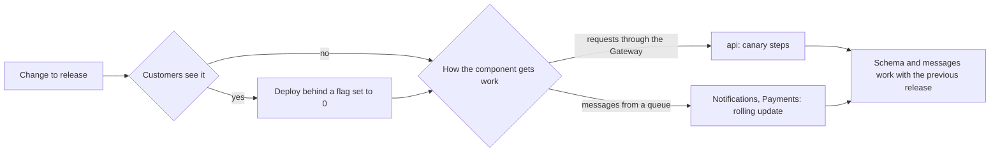

## Bạn cần biết trước

- [[devops.l4.feature-flags]] — bạn biết một feature flag đưa code lên ở trạng thái tắt, rồi bật sau mà không cần deploy.
- [[design.l4.one-deployment-for-all-shops]] — bạn biết ADR `0012` phục vụ mọi cửa hàng từ một bản triển khai dùng chung, thay vì mỗi cửa hàng một bản.
- [[backend.l4.message-schema-evolution]] — bạn biết một message chỉ được đổi theo cách mà mọi bên đọc vẫn đọc được, vì sau một lần deploy vẫn còn message dạng cũ tới.
- [[management.l3.weighing-options-in-an-adr]] — bạn biết một ADR cân từng phương án thật theo cùng các nhu cầu, và ghi rõ điều gì sẽ khiến quyết định được mở lại.

## Tình huống

Tới đây module đã cho bạn ba cách phát hành api: blue-green, canary theo từng bước, và feature flag. Lần phát hành tới cũng đổi Notifications và Payments. Một đồng nghiệp đề xuất một quy tắc chung cho tất cả: service nào cũng ra dưới dạng canary, trước tiên nhận 10% lưu lượng của nó.

Bạn mở các HTTPRoute để thêm weight. Api có một HTTPRoute. Notifications không có cái nào, vì việc của nó tới dưới dạng message từ RabbitMQ. Payments có một rule trong HTTPRoute của api, `/api/v1/refunds` dành cho nhân viên, và phần lớn việc của nó cũng tới dưới dạng message. Mỗi thành phần nên được phát hành theo cách nào, và team ghi điều đó vào đâu để lần phát hành sau không phải tranh luận lại?

## Khái niệm cốt lõi

- Cách một thành phần nhận việc (cụm từ thông thường, ở đây dùng theo nghĩa này) — hoặc là request đi qua Gateway trên một HTTPRoute, hoặc là message nó lấy từ một hàng đợi RabbitMQ.
- Chiến lược phát hành (cụm từ thông thường, ở đây dùng theo nghĩa này) — cách phiên bản mới của một thành phần bắt đầu làm việc thật: rolling update, blue-green, canary theo từng bước, hoặc code đưa lên sau một feature flag.
- Tương thích với lần phát hành trước (cụm từ thông thường, ở đây dùng theo nghĩa này) — bản mới đọc được dữ liệu và message mà bản cũ ghi, và bản cũ đọc được những gì bản mới ghi.
- ADR `0019` — bản ghi của Đơn Hàng chọn một chiến lược phát hành cho mỗi thành phần và ghi rõ điều gì sẽ mở lại lựa chọn đó.

## Cơ chế hoạt động



Sơ đồ hỏi hai câu, theo thứ tự này. Câu đầu: khách có nhìn thấy thay đổi không? Nếu có, code đi lên sau một feature flag đặt ở 0, dù nó nằm trong thành phần nào. Câu thứ hai: thành phần nhận việc bằng cách nào? Api trả lời request đi qua Gateway, nên nó có thể ra dưới dạng canary và dừng ở 10%. Notifications và Payments làm việc chủ yếu từ hàng đợi, nên chúng dùng rolling update.

Trong tình huống trên, quy tắc của đồng nghiệp hỏng ở câu thứ hai. Một HTTPRoute có thể liệt kê hai backend, bản cũ và bản mới, mỗi bản một weight. Các weight quyết định mỗi bản nhận bao nhiêu phần trong những request khớp route. Chúng chia các request đó và không chia gì khác. Message không bao giờ đi qua Gateway, nên không weight nào gửi được 10% message đi đâu cả. Trong lúc Notifications được cập nhật, Pod cũ và Pod mới cùng lấy message từ một hàng đợi, và mỗi message tới Pod nào nhận được nó trước. Chỉ request của api mới dừng ở 10%: api còn đọc sự kiện thanh toán từ hàng đợi `orders.payment-events`, và bản canary của nó nhận các message đó ngay từ phút đầu.

Mọi nhánh đều kết thúc ở cùng một ô. Trong mọi chiến lược, bản cũ và bản mới chạy cùng lúc trên một database và một bộ hàng đợi. Vì thế tương thích là quy tắc nằm bên dưới tất cả: nhờ nó, lần phát hành nào cũng đảo ngược được bằng cách deploy lại bản trước đó.

Một lựa chọn theo từng thành phần cần được ghi lại, nếu không thì lần phát hành nào cũng mở lại nó. ADR `0019` là bản ghi đó.

## Trong hệ thống Đơn Hàng

Phần quyết định của ADR `0019`:

```markdown file=docs/adr/0019-chien-luoc-phat-hanh-theo-thanh-phan.md tag=stage-4 lines=38-49
### Quyết định

- api: canary qua Gateway theo các bước và giới hạn của `canary-checks.md`.
- Notifications và Payments: rolling update. Message trong queue không đi qua
  route, nên trọng số của HTTPRoute không chia được chúng: bản cũ và bản mới
  cùng lấy message từ một queue. Route `/api/v1/refunds` của Payments ít
  request, và việc chính của Payments đi qua queue, nên đội không dựng canary
  riêng cho nó.
- Thay đổi khách nhìn thấy: deploy sau một feature flag đang tắt, rồi bật
  theo `feature-flags.md`.
- Blue-green bị từ chối: nó gấp đôi Pod api và kết nối database để có được
  cách quay lại nhanh mà canary cũng cho.
```

Dòng 40 cho api đi canary qua Gateway, theo các bước và giới hạn của `canary-checks.md`: bản mới nhận 10%, rồi 50%, rồi 100% request. Dòng 41–45 cho Notifications và Payments dùng rolling update: weight của route không chia được message trong hàng đợi, còn route `/api/v1/refunds` của Payments ít request trong khi việc chính của nó tới qua hàng đợi. Dòng 46–47 đặt những thay đổi khách nhìn thấy sau một flag đang tắt. Dòng 48–49 từ chối blue-green.

Phía trên đoạn trích, dòng 10–11 nêu lý do điều này quan trọng: cả 1.000 cửa hàng dự kiến dùng chung một bản triển khai, nên một lần phát hành hỏng sẽ chạm tới mọi cửa hàng cùng lúc. Dòng 27–30 nêu cái giá: trong lúc chạy blue-green, api có gấp đôi số Pod và gấp đôi số kết nối PostgreSQL mà `capacity-plan.md` tính cho nó. Dòng 31–34 mô tả canary: `api-canary` là một Deployment nhỏ chạy phiên bản api mới bên cạnh `api`, và HTTPRoute cho mỗi bên một weight. Đặt weight của `api-canary` về 0 là quay lại nhanh như blue-green, chỉ tốn thêm một Pod.

Phía dưới đoạn trích, dòng 74–77 trả lời một backend developer từng xin dùng blue-green cho Payments vì hoàn tiền là việc nhạy cảm: hai bộ Pod Payments vẫn lấy message từ một hàng đợi, nên blue-green không tách được bản cũ và bản mới cho phần việc đó.

Hệ quả và các điều kiện mở lại:

```markdown file=docs/adr/0019-chien-luoc-phat-hanh-theo-thanh-phan.md tag=stage-4 lines=51-70
### Hệ quả

- Mỗi bản phát hành giữ schema chạy được với code của bản trước nó. Bản cũ
  và bản mới chạy cùng lúc trong mọi cách ở trên, và trong canary một khách có
  thể gặp cả hai bản trong một phiên, nên mỗi bản phải đọc được dữ liệu bản kia
  ghi. Nhờ vậy mọi bản phát hành đảo ngược được bằng cách deploy lại bản trước.
- Message giữa các service cũng vậy: bản mới đọc được message bản cũ gửi, và
  ngược lại, trong suốt thời gian rolling update.
- Phát hành gắn với chính sách error budget trong `slo.md`: khi budget của
  một service đã hết, chỉ bản sửa lỗi được phát hành, và bản sửa lỗi của api
  vẫn đi qua đủ các bước canary.
- Staging có thêm Prometheus để đếm request theo Deployment, và hai nhãn
  `api-canary`, `api-green` trong các NetworkPolicy đang liệt kê `api`.

Điều kiện mở lại:

- Một cửa hàng cần một bản triển khai riêng (mở lại cả ADR 0012).
- Một thay đổi không thể làm tương thích với bản trước, nên bản cũ và bản mới
  không chạy cùng lúc được.
- Notifications hoặc Payments bắt đầu nhận phần lớn việc qua Gateway.
```

Dòng 53–56 là quy tắc ở ô cuối của sơ đồ: mỗi lần phát hành giữ một schema mà code của lần trước vẫn chạy được. Trong canary, một khách có thể gặp cả hai bản trong một session, nên mỗi bản phải đọc được những gì bản kia ghi. Dòng 57–58 nói điều tương tự cho message trong lúc rolling update. Dòng 59–61 gắn phát hành với error budget: theo chính sách trong `slo.md`, khi budget của một service đã hết thì tính năng của nó dừng lại và chỉ bản sửa lỗi được phát hành, cho tới khi SLI trở lại trên SLO, và một bản sửa của api vẫn đi qua mọi bước canary. `slo.md` không nói việc deploy một tính năng sau flag đặt ở 0 có tính là phát hành nó hay không. Khi quy tắc còn im lặng, giữ cả lần deploy đó lại là cách hiểu thận trọng.

Dòng 62–63 thêm công cụ cho staging: Prometheus đếm request theo Deployment, và các NetworkPolicy có liệt kê `api` thì cũng liệt kê `api-canary` và `api-green`, tức Deployment green trong phần thực hành của bài blue-green, vẫn còn trong repository. Dòng 65–70 nêu những gì sẽ mở lại quyết định: một cửa hàng cần bản triển khai riêng, một thay đổi không thể làm cho tương thích, hoặc Notifications hay Payments bắt đầu nhận phần lớn việc qua Gateway.

## Đánh đổi

Với api, ba phương án mà ADR đã cân:

| | Blue-green | Canary qua Gateway | Chỉ rolling update |
|---|---|---|---|
| Pod api thêm trong lúc phát hành | Một bộ đầy đủ thứ hai | Một Pod `api-canary` | Mỗi lần thêm một Pod, trong lúc thay Pod |
| Kết nối PostgreSQL cho api | Gấp đôi số `capacity-plan.md` tính | Thêm phần của một Pod | Thêm phần của một Pod, trong lúc thay Pod |
| Dừng lại khi mới một phần nhỏ gặp bản mới | Không, mọi request chuyển cùng lúc | Có, ở 10% | Không: bước nhỏ nhất là một Pod, khoảng một phần ba hoặc một nửa request của api |
| Quay lại | Chuyển route về như cũ | Đặt weight của `api-canary` về 0 | Deploy lại bản trước, tức thêm một lần rolling update |
| Dùng được cho việc tới từ hàng đợi | Không | Không | Có |

Dòng cuối là lý do câu trả lời khác nhau theo thành phần: hai phương án dừng hoặc chuyển nhanh chỉ dùng được với request.

## Bạn sẽ chọn gì nếu…

- …một service mới nhận phần lớn việc qua Gateway: dùng canary giống api, với các bước riêng được ghi ra trước lần phát hành đầu tiên. Với Notifications hoặc Payments, đây là điều kiện mở lại thứ ba, nên team xem lại ADR `0019` trước.
- …một lần phát hành phải đổi một message tới mức bên đọc cũ không đọc được: trước hết tìm một đường tương thích, chẳng hạn phát dạng mới dưới một routing key mới bên cạnh routing key cũ, cho tới khi mọi bên đọc đã chuyển sang. Nếu không có đường nào, điều kiện mở lại thứ hai áp dụng, và ADR được mở lại trước lần phát hành đó, không phải trong lúc phát hành.
- …budget của api đã hết và một bản sửa cho lỗi `5xx` đã sẵn sàng: đưa bản sửa qua đủ ba bước canary, các tính năng của api thì chờ.

## Senior hay nhầm rằng…

- **"Nên dùng một chiến lược phát hành cho mọi service, cho nhất quán."** → Thực ra một chiến lược chỉ hiệu quả trên con đường mà việc của thành phần đi tới: weight chia request, còn Notifications không nhận request nào qua Gateway. Bạn sẽ nhận ra khi checklist phát hành ghi "canary ở 10%" cho một service không có HTTPRoute nào để đặt weight.
- **"Service nào trên Kubernetes cũng phát hành dạng canary được, chỉ cần cho nó một weight trên route."** → Thực ra weight của route chỉ chạm tới những request khớp route. `/api/v1/refunds` của Payments sẽ gửi 10% của vài request từ nhân viên tới bản mới, trong khi message của saga tới cả Pod cũ lẫn Pod mới ngay từ phút đầu. Bạn sẽ nhận ra khi bản mới đã xử lý hoàn tiền từ hàng đợi trong lúc weight vẫn ghi 10.
- **"Một bản sửa gấp nên bỏ qua canary để tới tay khách nhanh hơn."** → Thực ra một bản triển khai dùng chung nghĩa là một bản sửa hỏng chạm tới mọi cửa hàng cùng lúc, và khi budget đã hết thì nó tiêu thêm budget. `canary-checks.md` đưa bản sửa qua đủ ba bước. Bạn sẽ nhận ra khi một bản sửa vội biến vài request lỗi thành lỗi cho mọi cửa hàng.

## Thử ngay (3 phút)

Lần phát hành tới có ba thay đổi:

1. Một cách sắp xếp mới cho danh sách sản phẩm mà khách sẽ nhìn thấy, trong api.
2. Một thay đổi trong cách Notifications thử gửi lại một email bị lỗi. Khách không thấy gì mới.
3. Một bản sửa cho lỗi `5xx` ở `POST /api/v1/orders`, trong api.

Các SLI trong `slo.md` được đo ở api (dòng 8). Error budget của api cho S1, đặt hàng không lỗi, đã hết. Dựa vào ADR `0019` (dòng 38–61) và chính sách trong `docs/design/slo.md` (dòng 86–94), hãy ghi cho mỗi thay đổi: đi ngay hay chờ, chiến lược nào, và cái gì phải giữ tương thích.

Kết quả mong đợi: mỗi thay đổi một dòng, nêu chiến lược và quy tắc của ADR quyết định nó.

<details><summary>Gợi ý đáp án</summary>

1. Chờ, kể cả lần deploy. Budget của api đã hết, nên chính sách trong `slo.md` dừng các tính năng của api cho tới khi S1 trở lại trên SLO của nó, và chính sách không miễn cho một lần deploy sau flag đặt ở 0. Khi được đi: theo các bước canary, với cách sắp xếp mới nằm sau một flag đặt ở 0.
2. Đi ngay, dạng rolling update. Pod Notifications cũ và mới cùng lấy message từ một hàng đợi trong lúc cập nhật, nên cả hai phải đọc được message mà api gửi. Đây không phải tính năng của api.
3. Đi ngay, vì khi budget đã hết thì chỉ bản sửa lỗi được phát hành, và nó vẫn đi qua đủ ba bước canary. Schema của nó phải chạy được với code của api bản trước, để quay lại nghĩa là deploy lại bản trước đó.

</details>

## Liên hệ

- [[devops.l4.blue-green-deployment]] — phương án mà ADR này từ chối cho api.
- [[devops.l4.progressive-delivery]] — các bước canary và giới hạn mà ADR `0019` dùng cho api.
- [[devops.l4.feature-flags]] — chiến lược ADR dùng cho mọi thay đổi khách nhìn thấy, ở bất kỳ thành phần nào.
- [[backend.l4.error-budget]] — chính sách mà ADR gắn việc phát hành vào: khi budget đã hết, chỉ bản sửa lỗi được phát hành.
- [[backend.l4.capacity-planning]] — số kết nối khiến blue-green quá tốn kém cho api.
- [[backend.l4.shop-id-rollout]] — quy tắc tương thích áp cho schema: mỗi lần phát hành chạy được với code trước nó.
- [[backend.l4.message-schema-evolution]] — quy tắc tương thích áp cho message trong lúc rolling update.
- [[design.l4.one-deployment-for-all-shops]] — quyết định đứng sau điều kiện mở lại đầu tiên.
- [[devops.l4.delivery-metrics]] — bài kế: đo xem việc phát hành có nhanh hơn mà không hỏng nhiều hơn không.

## Tóm tắt 5 dòng

1. Mỗi thành phần được phát hành theo cách mà đường đi của nó cho phép: weight của route chạm tới request qua Gateway, không bao giờ chạm tới message trong hàng đợi.
2. ADR `0019` cho api dùng canary, Notifications và Payments dùng rolling update, thay đổi khách nhìn thấy dùng flag, và từ chối blue-green.
3. Blue-green gấp đôi Pod và kết nối database của api để có cách quay lại nhanh mà weight 0 của canary cũng cho.
4. Bản cũ và bản mới luôn dùng chung database và hàng đợi, nên mọi lần phát hành giữ tương thích với lần trước nó.
5. Khi budget đã hết, chỉ bản sửa lỗi được phát hành, vẫn qua đủ các bước canary. ADR ghi rõ điều gì sẽ mở lại nó.
