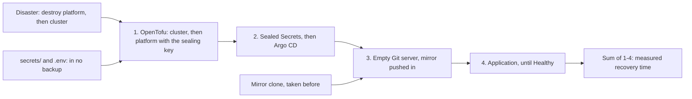

## Before you start

- [[devops.l3.restore-testing]] — you know a backup counts only once its restore is tested, and that the test's time is one part of the RTO.
- [[devops.l3.sealed-secrets]] — you know only the private half of the sealing key opens a SealedSecret, and that OpenTofu's platform layer installs that key from `secrets/`.
- [[devops.l3.remote-state-and-locking]] — you know OpenTofu's state lives in the `donhang_tofu` database, encrypted with a key derived from `TOFU_STATE_PASSPHRASE`.
- [[devops.l3.argo-cd-applications]] — you know an Application tells Argo CD which folder of the config repository goes into which namespace, and that the Git server runs inside `donhang-staging`.

## The situation

Your restore test passes, so the databases in Compose can come back, but staging is another matter. A colleague asks what happens if `donhang-staging` is lost tonight, cluster and all. You list the steps from memory: OpenTofu, the Sealed Secrets controller, Argo CD, the Application. Then you notice that the Git server Argo CD reads from runs inside that same cluster. Nobody has ever run the steps in a row, so nobody knows how long they take or what they leave out. How do you find out whether your written steps rebuild staging, and how long that takes, before a real loss tests them for you?

## Core concepts

- **DR drill** — destroying an environment on purpose and rebuilding it by the written steps, timed, to find what the steps miss before a real disaster does.
- Mirror clone — a copy of every branch and tag of a Git repository, kept outside its server; for the config repository it is the backup.
- Keys outside the backups — the sealing key in `secrets/` and the state passphrase in `.env`, needed to read backups that do not hold them.
- Measured recovery time — what the drill's steps take, set against the RTO target instead of guessed.

## How it works



A DR drill turns your list of steps from the situation into a test that passes or fails, run against a staging that is really gone.

The config repository lives on the Git server inside `donhang-staging`, so it is lost with the cluster. A mirror clone taken before the loss is the only copy that comes back; any commit pushed after it is gone.

OpenTofu builds staging in two parts, each applied on its own: the cluster layer creates the cluster `donhang-staging`, and the platform layer creates the namespace `donhang` and a Secret holding the sealing key from `secrets/`. The disaster destroys the platform layer, then the cluster layer, and a clock starts. OpenTofu applies them again, cluster first; the Sealed Secrets controller and Argo CD follow. A new Git server starts empty and the mirror is pushed into it. Last, the Application is applied, and the drill waits for `Synced` and `Healthy`.

Two inputs never pass through a backup: the sealing key and the state passphrase. The state of both layers lives in `donhang_tofu` on Compose's PostgreSQL, outside the cluster, and step 1 reads it before changing anything. Without the passphrase, that encrypted state cannot be read; without the sealing key, no SealedSecret in the mirror opens. If either is gone, the drill fails at the step that needs it.

The sum of the timed steps is staging's measured recovery time for the steps the drill runs; until the missing steps are in the list, it is a lower bound. If it exceeds the RTO target, change the steps or the target, then drill again.

## In the Đơn Hàng system

The backup and the disaster, from `scripts/devops/dr-drill.sh`:

```bash file=scripts/devops/dr-drill.sh tag=stage-3 lines=25-49
# Before the disaster: the backup of the config repository. The Git server
# keeps its repositories inside the cluster, so they die with it; this
# mirror clone is all that will come back, and commits pushed after it is
# taken are lost.
echo "== backup: mirror clone of the config repository"
if kubectl get deployment gitea -n git >/dev/null 2>&1; then
  git_server_open
  rm -rf "$config_mirror"
  git_auth clone -q --mirror "$git_server/$repo_path" "$config_mirror"
  git_server_close
elif [ -d "$config_mirror" ]; then
  echo "no Git server running: the mirror clone taken earlier is the backup"
else
  echo "no Git server and no mirror clone in $config_mirror: nothing to restore from" >&2
  exit 1
fi
git -C "$config_mirror" log -1 --format='newest commit in the mirror: %h %s' main
echo

# lesson: devops.l3.disaster-recovery-drill
# The disaster: the whole cluster is gone. Then the written steps, each
# timed: both OpenTofu layers, the controllers, the Git server with the
# repository from the mirror, and Argo CD's Application, until Healthy.
step "disaster: donhang-staging is destroyed, both layers"
scripts/devops/tofu-env.sh staging platform destroy -auto-approve -no-color | grep -e '^Destroy complete'
```

`$config_mirror` is `.gitops/donhang-config.git`. When the Git server still runs, the script refreshes the mirror right before the disaster, so the drill itself loses no commit. A real loss gives no such moment. `-auto-approve` makes `destroy` skip its interactive approval. After it, the script destroys the cluster layer the same way and starts the clock.

The rebuild, from the same file:

```bash file=scripts/devops/dr-drill.sh tag=stage-3 lines=53-77
step "1. OpenTofu: the cluster layer, then the platform layer"
scripts/devops/tofu-env.sh staging up | grep -e '^Apply complete' -e '^Plan:'

step "2. controllers: Sealed Secrets, then Argo CD"
if [ "$without_key" = yes ]; then
  # As if secrets/sealing.key had been lost: the cluster has no copy of it.
  kubectl delete secret sealing-key -n kube-system
fi
scripts/devops/sealed-secrets-install.sh --install-only >/dev/null
scripts/devops/argocd-install.sh >/dev/null
echo "both running"

step "3. Git server, and the repository pushed back from the mirror"
kubectl apply -f deploy/gitops/git-server.yaml >/dev/null
git_server_open
kubectl exec -n git deployment/gitea -- gitea admin user create --admin --username donhang \
  --email donhang@donhang.example --password "$GITEA_ADMIN_PASSWORD" --must-change-password=false >/dev/null
curl -fsS -u "donhang:$GITEA_ADMIN_PASSWORD" -H 'Content-Type: application/json' \
  -d '{"name":"donhang-config","private":false,"default_branch":"main"}' \
  "$git_server/api/v1/user/repos" >/dev/null
git_auth -C "$config_mirror" push -q --mirror "$git_server/$repo_path"
echo "pushed $(git -C "$config_mirror" rev-parse --short main)"

step "4. Argo CD: the Application from apps/staging.yaml, until Healthy"
git -C "$config_mirror" show main:apps/staging.yaml | kubectl apply -f - -o name
```

```text output=true
== backup: mirror clone of the config repository
newest commit in the mirror: ... Rotate the database password of staging

== disaster: donhang-staging is destroyed, both layers
Destroy complete! Resources: 1 destroyed.
Destroy complete! Resources: 1 destroyed.
== 1. OpenTofu: the cluster layer, then the platform layer
Plan: 1 to add, 0 to change, 0 to destroy.
Apply complete! Resources: 1 added, 0 changed, 0 destroyed.
Plan: 2 to add, 0 to change, 0 to destroy.
Apply complete! Resources: 2 added, 0 changed, 0 destroyed.
== 2. controllers: Sealed Secrets, then Argo CD
both running
== 3. Git server, and the repository pushed back from the mirror
pushed ...
== 4. Argo CD: the Application from apps/staging.yaml, until Healthy
application.argoproj.io/staging
staging: Synced, Healthy

== timings
... s  1. OpenTofu: the cluster layer, then the platform layer
... s  2. controllers: Sealed Secrets, then Argo CD
... s  3. Git server, and the repository pushed back from the mirror
... s  4. Argo CD: the Application from apps/staging.yaml, until Healthy
total: ... s from losing the cluster to Healthy
```

`step`, defined at the top of the script, prints a heading and records when that step starts. From `scripts/lib/gitops.sh`, `git_server_open` makes the Git server reachable from your machine, `git_server_close` ends that, and `git_auth` runs `git` with the admin's password in a header. The `...` marks commit ids and seconds.

The platform layer's two resources, in `deploy/tofu/modules/donhang-platform/main.tf`, are the namespace `donhang` and the Secret `sealing-key` in `kube-system`, where the controller runs. That Secret carries the label the controller looks for, so the controller loads this key; with key renewal off, it creates none of its own, and old SealedSecrets open again. The Git server is Gitea, the Deployment `gitea` in the namespace `git`: step 3 creates its admin user and an empty repository, then pushes every branch of the mirror.

With `--without-sealing-key` the script deletes that Secret before installing the controller, as if `secrets/sealing.key` were lost. Its recorded output, `dr-drill-without-sealing-key.txt`, shows the controller reporting `no key could decrypt secret (POSTGRES_PASSWORD)` for the SealedSecret `db`. The namespace `donhang` has no Secrets, and the db Pod waits with `CreateContainerConfigError`, because the Secret it needs does not exist. The api, in a later sync wave, is never applied.

`scripts/dev-secrets.sh` writes `TOFU_STATE_PASSPHRASE` to `.env` and the sealing key pair to `secrets/`; its comments say both are in no backup. When either is missing, it makes a new one: a key pair that opens no old SealedSecret, or a passphrase that cannot read the old state. The platform layer's state holds an encrypted copy of the key, but no written step reads it back, so the drill as written needs both files.

The drill restores no database: staging's db keeps its data in an `emptyDir`, storage that lives only as long as its Pod, so a new db Pod starts from the seed data in `db-init.yaml`. The drill also rebuilds only what `apps/staging.yaml` deploys; Traefik, the reverse proxy that lets requests into staging, and a few other pieces come back with their own scripts. Each is a step the list does not hold yet.

At the end of the file, outside the excerpts, the script prints each step's seconds and a total from losing the cluster to `Healthy`.

## Seniors often assume…

- **"With everything in Git, rebuilding an environment needs nothing else."** → Actually the Git server ran in the cluster, so the config repository comes back only from a copy taken outside it. The SealedSecrets in that copy open only with the sealing key, which is in no repository. You notice this when you ask where step 4 reads `apps/staging.yaml` from, and the answer is the mirror clone on your machine.
- **"A reviewed, written recovery plan works without ever being run."** → Actually a review checks that the steps make sense, not that they finish or how long they take. Running them is what shows that, and it often exposes a missing step a review overlooked, such as a Git server that must exist before Argo CD can sync. You notice this when a real recovery stops halfway at a step nobody wrote down, with the RTO already past.
- **"A backup of the cluster's objects includes the keys needed to read them."** → Actually the backups here hold encrypted forms: the config repository holds SealedSecrets, and OpenTofu's copy of the sealing key is encrypted with `TOFU_STATE_PASSPHRASE`. The keys that open them live in `secrets/` and `.env`, which no backup holds. You notice this when a rebuild without the key ends with `no key could decrypt secret` and a db Pod in `CreateContainerConfigError`.

## Try it (3 minutes)

The full drill deletes staging, so here you check only its two inputs that no backup holds.

1. From the repository root, run `ls secrets/sealing.*`, then `grep -c '^TOFU_STATE_PASSPHRASE=' .env`.
2. Think: tonight this machine's disk fails. Another machine has a copy of the mirror clone and of the newest dumps from `backup-logical.sh`. What else must be there for `dr-drill.sh` to bring staging back, and what fails without each?

Expected result: `secrets/sealing.crt` and `secrets/sealing.key`, then `1`.

<details><summary>Suggested answer</summary>

The two files you listed and the passphrase line. Without `sealing.key` the rebuilt cluster cannot open any SealedSecret, so step 4 never reaches `Healthy`. Without `TOFU_STATE_PASSPHRASE` the state restored into `donhang_tofu` cannot be read, so the OpenTofu steps cannot use it. Neither is in the mirror or the dumps: a copy there would let anyone holding a backup read every secret it protects. So they need their own copy on another machine, kept apart from the backups.

</details>

## Connections

- [[devops.l3.restore-testing]] — the same idea one level up: there one server was restored and checked, here a whole environment is rebuilt and timed.
- [[devops.l3.rpo-and-rto]] — where the RTO was set as a target; the drill's total is the measurement it is compared with.
- [[devops.l3.infrastructure-as-code]] — the promise this drill tests: an environment kept in files can be rebuilt from them, as long as their keys survive.
- [[devops.l3.self-heal]] — the same promise, small: self-heal restores one changed object from Git, the drill a whole cluster.

## Five-line summary

1. A DR drill destroys an environment on purpose and rebuilds it by the written steps, to find what they miss before a real disaster.
2. `dr-drill.sh` destroys `donhang-staging` with OpenTofu, then times OpenTofu, the controllers, the Git server and Argo CD until `Healthy`.
3. The config repository comes back only from a mirror clone taken earlier; commits pushed after that clone are lost.
4. The sealing key in `secrets/` and the passphrase in `.env` are in no backup; without them the backups cannot be read.
5. The drill's total is staging's measured recovery time; when it exceeds the RTO, change the steps or the target and drill again.
