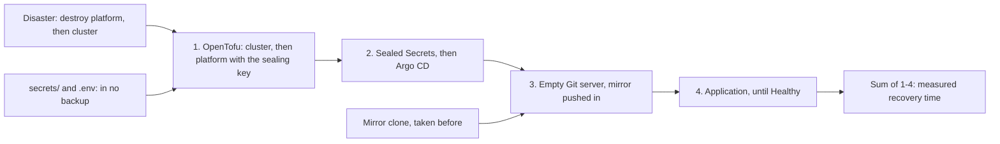

## Bạn cần biết trước

- [[devops.l3.restore-testing]] — bạn biết một bản backup chỉ đáng tin khi đã được khôi phục thử, và thời gian của bài kiểm thử là một phần của RTO.
- [[devops.l3.sealed-secrets]] — bạn biết chỉ nửa bí mật của sealing key mở được một SealedSecret, và tầng platform của OpenTofu cài khóa đó từ `secrets/`.
- [[devops.l3.remote-state-and-locking]] — bạn biết state của OpenTofu nằm trong database `donhang_tofu`, được mã hóa bằng một khóa sinh ra từ `TOFU_STATE_PASSPHRASE`.
- [[devops.l3.argo-cd-applications]] — bạn biết một Application chỉ cho Argo CD thư mục nào của repo cấu hình đi vào namespace nào, và Git server chạy bên trong `donhang-staging`.

## Tình huống

Bài kiểm thử khôi phục của bạn đã đạt, nên các database trong Compose có thể quay lại được. Staging thì khác. Một đồng nghiệp hỏi chuyện gì xảy ra nếu đêm nay mất `donhang-staging`, mất luôn cả cluster. Bạn liệt kê các bước theo trí nhớ: OpenTofu, controller Sealed Secrets, Argo CD, Application. Rồi bạn nhận ra Git server mà Argo CD đọc lại chạy ngay trong chính cluster đó. Chưa ai từng chạy liền một mạch các bước này, nên không ai biết chúng mất bao lâu hay còn thiếu gì. Làm sao biết các bước bạn đã viết có dựng lại được staging không, và mất bao lâu, trước khi một lần mất thật kiểm tra chúng thay bạn?

## Khái niệm cốt lõi

- **diễn tập DR** (DR drill) — cố ý phá một môi trường rồi dựng lại theo các bước đã viết, có bấm giờ, để tìm ra chỗ các bước còn thiếu trước khi một thảm họa thật tìm ra.
- Mirror clone — bản sao của mọi branch và tag trong một Git repository, giữ ở ngoài server của nó. Với repo cấu hình, đây chính là bản backup.
- Khóa nằm ngoài backup — sealing key trong `secrets/` và passphrase của state trong `.env`, cần có để đọc các bản backup vốn không chứa chúng.
- Thời gian khôi phục đo được — thời gian các bước của buổi diễn tập thực sự tốn, đặt cạnh mục tiêu RTO thay cho phỏng đoán.

## Cơ chế hoạt động



Diễn tập DR biến danh sách bước trong tình huống trên thành một bài kiểm tra có đạt hoặc trượt, chạy trên một staging đã mất thật.

Repo cấu hình nằm trên Git server bên trong `donhang-staging`, nên mất theo cluster. Bản mirror clone lấy trước lúc mất là bản duy nhất quay lại được. Commit nào push sau thời điểm đó đều mất.

OpenTofu dựng staging thành hai phần, mỗi phần apply riêng. Tầng cluster tạo cluster `donhang-staging`. Tầng platform tạo namespace `donhang` và một Secret giữ sealing key lấy từ `secrets/`. Thảm họa phá tầng platform, rồi tới tầng cluster, và đồng hồ bắt đầu chạy. OpenTofu apply lại cả hai, tầng cluster trước. Tiếp theo là controller Sealed Secrets và Argo CD. Một Git server mới khởi động ở trạng thái trống, và bản mirror được push vào đó. Cuối cùng, Application được apply, và buổi diễn tập chờ tới khi có `Synced` và `Healthy`.

Có hai đầu vào không bao giờ đi qua backup: sealing key và passphrase của state. State của cả hai tầng nằm trong `donhang_tofu` trên PostgreSQL của Compose, ngoài cluster, và bước 1 đọc nó trước khi thay đổi bất cứ thứ gì. Không có passphrase thì state đã mã hóa đó không đọc được. Không có sealing key thì không SealedSecret nào trong bản mirror mở được. Mất một trong hai, buổi diễn tập thất bại đúng ở bước cần tới nó.

Tổng thời gian các bước đã bấm giờ là thời gian khôi phục đo được của staging, tính cho những bước buổi diễn tập có chạy. Chừng nào các bước còn thiếu chưa vào danh sách, con số này chỉ là cận dưới. Nếu nó vượt mục tiêu RTO, hãy đổi các bước hoặc đổi mục tiêu, rồi diễn tập lại.

## Trong hệ thống Đơn Hàng

Phần backup và thảm họa, trích từ `scripts/devops/dr-drill.sh`:

```bash file=scripts/devops/dr-drill.sh tag=stage-3 lines=25-49
# Before the disaster: the backup of the config repository. The Git server
# keeps its repositories inside the cluster, so they die with it; this
# mirror clone is all that will come back, and commits pushed after it is
# taken are lost.
echo "== backup: mirror clone of the config repository"
if kubectl get deployment gitea -n git >/dev/null 2>&1; then
  git_server_open
  rm -rf "$config_mirror"
  git_auth clone -q --mirror "$git_server/$repo_path" "$config_mirror"
  git_server_close
elif [ -d "$config_mirror" ]; then
  echo "no Git server running: the mirror clone taken earlier is the backup"
else
  echo "no Git server and no mirror clone in $config_mirror: nothing to restore from" >&2
  exit 1
fi
git -C "$config_mirror" log -1 --format='newest commit in the mirror: %h %s' main
echo

# lesson: devops.l3.disaster-recovery-drill
# The disaster: the whole cluster is gone. Then the written steps, each
# timed: both OpenTofu layers, the controllers, the Git server with the
# repository from the mirror, and Argo CD's Application, until Healthy.
step "disaster: donhang-staging is destroyed, both layers"
scripts/devops/tofu-env.sh staging platform destroy -auto-approve -no-color | grep -e '^Destroy complete'
```

`$config_mirror` là `.gitops/donhang-config.git`. Khi Git server vẫn còn chạy, script làm mới bản mirror ngay trước thảm họa, nên bản thân buổi diễn tập không mất commit nào. Một lần mất thật không cho bạn khoảnh khắc đó. `-auto-approve` khiến `destroy` bỏ qua bước hỏi xác nhận. Sau lệnh này, script phá tầng cluster theo cùng cách rồi bắt đầu bấm giờ.

Phần dựng lại, cũng trong file đó:

```bash file=scripts/devops/dr-drill.sh tag=stage-3 lines=53-77
step "1. OpenTofu: the cluster layer, then the platform layer"
scripts/devops/tofu-env.sh staging up | grep -e '^Apply complete' -e '^Plan:'

step "2. controllers: Sealed Secrets, then Argo CD"
if [ "$without_key" = yes ]; then
  # As if secrets/sealing.key had been lost: the cluster has no copy of it.
  kubectl delete secret sealing-key -n kube-system
fi
scripts/devops/sealed-secrets-install.sh --install-only >/dev/null
scripts/devops/argocd-install.sh >/dev/null
echo "both running"

step "3. Git server, and the repository pushed back from the mirror"
kubectl apply -f deploy/gitops/git-server.yaml >/dev/null
git_server_open
kubectl exec -n git deployment/gitea -- gitea admin user create --admin --username donhang \
  --email donhang@donhang.example --password "$GITEA_ADMIN_PASSWORD" --must-change-password=false >/dev/null
curl -fsS -u "donhang:$GITEA_ADMIN_PASSWORD" -H 'Content-Type: application/json' \
  -d '{"name":"donhang-config","private":false,"default_branch":"main"}' \
  "$git_server/api/v1/user/repos" >/dev/null
git_auth -C "$config_mirror" push -q --mirror "$git_server/$repo_path"
echo "pushed $(git -C "$config_mirror" rev-parse --short main)"

step "4. Argo CD: the Application from apps/staging.yaml, until Healthy"
git -C "$config_mirror" show main:apps/staging.yaml | kubectl apply -f - -o name
```

```text output=true
== backup: mirror clone of the config repository
newest commit in the mirror: ... Rotate the database password of staging

== disaster: donhang-staging is destroyed, both layers
Destroy complete! Resources: 1 destroyed.
Destroy complete! Resources: 1 destroyed.
== 1. OpenTofu: the cluster layer, then the platform layer
Plan: 1 to add, 0 to change, 0 to destroy.
Apply complete! Resources: 1 added, 0 changed, 0 destroyed.
Plan: 2 to add, 0 to change, 0 to destroy.
Apply complete! Resources: 2 added, 0 changed, 0 destroyed.
== 2. controllers: Sealed Secrets, then Argo CD
both running
== 3. Git server, and the repository pushed back from the mirror
pushed ...
== 4. Argo CD: the Application from apps/staging.yaml, until Healthy
application.argoproj.io/staging
staging: Synced, Healthy

== timings
... s  1. OpenTofu: the cluster layer, then the platform layer
... s  2. controllers: Sealed Secrets, then Argo CD
... s  3. Git server, and the repository pushed back from the mirror
... s  4. Argo CD: the Application from apps/staging.yaml, until Healthy
total: ... s from losing the cluster to Healthy
```

`step`, định nghĩa ở đầu script, in ra một tiêu đề và ghi lại thời điểm bước đó bắt đầu. Trong `scripts/lib/gitops.sh`, `git_server_open` cho máy bạn truy cập được Git server, `git_server_close` đóng lại đường đó, còn `git_auth` chạy `git` với mật khẩu của admin đặt trong một header. Dấu `...` đánh dấu mã commit và số giây.

Hai resource của tầng platform, trong `deploy/tofu/modules/donhang-platform/main.tf`, là namespace `donhang` và Secret `sealing-key` trong `kube-system`, nơi controller chạy. Secret đó mang label mà controller tìm, nên controller nạp khóa này. Vì tính năng tự thay khóa bị tắt, controller không tự tạo khóa nào, và các SealedSecret cũ lại mở được. Git server là Gitea, tức Deployment `gitea` trong namespace `git`. Bước 3 tạo user admin và một repository trống cho nó, rồi push mọi branch của bản mirror vào.

Với `--without-sealing-key`, script xóa Secret đó trước khi cài controller, như thể đã mất `secrets/sealing.key`. Đầu ra ghi lại của lần chạy này, `dr-drill-without-sealing-key.txt`, cho thấy controller báo `no key could decrypt secret (POSTGRES_PASSWORD)` với SealedSecret `db`. Namespace `donhang` không có Secret nào, và Pod db đứng chờ với `CreateContainerConfigError`, vì Secret nó cần không tồn tại. Còn api, nằm ở một sync wave sau, không bao giờ được apply.

`scripts/dev-secrets.sh` ghi `TOFU_STATE_PASSPHRASE` vào `.env` và cặp sealing key vào `secrets/`. Comment trong script nói rõ cả hai không nằm trong bản backup nào. Khi thiếu một trong hai, script tạo cái mới: một cặp khóa không mở được SealedSecret cũ nào, hoặc một passphrase không đọc được state cũ. State của tầng platform có giữ một bản sao đã mã hóa của khóa, nhưng không bước nào đã viết đọc lại nó, nên buổi diễn tập như đang viết cần cả hai file.

Buổi diễn tập không khôi phục database nào. Db của staging giữ dữ liệu trong một `emptyDir`, kiểu lưu trữ chỉ sống chừng nào Pod của nó còn sống, nên Pod db mới bắt đầu từ dữ liệu mẫu trong `db-init.yaml`. Buổi diễn tập cũng chỉ dựng lại những gì `apps/staging.yaml` deploy. Traefik, reverse proxy cho request đi vào staging, cùng vài phần khác quay lại bằng script riêng của chúng. Mỗi phần như thế là một bước danh sách chưa có.

Ở cuối file, ngoài các đoạn trích, script in số giây của từng bước và tổng thời gian từ lúc mất cluster tới khi `Healthy`.

## Senior hay nhầm rằng…

- **"Mọi thứ đã ở trong Git thì dựng lại môi trường không cần gì khác."** → Thực ra Git server chạy trong cluster, nên repo cấu hình chỉ quay lại được từ một bản sao lấy ra ngoài cluster. Các SealedSecret trong bản sao đó chỉ mở được bằng sealing key, thứ không nằm trong repository nào. Bạn sẽ nhận ra khi hỏi bước 4 đọc `apps/staging.yaml` từ đâu, và câu trả lời là bản mirror clone trên máy bạn.
- **"Một kế hoạch khôi phục đã viết và đã review thì chạy được, dù chưa bao giờ chạy thử."** → Thực ra review chỉ kiểm các bước có hợp lý không, không kiểm chúng có chạy hết không hay mất bao lâu. Chỉ có chạy thật mới cho thấy điều đó, và lần chạy thường lộ ra một bước còn thiếu mà review bỏ sót, chẳng hạn một Git server phải có sẵn trước khi Argo CD sync được. Bạn sẽ nhận ra khi một lần khôi phục thật dừng giữa chừng ở một bước chưa ai ghi lại, trong khi RTO đã trôi qua.
- **"Bản backup các object của cluster đã chứa sẵn khóa để đọc chúng."** → Thực ra các bản backup ở đây giữ dạng đã mã hóa: repo cấu hình giữ SealedSecret, còn bản sao sealing key của OpenTofu được mã hóa bằng `TOFU_STATE_PASSPHRASE`. Khóa để mở chúng nằm trong `secrets/` và `.env`, những thứ không bản backup nào giữ. Bạn sẽ nhận ra khi một lần dựng lại thiếu khóa kết thúc với `no key could decrypt secret` và một Pod db kẹt ở `CreateContainerConfigError`.

## Thử ngay (3 phút)

Buổi diễn tập đầy đủ sẽ xóa staging, nên ở đây bạn chỉ kiểm hai đầu vào mà không bản backup nào giữ.

1. Từ thư mục gốc của repository, chạy `ls secrets/sealing.*`, rồi `grep -c '^TOFU_STATE_PASSPHRASE=' .env`.
2. Suy nghĩ: đêm nay ổ đĩa của máy này hỏng. Một máy khác có bản sao của mirror clone và của các bản dump mới nhất từ `backup-logical.sh`. Còn cần gì nữa để `dr-drill.sh` đưa staging trở lại, và thiếu từng thứ thì cái gì thất bại?

Kết quả mong đợi: `secrets/sealing.crt` và `secrets/sealing.key`, rồi `1`.

<details><summary>Gợi ý đáp án</summary>

Hai file bạn vừa liệt kê và dòng passphrase. Thiếu `sealing.key`, cluster dựng lại không mở được SealedSecret nào, nên bước 4 không bao giờ tới `Healthy`. Thiếu `TOFU_STATE_PASSPHRASE`, state khôi phục vào `donhang_tofu` không đọc được, nên các bước OpenTofu không dùng được nó. Cả hai đều không nằm trong bản mirror hay các bản dump: nếu có bản sao ở đó, ai giữ một bản backup cũng đọc được mọi bí mật mà nó bảo vệ. Vì thế chúng cần bản sao riêng trên một máy khác, để tách biệt khỏi các bản backup.

</details>

## Liên hệ

- [[devops.l3.restore-testing]] — cùng ý tưởng đó ở quy mô lớn hơn: ở đó là khôi phục và kiểm một server, ở đây là dựng lại cả một môi trường và bấm giờ.
- [[devops.l3.rpo-and-rto]] — nơi RTO được đặt làm mục tiêu. Tổng thời gian của buổi diễn tập là số đo để so với nó.
- [[devops.l3.infrastructure-as-code]] — lời hứa mà buổi diễn tập này kiểm tra: một môi trường giữ trong file thì dựng lại được từ chính các file đó, miễn là khóa của chúng còn.
- [[devops.l3.self-heal]] — cùng lời hứa đó ở quy mô nhỏ: self-heal khôi phục một object bị đổi từ Git, còn buổi diễn tập khôi phục cả một cluster.

## Tóm tắt 5 dòng

1. Diễn tập DR cố ý phá một môi trường rồi dựng lại theo các bước đã viết, để tìm ra chỗ thiếu trước khi có thảm họa thật.
2. `dr-drill.sh` dùng OpenTofu phá `donhang-staging`, rồi bấm giờ OpenTofu, các controller, Git server và Argo CD cho tới khi `Healthy`.
3. Repo cấu hình chỉ quay lại được từ một bản mirror clone lấy từ trước, và các commit push sau lần clone đó đều mất.
4. Sealing key trong `secrets/` và passphrase trong `.env` không nằm trong bản backup nào, thiếu chúng thì không đọc được các bản backup.
5. Tổng thời gian của buổi diễn tập là thời gian khôi phục đo được của staging. Khi nó vượt RTO, hãy đổi các bước hoặc mục tiêu rồi diễn tập lại.
