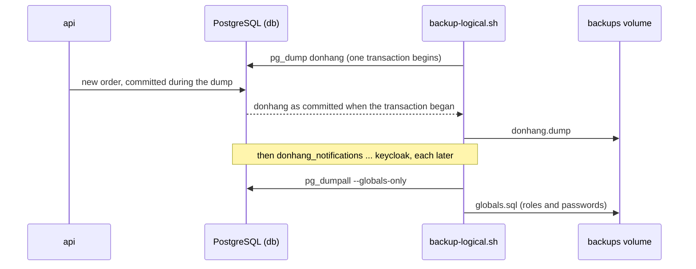

## Before you start

- [[devops.l3.rpo-and-rto]] — you know the RPO is counted back to the last copy you can restore, and that stage-2's `backup-db.sh` dumps no rows.
- [[backend.l2.transactions-in-practice]] — you know a transaction can keep seeing a consistent state of the data while other transactions commit.
- [[foundation.l1.shell-scripts]] — you can read a bash script top to bottom, including a `for` loop and its exit code.

## The situation

The shop has given you its numbers, and the first thing missing is a backup that holds rows. Orders arrive all day, so stopping the api for a copy is not an option. You also count what Compose's PostgreSQL holds at stage-3: not one database but five, `donhang`, `donhang_notifications`, `donhang_payments`, `donhang_tofu` and `keycloak`, plus the login the api uses. You could copy the files in the `db-data` volume, or ask PostgreSQL to write each database out. If orders keep arriving while the copy runs, what does that copy actually contain?

## Core concepts

- **logical backup** — a backup that stores a database as the statements and data that rebuild it, rather than as a copy of the server's files; in the situation above, the file PostgreSQL writes out for each database.
- `pg_dump` — PostgreSQL's tool that makes a logical backup of one database, reading all of it inside a single transaction.
- Custom format — what `pg_dump --format custom` (short form `-Fc`) writes: not a plain SQL file, but a file that `pg_restore` reads to rebuild the whole database or only chosen tables.
- Server-wide objects — things that belong to the PostgreSQL server rather than to one database, such as roles (logins like `donhang`) and their passwords; `pg_dumpall --globals-only` writes them out.

## How it works



Read the diagram from the top. In the situation above, the script asks for `donhang`, and `pg_dump` opens one transaction for the whole read. While it reads, the api keeps committing orders. Those orders are not in this file: the transaction sees only what was committed before it began. Under Read Committed, the default, each statement would see a newer moment; here every statement sees that one moment, as under Repeatable Read. So the file is consistent: another transaction's change is either wholly in it or wholly absent, yet nobody had to stop ordering.

`pg_dump` does not block the api's reads and writes either. Operations that need a table to themselves, such as most forms of `ALTER TABLE` from a migration, wait until the dump ends; while one waits, the api's queries on that table queue behind it.

The script then dumps the next database, and the next, each in its own transaction that begins later. Five files means five moments. Restored together, they can disagree: a payment written to `donhang_payments` after `donhang` was dumped can point to an order the restored `donhang` does not have.

Last, `pg_dumpall --globals-only` writes what no single database owns: the roles and their passwords.

Everything committed after the last dump exists only on the live server. Lose the server and it is gone, so with dumps alone the RPO is the time between dump runs.

## In the Đơn Hàng system

The backup script at this tag, from `scripts/devops/backup-logical.sh`:

```bash file=scripts/devops/backup-logical.sh tag=stage-3 lines=7-26
# One directory per run in the backups volume (/backups in the lab box): not
# inside db's own volume, but still on this one machine.
dir="/backups/logical/$(date +%Y-%m-%dT%H-%M-%S)"
mkdir -p "$dir"

# lesson: devops.l3.logical-backups
# The databases whose data exists nowhere else. The lab databases that
# scripts rebuild (donhang_perf, donhang_tenancy, the shards...) are left out.
# Each pg_dump reads its database inside one transaction, so the file shows
# the database at one moment while orders keep arriving; --format custom
# writes the format pg_restore reads.
for db in donhang donhang_notifications donhang_payments donhang_tofu keycloak; do
  pg_dump --host db --username donhang --dbname "$db" --format custom --file "$dir/$db.dump"
  echo "pg_dump $db -> $db.dump"
done

# Roles and their passwords belong to the server, not to one database, so
# no pg_dump file has them.
pg_dumpall --host db --username donhang --globals-only --file "$dir/globals.sql"
echo "pg_dumpall --globals-only -> globals.sql"
```

```text output=true
pg_dump donhang -> donhang.dump
pg_dump donhang_notifications -> donhang_notifications.dump
pg_dump donhang_payments -> donhang_payments.dump
pg_dump donhang_tofu -> donhang_tofu.dump
pg_dump keycloak -> keycloak.dump
pg_dumpall --globals-only -> globals.sql

in /backups/logical/...:
  counts.txt
  donhang.dump
  donhang_notifications.dump
  donhang_payments.dump
  donhang_tofu.dump
  globals.sql
  keycloak.dump
counts.txt:
  orders ...
  order_items ...
  customers 5
```

Lines above the excerpt make the script run itself again inside the lab box, the container `scripts/up.sh` starts beside `db`. From there `--host db` reaches PostgreSQL by its service name, and `/backups` is the `backups` volume.

Look at the list in the `for` line. It names the five databases whose data exists nowhere else, `keycloak` included, since Keycloak keeps its data there. This script backs up only those; lab databases that other scripts rebuild, such as `donhang_tenancy` and the shards, are left out to keep the dumps small. The output shows the loop running one `pg_dump` after another, which is where the five separate moments come from.

Each file is in custom format. To bring `donhang` back, you create an empty database and give it to `pg_restore` with `--dbname`; adding `--table orders` restores only that table's definition and rows, without its indexes. The `pg_dumpall` line writes `globals.sql`, the one file that recreates the role `donhang` and its password. The rest of the script, outside this excerpt, reads three tables back out of `donhang.dump` with `pg_restore`, writes their row counts to `counts.txt` for checking a restore later, and prints the file listing.

Now read the comment at the top. Every run writes a new directory in the `backups` volume, which is not inside `db-data` but is still on the same machine. If that machine is lost, the dumps are lost with the database.

## Seniors often assume…

- **"`pg_dump` locks the database, so it can only run when nobody uses it."** → Actually other transactions keep reading and writing while it runs, and its single transaction keeps the file consistent anyway. Only operations that need a table to themselves, such as most `ALTER TABLE`, wait for it. You notice this when a migration that alters a table hangs until a long dump finishes.
- **"Copying the `db-data` volume's files while PostgreSQL runs gives a usable backup."** → Actually PostgreSQL keeps changing those files and holds recent changes in its own memory while the copy runs, so the copy mixes moments the server was never in. PostgreSQL's documentation says a plain copy of its files is usable only when the server is shut down. You notice this only when you first start a server from such a copy, the worst moment to find out.
- **"A dump of `donhang` also brings back the role the api logs in with."** → Actually roles belong to the server, so `pg_dump` leaves them out; the dump only names `donhang` as the owner of its tables. You notice this when you restore without `globals.sql` onto a new server where the role `donhang` was never created: `pg_restore` reports errors that the role does not exist, and the api cannot log in.

## Try it (3 minutes)

1. With the stage-3 lab running, run `scripts/devops/backup-logical.sh` from the repository root.
2. Read the file list it prints and the `customers` line under `counts.txt`.
3. Run it again a few seconds later and compare the directory names in the two outputs.

Expected result: the first run lists seven files (five `.dump` files, `globals.sql` and `counts.txt`) and, on a fresh lab, `customers 5`; the second run prints a different directory name, so both sets of dumps now sit in the `backups` volume.

<details><summary>Suggested answer</summary>

Each run names its directory after the time it started, so runs started at different seconds never overwrite each other. If you ran the script once a day, the RPO would be up to a day of orders. Both runs also live on the same machine as `db`, so neither would survive losing that machine.

</details>

## Connections

- [[devops.l3.rpo-and-rto]] — the fix for the problem found there: these dumps hold rows, and their RPO is the time between runs.
- [[backend.l2.transactions-in-practice]] — the same idea applied to a whole database: one transaction sees one consistent state while others commit.
- [[devops.l3.remote-state-and-locking]] — `donhang_tofu`, where that lesson's `pg` backend keeps OpenTofu state, is one of the five databases dumped here.
- [[backend.l3.multi-tenancy]] — its lab database `donhang_tenancy` is one the script leaves out, because a script rebuilds it.
- [[devops.l3.point-in-time-recovery]] — the next step: a copy of the whole server for an RPO smaller than the time between dumps.
- [[devops.l3.restore-testing]] — where these dumps are restored into a fresh server and checked against `counts.txt`.

## Five-line summary

1. `pg_dump` writes one database, as committed when its transaction began, into a file that `pg_restore` rebuilds it from.
2. Reads and writes continue during the dump; operations needing a table to themselves, such as most `ALTER TABLE`, wait for it to finish.
3. Roles and passwords belong to the server, so `pg_dumpall --globals-only` saves them in a separate file.
4. `backup-logical.sh` dumps five databases one after another, so each file shows a different moment.
5. Anything written after the last dump is lost, and dumps on the database's machine are lost with it.
