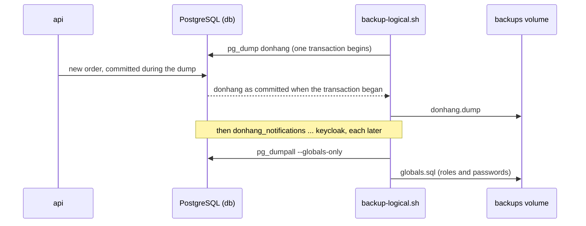

## Bạn cần biết trước

- [[devops.l3.rpo-and-rto]] — bạn biết RPO tính ngược về bản sao gần nhất bạn khôi phục được, và biết `backup-db.sh` của stage-2 dump ra không có dòng dữ liệu nào.
- [[backend.l2.transactions-in-practice]] — bạn biết một giao dịch có thể tiếp tục thấy một trạng thái nhất quán của dữ liệu trong khi các giao dịch khác commit.
- [[foundation.l1.shell-scripts]] — bạn đọc được một script bash từ trên xuống, kể cả vòng `for` và exit code của nó.

## Tình huống

Cửa hàng đã đưa bạn hai con số, và thứ đầu tiên còn thiếu là một bản backup có dữ liệu các dòng. Đơn hàng đến suốt ngày, nên dừng api để sao chép là không được. Bạn cũng đếm xem PostgreSQL của Compose ở stage-3 giữ những gì: không phải một database mà là năm, `donhang`, `donhang_notifications`, `donhang_payments`, `donhang_tofu` và `keycloak`, cộng thêm login mà api dùng. Bạn có thể chép các file trong volume `db-data`, hoặc nhờ PostgreSQL ghi từng database ra. Nếu đơn hàng vẫn đến trong lúc sao chép, bản sao đó thật ra chứa gì?

## Khái niệm cốt lõi

- **bản sao lưu logic** (logical backup) — bản backup lưu một database thành các câu lệnh và dữ liệu để dựng lại nó, thay vì chép các file của server. Trong tình huống trên, đó là file PostgreSQL ghi ra cho từng database.
- `pg_dump` — công cụ của PostgreSQL tạo bản sao lưu logic cho một database, đọc toàn bộ database đó bên trong một giao dịch duy nhất.
- Custom format — thứ `pg_dump --format custom` (dạng ngắn `-Fc`) ghi ra: không phải file SQL thuần, mà là file `pg_restore` đọc để dựng lại cả database hoặc chỉ vài bảng được chọn.
- Đối tượng cấp server — những thứ thuộc về server PostgreSQL chứ không thuộc một database nào, như các role (login kiểu `donhang`) và mật khẩu của chúng. `pg_dumpall --globals-only` ghi chúng ra.

## Cơ chế hoạt động



Hãy đọc sơ đồ từ trên xuống. Trong tình huống trên, script yêu cầu `donhang`, và `pg_dump` mở một giao dịch cho cả lần đọc. Trong lúc nó đọc, api vẫn commit đơn hàng. Những đơn đó không có trong file này: giao dịch chỉ thấy những gì đã commit trước khi nó bắt đầu. Với Read Committed, mức mặc định, mỗi câu lệnh sẽ thấy một thời điểm mới hơn. Ở đây mọi câu lệnh đều thấy cùng một thời điểm, như với Repeatable Read. Nhờ vậy file nhất quán: thay đổi của một giao dịch khác hoặc có trọn trong file, hoặc hoàn toàn vắng mặt, mà không ai phải ngừng đặt hàng.

`pg_dump` cũng không chặn các lần đọc và ghi của api. Những thao tác cần một bảng cho riêng mình, như phần lớn các dạng `ALTER TABLE` trong một migration, phải chờ tới khi dump xong. Trong lúc một thao tác như thế chờ, các query của api trên bảng đó xếp hàng phía sau nó.

Sau đó script dump database kế tiếp, rồi cái kế tiếp nữa, mỗi cái trong giao dịch riêng bắt đầu muộn hơn. Năm file nghĩa là năm thời điểm. Khôi phục cùng nhau, chúng có thể vênh nhau: một payment ghi vào `donhang_payments` sau khi `donhang` đã dump xong có thể trỏ tới một đơn hàng mà `donhang` khôi phục lại không có.

Cuối cùng, `pg_dumpall --globals-only` ghi ra thứ không database nào sở hữu: các role và mật khẩu của chúng.

Mọi thứ commit sau lần dump cuối chỉ tồn tại trên server đang chạy. Mất server là mất chúng, nên nếu chỉ có dump thì RPO là khoảng thời gian giữa hai lần chạy dump.

## Trong hệ thống Đơn Hàng

Script backup ở tag này, trong `scripts/devops/backup-logical.sh`:

```bash file=scripts/devops/backup-logical.sh tag=stage-3 lines=7-26
# One directory per run in the backups volume (/backups in the lab box): not
# inside db's own volume, but still on this one machine.
dir="/backups/logical/$(date +%Y-%m-%dT%H-%M-%S)"
mkdir -p "$dir"

# lesson: devops.l3.logical-backups
# The databases whose data exists nowhere else. The lab databases that
# scripts rebuild (donhang_perf, donhang_tenancy, the shards...) are left out.
# Each pg_dump reads its database inside one transaction, so the file shows
# the database at one moment while orders keep arriving; --format custom
# writes the format pg_restore reads.
for db in donhang donhang_notifications donhang_payments donhang_tofu keycloak; do
  pg_dump --host db --username donhang --dbname "$db" --format custom --file "$dir/$db.dump"
  echo "pg_dump $db -> $db.dump"
done

# Roles and their passwords belong to the server, not to one database, so
# no pg_dump file has them.
pg_dumpall --host db --username donhang --globals-only --file "$dir/globals.sql"
echo "pg_dumpall --globals-only -> globals.sql"
```

```text output=true
pg_dump donhang -> donhang.dump
pg_dump donhang_notifications -> donhang_notifications.dump
pg_dump donhang_payments -> donhang_payments.dump
pg_dump donhang_tofu -> donhang_tofu.dump
pg_dump keycloak -> keycloak.dump
pg_dumpall --globals-only -> globals.sql

in /backups/logical/...:
  counts.txt
  donhang.dump
  donhang_notifications.dump
  donhang_payments.dump
  donhang_tofu.dump
  globals.sql
  keycloak.dump
counts.txt:
  orders ...
  order_items ...
  customers 5
```

Các dòng phía trên đoạn trích khiến script tự chạy lại chính nó bên trong lab box, container mà `scripts/up.sh` khởi động cạnh `db`. Từ đó `--host db` gọi tới PostgreSQL bằng tên service, và `/backups` là volume `backups`.

Hãy nhìn danh sách trên dòng `for`. Nó liệt kê năm database có dữ liệu không nằm ở đâu khác, kể cả `keycloak`, vì Keycloak giữ dữ liệu của nó ở đó. Script này chỉ backup những cái đó. Các database lab mà script khác dựng lại, như `donhang_tenancy` và các shard, được bỏ ra để bản dump nhỏ gọn. Output cho thấy vòng lặp chạy hết `pg_dump` này tới `pg_dump` khác, và năm thời điểm riêng biệt đến từ chính chỗ đó.

Mỗi file ở custom format. Để đưa `donhang` về, bạn tạo một database trống rồi đưa nó cho `pg_restore` qua `--dbname`. Thêm `--table orders` thì chỉ khôi phục định nghĩa và các dòng của bảng đó, không kèm index của nó. Dòng `pg_dumpall` ghi ra `globals.sql`, file duy nhất tạo lại role `donhang` cùng mật khẩu. Phần còn lại của script, nằm ngoài đoạn trích, dùng `pg_restore` đọc ngược ba bảng từ `donhang.dump`, ghi số dòng của chúng vào `counts.txt` để sau này kiểm tra một lần restore, rồi in danh sách file.

Giờ hãy đọc comment ở đầu đoạn trích. Mỗi lần chạy ghi một thư mục mới trong volume `backups`, thứ không nằm trong `db-data` nhưng vẫn ở trên cùng một máy. Mất máy đó thì bản dump mất theo database.

## Senior hay nhầm rằng…

- **"`pg_dump` khóa database, nên chỉ chạy được khi không ai dùng."** → Thực ra các giao dịch khác vẫn đọc và ghi trong lúc nó chạy, và giao dịch duy nhất của nó vẫn giữ cho file nhất quán. Chỉ những thao tác cần một bảng cho riêng mình, như phần lớn `ALTER TABLE`, mới phải chờ nó. Bạn sẽ nhận ra khi một migration sửa bảng bị treo cho tới lúc một lần dump dài chạy xong.
- **"Chép các file của volume `db-data` trong lúc PostgreSQL đang chạy là có một bản backup dùng được."** → Thực ra PostgreSQL liên tục thay đổi các file đó và giữ những thay đổi gần đây trong bộ nhớ của nó trong lúc bạn chép, nên bản chép trộn lẫn những thời điểm mà server chưa bao giờ ở trong. Tài liệu của PostgreSQL nói bản chép thẳng các file của nó chỉ dùng được khi server đã tắt. Bạn chỉ nhận ra khi lần đầu khởi động server từ một bản chép như vậy, đúng lúc tệ nhất để phát hiện.
- **"Bản dump của `donhang` cũng mang về luôn role mà api dùng để đăng nhập."** → Thực ra role thuộc về server, nên `pg_dump` bỏ chúng ra. Bản dump chỉ ghi tên `donhang` là chủ sở hữu các bảng. Bạn sẽ nhận ra khi khôi phục mà không có `globals.sql` lên một server mới chưa từng tạo role `donhang`: `pg_restore` báo lỗi role không tồn tại, và api không đăng nhập được.

## Thử ngay (3 phút)

1. Với lab stage-3 đang chạy, chạy `scripts/devops/backup-logical.sh` từ thư mục gốc của repository.
2. Đọc danh sách file nó in ra và dòng `customers` dưới `counts.txt`.
3. Vài giây sau chạy lại lần nữa, rồi so tên thư mục trong hai output.

Kết quả mong đợi: lần chạy đầu liệt kê bảy file (năm file `.dump`, `globals.sql` và `counts.txt`) và, trên một lab mới, có `customers 5`. Lần chạy thứ hai in ra một tên thư mục khác, nên giờ cả hai bộ dump cùng nằm trong volume `backups`.

<details><summary>Gợi ý đáp án</summary>

Mỗi lần chạy đặt tên thư mục theo thời điểm nó bắt đầu, nên các lần chạy bắt đầu ở những giây khác nhau không bao giờ ghi đè lên nhau. Nếu bạn chạy script mỗi ngày một lần, RPO sẽ lên tới một ngày đơn hàng. Cả hai lần chạy cũng nằm trên cùng máy với `db`, nên không lần nào sống sót nếu mất máy đó.

</details>

## Liên hệ

- [[devops.l3.rpo-and-rto]] — cách sửa vấn đề phát hiện ở bài đó: các bản dump này có dữ liệu các dòng, và RPO của chúng là khoảng thời gian giữa hai lần chạy.
- [[backend.l2.transactions-in-practice]] — cùng ý tưởng đó áp dụng cho cả một database: một giao dịch thấy một trạng thái nhất quán trong khi các giao dịch khác commit.
- [[devops.l3.remote-state-and-locking]] — `donhang_tofu`, nơi backend `pg` của bài đó giữ state của OpenTofu, là một trong năm database được dump ở đây.
- [[backend.l3.multi-tenancy]] — database lab `donhang_tenancy` của bài đó là một trong những database script bỏ ra, vì đã có script dựng lại nó.
- [[devops.l3.point-in-time-recovery]] — bước kế tiếp: một bản sao của cả server để có RPO nhỏ hơn khoảng thời gian giữa hai lần dump.
- [[devops.l3.restore-testing]] — nơi các bản dump này được khôi phục vào một server mới và kiểm tra lại theo `counts.txt`.

## Tóm tắt 5 dòng

1. `pg_dump` ghi một database, gồm những gì đã commit lúc giao dịch của nó bắt đầu, vào một file mà `pg_restore` dùng để dựng lại database đó.
2. Đọc và ghi vẫn diễn ra trong lúc dump. Thao tác cần một bảng cho riêng mình, như phần lớn `ALTER TABLE`, phải chờ dump xong.
3. Role và mật khẩu thuộc về server, nên `pg_dumpall --globals-only` lưu chúng vào một file riêng.
4. `backup-logical.sh` dump năm database lần lượt, nên mỗi file thể hiện một thời điểm khác nhau.
5. Mọi thứ ghi sau lần dump cuối đều mất, và bản dump nằm trên máy của database thì mất theo máy đó.
