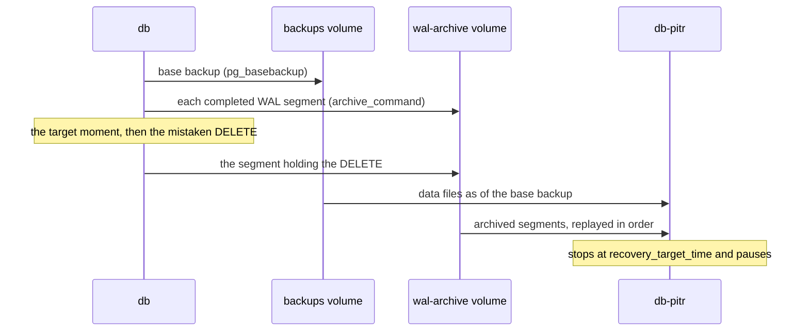

## Before you start

- [[devops.l3.logical-backups]] — you know a dump shows one database at the moment it ran, so everything written after the last dump is lost.
- [[backend.l3.read-replicas]] — you know a replica receives the primary's changes as a stream and applies each of them.
- [[foundation.l1.transaction-intro]] — you know a transaction's changes become visible to others only when it commits.

## The situation

It is mid-afternoon at stage-3, and order 3 should lose one of its two items. You type the `DELETE` in `psql`, the PostgreSQL command-line client, on `db` and read `DELETE 2`: you left the product out of the `WHERE`, so both items are gone. Last night's dump from `backup-logical.sh` still has them, but restoring it would also take back every order placed since. Copying two rows out of the dump by hand works once, not for hundreds of rows across several tables. What you want is the server as it was one second before the `DELETE`. Which copy can take you back to a moment you choose, not just to the moment a backup happened to run?

## Core concepts

- **WAL (write-ahead log)** — PostgreSQL's record of every change, written before the data files themselves change; replaying it from a known starting point redoes every change made since.
- **base backup** — a copy of the data files of the whole PostgreSQL server, every database in it, taken with `pg_basebackup` while the server keeps running; it is the starting point for replaying WAL.
- WAL archive — the place where `archive_command` copies each completed WAL file, called a segment, once `archive_mode` is on; in Đơn Hàng, the `wal-archive` volume.
- **point-in-time recovery (PITR)** — starting a server from a base backup and replaying archived WAL up to `recovery_target_time`, such as just before the mistaken `DELETE` above.

## How it works



In the situation above, every change you and the api make on `db` is first written to the WAL, your `DELETE` included. So the WAL is a list of every change in the order it happened.

A list of changes needs something to apply them to. That is the base backup: `pg_basebackup` copies the data files of the whole server into the `backups` volume while orders keep arriving. From then on, with `archive_mode` on, `db` runs `archive_command` each time it finishes a WAL segment, and that command copies the segment into the `wal-archive` volume.

To recover, you start a separate server, `db-pitr`, from the base backup's files. It reads the archived segments in order and redoes each change, moving forward in time from when the base backup was taken. You give it `recovery_target_time`, the moment one second before the `DELETE`. Replay stops there, so the `DELETE` is never applied, and the server pauses, ready to be read. Replay applies a transaction only if it committed before the target, so one not yet committed at that moment is left out entirely.

Two limits follow. The base backup holds the whole server, so recovery brings every database in it back to that same moment. And recovery can only go as far as the archive reaches: a change still in a segment `db` has not yet finished and archived exists nowhere else.

## In the Đơn Hàng system

From stage-3, `db` archives its WAL. The settings in `docker-compose.yml`:

```yaml file=docker-compose.yml tag=stage-3 lines=74-87
    # lesson: devops.l3.point-in-time-recovery
    # From stage-3 the server archives its WAL: archive_command gzips each
    # completed segment into the wal-archive volume, and archive_timeout
    # makes a quiet server close a partly filled segment after 60 s.
    # Command-line settings, not a new volume: an existing db-data keeps
    # its data, and `docker compose up -d` restarts the server with them.
    command:
      - postgres
      - -c
      - archive_mode=on
      - -c
      - archive_command=test ! -f /wal-archive/%f.gz && gzip < %p > /wal-archive/%f.gz
      - -c
      - archive_timeout=60
```

In `archive_command`, PostgreSQL replaces `%p` with the path of the finished segment and `%f` with its file name; `gzip` compresses the segment, so the archive holds a smaller `.gz` copy of it. The `test ! -f` part refuses to overwrite a segment already in the archive. PostgreSQL treats any non-zero exit, from a failed copy or from a file already there, as a failed archive and keeps trying the same segment, so a segment it has not archived is never thrown away.

`archive_timeout=60` matters for the RPO. A segment is archived only when it is finished, and a server with few orders can take a long time to fill one. With this setting, once 60 seconds have passed since the last segment was finished and something was written, `db` finishes the current segment early. So if `db`'s own files are lost while the archive survives, you lose only what was not yet archived, at most about a minute on a quiet server. In Đơn Hàng the `wal-archive` volume is on the same machine as `db`, so losing the whole machine loses the archive with it; the one-minute figure does not cover that case.

The base backup comes from `scripts/devops/base-backup.sh`, outside this excerpt: it runs `pg_basebackup` against `db` and keeps only the newest copy in `/backups/base`. The recovery is in `scripts/devops/pitr.sh`, which first runs `base-backup.sh` if no base backup exists. Its helpers, defined earlier: `on_db` and `on_pitr` run a SQL command with `psql` on `db` and `db-pitr`; `value` runs a query on `db` and prints only its result.

```bash file=scripts/devops/pitr.sh tag=stage-3 lines=34-58
# The mistake: meant for one item, run for the whole order. Recovery will
# go back to $target, a moment before it. pg_switch_wal() closes the current
# WAL segment so it is archived now, not after archive_timeout.
echo "== the mistake, a second later"
on_db --command "DELETE FROM order_items WHERE order_id = 3"
segment=$(value "SELECT pg_walfile_name(pg_switch_wal())")
for _ in $(seq 60); do
  [ "$(value "SELECT last_archived_wal >= '$segment' FROM pg_stat_archiver")" = "t" ] && break
  sleep 1
done

echo "== recover into db-pitr, up to the moment before the DELETE"
docker compose --profile pitr rm --stop --force db-pitr >/dev/null 2>&1
docker volume rm --force donhang_db-pitr-data >/dev/null
RECOVERY_TARGET_TIME="$target" docker compose --profile pitr up --detach db-pitr 2>/dev/null
for _ in $(seq 120); do
  state=$(on_pitr --tuples-only --no-align --command "SELECT pg_get_wal_replay_pause_state()" 2>/dev/null || true)
  [ "$state" = "paused" ] && break
  sleep 1
done
if [ "$state" != "paused" ]; then
  echo "db-pitr did not reach recovery_target_time:" >&2
  docker compose --profile pitr logs --tail 20 db-pitr >&2
  exit 1
fi
```

```text output=true
== order 3's items on db
 order_id | product_id | quantity | unit_price_vnd 
----------+------------+----------+----------------
        3 |          4 |        1 |        3200000
        3 |          5 |        1 |         320000
(2 rows)

recovery_target_time = ...
== the mistake, a second later
DELETE 2
== recover into db-pitr, up to the moment before the DELETE
db-pitr stopped replaying the WAL at recovery_target_time: paused
== order 3's items, on db then on db-pitr
 order_id | product_id | quantity | unit_price_vnd 
----------+------------+----------+----------------
(0 rows)

 order_id | product_id | quantity | unit_price_vnd 
----------+------------+----------+----------------
        3 |          4 |        1 |        3200000
        3 |          5 |        1 |         320000
(2 rows)

== copy them from db-pitr back into db
COPY 2
 order_id | product_id | quantity | unit_price_vnd 
----------+------------+----------+----------------
        3 |          4 |        1 |        3200000
        3 |          5 |        1 |         320000
(2 rows)
```

Earlier in the script, outside the excerpt, `$target` is the time read from `db` one second before the mistake. After the `DELETE`, `pg_switch_wal()` finishes the current segment at once, `pg_walfile_name` gives that segment's file name, and the loop waits until `pg_stat_archiver` reports it archived. Otherwise the segment could stay unarchived for up to a minute, and `db-pitr`, finding the archive ending before the target, would shut down with an error instead of pausing.

Then the script removes any `db-pitr` container and data volume left by an earlier run, so recovery starts fresh from the base backup, and starts `db-pitr`, a container in the Compose profile `pitr`, with `RECOVERY_TARGET_TIME` set to `$target`. It is a separate server: `db` keeps serving orders throughout. The loop waits until `db-pitr` reports its replay `paused`, meaning it reached the target. Order 3 then has no items on `db` and two on `db-pitr`. The lines after the excerpt copy those two rows back into `db` with `COPY`, and nothing else on `db` changes.

## Seniors often assume…

- **"A read replica already protects me from a mistaken `DELETE`."** → Actually a replica applies every change the primary streams to it, and your `DELETE` is one of them. It keeps a second copy of the newest data, not a copy of an earlier moment. You notice this when you run the same `SELECT` on the replica and see the same zero rows, moments after the mistake.
- **"A base backup alone can bring the server back to any time after it was taken."** → Actually a base backup holds the server only as it was around the time it was taken; every later moment exists only in the archived WAL, and replay cannot pass the first missing segment. You notice this when the archive stopped working days ago and `pitr.sh` ends with `db-pitr did not reach recovery_target_time`.
- **"Point-in-time recovery can take back one database while the others keep their newest data."** → Actually the base backup and the WAL cover the whole server, so `db-pitr` holds `donhang`, `donhang_payments`, `keycloak` and the others all at the same moment. That is why `pitr.sh` copies rows back instead of replacing `db`. You notice this when you consider swapping `db-pitr` in for `db` and realise the payments and logins made since the target would disappear with it.

## Try it (3 minutes)

1. With the stage-3 lab running, run `scripts/devops/pitr.sh` from the repository root. You need no base backup first: the script takes one if none exists.
2. Compare the two tables printed under `== order 3's items, on db then on db-pitr`.
3. Read the last table, after `COPY 2`.

Expected result: `DELETE 2` after the first table; under the comparison heading, `(0 rows)` from `db` and the two items of products 4 and 5 from `db-pitr`; after `COPY 2`, both items are back on `db`.

<details><summary>Suggested answer</summary>

`db` has applied the `DELETE`. `db-pitr` replayed the archived WAL only up to `recovery_target_time`, one second before it, so it still holds both items. Copying them back repairs `db` without moving any other row back in time.

</details>

## Connections

- [[devops.l3.logical-backups]] — the step before: dumps lose everything after the last run, while archived WAL shrinks that loss to what is not yet archived.
- [[backend.l3.read-replicas]] — the same WAL streamed to a server that applies it at once; here it is kept and applied only up to a moment you choose.
- [[foundation.l1.transaction-intro]] — the unit replay works in: recovery stops between committed transactions, never in the middle of one.
- [[devops.l3.restore-testing]] — the next step: proving that a backup like this one actually restores before you need it.

## Five-line summary

1. A base backup plus every archived WAL segment after it lets you rebuild the server as it was at a moment you choose.
2. PostgreSQL writes each change to the WAL before the data files, so replaying the WAL redoes the changes in order.
3. `pg_basebackup` copies the whole running server; `archive_command` copies each finished segment; `recovery_target_time` sets where replay stops.
4. `pitr.sh` recovers into the separate `db-pitr` and copies the deleted rows back, while `db` keeps running.
5. Recovery returns every database on the server to the same moment, and loses whatever WAL was not yet archived.
