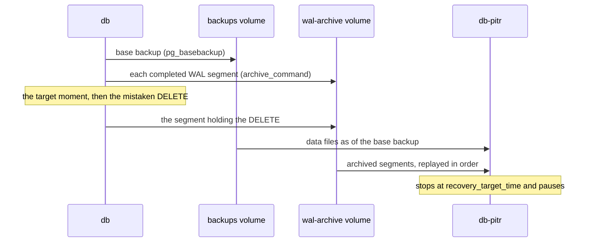

## Bạn cần biết trước

- [[devops.l3.logical-backups]] — bạn biết một bản dump chỉ cho thấy database tại lúc nó chạy, nên mọi thứ ghi sau lần dump cuối đều mất.
- [[backend.l3.read-replicas]] — bạn biết một replica nhận thay đổi của primary thành một dòng chảy liên tục và áp từng thay đổi một.
- [[foundation.l1.transaction-intro]] — bạn biết thay đổi của một giao dịch chỉ hiện ra với người khác khi nó commit.

## Tình huống

Giữa buổi chiều ở stage-3, đơn hàng 3 cần bỏ đi một trong hai món. Bạn gõ lệnh `DELETE` trong `psql`, công cụ dòng lệnh của PostgreSQL, trên `db` và đọc thấy `DELETE 2`: bạn quên đưa sản phẩm vào `WHERE`, nên cả hai món đều mất. Bản dump đêm qua của `backup-logical.sh` vẫn còn chúng, nhưng khôi phục bản đó sẽ lấy đi luôn mọi đơn hàng đặt từ lúc ấy. Chép tay hai dòng từ bản dump thì được một lần, chứ không được với hàng trăm dòng trải trên nhiều bảng. Thứ bạn cần là server đúng như một giây trước lệnh `DELETE`. Bản sao nào đưa bạn về được một thời điểm do bạn chọn, chứ không chỉ về lúc một bản backup tình cờ chạy?

## Khái niệm cốt lõi

- **WAL (write-ahead log)** — bản ghi của PostgreSQL về mọi thay đổi, được ghi trước khi chính các file dữ liệu thay đổi. Phát lại nó từ một điểm xuất phát đã biết sẽ làm lại mọi thay đổi kể từ đó.
- **base backup** — bản chép các file dữ liệu của cả server PostgreSQL, gồm mọi database trong đó, tạo bằng `pg_basebackup` trong khi server vẫn chạy. Đây là điểm xuất phát để phát lại WAL.
- Kho lưu trữ WAL — nơi `archive_command` chép từng file WAL đã hoàn tất, gọi là segment, khi `archive_mode` bật. Trong Đơn Hàng, đó là volume `wal-archive`.
- **khôi phục về thời điểm (PITR)** (point-in-time recovery) — khởi động một server từ base backup rồi phát lại WAL đã lưu trữ tới `recovery_target_time`, chẳng hạn ngay trước lệnh `DELETE` nhầm ở trên.

## Cơ chế hoạt động



Trong tình huống trên, mọi thay đổi bạn và api tạo ra trên `db` đều được ghi vào WAL trước, kể cả lệnh `DELETE` của bạn. Vì vậy WAL là danh sách mọi thay đổi theo đúng thứ tự chúng xảy ra.

Danh sách thay đổi cần một thứ để áp vào. Đó là base backup: `pg_basebackup` chép các file dữ liệu của cả server vào volume `backups` trong khi đơn hàng vẫn tiếp tục đến. Từ đó trở đi, khi `archive_mode` bật, mỗi lần `db` hoàn tất một segment WAL, nó chạy `archive_command`, và lệnh này chép segment đó vào volume `wal-archive`.

Để khôi phục, bạn khởi động một server riêng, `db-pitr`, từ các file của base backup. Server này đọc lần lượt các segment đã lưu trữ và làm lại từng thay đổi, tiến dần theo thời gian kể từ lúc tạo base backup. Bạn đưa cho nó `recovery_target_time`, thời điểm một giây trước lệnh `DELETE`. Quá trình phát lại dừng ở đó, nên lệnh `DELETE` không bao giờ được áp, và server tạm dừng, sẵn sàng cho bạn đọc. Phát lại chỉ áp một giao dịch nếu nó đã commit trước thời điểm đích, nên giao dịch nào lúc đó chưa commit sẽ bị bỏ ra hoàn toàn.

Từ đây có hai giới hạn. Base backup chứa cả server, nên khôi phục sẽ đưa mọi database trong đó về cùng một thời điểm. Và khôi phục chỉ đi xa được tới chỗ kho lưu trữ còn dữ liệu: một thay đổi vẫn nằm trong segment mà `db` chưa hoàn tất và chưa lưu trữ thì không tồn tại ở đâu khác.

## Trong hệ thống Đơn Hàng

Từ stage-3, `db` lưu trữ WAL của nó. Các thiết lập nằm trong `docker-compose.yml`:

```yaml file=docker-compose.yml tag=stage-3 lines=74-87
    # lesson: devops.l3.point-in-time-recovery
    # From stage-3 the server archives its WAL: archive_command gzips each
    # completed segment into the wal-archive volume, and archive_timeout
    # makes a quiet server close a partly filled segment after 60 s.
    # Command-line settings, not a new volume: an existing db-data keeps
    # its data, and `docker compose up -d` restarts the server with them.
    command:
      - postgres
      - -c
      - archive_mode=on
      - -c
      - archive_command=test ! -f /wal-archive/%f.gz && gzip < %p > /wal-archive/%f.gz
      - -c
      - archive_timeout=60
```

Trong `archive_command`, PostgreSQL thay `%p` bằng đường dẫn của segment vừa hoàn tất và `%f` bằng tên file của nó. `gzip` nén segment lại, nên kho lưu trữ giữ một bản `.gz` nhỏ hơn. Phần `test ! -f` từ chối ghi đè một segment đã có trong kho. PostgreSQL coi mọi exit code khác 0, dù do chép lỗi hay do file đã tồn tại, là lưu trữ thất bại và cứ thử lại đúng segment đó, nên segment chưa lưu trữ thì không bao giờ bị vứt đi.

`archive_timeout=60` quan trọng với RPO. Một segment chỉ được lưu trữ khi đã hoàn tất, và một server ít đơn hàng có thể mất rất lâu mới ghi đầy một segment. Với thiết lập này, khi đã qua 60 giây kể từ lúc segment trước hoàn tất và có gì đó được ghi, `db` sẽ hoàn tất segment hiện tại sớm. Vì vậy nếu các file của chính `db` mất mà kho lưu trữ còn, bạn chỉ mất phần chưa kịp lưu trữ, nhiều nhất khoảng một phút trên một server vắng. Trong Đơn Hàng, volume `wal-archive` nằm trên cùng máy với `db`, nên mất cả máy là mất luôn kho lưu trữ. Con số một phút không áp dụng cho trường hợp đó.

Base backup đến từ `scripts/devops/base-backup.sh`, nằm ngoài đoạn trích: nó chạy `pg_basebackup` nhắm vào `db` và chỉ giữ bản mới nhất trong `/backups/base`. Phần khôi phục nằm trong `scripts/devops/pitr.sh`, script này chạy `base-backup.sh` trước nếu chưa có base backup nào. Các hàm phụ của nó được định nghĩa ở phía trên: `on_db` và `on_pitr` chạy một lệnh SQL bằng `psql` trên `db` và `db-pitr`, còn `value` chạy một query trên `db` và chỉ in ra kết quả.

```bash file=scripts/devops/pitr.sh tag=stage-3 lines=34-58
# The mistake: meant for one item, run for the whole order. Recovery will
# go back to $target, a moment before it. pg_switch_wal() closes the current
# WAL segment so it is archived now, not after archive_timeout.
echo "== the mistake, a second later"
on_db --command "DELETE FROM order_items WHERE order_id = 3"
segment=$(value "SELECT pg_walfile_name(pg_switch_wal())")
for _ in $(seq 60); do
  [ "$(value "SELECT last_archived_wal >= '$segment' FROM pg_stat_archiver")" = "t" ] && break
  sleep 1
done

echo "== recover into db-pitr, up to the moment before the DELETE"
docker compose --profile pitr rm --stop --force db-pitr >/dev/null 2>&1
docker volume rm --force donhang_db-pitr-data >/dev/null
RECOVERY_TARGET_TIME="$target" docker compose --profile pitr up --detach db-pitr 2>/dev/null
for _ in $(seq 120); do
  state=$(on_pitr --tuples-only --no-align --command "SELECT pg_get_wal_replay_pause_state()" 2>/dev/null || true)
  [ "$state" = "paused" ] && break
  sleep 1
done
if [ "$state" != "paused" ]; then
  echo "db-pitr did not reach recovery_target_time:" >&2
  docker compose --profile pitr logs --tail 20 db-pitr >&2
  exit 1
fi
```

```text output=true
== order 3's items on db
 order_id | product_id | quantity | unit_price_vnd 
----------+------------+----------+----------------
        3 |          4 |        1 |        3200000
        3 |          5 |        1 |         320000
(2 rows)

recovery_target_time = ...
== the mistake, a second later
DELETE 2
== recover into db-pitr, up to the moment before the DELETE
db-pitr stopped replaying the WAL at recovery_target_time: paused
== order 3's items, on db then on db-pitr
 order_id | product_id | quantity | unit_price_vnd 
----------+------------+----------+----------------
(0 rows)

 order_id | product_id | quantity | unit_price_vnd 
----------+------------+----------+----------------
        3 |          4 |        1 |        3200000
        3 |          5 |        1 |         320000
(2 rows)

== copy them from db-pitr back into db
COPY 2
 order_id | product_id | quantity | unit_price_vnd 
----------+------------+----------+----------------
        3 |          4 |        1 |        3200000
        3 |          5 |        1 |         320000
(2 rows)
```

Ở phần trước của script, ngoài đoạn trích, `$target` là thời điểm đọc từ `db` một giây trước lệnh nhầm. Sau lệnh `DELETE`, `pg_switch_wal()` hoàn tất segment hiện tại ngay lập tức, `pg_walfile_name` cho biết tên file của segment đó, và vòng lặp chờ tới khi `pg_stat_archiver` báo nó đã được lưu trữ. Nếu không, segment đó có thể nằm chưa lưu trữ tới một phút, và `db-pitr`, thấy kho lưu trữ kết thúc trước thời điểm đích, sẽ tắt kèm lỗi thay vì tạm dừng.

Sau đó script xóa container và volume dữ liệu `db-pitr` còn sót từ lần chạy trước, để khôi phục bắt đầu lại từ base backup. Rồi nó khởi động `db-pitr`, một container trong Compose profile `pitr`, với `RECOVERY_TARGET_TIME` đặt bằng `$target`. Đây là một server riêng: `db` vẫn phục vụ đơn hàng suốt thời gian đó. Vòng lặp chờ tới khi `db-pitr` báo quá trình phát lại đang `paused`, nghĩa là nó đã tới thời điểm đích. Lúc này đơn hàng 3 không còn món nào trên `db` nhưng có hai món trên `db-pitr`. Các dòng sau đoạn trích chép hai dòng đó trở lại `db` bằng `COPY`, và không gì khác trên `db` thay đổi.

## Senior hay nhầm rằng…

- **"Read replica đã bảo vệ mình khỏi một lệnh `DELETE` nhầm."** → Thực ra replica áp mọi thay đổi mà primary gửi sang, và lệnh `DELETE` của bạn là một trong số đó. Nó giữ bản sao thứ hai của dữ liệu mới nhất, không phải bản sao của một thời điểm trước. Bạn sẽ nhận ra khi chạy cùng câu `SELECT` trên replica ngay sau lúc nhầm và thấy cùng con số không dòng.
- **"Chỉ cần base backup là đưa server về được bất kỳ lúc nào sau khi nó được tạo."** → Thực ra base backup chỉ giữ server như nó ở quanh lúc tạo bản backup. Mọi thời điểm sau đó chỉ tồn tại trong WAL đã lưu trữ, và phát lại không vượt qua được segment đầu tiên bị thiếu. Bạn sẽ nhận ra khi kho lưu trữ đã ngừng hoạt động từ mấy ngày trước và `pitr.sh` kết thúc với `db-pitr did not reach recovery_target_time`.
- **"Khôi phục về thời điểm có thể đưa riêng một database về trước, còn các database khác giữ dữ liệu mới nhất."** → Thực ra base backup và WAL bao trùm cả server, nên `db-pitr` giữ `donhang`, `donhang_payments`, `keycloak` và các database khác, tất cả ở cùng một thời điểm. Đó là lý do `pitr.sh` chép các dòng trở lại thay vì thay thế `db`. Bạn sẽ nhận ra khi tính chuyện đổi `db-pitr` vào chỗ `db` và thấy các payment cùng lượt đăng nhập phát sinh sau thời điểm đích sẽ biến mất theo.

## Thử ngay (3 phút)

1. Với lab stage-3 đang chạy, chạy `scripts/devops/pitr.sh` từ thư mục gốc của repository. Bạn không cần tạo base backup trước: script tự tạo một bản nếu chưa có.
2. So hai bảng in ra dưới `== order 3's items, on db then on db-pitr`.
3. Đọc bảng cuối cùng, sau `COPY 2`.

Kết quả mong đợi: `DELETE 2` sau bảng đầu tiên. Dưới tiêu đề so sánh, `(0 rows)` từ `db` và hai món của sản phẩm 4 và 5 từ `db-pitr`. Sau `COPY 2`, cả hai món đã trở lại `db`.

<details><summary>Gợi ý đáp án</summary>

`db` đã áp lệnh `DELETE`. `db-pitr` chỉ phát lại WAL đã lưu trữ tới `recovery_target_time`, một giây trước lệnh đó, nên vẫn giữ cả hai món. Chép chúng trở lại sửa được `db` mà không đưa dòng nào khác lùi về quá khứ.

</details>

## Liên hệ

- [[devops.l3.logical-backups]] — bước trước đó: bản dump mất mọi thứ sau lần chạy cuối, còn WAL lưu trữ thu hẹp phần mất đó xuống chỉ còn những gì chưa kịp lưu trữ.
- [[backend.l3.read-replicas]] — cũng WAL đó, gửi tới một server áp nó ngay lập tức. Ở đây nó được giữ lại và chỉ áp tới thời điểm bạn chọn.
- [[foundation.l1.transaction-intro]] — đơn vị mà phát lại làm việc theo: khôi phục dừng giữa các giao dịch đã commit, không bao giờ dừng giữa chừng một giao dịch.
- [[devops.l3.restore-testing]] — bước kế tiếp: chứng minh một bản backup như thế này thật sự khôi phục được, trước khi bạn cần đến nó.

## Tóm tắt 5 dòng

1. Một base backup cùng mọi segment WAL lưu trữ sau nó cho phép dựng lại server đúng như tại thời điểm bạn chọn.
2. PostgreSQL ghi mỗi thay đổi vào WAL trước file dữ liệu, nên phát lại WAL sẽ làm lại các thay đổi theo đúng thứ tự.
3. `pg_basebackup` chép cả server đang chạy, `archive_command` chép từng segment đã hoàn tất, `recovery_target_time` đặt chỗ phát lại dừng.
4. `pitr.sh` khôi phục vào `db-pitr` riêng biệt rồi chép các dòng bị xóa trở lại, trong khi `db` vẫn chạy.
5. Khôi phục đưa mọi database trên server về cùng một thời điểm, và mất phần WAL chưa kịp lưu trữ.
