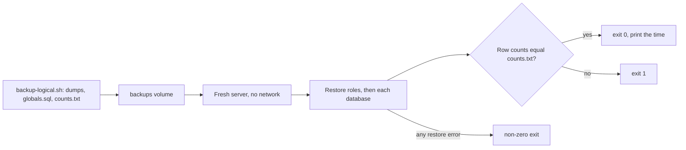

## Before you start

- [[devops.l3.point-in-time-recovery]] — you know `pitr.sh` recovers into a separate container, `db-pitr`, while `db` keeps running.
- [[devops.l3.logical-backups]] — you know `backup-logical.sh` writes one directory per run with five database dumps and the roles, and that `pg_restore` rebuilds a database from a dump.

## The situation

You have run `scripts/devops/backup-logical.sh` several times this week. Each run printed a tidy list of files and ended with exit code `0`. In a review, a colleague asks whether anyone has ever restored one of those directories, and nobody has. You remember stage-2's `backup-db.sh`, which also ran cleanly every time and never held a single order. Something similar could be wrong now in a way you have not spotted, and you would find out on the day `db` is gone. How do you know that tonight's backup can bring Đơn Hàng back, before you need it?

## Core concepts

- Silent backup failure — a backup run that reports success while its result cannot bring the data back, such as a dump with no rows, a database missing from the list, or a WAL archive that stopped receiving segments.
- **restore test** — restoring the newest backup into a fresh, separate server and checking the result against facts recorded when the backup was taken, such as row counts per table.
- Measured restore time — how long a restore test took from start to a checked result: one measured part of the RTO in place of a guess.

## How it works



A backup job reports on what it did, not on what you will need. Stage-2's `backup-db.sh` passed `--schema-only` to `pg_dump`, so `pg_dump` wrote no rows and exited `0`. A database left off a backup script's list raises no error either, because nothing is ever asked to dump it. When `archive_command` starts failing, PostgreSQL retries it and keeps the unarchived WAL on its own disk, so the api sees nothing different while the archive falls behind, until that disk fills up. Each looks fine until the day of the restore. The test below covers the dumps; the WAL archive is tested by recovering from it.

A restore test asks that day's question ahead of time. In the situation above, it takes the newest directory written by `backup-logical.sh` and follows the diagram. It starts a fresh PostgreSQL server that knows nothing about Đơn Hàng, as a replacement machine would, with no network and only the backups volume to read. It restores the roles first, then each database, and compares row counts with `counts.txt`, written at backup time. A failed restore stops the test with a non-zero exit code; a different number ends it with exit code `1`.

The test also gives you a number. The time from start to a checked result is a measured restore time. Set it against the RTO: if the restore alone takes longer than the target allows, the target or the backup method has to change, and you learn that before an outage. When backups run on a schedule, the restore test belongs on one too, with an alert someone sees when it fails. The lab runs it by hand.

## In the Đơn Hàng system

The fresh server and the restore, from `scripts/devops/restore-test.sh`:

```bash file=scripts/devops/restore-test.sh tag=stage-3 lines=16-34
# lesson: devops.l3.restore-testing
# A fresh, separate server, never the live db: an empty PostgreSQL with no
# network at all, which reads the backups volume and nothing else. It is
# removed when the script ends, whatever happens.
docker run --detach --rm --name donhang-restore-test --network none \
  --env POSTGRES_HOST_AUTH_METHOD=trust \
  --volume donhang_backups:/backups:ro postgres:17.6-alpine >/dev/null
trap 'docker rm --force donhang-restore-test >/dev/null' EXIT
in_test() { docker exec donhang-restore-test "$@"; }
# The image first runs a temporary server on its socket only; TCP answers
# once the real server is up.
until in_test pg_isready --host 127.0.0.1 --quiet; do sleep 1; done

# The roles first (the dumps' tables belong to donhang), then each database.
in_test psql --username postgres --no-psqlrc --quiet --file "$newest/globals.sql" >/dev/null 2>&1
for dump in $(in_test sh -c "ls $newest/*.dump"); do
  in_test pg_restore --username postgres --create --dbname postgres --exit-on-error "$dump"
  echo "restored $(basename "$dump" .dump)"
done
```

`$newest` is the newest backup directory and `started` the time it was found, both set earlier in the file. With `--network none` the container has no network except a connection to itself (`127.0.0.1`), so it cannot reach `db`; it sees only the backups volume, mounted read-only. `POSTGRES_HOST_AUTH_METHOD=trust` lets any connection in without a password, acceptable because nothing outside can connect. The `trap` on `EXIT` removes the container when the script ends, pass or fail. The image first runs a short setup server that takes no TCP connections, so `pg_isready` asks whether the server accepts connections and the `until` loop retries every second until the real one does.

`psql`, PostgreSQL's command-line client, runs `globals.sql` first, because the empty server has no `donhang` role and the dumped tables belong to it. `pg_restore --create` creates the database named in the dump; `--dbname postgres` names the database every new server starts with, and is only where `pg_restore` connects first. `--exit-on-error` makes `pg_restore` stop at the first error, where by default it carries on and reports a count of errors at the end. With `set -euo pipefail`, a line at the top of the script that makes it stop when a command like this fails, that ends the test as a failure.

The check, from the same file:

```bash file=scripts/devops/restore-test.sh tag=stage-3 lines=36-53
# lesson: devops.l3.restore-testing
# The check: the restored rows against what backup-logical.sh counted in the
# dump. Any difference fails the test with exit code 1.
counts=$(in_test cat "$newest/counts.txt")
failed=0
while read -r table expected; do
  restored=$(in_test psql --username postgres --dbname donhang --no-psqlrc --tuples-only --no-align \
                          --command "SELECT count(*) FROM $table")
  if [ "$restored" = "$expected" ]; then
    echo "$table: $expected in counts.txt, $restored restored, same"
  else
    echo "$table: $expected in counts.txt, $restored restored, DIFFERENT"
    failed=1
  fi
done <<< "$counts"

echo "restore and check took $(( $(date +%s) - started )) s"
exit "$failed"
```

```text output=true
newest dumps: /backups/logical/...
restored donhang
restored donhang_notifications
restored donhang_payments
restored donhang_tofu
restored keycloak
orders: ... in counts.txt, ... restored, same
order_items: ... in counts.txt, ... restored, same
customers: 5 in counts.txt, 5 restored, same
restore and check took ... s
```

Each line of `counts.txt` names a table of `donhang` and a row count. `backup-logical.sh` takes each count from the dump file, not from the running `db`: it reads that table's rows back out of `donhang.dump` and counts them. The loop counts the same table after the restore; one difference sets `failed=1`, which becomes the exit code. The `...` marks values that change between runs. The last line is the measured time, from finding the newest dumps to the end of the check, container start included.

Know the test's limits. It checks three tables of one database, and the expected counts come from the dump itself, so a match proves the file restores what it holds, not that it holds everything the shop needs. A database missing from the list in `backup-logical.sh` would pass, because neither file mentions it.

## Seniors often assume…

- **"`pg_dump` exiting with `0` proves its file can be restored."** → Actually exit code `0` says `pg_dump` did what it was asked without an error. It says nothing about whether the options were right, whether a new server will have the roles the file needs, or whether the file is intact when you read it back. You notice this when a backup that never failed turns out to be schema-only, as stage-2's was.
- **"Restoring over the live database is the most realistic test."** → Actually a real disaster leaves you an empty server, so a fresh server is the realistic case. On `db` the `donhang` role already exists, so a missing `globals.sql` would go unnoticed. Restoring over live data also replaces orders still being written, and a restore that fails halfway loses them. You notice this when a test that passed on `db` fails on a new machine with errors that a role does not exist.
- **"A restore test is needed once, when the backup job is first set up."** → Actually one pass proves only that one backup restored on that day. Backups keep changing: the data grows, so the restore takes longer; the scripts change; the volume they write to fills up. When backups run on a schedule, run the restore test on one too and alert on failure, since last month's pass says nothing about last night's backup. You notice this when the first restore in a long while fails on a problem that began weeks earlier.

## Try it (3 minutes)

1. With the stage-3 lab running, run `scripts/devops/backup-logical.sh`, then `scripts/devops/restore-test.sh`, both from the repository root.
2. Read the three count lines and the last line, then run `echo $?`.
3. Think: would this test have failed on a dump made with stage-2's `--schema-only`?

Expected result: five `restored` lines, three lines ending in `same` including `customers: 5 in counts.txt, 5 restored, same`, a time in seconds, and `0` from `echo $?`.

<details><summary>Suggested answer</summary>

No. `backup-logical.sh` counts rows inside the dump, so a dump with no rows would put zeros in `counts.txt`. The restored tables would hold zero rows too, and every line would say `same`. The test proves the file restores what it holds; noticing that `orders` is 0 while the shop has orders is a check you make by reading the numbers.

</details>

## Connections

- [[devops.l3.rpo-and-rto]] — where the RTO was a target with no measurement; the time this test prints is its first measured part.
- [[devops.l2.quality-gate]] — the same pass-or-fail check by exit code, pointed at backups instead of code.
- [[devops.l3.point-in-time-recovery]] — `pitr.sh` already recovers into a separate container; a base backup is tested the same way, by recovering it.
- [[devops.l3.disaster-recovery-drill]] — the next step: rebuilding a whole environment, not one server, and timing it.

## Five-line summary

1. A backup counts only once a restore of it has been tested, because a backup can fail without any error.
2. A restore test restores the newest backup into a fresh, separate server and compares the result with facts recorded at backup time.
3. `restore-test.sh` restores the roles and five databases into a throwaway container and exits `1` when a row count differs.
4. The time it prints is a measured part of the RTO, in place of a guess.
5. When backups run on a schedule, the restore test needs one too, with an alert when it fails.
