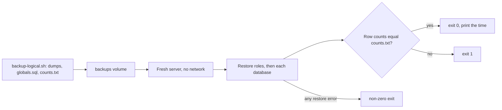

## Bạn cần biết trước

- [[devops.l3.point-in-time-recovery]] — bạn biết `pitr.sh` khôi phục vào một container riêng, `db-pitr`, trong khi `db` vẫn chạy.
- [[devops.l3.logical-backups]] — bạn biết mỗi lần chạy, `backup-logical.sh` ghi ra một thư mục gồm năm bản dump database cùng các role, và `pg_restore` dựng lại một database từ bản dump.

## Tình huống

Tuần này bạn đã chạy `scripts/devops/backup-logical.sh` vài lần. Lần nào nó cũng in ra một danh sách file gọn gàng và kết thúc với exit code `0`. Trong một buổi review, một đồng nghiệp hỏi đã có ai khôi phục thử một trong các thư mục đó chưa, và chưa ai làm cả. Bạn nhớ tới `backup-db.sh` của stage-2: nó cũng chạy êm mọi lần mà chưa từng chứa một đơn hàng nào. Bây giờ cũng có thể có chỗ sai tương tự mà bạn chưa thấy, và bạn sẽ chỉ biết vào ngày `db` mất. Làm sao biết bản backup đêm nay đưa Đơn Hàng trở lại được, trước khi bạn cần đến nó?

## Khái niệm cốt lõi

- Backup hỏng âm thầm — một lần backup báo thành công trong khi kết quả của nó không đưa dữ liệu trở lại được, chẳng hạn bản dump không có dòng nào, một database bị thiếu trong danh sách, hay kho lưu trữ WAL đã ngừng nhận segment.
- **kiểm thử khôi phục** (restore test) — khôi phục bản backup mới nhất vào một server mới, riêng biệt rồi đối chiếu kết quả với số liệu ghi lại lúc backup, chẳng hạn số dòng của từng bảng.
- Thời gian khôi phục đo được — thời gian một lần kiểm thử khôi phục chạy từ lúc bắt đầu tới khi có kết quả đã kiểm: một phần của RTO được đo thật thay cho phỏng đoán.

## Cơ chế hoạt động



Một job backup báo về những gì nó đã làm, không báo về thứ bạn sẽ cần. `backup-db.sh` của stage-2 truyền `--schema-only` cho `pg_dump`, nên `pg_dump` không ghi dòng nào mà vẫn thoát với `0`. Một database bị bỏ sót khỏi danh sách trong script backup cũng không gây lỗi gì, vì không có gì yêu cầu dump nó. Khi `archive_command` bắt đầu lỗi, PostgreSQL thử lại và giữ phần WAL chưa lưu trữ trên chính ổ đĩa của nó, nên api không thấy gì khác thường trong khi kho lưu trữ tụt lại phía sau, cho tới khi ổ đĩa đó đầy. Trường hợp nào trông cũng ổn cho tới ngày cần khôi phục. Bài kiểm thử dưới đây kiểm các bản dump. Còn kho lưu trữ WAL thì được kiểm bằng cách khôi phục từ nó.

Kiểm thử khôi phục đặt câu hỏi của ngày đó từ trước. Trong tình huống trên, nó lấy thư mục mới nhất do `backup-logical.sh` ghi ra và đi theo sơ đồ. Nó khởi động một server PostgreSQL mới, không biết gì về Đơn Hàng, giống như một máy thay thế, không có mạng và chỉ đọc được volume chứa backup. Nó khôi phục các role trước, rồi từng database, và so số dòng với `counts.txt`, file được ghi lúc backup. Một lần khôi phục thất bại sẽ dừng bài kiểm thử với exit code khác 0. Còn một con số lệch thì kết thúc nó với exit code `1`.

Bài kiểm thử còn cho bạn một con số. Thời gian từ lúc bắt đầu tới khi có kết quả đã kiểm là thời gian khôi phục đo được. Đặt nó cạnh RTO: nếu riêng phần khôi phục đã lâu hơn mức mục tiêu cho phép, thì phải đổi mục tiêu hoặc đổi cách backup, và bạn biết điều đó trước khi có sự cố. Khi backup chạy theo lịch, kiểm thử khôi phục cũng nên chạy theo lịch, kèm một cảnh báo có người nhìn thấy khi nó thất bại. Trong lab, bạn chạy nó bằng tay.

## Trong hệ thống Đơn Hàng

Server mới và phần khôi phục, trích từ `scripts/devops/restore-test.sh`:

```bash file=scripts/devops/restore-test.sh tag=stage-3 lines=16-34
# lesson: devops.l3.restore-testing
# A fresh, separate server, never the live db: an empty PostgreSQL with no
# network at all, which reads the backups volume and nothing else. It is
# removed when the script ends, whatever happens.
docker run --detach --rm --name donhang-restore-test --network none \
  --env POSTGRES_HOST_AUTH_METHOD=trust \
  --volume donhang_backups:/backups:ro postgres:17.6-alpine >/dev/null
trap 'docker rm --force donhang-restore-test >/dev/null' EXIT
in_test() { docker exec donhang-restore-test "$@"; }
# The image first runs a temporary server on its socket only; TCP answers
# once the real server is up.
until in_test pg_isready --host 127.0.0.1 --quiet; do sleep 1; done

# The roles first (the dumps' tables belong to donhang), then each database.
in_test psql --username postgres --no-psqlrc --quiet --file "$newest/globals.sql" >/dev/null 2>&1
for dump in $(in_test sh -c "ls $newest/*.dump"); do
  in_test pg_restore --username postgres --create --dbname postgres --exit-on-error "$dump"
  echo "restored $(basename "$dump" .dump)"
done
```

`$newest` là thư mục backup mới nhất, còn `started` là thời điểm tìm thấy nó, cả hai được gán ở phần trước của file. Với `--network none`, container không có mạng nào ngoài kết nối tới chính nó (`127.0.0.1`), nên không chạm được tới `db`. Nó chỉ thấy volume chứa backup, được mount ở chế độ chỉ đọc. `POSTGRES_HOST_AUTH_METHOD=trust` cho mọi kết nối vào mà không cần mật khẩu, chấp nhận được vì không gì bên ngoài kết nối vào được. `trap` trên `EXIT` xóa container khi script kết thúc, dù đạt hay không. Image chạy trước một server dựng tạm ngắn, không nhận kết nối TCP, nên `pg_isready` hỏi xem server đã nhận kết nối chưa, và vòng lặp `until` thử lại mỗi giây tới khi server thật sẵn sàng.

`psql`, công cụ dòng lệnh của PostgreSQL, chạy `globals.sql` trước, vì server trống chưa có role `donhang` mà các bảng trong bản dump lại thuộc về role đó. `pg_restore --create` tạo database có tên ghi trong bản dump. `--dbname postgres` chỉ ra database mà server mới nào cũng có sẵn, và chỉ là nơi `pg_restore` kết nối vào trước. `--exit-on-error` khiến `pg_restore` dừng ở lỗi đầu tiên, trong khi mặc định nó chạy tiếp và cuối cùng báo số lỗi. Có `set -euo pipefail`, một dòng ở đầu script khiến script dừng khi một lệnh như thế này thất bại, nên bài kiểm thử kết thúc là thất bại.

Phần kiểm tra, cũng trong file đó:

```bash file=scripts/devops/restore-test.sh tag=stage-3 lines=36-53
# lesson: devops.l3.restore-testing
# The check: the restored rows against what backup-logical.sh counted in the
# dump. Any difference fails the test with exit code 1.
counts=$(in_test cat "$newest/counts.txt")
failed=0
while read -r table expected; do
  restored=$(in_test psql --username postgres --dbname donhang --no-psqlrc --tuples-only --no-align \
                          --command "SELECT count(*) FROM $table")
  if [ "$restored" = "$expected" ]; then
    echo "$table: $expected in counts.txt, $restored restored, same"
  else
    echo "$table: $expected in counts.txt, $restored restored, DIFFERENT"
    failed=1
  fi
done <<< "$counts"

echo "restore and check took $(( $(date +%s) - started )) s"
exit "$failed"
```

```text output=true
newest dumps: /backups/logical/...
restored donhang
restored donhang_notifications
restored donhang_payments
restored donhang_tofu
restored keycloak
orders: ... in counts.txt, ... restored, same
order_items: ... in counts.txt, ... restored, same
customers: 5 in counts.txt, 5 restored, same
restore and check took ... s
```

Mỗi dòng của `counts.txt` ghi tên một bảng của `donhang` và số dòng của nó. `backup-logical.sh` lấy mỗi con số từ file dump, không phải từ `db` đang chạy: nó đọc lại các dòng của bảng đó từ `donhang.dump` rồi đếm. Vòng lặp đếm cùng bảng đó sau khi khôi phục. Chỉ cần một chỗ lệch là `failed=1`, và giá trị này trở thành exit code. Dấu `...` đánh dấu các giá trị thay đổi giữa các lần chạy. Dòng cuối là thời gian đo được, từ lúc tìm thấy các bản dump mới nhất tới khi kiểm xong, tính cả thời gian khởi động container.

Hãy biết giới hạn của bài kiểm thử này. Nó chỉ kiểm ba bảng của một database, và số dòng mong đợi lấy từ chính bản dump. Vì thế khớp số chỉ chứng minh file khôi phục được đúng những gì nó chứa, không chứng minh nó chứa đủ mọi thứ cửa hàng cần. Một database bị thiếu trong danh sách của `backup-logical.sh` vẫn sẽ đạt, vì cả hai file đều không nhắc tới nó.

## Senior hay nhầm rằng…

- **"`pg_dump` thoát với `0` là chứng minh file của nó khôi phục được."** → Thực ra exit code `0` chỉ nói `pg_dump` đã làm đúng điều được yêu cầu mà không gặp lỗi. Nó không cho biết tùy chọn có đúng không, server mới có sẵn các role mà file cần không, hay file có còn nguyên vẹn khi bạn đọc lại không. Bạn sẽ nhận ra khi một bản backup chưa từng lỗi hóa ra chỉ có schema, như bản của stage-2.
- **"Khôi phục đè lên database đang chạy là cách kiểm thử sát thực tế nhất."** → Thực ra một sự cố thật để lại cho bạn một server trống, nên server mới mới là trường hợp sát thực tế. Trên `db`, role `donhang` đã có sẵn, nên thiếu `globals.sql` cũng không ai thấy. Khôi phục đè lên dữ liệu đang chạy còn thay thế các đơn hàng vẫn đang được ghi, và một lần khôi phục hỏng giữa chừng sẽ làm mất chúng. Bạn sẽ nhận ra khi một bài kiểm thử đạt trên `db` lại thất bại trên máy mới với lỗi báo một role không tồn tại.
- **"Kiểm thử khôi phục chỉ cần làm một lần, khi mới dựng job backup."** → Thực ra một lần đạt chỉ chứng minh đúng một bản backup khôi phục được vào đúng hôm đó. Backup thì liên tục thay đổi: dữ liệu lớn dần nên khôi phục lâu hơn, các script đổi, volume chúng ghi vào đầy dần. Khi backup chạy theo lịch, hãy cho kiểm thử khôi phục chạy theo lịch và cảnh báo khi thất bại, vì lần đạt tháng trước không nói gì về bản backup đêm qua. Bạn sẽ nhận ra khi lần khôi phục đầu tiên sau một thời gian dài thất bại vì một vấn đề đã bắt đầu từ nhiều tuần trước.

## Thử ngay (3 phút)

1. Với lab stage-3 đang chạy, chạy `scripts/devops/backup-logical.sh`, rồi `scripts/devops/restore-test.sh`, cả hai từ thư mục gốc của repository.
2. Đọc ba dòng số đếm và dòng cuối, rồi chạy `echo $?`.
3. Suy nghĩ: bài kiểm thử này có thất bại với một bản dump tạo bằng `--schema-only` của stage-2 không?

Kết quả mong đợi: năm dòng `restored`, ba dòng kết thúc bằng `same`, trong đó có `customers: 5 in counts.txt, 5 restored, same`, một khoảng thời gian tính bằng giây, và `0` từ `echo $?`.

<details><summary>Gợi ý đáp án</summary>

Không. `backup-logical.sh` đếm các dòng bên trong bản dump, nên một bản dump không có dòng nào sẽ ghi số 0 vào `counts.txt`. Các bảng sau khi khôi phục cũng có 0 dòng, và dòng nào cũng báo `same`. Bài kiểm thử chứng minh file khôi phục được những gì nó chứa. Còn nhận ra `orders` bằng 0 trong khi cửa hàng có đơn hàng là phần bạn tự kiểm khi đọc các con số.

</details>

## Liên hệ

- [[devops.l3.rpo-and-rto]] — nơi RTO là một mục tiêu chưa được đo. Thời gian bài kiểm thử này in ra là phần đầu tiên của nó được đo thật.
- [[devops.l2.quality-gate]] — cũng là kiểm tra đạt hay không theo exit code, chỉ là nhắm vào backup thay vì code.
- [[devops.l3.point-in-time-recovery]] — `pitr.sh` vốn đã khôi phục vào một container riêng. Base backup được kiểm thử theo cùng cách, bằng cách khôi phục từ nó.
- [[devops.l3.disaster-recovery-drill]] — bước kế tiếp: dựng lại cả một môi trường, không chỉ một server, và bấm giờ.

## Tóm tắt 5 dòng

1. Bản backup chỉ đáng tin khi đã được khôi phục thử, vì backup có thể hỏng mà không báo lỗi nào.
2. Kiểm thử khôi phục đưa bản backup mới nhất vào một server mới, riêng biệt rồi so kết quả với số liệu ghi lúc backup.
3. `restore-test.sh` khôi phục các role và năm database vào một container dùng xong bỏ, và thoát với `1` khi một số dòng bị lệch.
4. Thời gian nó in ra là một phần đo được của RTO, thay cho phỏng đoán.
5. Khi backup chạy theo lịch, kiểm thử khôi phục cũng cần một lịch, kèm cảnh báo khi thất bại.
