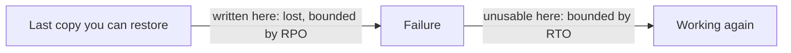

## Bạn cần biết trước

- [[devops.l1.volumes]] — bạn biết service `db` giữ các file của PostgreSQL trong volume `db-data`, thứ sống lâu hơn container.
- [[k8s.l1.deploying-don-hang]] — bạn biết Pod `db` của cluster giữ dữ liệu trong một `emptyDir`, và Pod thay thế khởi động với dữ liệu trống.
- [[management.l2.non-functional-requirements]] — bạn biết một yêu cầu về việc hệ thống chạy tốt tới đâu chỉ có ích khi nêu rõ tình huống và thước đo.

## Tình huống

Trong buổi họp lên kế hoạch, trưởng nhóm hỏi một câu rất thẳng: nếu tối nay máy chạy database của Đơn Hàng chết, cửa hàng mất bao nhiêu đơn hàng, và khách không đặt hàng được trong bao lâu? Bạn trả lời là có backup, `scripts/terminal/backup-db.sh`. Rồi bạn mở file nó ghi ra. File tạo đủ mọi bảng, nhưng không có lấy một đơn hàng. Chưa ai từng nói cửa hàng chịu được mất bao nhiêu đơn, hay bao nhiêu giờ không đặt hàng được. Trước khi chọn công cụ backup nào, khôi phục phải cam kết điều gì, và ai quyết định điều đó?

## Khái niệm cốt lõi

- **khôi phục sau thảm họa (DR)** (disaster recovery) — đưa hệ thống chạy lại sau khi mất thứ nó không thể thiếu, như ổ đĩa chứa database hay cả một cluster.
- **RPO (recovery point objective)** — lượng dữ liệu gần nhất mà doanh nghiệp chấp nhận mất trong một sự cố như vậy, tính bằng khoảng thời gian trước lúc hỏng.
- **RTO (recovery time objective)** — khoảng thời gian doanh nghiệp chấp nhận hệ thống không dùng được sau sự cố, cho tới khi nó chạy lại.
- Bản duy nhất của một dữ kiện — dữ liệu chỉ có ở một nơi lưu trữ và không ở đâu khác, nên mất nơi đó là mất luôn dữ kiện. Chỉ những nơi lưu trữ giữ loại dữ liệu này mới cần backup.

## Cơ chế hoạt động



Hãy đọc sơ đồ như một trục thời gian. Bên trái là bản sao mới nhất của dữ liệu mà bạn thật sự khôi phục được. Mọi đơn hàng ghi vào giữa bản sao đó và lúc hỏng đều mất. RPO là độ dài tối đa của khoảng hở này: RPO một giờ nghĩa là mất nhiều nhất các đơn hàng của một giờ cuối.

Bên phải, đồng hồ bắt đầu chạy khi sự cố xảy ra và dừng khi khách đặt hàng lại được. RTO là độ dài tối đa của quãng này. Nó gồm mọi thứ ở giữa: có người nhận ra sự cố, có được một máy chạy được, tìm bản sao, khôi phục nó, kiểm tra lại, rồi trỏ api sang đó.

Trong tình huống trên, cả hai con số đều chưa có, và cũng không phải do bạn tự đặt ra. Cả hai đến từ phía kinh doanh. Cửa hàng biết nhân viên có thể nhập lại bằng tay bao nhiêu đơn từ email của khách, và một lần ngừng nhận đơn tốn của họ bao nhiêu. Phần của bạn là hỏi, ghi câu trả lời thành hai yêu cầu kiểm tra được, rồi thiết kế theo đó.

Mỗi lần hạ con số xuống là tốn thêm tiền. RPO nhỏ hơn cần sao lưu thường xuyên hơn, nên tốn thêm chỗ lưu và công cụ. RTO nhỏ hơn cần máy và script chuẩn bị sẵn, cùng những người đã tập các bước. Vì thế phía kinh doanh, bên trả tiền, đặt cả hai con số. Đòi không mất chút dữ liệu nào và không ngừng chút nào là một yêu cầu mà ai đó phải thấy giá của nó trước.

## Trong hệ thống Đơn Hàng

Bản backup đang có ở tag này, trong `scripts/terminal/backup-db.sh`:

```bash file=scripts/terminal/backup-db.sh tag=stage-2 lines=7-18
out_dir="${1:-/tmp/backups}"
mkdir -p "$out_dir"
file="$out_dir/donhang-schema.sql"

pg_dump --host db --username donhang --dbname donhang \
        --schema-only --no-owner --no-privileges > "$file"

echo "wrote $file"
echo "tables in the backup: $(grep -c 'CREATE TABLE' "$file")"

echo
echo "the exit code of the last command was $?"
```

```text output=true
wrote /tmp/backups/donhang-schema.sql
tables in the backup: 7

the exit code of the last command was 0
```

`pg_dump` là công cụ của PostgreSQL ghi một database ra thành file chứa các câu lệnh SQL, gọi là bản dump. Cờ cần để ý là `--schema-only` trong lệnh `pg_dump`. Có cờ này, bản dump chỉ giữ các câu lệnh tạo bảng của `donhang`, không có dòng dữ liệu nào. Khôi phục nó, bạn được bảy bảng trống: không khách hàng, không sản phẩm, không đơn hàng. Lần chạy trông rất ổn, có file, có số đếm và exit code `0`, con số một lệnh trả về để báo là thành công, nhưng không khôi phục được gì. File còn nằm ở `/tmp/backups` trong lab box, trên cùng máy với database.

Nơi dữ liệu thật sự nằm trong cluster, từ `deploy/k8s/db.yaml`:

```yaml file=deploy/k8s/db.yaml tag=stage-2 lines=50-60
          volumeMounts:
            - name: init-scripts
              mountPath: /docker-entrypoint-initdb.d
            - name: data
              mountPath: /var/lib/postgresql/data
      volumes:
        - name: init-scripts
          configMap:
            name: db-init
        - name: data
          emptyDir: {}
```

Thư mục dữ liệu của PostgreSQL là volume `data`, một `emptyDir` (các dòng `init-scripts` mount file cài đặt, không phải dữ liệu, ở đây bỏ qua). Kubernetes tạo nó trống cho Pod và xóa nó khi Pod bị xóa. Nếu Pod bị thay, hoặc mất node chạy nó, mọi đơn hàng trong cluster đều mất. Bên Compose, `docker-compose.yml` mount named volume `db-data` vào cùng thư mục đó. Nó còn sau khi xóa container, nhưng nằm trên ổ đĩa của một máy, nên mất máy đó là mất nó.

Redis thì khác. `docker-compose.yml`, trong comment phía trên service `redis`, nói rằng không thứ gì trong đó là bản duy nhất của một dữ kiện: PostgreSQL giữ tất cả. Api nạp Redis từ PostgreSQL và vẫn trả lời từ PostgreSQL khi không có Redis. Mất Redis chỉ làm vài request chậm hơn, không mất dữ liệu. Nên câu hỏi đầu tiên với mỗi nơi lưu trữ là nó có giữ bản duy nhất của dữ kiện nào không. Backup nó thế nào là chuyện thứ hai.

## Senior hay nhầm rằng…

- **"RPO là khoảng cách giữa các lần chạy của job backup, chạy bao lâu một lần thì là bấy nhiêu."** → Thực ra RPO là mục tiêu do phía kinh doanh đặt, còn chu kỳ của job chỉ là một thiết kế phải đáp ứng nó. Lượng dữ liệu thật sự mất tính ngược về bản sao gần nhất bạn khôi phục được, và bản đó cũ hơn lần chạy cuối nếu lần chạy ấy lỗi, sao nhầm thứ, hoặc nằm trên chính cái máy đã chết. Bạn sẽ nhận ra khi một job "chạy mỗi đêm" gặp sự cố thật đầu tiên, và bản sao dùng được mới nhất đã cũ vài tuần.
- **"RTO là thời gian lệnh restore chạy."** → Thực ra đồng hồ RTO chạy từ lúc hỏng cho tới khi khách dùng lại được hệ thống, và lệnh restore chỉ là một bước bên trong. Nhận ra sự cố, có được máy, tìm bản sao và kiểm tra kết quả đều tính vào. Bạn sẽ nhận ra khi một lần restore mất vài phút trên laptop biến thành cả buổi chiều trong một sự cố thật.
- **"Mọi nơi lưu trữ dữ liệu trong hệ thống đều cần cùng một kiểu backup."** → Thực ra chỉ nơi giữ bản duy nhất của một dữ kiện mới cần backup để khỏi mất dữ liệu. Một cache như Redis, thứ api nạp lại từ PostgreSQL và trả lời được khi thiếu nó, thì không cần. Bạn sẽ nhận ra khi một kế hoạch backup tốn công cho Redis, trong khi một nơi giữ dữ liệu thật lại bị bỏ sót.

## Thử ngay (3 phút)

Một bài tập suy nghĩ. Giả sử cửa hàng nói: nhân viên nhập lại bằng tay được nhiều nhất các đơn hàng của 15 phút cuối, và khách có thể không đặt hàng được nhiều nhất 2 giờ.

1. Một bản dump của `donhang` có đủ dữ liệu các dòng, chạy mỗi đêm, có đáp ứng RPO đó không?
2. Với RTO, liệt kê các bước từ "máy database chết" tới "khách đặt hàng lại được". Lệnh restore làm được bước nào trong đó?

Kết quả mong đợi: với mỗi con số, bạn nói được bản dump mỗi đêm có đáp ứng nó hay không, và có một danh sách ít nhất bốn bước cho RTO.

<details><summary>Gợi ý đáp án</summary>

1. Không. Sự cố xảy ra ngay trước lần chạy đêm kế tiếp làm mất gần một ngày đơn hàng, nhiều hơn 15 phút rất xa. Để đạt RPO 15 phút, cần ít nhất 15 phút một bản sao, và bản đó phải nằm ngoài máy chạy database.
2. Nhận ra sự cố, có được một máy chạy được, lấy bản sao mới nhất, khôi phục nó, kiểm tra các đơn hàng đã có mặt, và trỏ api sang database mới. Lệnh restore chỉ làm một trong số đó. Phần còn lại có vừa trong 2 giờ không, bạn biết được bằng cách đo thời gian, không phải bằng cách đoán.

</details>

## Liên hệ

- [[foundation.l1.shell-scripts]] — vẫn là `backup-db.sh` ở dạng script đầu tay, nhưng ở đây nó được đánh giá theo thứ nó mang về được.
- [[backend.l2.redis-key-value-store]] — lý do Redis không cần backup: PostgreSQL giữ mọi dữ kiện mà Redis cache.
- [[management.l2.non-functional-requirements]] — RPO và RTO là hai yêu cầu như thế, mỗi cái có tình huống và thước đo rõ ràng.
- [[devops.l3.logical-backups]] — bước kế tiếp: một bản dump có dữ liệu các dòng, với RPO là khoảng thời gian giữa hai lần dump.
- [[devops.l3.restore-testing]] — nơi một lần restore có đo giờ thay cho phỏng đoán về RTO.

## Tóm tắt 5 dòng

1. Khôi phục bắt đầu từ hai con số của phía kinh doanh: được mất bao nhiêu dữ liệu gần nhất (RPO) và được ngừng bao lâu (RTO).
2. RPO tính ngược từ lúc hỏng về bản sao gần nhất bạn thật sự khôi phục được, không phải về lần chạy job cuối.
3. RTO chạy từ lúc hỏng tới khi hệ thống chạy lại, và gồm nhiều thứ hơn hẳn lệnh restore.
4. `backup-db.sh` của stage-2 dump với `--schema-only`, còn cả `db-data` lẫn `emptyDir` của cluster đều nằm trên một máy.
5. Redis không giữ bản duy nhất của dữ kiện nào nên không cần backup: tìm những nơi giữ chúng trước, rồi mới chọn cách backup.
