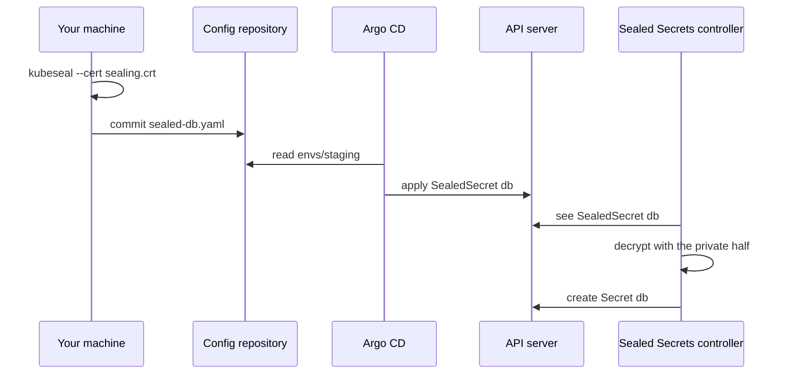

## Before you start

- [[devops.l3.secrets-and-gitops]] — you know staging's folder is to hold its Secrets encrypted, so that only a component inside the cluster can turn them back.
- [[backend.l2.validating-provider-tokens]] — you know a key pair has a public half you can hand out and a private half that must stay with its owner.
- [[devops.l3.one-state-per-environment]] — you know staging's platform layer runs after its cluster layer and keeps its own state.
- [[devops.l3.synced-versus-healthy]] — you know Argo CD applies the manifests of `envs/staging` and reports whether they are `Synced` and `Healthy`.

## The situation

At stage-3 staging takes everything from `envs/staging`, and the last lesson settled that its Secrets go there encrypted. You open `scripts/devops/seal-secrets.sh` expecting it to fetch a key from the cluster first, since encrypting for the cluster seems to need the cluster. For sealing it reads `.env` and, of the key pair, only `secrets/sealing.crt`. Then it commits files such as `sealed-db.yaml` and pushes them. Argo CD was never given a key, yet after the sync the database Pod reads `POSTGRES_PASSWORD` as before. Who can turn these files back into Secrets, and why can no one else?

## Core concepts

- **sealing key (Sealed Secrets)** — the key pair of the Sealed Secrets controller. A key pair also works for encryption: what the public half encrypts, only the private half can decrypt. A certificate is a file that carries the public half, here `secrets/sealing.crt`; the private half is `secrets/sealing.key`.
- `kubeseal` — the command-line tool that reads a Secret manifest on your machine and encrypts its values with the certificate.
- **SealedSecret** — an object holding a Secret's values encrypted for one name and namespace, with the name and namespace of the Secret to create; it is safe in Git because only the private half opens it.
- Sealed Secrets controller — a program running a control loop in a Pod in `kube-system`, the namespace Kubernetes keeps for its own system components; it uses the private half, watches for SealedSecrets and creates the Secret each one describes.

## How it works



Start on your machine. `seal-secrets.sh` builds the Secret `db` exactly as stage-2 did, as YAML that never leaves the machine. Instead of sending it to the API server, it pipes it into `kubeseal`, which encrypts each value with the certificate. In the situation above, the certificate is the public half of the sealing key, so the script needs no access to the cluster. What comes out is a SealedSecret: its values are ciphertext (the encrypted, unreadable form of a value), and its name and namespace stay readable.

The script commits that file to `envs/staging` and pushes it. Argo CD reads the folder and applies the SealedSecret `db` to the API server unchanged, as it applies a Deployment. Argo CD never decrypts anything, so it needs no key.

The controller then sees the new SealedSecret. Inside the cluster, only the controller uses the private half, which it reads from the Secret `sealing-key` in `kube-system`; Argo CD never gets it. It creates a Secret with the same name, `db`, in the same namespace. The database Pod still names `db` in its manifest and reads `POSTGRES_PASSWORD` as before; nothing on the reading side changed.

The encryption covers more than the values. By default, the name and namespace of the SealedSecret are part of what was encrypted. The same file placed in another namespace no longer matches, the controller cannot decrypt it, and no Secret appears.

## In the Đơn Hàng system

The part of `seal-secrets.sh` that seals staging's Secrets:

```bash file=scripts/devops/seal-secrets.sh tag=stage-3 lines=14-29
# lesson: devops.l3.sealed-secrets
# Build each Secret as before (scripts/k8s/secrets.sh), but instead of sending
# it to the cluster, encrypt it with the certificate: kubeseal --cert needs
# no connection to the cluster. The SealedSecret goes into the config
# repository; only the controller's private key can turn it back.
seal() {
  local name=$1
  shift
  kubectl create secret generic "$name" -n donhang "$@" --dry-run=client -o yaml \
    | kubeseal --cert secrets/sealing.crt --format yaml > "$config_repo/envs/staging/sealed-$name.yaml"
  echo "sealed $name into envs/staging/sealed-$name.yaml"
}
# Staging's database password: the one in .env, until
# scripts/devops/rotate-db-password.sh gives staging one of its own.
db_password=${STAGING_POSTGRES_PASSWORD:-$POSTGRES_PASSWORD}
seal db --from-literal=POSTGRES_PASSWORD="$db_password"
```

Line 22 is the same `kubectl create ... --dry-run=client -o yaml` that stage-2 piped into `kubectl apply`, which only prints the Secret as YAML on your machine and sends nothing to the cluster. Line 23 pipes it into `kubeseal --cert` instead and writes the result into the working clone of the config repository. Line 29 seals `db`; later lines seal the other services the same way. The output, shortened here (the script itself cuts the ciphertext short):

```text output=true
...
== envs/staging/sealed-db.yaml
---
apiVersion: bitnami.com/v1alpha1
kind: SealedSecret
metadata:
  name: db
  namespace: donhang
spec:
  encryptedData:
    POSTGRES_PASSWORD: ......
  template:
    metadata:
      name: db
      namespace: donhang
...
== the Secrets the controller made from them, read by the Pods as before
NAME            OWNER
api             SealedSecret
db              SealedSecret
...
```

The file in Git shows the name and namespace in clear, only ciphertext under `encryptedData`, and under `template` the name of the Secret to create. A Kubernetes object can record in its metadata which object it was made for; the controller writes the SealedSecret there. After the push and the sync, every Secret in `donhang` lists a SealedSecret as its owner: the controller made it, not Argo CD.

The name-and-namespace check from `scripts/devops/sealed-secrets-install.sh`:

```bash file=scripts/devops/sealed-secrets-install.sh tag=stage-3 lines=23-40
# lesson: devops.l3.sealed-secrets
# Seal a throwaway value for the name scope-demo in the namespace donhang,
# offline, with the certificate only. Applied there, it becomes a Secret.
# The same SealedSecret moved to another namespace decrypts to nothing: the
# name and namespace are part of what was encrypted.
kubectl create secret generic scope-demo -n donhang --from-literal=word=not-a-real-secret \
  --dry-run=client -o yaml | kubeseal --cert secrets/sealing.crt --format yaml > "${TMPDIR:-/tmp}/scope-demo.yaml"
kubectl create namespace sealing-demo --dry-run=client -o yaml | kubectl apply -f - >/dev/null
echo "== sealed for donhang, applied in donhang"
kubectl apply -f "${TMPDIR:-/tmp}/scope-demo.yaml" -o name
echo "== the same SealedSecret, applied in sealing-demo"
sed 's/namespace: donhang/namespace: sealing-demo/' "${TMPDIR:-/tmp}/scope-demo.yaml" | kubectl apply -f - -o name
sleep 5
echo
echo "== Secrets named scope-demo the controller made"
kubectl get secrets -A --field-selector metadata.name=scope-demo -o custom-columns=NAMESPACE:.metadata.namespace,NAME:.metadata.name
echo "== why sealing-demo has none"
kubectl get sealedsecret scope-demo -n sealing-demo -o jsonpath='{.status.conditions[0].message}{"\n"}'
```

```text output=true
...
== the sealing keys in kube-system: only the one from secrets/
NAME          STATE
sealing-key   active

== sealed for donhang, applied in donhang
sealedsecret.bitnami.com/scope-demo
== the same SealedSecret, applied in sealing-demo
sealedsecret.bitnami.com/scope-demo

== Secrets named scope-demo the controller made
NAMESPACE   NAME
donhang     scope-demo
== why sealing-demo has none
no key could decrypt secret (word)
```

Line 34 changes only the namespace with `sed`, and the API server accepts both objects. Line 38 lists every Secret named `scope-demo` in any namespace; line 40 prints the status message of the copy in `sealing-demo`. Only `donhang` gets a Secret; the copy reports that no key could decrypt it.

The first lines of that output come from earlier in the script: `kube-system` holds one sealing key, `sealing-key`. `scripts/dev-secrets.sh`, outside the excerpts, creates the pair in the gitignored `secrets/`. The platform layer in `deploy/tofu/modules/donhang-platform/main.tf` installs both halves as the Secret `sealing-key` in `kube-system`, with the label that tells the controller to use it, so the platform layer's encrypted state holds a copy too.

The controller would add a new key of its own from time to time; Đơn Hàng starts it with `--key-renew-period=0`, so this key stays the only one. Whoever holds `secrets/sealing.key` can open every SealedSecret in the config repository.

## Seniors often assume…

- **"Argo CD needs the private key to deploy a SealedSecret."** → Actually Argo CD applies the SealedSecret to the API server unchanged, like any other manifest; the controller, which reads the private half from `kube-system`, creates the Secret afterwards. You notice this in the output of `seal-secrets.sh`: each Secret in `donhang` has a SealedSecret as its owner, and the only sealing key sits in `kube-system`, not with Argo CD.
- **"Sealing a value requires kubectl access to the cluster."** → Actually `kubeseal --cert` encrypts with the certificate, the public half, read from a file. Anyone holding the certificate can seal, which is safe, because sealing gives no way to decrypt. You notice this when the command in "Try it" prints a SealedSecret although nothing in it names a cluster.
- **"A SealedSecret can be copied into another namespace like any other manifest."** → Actually by default its name and namespace are part of what was encrypted, so a copy under another namespace or name cannot be decrypted, and no Secret appears. To use the value elsewhere, seal it again for that name and namespace. You notice this when the copy is accepted by the API server, yet its status reads `no key could decrypt secret`.

## Try it (3 minutes)

In the `don-hang` repository folder, with `kubeseal` 0.40 installed as `STAGE.md` lists for the host scripts, after `scripts/dev-secrets.sh` has created `secrets/sealing.crt`:

1. Run `kubectl create secret generic try-it -n donhang --from-literal=word=hello --dry-run=client -o yaml | kubeseal --cert secrets/sealing.crt --format yaml`.
2. Run the same command a second time and compare the line under `encryptedData`.

Expected result: each run prints a SealedSecret named `try-it` in `donhang` whose `word` is a long string of ciphertext instead of `hello`, and the two strings differ, although the value and the certificate are the same. Nothing was written to Git or sent to a cluster. Because every seal gives a new ciphertext, no one can seal guessed passwords and compare them with the file in Git.

## Connections

- [[devops.l3.secrets-and-gitops]] — the problem this lesson solves: staging's Secrets had no file in the config repository.
- [[k8s.l1.secrets]] — the object the controller creates is the same Secret, still only base64 inside the cluster.
- [[devops.l3.argo-cd-applications]] — the Application that applies `envs/staging` treats a SealedSecret like any other manifest there.
- [[devops.l3.secret-rotation]] — next: changing a sealed value means sealing it again and committing the new file.
- [[devops.l3.disaster-recovery-drill]] — where losing the private half is put to the test: without it, no SealedSecret in Git opens.

## Five-line summary

1. A SealedSecret is safe in Git because only the controller's private half of the sealing key can decrypt it.
2. `seal-secrets.sh` builds each Secret as YAML and encrypts it with `kubeseal --cert`, using only the certificate, never the cluster.
3. Argo CD applies the SealedSecret like any manifest; the controller decrypts it and creates the Secret of the same name.
4. By default the name and namespace are sealed in, so a copy in another namespace produces no Secret.
5. Đơn Hàng keeps one sealing key, made in `secrets/` and installed by OpenTofu, with key renewal off.
