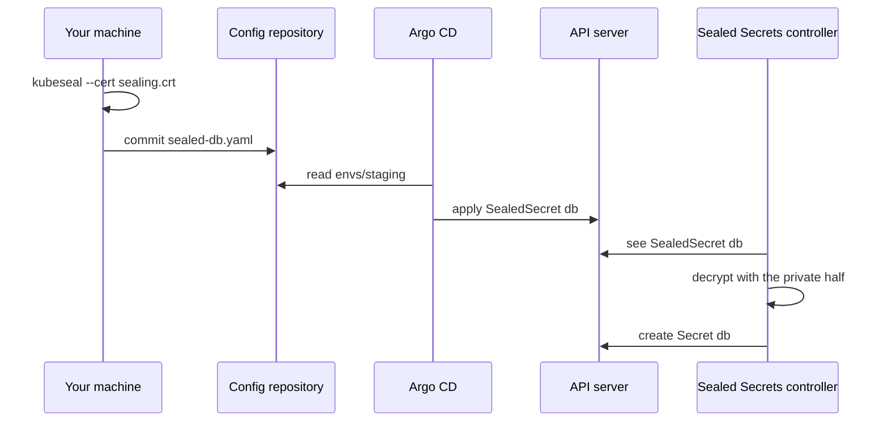

## Bạn cần biết trước

- [[devops.l3.secrets-and-gitops]] — bạn biết thư mục của staging sẽ giữ các Secret ở dạng mã hóa, để chỉ một thành phần trong cluster biến được chúng trở lại.
- [[backend.l2.validating-provider-tokens]] — bạn biết một cặp khóa có nửa công khai, đưa cho ai cũng được, và nửa bí mật, phải ở lại với chủ của nó.
- [[devops.l3.one-state-per-environment]] — bạn biết tầng platform của staging chạy sau tầng cluster và giữ state riêng.
- [[devops.l3.synced-versus-healthy]] — bạn biết Argo CD apply các manifest của `envs/staging` và báo chúng có `Synced` và `Healthy` hay không.

## Tình huống

Ở stage-3, staging lấy mọi thứ từ `envs/staging`, và bài trước đã chốt rằng các Secret của nó vào đó ở dạng mã hóa. Bạn mở `scripts/devops/seal-secrets.sh`, chờ thấy nó lấy khóa từ cluster trước, vì mã hóa cho cluster thì có vẻ phải cần tới cluster. Để niêm phong, script chỉ đọc `.env` và, trong cặp khóa, chỉ đọc `secrets/sealing.crt`. Sau đó nó commit các file như `sealed-db.yaml` rồi push. Argo CD chưa bao giờ được giao khóa nào, vậy mà sau lần sync, Pod database vẫn đọc `POSTGRES_PASSWORD` như trước. Ai biến được các file này trở lại thành Secret, và vì sao không ai khác làm được?

## Khái niệm cốt lõi

- **sealing key (Sealed Secrets)** (cặp khóa của controller Sealed Secrets: nửa công khai để mã hóa, nửa bí mật giải mã mọi SealedSecret) — cặp khóa của controller Sealed Secrets. Cặp khóa cũng dùng được để mã hóa: thứ nửa công khai mã hóa thì chỉ nửa bí mật giải mã được. Certificate là file mang nửa công khai, ở đây là `secrets/sealing.crt`, còn nửa bí mật là `secrets/sealing.key`.
- `kubeseal` — công cụ dòng lệnh đọc một manifest Secret trên máy bạn và mã hóa các giá trị của nó bằng certificate.
- **SealedSecret** (object chứa một Secret đã mã hóa bằng public key của controller Sealed Secrets, chỉ controller trong cluster giải mã được) — object giữ các giá trị của một Secret, mã hóa cho đúng một tên và một namespace, kèm tên và namespace của Secret cần tạo. Nó an toàn trong Git vì chỉ nửa bí mật mở được nó.
- Controller Sealed Secrets — chương trình chạy một vòng điều khiển trong một Pod ở `kube-system`, namespace Kubernetes dành cho các thành phần hệ thống của chính nó. Controller dùng nửa bí mật, theo dõi các SealedSecret và tạo Secret mà mỗi SealedSecret mô tả.

## Cơ chế hoạt động



Bắt đầu từ máy bạn. `seal-secrets.sh` dựng Secret `db` y như stage-2, thành YAML không bao giờ rời khỏi máy. Thay vì gửi tới API server, script chuyển nó qua pipe vào `kubeseal`, công cụ mã hóa từng giá trị bằng certificate. Trong tình huống trên, certificate là nửa công khai của sealing key, nên script không cần truy cập cluster. Kết quả là một SealedSecret: các giá trị là ciphertext (dạng đã mã hóa, không đọc được, của một giá trị), còn tên và namespace vẫn đọc được.

Script commit file đó vào `envs/staging` rồi push. Argo CD đọc thư mục và apply nguyên SealedSecret `db` lên API server, như khi apply một Deployment. Argo CD không giải mã gì cả, nên không cần khóa nào.

Sau đó controller thấy SealedSecret mới. Trong cluster, chỉ controller dùng nửa bí mật, đọc từ Secret `sealing-key` trong `kube-system`, còn Argo CD không bao giờ có nó. Controller tạo một Secret cùng tên `db`, trong cùng namespace. Manifest của Pod database vẫn gọi tên `db` và đọc `POSTGRES_PASSWORD` như trước. Phía đọc không thay đổi gì.

Phần được mã hóa không chỉ là các giá trị. Mặc định, tên và namespace của SealedSecret cũng nằm trong thứ được mã hóa. Cùng file đó đặt vào namespace khác sẽ không còn khớp, controller không giải mã được, và không Secret nào xuất hiện.

## Trong hệ thống Đơn Hàng

Phần của `seal-secrets.sh` niêm phong các Secret của staging:

```bash file=scripts/devops/seal-secrets.sh tag=stage-3 lines=14-29
# lesson: devops.l3.sealed-secrets
# Build each Secret as before (scripts/k8s/secrets.sh), but instead of sending
# it to the cluster, encrypt it with the certificate: kubeseal --cert needs
# no connection to the cluster. The SealedSecret goes into the config
# repository; only the controller's private key can turn it back.
seal() {
  local name=$1
  shift
  kubectl create secret generic "$name" -n donhang "$@" --dry-run=client -o yaml \
    | kubeseal --cert secrets/sealing.crt --format yaml > "$config_repo/envs/staging/sealed-$name.yaml"
  echo "sealed $name into envs/staging/sealed-$name.yaml"
}
# Staging's database password: the one in .env, until
# scripts/devops/rotate-db-password.sh gives staging one of its own.
db_password=${STAGING_POSTGRES_PASSWORD:-$POSTGRES_PASSWORD}
seal db --from-literal=POSTGRES_PASSWORD="$db_password"
```

Dòng 22 chính là lệnh `kubectl create ... --dry-run=client -o yaml` mà stage-2 chuyển qua pipe vào `kubectl apply`. Lệnh này chỉ in Secret ra dạng YAML trên máy bạn, không gửi gì tới cluster. Dòng 23 thay vào đó chuyển nó vào `kubeseal --cert` và ghi kết quả vào bản clone đang làm việc của repo cấu hình. Dòng 29 niêm phong `db`, các dòng sau niêm phong những service khác theo cùng cách. Đầu ra, đã rút gọn ở đây (chính script cũng cắt ngắn ciphertext):

```text output=true
...
== envs/staging/sealed-db.yaml
---
apiVersion: bitnami.com/v1alpha1
kind: SealedSecret
metadata:
  name: db
  namespace: donhang
spec:
  encryptedData:
    POSTGRES_PASSWORD: ......
  template:
    metadata:
      name: db
      namespace: donhang
...
== the Secrets the controller made from them, read by the Pods as before
NAME            OWNER
api             SealedSecret
db              SealedSecret
...
```

File trong Git cho thấy tên và namespace ở dạng rõ, dưới `encryptedData` chỉ có ciphertext, và dưới `template` là tên của Secret cần tạo. Một object Kubernetes có thể ghi trong metadata của nó rằng nó được tạo cho object nào, và controller ghi SealedSecret vào đó. Sau khi push và sync, mọi Secret trong `donhang` đều liệt kê một SealedSecret làm owner: controller tạo ra chúng, không phải Argo CD.

Phần kiểm tra tên và namespace trong `scripts/devops/sealed-secrets-install.sh`:

```bash file=scripts/devops/sealed-secrets-install.sh tag=stage-3 lines=23-40
# lesson: devops.l3.sealed-secrets
# Seal a throwaway value for the name scope-demo in the namespace donhang,
# offline, with the certificate only. Applied there, it becomes a Secret.
# The same SealedSecret moved to another namespace decrypts to nothing: the
# name and namespace are part of what was encrypted.
kubectl create secret generic scope-demo -n donhang --from-literal=word=not-a-real-secret \
  --dry-run=client -o yaml | kubeseal --cert secrets/sealing.crt --format yaml > "${TMPDIR:-/tmp}/scope-demo.yaml"
kubectl create namespace sealing-demo --dry-run=client -o yaml | kubectl apply -f - >/dev/null
echo "== sealed for donhang, applied in donhang"
kubectl apply -f "${TMPDIR:-/tmp}/scope-demo.yaml" -o name
echo "== the same SealedSecret, applied in sealing-demo"
sed 's/namespace: donhang/namespace: sealing-demo/' "${TMPDIR:-/tmp}/scope-demo.yaml" | kubectl apply -f - -o name
sleep 5
echo
echo "== Secrets named scope-demo the controller made"
kubectl get secrets -A --field-selector metadata.name=scope-demo -o custom-columns=NAMESPACE:.metadata.namespace,NAME:.metadata.name
echo "== why sealing-demo has none"
kubectl get sealedsecret scope-demo -n sealing-demo -o jsonpath='{.status.conditions[0].message}{"\n"}'
```

```text output=true
...
== the sealing keys in kube-system: only the one from secrets/
NAME          STATE
sealing-key   active

== sealed for donhang, applied in donhang
sealedsecret.bitnami.com/scope-demo
== the same SealedSecret, applied in sealing-demo
sealedsecret.bitnami.com/scope-demo

== Secrets named scope-demo the controller made
NAMESPACE   NAME
donhang     scope-demo
== why sealing-demo has none
no key could decrypt secret (word)
```

Dòng 34 dùng `sed` chỉ đổi namespace, và API server nhận cả hai object. Dòng 38 liệt kê mọi Secret tên `scope-demo` ở bất kỳ namespace nào, dòng 40 in thông báo trạng thái của bản sao trong `sealing-demo`. Chỉ `donhang` có Secret, còn bản sao báo rằng không khóa nào giải mã được nó.

Mấy dòng đầu của đầu ra đến từ phần trước trong script: `kube-system` giữ một sealing key duy nhất, `sealing-key`. `scripts/dev-secrets.sh`, nằm ngoài đoạn trích, tạo cặp khóa trong thư mục `secrets/` đã gitignore. Tầng platform trong `deploy/tofu/modules/donhang-platform/main.tf` cài cả hai nửa thành Secret `sealing-key` trong `kube-system`, kèm label báo cho controller dùng nó, nên state đã mã hóa của tầng platform cũng giữ một bản sao.

Controller vốn sẽ thỉnh thoảng tự thêm một khóa mới. Đơn Hàng khởi động nó với `--key-renew-period=0`, nên khóa này vẫn là khóa duy nhất. Ai giữ `secrets/sealing.key` là mở được mọi SealedSecret trong repo cấu hình.

## Senior hay nhầm rằng…

- **"Argo CD cần private key để deploy một SealedSecret."** → Thực ra Argo CD apply nguyên SealedSecret lên API server, như mọi manifest khác. Controller, thứ đọc nửa bí mật từ `kube-system`, tạo Secret sau đó. Bạn sẽ nhận ra trong đầu ra của `seal-secrets.sh`: mỗi Secret trong `donhang` có một SealedSecret làm owner, và sealing key duy nhất nằm trong `kube-system`, không nằm ở Argo CD.
- **"Muốn niêm phong một giá trị thì phải có quyền kubectl vào cluster."** → Thực ra `kubeseal --cert` mã hóa bằng certificate, tức nửa công khai, đọc từ một file. Ai giữ certificate cũng niêm phong được, và điều đó an toàn, vì niêm phong không cho cách nào để giải mã. Bạn sẽ nhận ra khi lệnh trong "Thử ngay" in ra một SealedSecret dù không chỗ nào trong lệnh nhắc tới cluster.
- **"Chép một SealedSecret sang namespace khác được như mọi manifest khác."** → Thực ra mặc định tên và namespace của nó nằm trong phần được mã hóa, nên bản sao dưới namespace hay tên khác không giải mã được, và không Secret nào xuất hiện. Muốn dùng giá trị ở chỗ khác, hãy niêm phong lại cho đúng tên và namespace đó. Bạn sẽ nhận ra khi API server nhận bản sao, nhưng trạng thái của nó ghi `no key could decrypt secret`.

## Thử ngay (3 phút)

Trong thư mục repository `don-hang`, khi đã cài `kubeseal` 0.40 như `STAGE.md` liệt kê cho các script chạy trên máy host, và `scripts/dev-secrets.sh` đã tạo `secrets/sealing.crt`:

1. Chạy `kubectl create secret generic try-it -n donhang --from-literal=word=hello --dry-run=client -o yaml | kubeseal --cert secrets/sealing.crt --format yaml`.
2. Chạy lại đúng lệnh đó lần thứ hai và so dòng dưới `encryptedData`.

Kết quả mong đợi: mỗi lần chạy in ra một SealedSecret tên `try-it` trong `donhang`, với `word` là một chuỗi ciphertext dài thay cho `hello`, và hai chuỗi khác nhau dù giá trị và certificate giống nhau. Không có gì được ghi vào Git hay gửi tới cluster. Vì mỗi lần niêm phong cho ra ciphertext mới, không ai niêm phong được các mật khẩu đoán thử rồi đem so với file trong Git.

## Liên hệ

- [[devops.l3.secrets-and-gitops]] — vấn đề bài này giải quyết: các Secret của staging chưa có file nào trong repo cấu hình.
- [[k8s.l1.secrets]] — object controller tạo ra vẫn là Secret đó, bên trong cluster vẫn chỉ là base64.
- [[devops.l3.argo-cd-applications]] — Application apply `envs/staging` đối xử với SealedSecret như mọi manifest khác ở đó.
- [[devops.l3.secret-rotation]] — bài kế: đổi một giá trị đã niêm phong nghĩa là niêm phong lại và commit file mới.
- [[devops.l3.disaster-recovery-drill]] — nơi đem ra thử chuyện mất nửa bí mật: không có nó, không SealedSecret nào trong Git mở được.

## Tóm tắt 5 dòng

1. SealedSecret an toàn trong Git vì chỉ nửa bí mật của sealing key, nằm ở controller, giải mã được nó.
2. `seal-secrets.sh` dựng từng Secret thành YAML rồi mã hóa bằng `kubeseal --cert`, chỉ dùng certificate, không bao giờ dùng cluster.
3. Argo CD apply SealedSecret như mọi manifest, controller giải mã nó và tạo Secret cùng tên.
4. Mặc định tên và namespace bị niêm phong vào, nên bản sao ở namespace khác không tạo ra Secret nào.
5. Đơn Hàng giữ một sealing key duy nhất, tạo trong `secrets/` và cài bằng OpenTofu, với tính năng tự thay khóa bị tắt.
