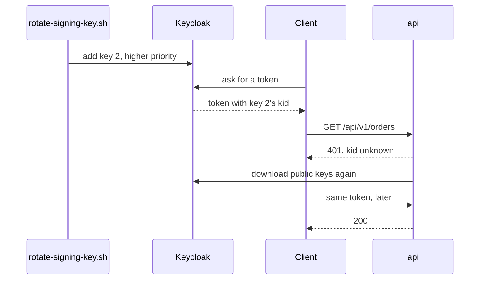

## Before you start

- [[devops.l3.sealed-secrets]] — you know staging's Secrets live in Git as SealedSecrets, so a new value means sealing again and committing.
- [[backend.l2.validating-provider-tokens]] — you know the api checks Keycloak's tokens with public keys it downloaded and keeps in memory.
- [[backend.l2.refresh-tokens]] — you know an access token from the Đơn Hàng realm lasts 300 seconds and cannot be recalled.
- [[devops.l3.deploying-by-commit]] — you know a commit to `envs/staging` is applied by Argo CD without any command.

## The situation

A copy of staging's `.env`, the file holding staging's passwords before they are sealed, turns up in a shared chat, so staging's database password has to change. The same week, Keycloak's token signing key is due for its planned change. The quick plan: swap the signing key, restart the api, and put a new `POSTGRES_PASSWORD` into the db Secret. But customers hold tokens signed by the current key, and the api's Pods hold open connections to PostgreSQL. How do you replace a value that running parts of Đơn Hàng depend on without breaking them at the moment of the switch?

## Core concepts

- **secret rotation** — replacing a secret's value on a schedule or after a suspected leak, so that any copy someone kept stops working.
- Realm — the space in Keycloak that holds one system's users and signing keys; Đơn Hàng's is `donhang`.
- Key priority in Keycloak — a realm can hold several signing keys at once; Keycloak signs new tokens with the key of the highest priority and keeps publishing the public half of the others.
- `kid` — the key id in a token's header, naming the key that signed it, so that whoever checks the token knows which public key to use.
- Key refresh in the api — `AddJwtBearer` keeps the keys it downloaded. When a token names a `kid` it does not have, it downloads them again in the background, at most once per refresh interval. It also downloads them after every start and on a longer schedule of its own (`AutomaticRefreshInterval`).
- Pod template annotation — a free-form key and value in the metadata of a Deployment's Pod template; changing it changes the template, so the Deployment replaces its Pods.

## How it works



A rotation is safe when there is a stretch of time in which the old value and the new value both work. Each user of the secret then moves over at its own pace, and nothing has to switch at the same instant.

In the situation above, the signing key allows that overlap. The script adds a second key with a higher priority. From then on Keycloak signs every new token with it and writes its `kid` into the token's header. The old key stays in the realm, no longer signing, so a token it signed a minute earlier still passes.

The api has never seen the new `kid`. It answers `401` and asks Keycloak for the keys again, in the background. If the api was asked for a download shortly before, this one waits until the refresh interval has passed, and new tokens get `401` meanwhile. The rotation needs no restart, only that wait. Once the download is done, the same token gets `200`.

The old key goes last: only after every token it signed has expired. Even after you remove it from Keycloak, the api keeps accepting it until its next download of the keys.

The database password allows no such overlap, because a PostgreSQL role, the database account the api logs in as, has one password at a time. There the order of the steps decides what can fail, as the second script shows.

## In the Đơn Hàng system

The part of `scripts/devops/rotate-signing-key.sh` that adds the key and waits for the api:

```bash file=scripts/devops/rotate-signing-key.sh tag=stage-3 lines=46-70
# lesson: devops.l3.secret-rotation
# A second RS256 key, with a priority above every key the realm has: from
# now on Keycloak signs new tokens with it. The old key stays in the realm,
# no longer signing, so tokens it already signed still check out.
priority=$(kcadm get components -r donhang -q providerId=rsa-generated --fields 'config(priority)' --format csv --noquotes \
  | tr -d '[]"' | sort -n | tail -n 1)
realm_id=$(kcadm get realms/donhang --fields id --format csv --noquotes)
kcadm create components -r donhang -s name="rotated-$(date +%s)" -s providerId=rsa-generated \
  -s providerType=org.keycloak.keys.KeyProvider -s parentId="$realm_id" \
  -s "config.priority=[\"$(( priority + 10 ))\"]" -s 'config.algorithm=["RS256"]' >/dev/null 2>&1
echo "== after adding a key with priority $(( priority + 10 ))"

new_token=$(keycloak_access_token anh.tran@example.com)
echo "  a new token's kid is the new key's: $([ "$(kid_of "$new_token")" = "$(active_kid)" ] && echo yes || echo no)"
echo "  and differs from the old token's: $([ "$(kid_of "$new_token")" != "$(kid_of "$old_token")" ] && echo yes || echo no)"
# lesson: devops.l3.secret-rotation
# The api has never seen the new kid. It fetches Keycloak's keys again by
# itself, without a restart, but in the background and at most once every
# 5 minutes (JwtBearer's RefreshInterval): until then it answers 401 to
# tokens from the new key. Ask again every 5 s, for up to 6 minutes.
waited=0
until [ "$(api_status "$new_token")" = "200" ] || [ "$waited" -ge 360 ]; do
  sleep 5
  waited=$(( waited + 5 ))
done
```

```text output=true
== before: a token from the active key
  token's kid is the active RS256 key: yes
  GET /api/v1/orders with it -> 200
== after adding a key with priority ...
  a new token's kid is the new key's: yes
  and differs from the old token's: yes
  GET /api/v1/orders with the new token -> 200 (after ... s)
  GET /api/v1/orders with the old token -> 200
the old key can go once every token it signed has expired: 300 s after this rotation
```

`kcadm` is Keycloak's admin command line, driven inside the `keycloak` container of the Compose system on your machine; the api it checks is the Compose api at `localhost:8080`. The excerpt starts at line 46. Lines 50–51 find the highest priority among the realm's signing keys, and lines 53–55 add a new one ten above it. Lines 58–60 show that a fresh token names the new key; the helpers they call and `old_token` come from earlier lines. Lines 66–70 retry until the api accepts it; the wait varies, so the capture masks it.

In the output, both tokens get `200` at the end, which is the overlap. The last line reads the realm's access token lifespan, 300 seconds.

The database half, from `scripts/devops/rotate-db-password.sh`:

```bash file=scripts/devops/rotate-db-password.sh tag=stage-3 lines=26-50
# lesson: devops.l3.secret-rotation
# A role has one password at a time. Change it in the database first: the
# sessions already open stay open, a new connection needs the new password.
echo "== ALTER ROLE donhang"
printf "ALTER ROLE donhang PASSWORD '%s';\n" "$new" | kubectl exec -i -n donhang deployment/db -- psql -U donhang -d donhang -q
wait "$session"
if psql_with "$old" -c 'select 1' >/dev/null 2>&1; then
  echo "new connection, old password: connected"
else
  echo "new connection, old password: refused"
fi
echo "new connection, new password: $(psql_with "$new" -c "select 'connected'")"
echo

# lesson: devops.l3.secret-rotation
# Then give the cluster the new value: staging's own password in .env,
# resealed into db and api, and one more number in the api's Pod template so
# that the api's Pods are replaced and read the new Secret. One commit.
if grep -q '^STAGING_POSTGRES_PASSWORD=' .env; then
  NEW="$new" perl -pi -e 's/^STAGING_POSTGRES_PASSWORD=.*/STAGING_POSTGRES_PASSWORD=$ENV{NEW}/' .env
else
  echo "STAGING_POSTGRES_PASSWORD=$new" >> .env
fi
STAGING_POSTGRES_PASSWORD=$new scripts/devops/seal-secrets.sh --no-commit
perl -pi -e 's/(donhang\/db-password-version: ")(\d+)"/$1 . ($2 + 1) . "\""/e' "$config_repo/envs/staging/api.yaml"
```

```text output=true
== ALTER ROLE donhang
session opened before the change
the same session, after the change: still working
new connection, old password: refused
new connection, new password: connected
...
-        donhang/db-password-version: "1"
+        donhang/db-password-version: "2"
...
api Pods replaced: yes
...
```

The excerpt starts at line 26. Line 30 changes the password inside PostgreSQL. A connection opened with the old password before the change, outside the excerpt, keeps running; a new connection with the old password is refused. Line 49 reseals `db` and `api` with the new value; the script reads the current password from `db`'s Secret at its start (line 15). Line 50 raises the annotation `donhang/db-password-version` in the Pod template of `envs/staging/api.yaml`, and the next lines commit everything as one commit. The api reads its Secret as environment variables, copied in only when its container starts, so only replaced Pods get the new password.

The order matters. If the new Pods started before `ALTER ROLE`, every connection they open would be refused. In this order, only new connections the old Pods open after `ALTER ROLE`, until the rollout has replaced them, are refused.

## Seniors often assume…

- **"Rotating a signing key means swapping it in one step and restarting everything that checks tokens."** → Actually Keycloak can hold the old and the new key at once, and the api downloads the new public key by itself after a short wait, without a restart. A one-step swap rejects every access token signed before it, although each had minutes left. You notice this when clients that were working all get `401` together right after such a swap.
- **"A new `POSTGRES_PASSWORD` in the db Secret changes the password inside the database."** → Actually the PostgreSQL image reads that variable only when it creates a new, empty data directory (the folder where PostgreSQL keeps the database's files); an existing database keeps its role's password until `ALTER ROLE` changes it. You notice this when the api, restarted with the new value alone, is refused while the old password still connects.
- **"Running Pods pick up a changed Secret by themselves."** → Actually a Secret read as environment variables is copied into the container when it starts, and later changes to the Secret do not reach it. Only a container that starts again, which in practice here means the new Pods of a rollout, sees the new value, which is why the same commit changes the annotation. You notice this when `printenv` inside an old api Pod still shows the old connection string after Argo CD has synced the new SealedSecret.

## Try it (3 minutes)

With the example system running (`scripts/up.sh`):

1. Open `localhost:8180/realms/donhang/protocol/openid-connect/certs`, the page where Keycloak publishes the realm's public keys, and note the `kid` of each key with `"alg": "RS256"`, the signing algorithm the script gives its new key.
2. Run `scripts/devops/rotate-signing-key.sh`. As soon as it prints `== after adding a key`, reload the page. You can stop the script there.

Expected result: after the reload a new RS256 `kid` appears, and on a first run every `kid` you noted is still there. Nothing removes the old keys by themselves: only a later run of the script, more than 300 seconds after this one, deletes them first, outside the excerpt.

## Connections

- [[devops.l1.the-jwt-secret-in-practice]] — the opposite case: with stage-1's single shared key, a new key rejected every old token at once.
- [[backend.l2.validating-provider-tokens]] — the reason for the wait: the api keeps Keycloak's public keys in memory and downloads them again only now and then.
- [[backend.l2.refresh-tokens]] — the short access token lifespan there is what bounds how long the old key must stay.
- [[k8s.l1.rolling-updates]] — the mechanism that replaces the api's Pods once the annotation changes the Pod template.
- [[devops.l3.sealed-secrets]] — prerequisite: the new password reaches the cluster only by sealing it again and committing.

## Five-line summary

1. Rotating a secret safely needs a stretch of time in which both the old and the new value work.
2. Keycloak signs new tokens with a higher-priority key while the old key's public half still checks earlier tokens.
3. The api downloads the new key by itself, at most once per refresh interval, so new tokens may get `401` for a few minutes.
4. A PostgreSQL role has one password: `ALTER ROLE` first, open connections continue, and new Pods bring the new value.
5. Pods read Secrets as environment variables only at start, so the resealing commit also changes a Pod template annotation.
