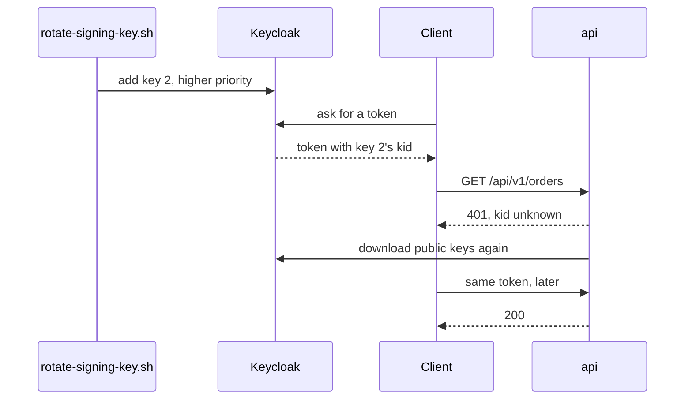

## Bạn cần biết trước

- [[devops.l3.sealed-secrets]] — bạn biết các Secret của staging nằm trong Git dưới dạng SealedSecret, nên đổi giá trị nghĩa là niêm phong lại rồi commit.
- [[backend.l2.validating-provider-tokens]] — bạn biết api kiểm tra token của Keycloak bằng các public key nó đã tải về và giữ trong bộ nhớ.
- [[backend.l2.refresh-tokens]] — bạn biết access token từ realm của Đơn Hàng sống 300 giây và không thu hồi được.
- [[devops.l3.deploying-by-commit]] — bạn biết một commit vào `envs/staging` được Argo CD apply mà không cần chạy lệnh nào.

## Tình huống

Một bản sao file `.env` của staging, file giữ mật khẩu của staging trước khi niêm phong, bị dán vào một nhóm chat chung, nên mật khẩu database của staging phải đổi. Cùng tuần đó, khóa ký token của Keycloak cũng tới hạn thay theo kế hoạch. Kế hoạch nhanh: đổi khóa ký, khởi động lại api, rồi đặt `POSTGRES_PASSWORD` mới vào Secret `db`. Nhưng khách hàng đang cầm token ký bằng khóa hiện tại, và các Pod của api đang giữ kết nối mở tới PostgreSQL. Làm sao thay một giá trị mà các phần đang chạy của Đơn Hàng phụ thuộc vào, mà không làm chúng gãy đúng lúc chuyển?

## Khái niệm cốt lõi

- **xoay vòng secret** (secret rotation) — thay giá trị của một secret theo lịch hoặc sau khi nghi bị lộ, để bản sao nào ai đó còn giữ cũng không dùng được nữa.
- Realm — không gian trong Keycloak chứa người dùng và khóa ký của một hệ thống. Realm của Đơn Hàng là `donhang`.
- Độ ưu tiên khóa trong Keycloak — một realm giữ được nhiều khóa ký cùng lúc. Keycloak ký token mới bằng khóa có độ ưu tiên cao nhất, và vẫn tiếp tục công bố nửa công khai của các khóa còn lại.
- `kid` — mã khóa trong header của token, chỉ ra khóa nào đã ký nó, để bên kiểm tra token biết phải dùng public key nào.
- Làm mới khóa trong api — `AddJwtBearer` giữ các khóa đã tải về. Khi token nêu một `kid` nó chưa có, nó tải lại các khóa ở chế độ nền, nhiều nhất một lần mỗi khoảng làm mới (refresh interval). Nó cũng tải sau mỗi lần khởi động và theo một lịch dài hơn của riêng nó (`AutomaticRefreshInterval`).
- Annotation trên Pod template — một cặp khóa và giá trị tùy ý trong metadata của Pod template thuộc một Deployment. Đổi nó là đổi template, nên Deployment thay các Pod của mình.

## Cơ chế hoạt động



Xoay vòng an toàn khi có một khoảng thời gian mà cả giá trị cũ lẫn giá trị mới đều dùng được. Khi đó mỗi bên dùng secret tự chuyển sang theo nhịp của mình, và không có gì phải đổi cùng một khoảnh khắc.

Trong tình huống trên, khóa ký cho phép khoảng chồng lấn đó. Script thêm một khóa thứ hai với độ ưu tiên cao hơn. Từ lúc đó Keycloak ký mọi token mới bằng khóa này và ghi `kid` của nó vào header của token. Khóa cũ vẫn ở trong realm, không ký nữa, nên token nó ký một phút trước vẫn qua được.

Api chưa từng thấy `kid` mới. Nó trả `401` và hỏi lại Keycloak các khóa, ở chế độ nền. Nếu api vừa được yêu cầu tải ngay trước đó, lần tải này phải chờ hết khoảng làm mới, và trong lúc chờ, token mới nhận `401`. Lần xoay vòng không cần khởi động lại, chỉ cần chờ chừng đó. Tải xong, cùng token đó nhận `200`.

Khóa cũ bỏ đi sau cùng: chỉ khi mọi token nó ký đã hết hạn. Kể cả khi bạn đã xóa nó khỏi Keycloak, api vẫn chấp nhận nó cho tới lần tải khóa kế tiếp.

Mật khẩu database thì không có khoảng chồng lấn như vậy, vì một role PostgreSQL, tài khoản database mà api đăng nhập, chỉ có một mật khẩu tại một thời điểm. Ở đây thứ tự các bước quyết định cái gì có thể hỏng, như script thứ hai cho thấy.

## Trong hệ thống Đơn Hàng

Phần của `scripts/devops/rotate-signing-key.sh` thêm khóa và chờ api:

```bash file=scripts/devops/rotate-signing-key.sh tag=stage-3 lines=46-70
# lesson: devops.l3.secret-rotation
# A second RS256 key, with a priority above every key the realm has: from
# now on Keycloak signs new tokens with it. The old key stays in the realm,
# no longer signing, so tokens it already signed still check out.
priority=$(kcadm get components -r donhang -q providerId=rsa-generated --fields 'config(priority)' --format csv --noquotes \
  | tr -d '[]"' | sort -n | tail -n 1)
realm_id=$(kcadm get realms/donhang --fields id --format csv --noquotes)
kcadm create components -r donhang -s name="rotated-$(date +%s)" -s providerId=rsa-generated \
  -s providerType=org.keycloak.keys.KeyProvider -s parentId="$realm_id" \
  -s "config.priority=[\"$(( priority + 10 ))\"]" -s 'config.algorithm=["RS256"]' >/dev/null 2>&1
echo "== after adding a key with priority $(( priority + 10 ))"

new_token=$(keycloak_access_token anh.tran@example.com)
echo "  a new token's kid is the new key's: $([ "$(kid_of "$new_token")" = "$(active_kid)" ] && echo yes || echo no)"
echo "  and differs from the old token's: $([ "$(kid_of "$new_token")" != "$(kid_of "$old_token")" ] && echo yes || echo no)"
# lesson: devops.l3.secret-rotation
# The api has never seen the new kid. It fetches Keycloak's keys again by
# itself, without a restart, but in the background and at most once every
# 5 minutes (JwtBearer's RefreshInterval): until then it answers 401 to
# tokens from the new key. Ask again every 5 s, for up to 6 minutes.
waited=0
until [ "$(api_status "$new_token")" = "200" ] || [ "$waited" -ge 360 ]; do
  sleep 5
  waited=$(( waited + 5 ))
done
```

```text output=true
== before: a token from the active key
  token's kid is the active RS256 key: yes
  GET /api/v1/orders with it -> 200
== after adding a key with priority ...
  a new token's kid is the new key's: yes
  and differs from the old token's: yes
  GET /api/v1/orders with the new token -> 200 (after ... s)
  GET /api/v1/orders with the old token -> 200
the old key can go once every token it signed has expired: 300 s after this rotation
```

`kcadm` là công cụ dòng lệnh quản trị của Keycloak, chạy bên trong container `keycloak` của hệ thống Compose trên máy bạn. Api mà script kiểm tra là api của Compose ở `localhost:8080`. Đoạn trích bắt đầu từ dòng 46. Dòng 50–51 tìm độ ưu tiên cao nhất trong các khóa ký của realm, còn dòng 53–55 thêm một khóa mới cao hơn mức đó 10. Dòng 58–60 cho thấy token mới tạo nêu tên khóa mới. Các hàm phụ chúng gọi và `old_token` đến từ các dòng phía trước. Dòng 66–70 thử lại cho tới khi api chấp nhận token mới. Thời gian chờ mỗi lần một khác, nên bản ghi đầu ra che nó đi.

Ở đầu ra, cuối cùng cả hai token đều nhận `200`: đó chính là khoảng chồng lấn. Dòng cuối đọc thời gian sống của access token trong realm, 300 giây.

Nửa database, từ `scripts/devops/rotate-db-password.sh`:

```bash file=scripts/devops/rotate-db-password.sh tag=stage-3 lines=26-50
# lesson: devops.l3.secret-rotation
# A role has one password at a time. Change it in the database first: the
# sessions already open stay open, a new connection needs the new password.
echo "== ALTER ROLE donhang"
printf "ALTER ROLE donhang PASSWORD '%s';\n" "$new" | kubectl exec -i -n donhang deployment/db -- psql -U donhang -d donhang -q
wait "$session"
if psql_with "$old" -c 'select 1' >/dev/null 2>&1; then
  echo "new connection, old password: connected"
else
  echo "new connection, old password: refused"
fi
echo "new connection, new password: $(psql_with "$new" -c "select 'connected'")"
echo

# lesson: devops.l3.secret-rotation
# Then give the cluster the new value: staging's own password in .env,
# resealed into db and api, and one more number in the api's Pod template so
# that the api's Pods are replaced and read the new Secret. One commit.
if grep -q '^STAGING_POSTGRES_PASSWORD=' .env; then
  NEW="$new" perl -pi -e 's/^STAGING_POSTGRES_PASSWORD=.*/STAGING_POSTGRES_PASSWORD=$ENV{NEW}/' .env
else
  echo "STAGING_POSTGRES_PASSWORD=$new" >> .env
fi
STAGING_POSTGRES_PASSWORD=$new scripts/devops/seal-secrets.sh --no-commit
perl -pi -e 's/(donhang\/db-password-version: ")(\d+)"/$1 . ($2 + 1) . "\""/e' "$config_repo/envs/staging/api.yaml"
```

```text output=true
== ALTER ROLE donhang
session opened before the change
the same session, after the change: still working
new connection, old password: refused
new connection, new password: connected
...
-        donhang/db-password-version: "1"
+        donhang/db-password-version: "2"
...
api Pods replaced: yes
...
```

Đoạn trích bắt đầu từ dòng 26. Dòng 30 đổi mật khẩu bên trong PostgreSQL. Một kết nối mở bằng mật khẩu cũ trước khi đổi, nằm ngoài đoạn trích, vẫn tiếp tục chạy. Kết nối mới dùng mật khẩu cũ thì bị từ chối. Dòng 49 niêm phong lại `db` và `api` với giá trị mới. Script đọc mật khẩu hiện tại từ Secret của `db` ngay khi bắt đầu (dòng 15). Dòng 50 tăng annotation `donhang/db-password-version` trong Pod template của `envs/staging/api.yaml`, và các dòng sau commit tất cả thành một commit. Api đọc Secret của nó dưới dạng biến môi trường, chỉ được chép vào khi container khởi động, nên chỉ các Pod đã được thay mới nhận mật khẩu mới.

Thứ tự là điều quyết định. Nếu Pod mới khởi động trước `ALTER ROLE`, mọi kết nối chúng mở đều bị từ chối. Theo thứ tự này, chỉ những kết nối mới mà Pod cũ mở sau `ALTER ROLE`, cho tới khi rollout thay xong chúng, mới bị từ chối.

## Senior hay nhầm rằng…

- **"Xoay vòng khóa ký là đổi nó trong một bước rồi khởi động lại mọi thứ kiểm tra token."** → Thực ra Keycloak giữ được cả khóa cũ lẫn khóa mới cùng lúc, và api tự tải public key mới sau một lúc chờ ngắn, không cần khởi động lại. Đổi một bước sẽ từ chối mọi access token đã ký trước đó, dù mỗi token còn vài phút. Bạn sẽ nhận ra khi các client đang chạy tốt cùng lúc nhận `401` ngay sau một lần đổi như vậy.
- **"Đặt `POSTGRES_PASSWORD` mới vào Secret `db` là đổi mật khẩu bên trong database."** → Thực ra image PostgreSQL chỉ đọc biến đó khi tạo một thư mục dữ liệu mới, còn trống (thư mục nơi PostgreSQL giữ các file của database). Database đã có thì role vẫn giữ mật khẩu cũ cho tới khi `ALTER ROLE` đổi nó. Bạn sẽ nhận ra khi api, khởi động lại chỉ với giá trị mới, bị từ chối, trong khi mật khẩu cũ vẫn kết nối được.
- **"Pod đang chạy tự nhận Secret đã đổi."** → Thực ra Secret đọc dưới dạng biến môi trường được chép vào container khi nó khởi động, và các thay đổi sau đó của Secret không tới được nó. Chỉ container khởi động lại, mà ở đây trên thực tế là các Pod mới của một rollout, mới thấy giá trị mới. Đó là lý do cùng commit đó đổi luôn annotation. Bạn sẽ nhận ra khi `printenv` bên trong một Pod api cũ vẫn in chuỗi kết nối cũ, dù Argo CD đã sync SealedSecret mới.

## Thử ngay (3 phút)

Khi hệ thống ví dụ đang chạy (`scripts/up.sh`):

1. Mở `localhost:8180/realms/donhang/protocol/openid-connect/certs`, trang nơi Keycloak công bố các public key của realm, và ghi lại `kid` của từng khóa có `"alg": "RS256"`, thuật toán ký mà script gán cho khóa mới.
2. Chạy `scripts/devops/rotate-signing-key.sh`. Ngay khi nó in `== after adding a key`, tải lại trang. Bạn có thể dừng script ở đó.

Kết quả mong đợi: sau khi tải lại, một `kid` RS256 mới xuất hiện, và ở lần chạy đầu, mọi `kid` bạn đã ghi vẫn còn đó. Không có gì tự xóa các khóa cũ: chỉ một lần chạy script sau đó, cách lần này hơn 300 giây, mới xóa chúng trước tiên, ở phần nằm ngoài đoạn trích.

## Liên hệ

- [[devops.l1.the-jwt-secret-in-practice]] — trường hợp ngược lại: với khóa dùng chung duy nhất của stage-1, khóa mới từ chối mọi token cũ ngay lập tức.
- [[backend.l2.validating-provider-tokens]] — lý do phải chờ: api giữ public key của Keycloak trong bộ nhớ và chỉ thỉnh thoảng mới tải lại.
- [[backend.l2.refresh-tokens]] — thời gian sống ngắn của access token ở bài đó chính là thứ giới hạn khóa cũ phải ở lại bao lâu.
- [[k8s.l1.rolling-updates]] — cơ chế thay các Pod của api khi annotation làm đổi Pod template.
- [[devops.l3.sealed-secrets]] — bài cần học trước: mật khẩu mới chỉ tới được cluster bằng cách niêm phong lại và commit.

## Tóm tắt 5 dòng

1. Xoay vòng secret an toàn cần một khoảng thời gian mà cả giá trị cũ lẫn giá trị mới đều dùng được.
2. Keycloak ký token mới bằng khóa có độ ưu tiên cao hơn, trong khi nửa công khai của khóa cũ vẫn kiểm tra được các token trước đó.
3. Api tự tải khóa mới, nhiều nhất một lần mỗi khoảng làm mới, nên token mới có thể nhận `401` trong vài phút.
4. Role PostgreSQL có một mật khẩu: `ALTER ROLE` trước, kết nối đang mở vẫn chạy tiếp, và Pod mới mang giá trị mới tới.
5. Pod chỉ đọc Secret dưới dạng biến môi trường lúc khởi động, nên commit niêm phong lại cũng đổi một annotation trên Pod template.
