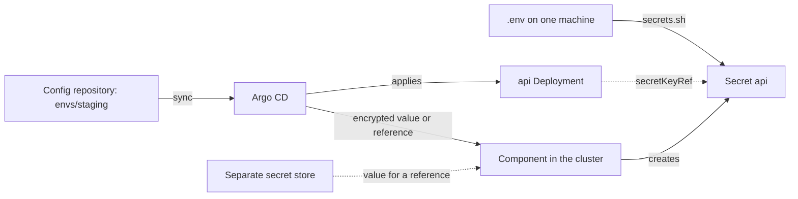

## Before you start

- [[k8s.l1.secrets]] — you know a Secret's values are only base64-encoded, and that Đơn Hàng builds its Secrets from `.env` instead of keeping them in Git.
- [[devops.l3.argo-cd-applications]] — you know an Application points Argo CD at `envs/staging` of the config repository, which holds only manifests.
- [[devops.l3.self-heal]] — you know that with self-heal and prune, the objects from `envs/staging` follow Git both ways.

## The situation

At stage-2 you deploy with `scripts/k8s/deploy.sh`. Right after the namespace, it runs `secrets.sh`, which reads the `.env` on your machine and creates the Secrets `db`, `api` and `keycloak`. Now staging is to follow the config repository instead, so every object needs a file in `envs/staging`, and the Secrets have none. One teammate suggests writing them out with `--dry-run=client -o yaml` and committing the result, since the repository is private. Another says to leave them out, because Argo CD will not touch what is not in its folder. What should `envs/staging` hold in place of the Secrets?

## Core concepts

- Secret created outside Git — a Secret that a command such as `secrets.sh` sends straight to the API server; no file in the config repository describes it, so Argo CD does not manage it.
- Plain Secret manifest — the YAML that `kubectl create secret ... --dry-run=client -o yaml` prints, with each value base64-encoded under `data`; committing it puts the values in Git.
- Encrypted Secret in Git — a manifest that holds each value encrypted, so that only a separate component inside the cluster (not Argo CD), which holds the key, can turn it back into a Secret. How you encrypt a value without holding that key is the subject of the next lesson.
- Reference to a secret store — a manifest that names where a value is kept in a secret store, a separate server whose only job is to keep secret values and hand each one, by name, to callers allowed to read it; a component inside the cluster copies the value into a Secret.

## How it works



Follow the path from the config repository to the api Deployment first. Argo CD applies the Deployment from `envs/staging` on every sync. It only names the Secret `api` through `secretKeyRef`; the Secret itself comes from the `.env` of whoever last ran `secrets.sh`. Git holds the reference, not the thing it points to.

Argo CD compares and applies only what the folder describes. A Secret created by a command is not one of its objects, so Argo CD neither puts it back when it is deleted nor records when its value changed. A cluster rebuilt from Git gets the Deployments but none of the Secrets they need, so the database cannot start.

Committing the output of `--dry-run=client -o yaml` would close that gap and open a worse one. The file holds each value in base64, which anyone reverses without a key. Everyone who can clone the repository reads the values. Deleting the file later removes them only from the newest commit: every earlier commit, and every clone already made, still holds them.

The path through the component in the cluster replaces the arrow from `.env`; it does not run beside it. It keeps the config repository as the only source while no value sits there in readable form. In one design the file holds each value encrypted, and only that component holds the key; Argo CD applies the encrypted object like any other manifest. In the other design the file holds only a reference, and the component copies the value from a separate secret store. Either way Argo CD restores and versions the file, and a reader of Git learns no password.

## In the Đơn Hàng system

The part of `secrets.sh` that builds the Secrets:

```bash file=scripts/k8s/secrets.sh tag=stage-2 lines=18-31
# lesson: k8s.l1.secrets
# No Secret manifest exists in Git: each Secret is built here from .env and
# sent to the API server. `create --dry-run=client -o yaml` only writes the
# object out; `apply` creates it, or updates it when .env has changed.
secret() {
  local name=$1
  shift
  kubectl create secret generic "$name" -n donhang "$@" --dry-run=client -o yaml \
    | kubectl apply -f - -o name
}
echo "== Secrets from .env"
secret db --from-literal=POSTGRES_PASSWORD="$POSTGRES_PASSWORD"
secret api --from-literal=ConnectionStrings__Default="Host=db;Database=donhang;Username=donhang;Password=$POSTGRES_PASSWORD"
secret keycloak --from-literal=KC_BOOTSTRAP_ADMIN_PASSWORD="$KEYCLOAK_ADMIN_PASSWORD"
```

Lines 19–21 state the stage-2 rule: no Secret manifest exists in Git. The function `secret` pipes the YAML straight from `kubectl create` into `kubectl apply`, so the base64 values never land in a file. Lines 29–31 fill the three Secrets from variables read out of `.env`; the connection string in `api` repeats the password of `db`.

Where `deploy.sh` calls it:

```bash file=scripts/k8s/deploy.sh tag=stage-2 lines=10-16
echo "== namespace"
kubectl apply -f deploy/k8s/namespace.yaml -o name

echo "== Secrets, from .env (scripts/k8s/secrets.sh)"
scripts/dev-secrets.sh >/dev/null
scripts/k8s/secrets.sh >/dev/null
kubectl get secrets -n donhang -o name
```

Line 11 applies the namespace, line 14 creates `.env` when it is missing, line 15 builds the Secrets, and line 16 lists them by name only.

`dev-secrets.sh`, outside the excerpt, writes the same fixed database password into every new `.env`, but a random Keycloak admin password on each machine, so the Keycloak password staging gets depends on who deployed last. Two other steps of `deploy.sh` also build objects by command, the ConfigMaps `db-init` and `keycloak-realm`, but their output holds nothing secret, so it can be written to a file and committed. The Secrets are the only objects whose file would hand out their values.

From stage-3, Đơn Hàng takes the first design: staging's folder holds its Secrets encrypted, because the lab then needs nothing beyond the cluster and the repository. A separate store fits better when many systems share the same secrets, or when values change without a commit, such as a password another team replaces on its own schedule. The component Đơn Hàng uses is the next lesson.

## Seniors often assume…

- **"A private config repository is safe enough for plain Secret manifests."** → Actually private only limits who can clone, and everyone who can is handed every value: each teammate who reviews a replica change, and Argo CD itself. A value deleted later stays in earlier commits and in every clone, so it has to be changed, not only removed. You notice this when someone given access to review manifests runs `base64 -d` on `POSTGRES_PASSWORD` and reads the database password.
- **"Keeping Secrets out of Git costs nothing under GitOps, since Argo CD simply ignores them."** → Actually ignoring them is the cost: Argo CD does not recreate a Secret it does not manage, and the config repository holds no record of when its value changed. The repository then describes a staging that cannot start on its own. You notice this when a cluster rebuilt from Git syncs, yet the db Pod waits with `CreateContainerConfigError`, the reason a container shows while a Secret it names through `secretKeyRef` does not exist, and the sync never gets past the database's sync wave, so the api is never applied.
- **"If the values in Git are encrypted, Argo CD must hold the key to decrypt them."** → Not when a separate component, running in the cluster beside Argo CD, does the decryption: Argo CD applies the encrypted object as it applies any manifest, and the component holding the key turns it into a Secret afterwards. Some setups do give Argo CD the key, through an add-on that decrypts while it reads the folder; then the decrypted values sit in Argo CD's own cache, and anyone with access to Argo CD's internal components can read every one of them. You notice this in `scripts/devops/argocd-install.sh` from stage-3: it only applies Argo CD's install manifest and no Secret or key, yet staging's api starts with its password.

## Try it (3 minutes)

In the `don-hang` repository folder:

1. Run `git check-ignore -v .env`.
2. Run `git log --all --oneline -- .env`.

Expected result: the first command prints `.gitignore:1:.env` followed by `.env`, the rule that keeps the file out of Git. The second prints nothing: no commit on any branch has ever held `.env`, the only place the Secret values of stage-2 exist. A cluster rebuilt only from what Git holds would therefore have no way to get them.

## Connections

- [[k8s.l1.secrets]] — prerequisite: why base64 in a Secret protects nothing, which is what makes a committed Secret manifest readable.
- [[devops.l1.secrets-vs-config]] — the same rule one layer down: there `.gitignore` kept `.env` out of the source repository; here the config repository needs the values in some form.
- [[devops.l3.tofu-state]] — the same problem in another file: the state file holds credentials too, which is why that lesson kept it out of Git.
- [[devops.l3.sealed-secrets]] — next: the component Đơn Hàng uses from stage-3 to commit its Secrets encrypted.

## Five-line summary

1. Under GitOps the config repository should describe every Secret staging needs, yet no value may sit there in readable form.
2. At stage-2 `secrets.sh` builds the Secrets `db`, `api` and `keycloak` from the deployer's gitignored `.env`; no file in Git holds them.
3. Argo CD neither restores nor records a Secret created outside Git, so a cluster rebuilt from Git cannot start the database.
4. A committed Secret manifest hands its base64 values to everyone who can clone, and they stay in history after deletion.
5. Commit each value encrypted for a component in the cluster, or a reference to a separate store; Đơn Hàng encrypts from stage-3.
